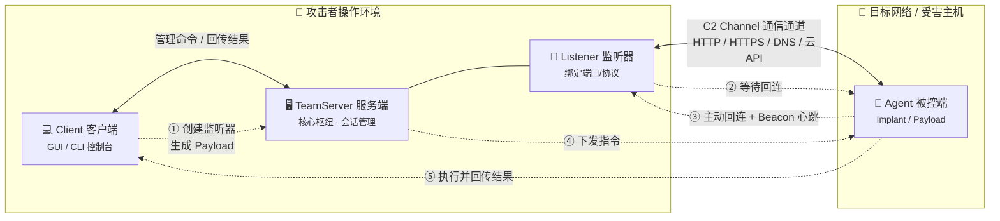

# C2（Command and Control）框架
>红队作战和高级网络攻击中的核心指挥平台
>专门用于管理大量被控主机

## C2 框架是什么
>C2 框架是一套服务端 + 客户端 + 载荷的完整系统，用于在攻击者与被控主机之间建立长期、隐蔽、可管理的通信通道。

**核心构成**

- **服务端 (Server / TeamServer)：** 部署在攻击者控制的服务器（通常是 VPS）上，作为整个框架的核心枢纽，负责接收来自各个被控端的回连请求、管理会话、向客户端下发命令。
- **客户端 (Client)：**操作者使用的本地控制台（GUI 或 CLI），用于连接服务端，并执行具体的操作，如查看上线主机、执行命令、文件操作等。
- **被控端 (Agent / Implant / Payload)：** 运行在受害者机器上的恶意代码或脚本。它的主要职责是回连服务端，并周期性检查是否有新指令（这个过程称为“Beacon”），然后执行指令并回传结果。
- **监听器 (Listener)：** 运行在服务端或重定向器上的进程，负责监听特定端口或协议，等待被控端发起连接。
- **通信通道 (C2 Channel)：** 服务端与被控端之间通信的“道路”。为了隐蔽，常常使用 HTTP/HTTPS、DNS 等常见协议，将通信数据隐藏在正常流量中。

**数据流向**

| 步骤 | 方向 | 说明 |
|------|------|------|
| ① | Client → TeamServer | 操作者通过客户端连接服务端，创建监听器、生成 Payload |
| ② | TeamServer → Listener | 服务端启动监听器，绑定端口/协议等待回连 |
| ③ | Agent → Listener | 被控端在受害机执行后，主动回连监听器 |
| ④ | Listener → TeamServer | 监听器将新上线会话注册到服务端会话管理 |
| ⑤ | TeamServer → Client | 客户端看到新主机上线，显示会话信息 |
| ⑥ | Client → TeamServer → Agent | 操作者下发命令，经服务端通过 C2 Channel 传给 Agent |
| ⑦ | Agent → TeamServer → Client | Agent 执行后回传结果，最终展示在客户端 |

**关键关系总结**

- **Client 与 TeamServer：** 控制关系。Client 是操作入口，TeamServer 是执行中枢，二者通过管理协议（如 gRPC、REST、自定义协议）通信。
- **TeamServer 与 Listener：** 宿主关系。Listener 通常作为 TeamServer 的一个模块/进程运行，也可部署在独立重定向器上。
- **Listener 与 Agent：** 握手关系。Listener 负责“接客”，Agent 主动找上门，建立 C2 Channel。
- **Agent 与 C2 Channel：** 承载关系。Agent 的所有指令收发都通过 C2 Channel 完成。
- **Client 与 Agent：** 逻辑上的“遥控”关系，但实际不直接通信，必须经过 TeamServer 中转。



**补充：重定向器（Redirector）的位置**
在实际隐蔽部署中，常在 Listener 前加一层重定向器：

```text
Agent → [Redirector] → Listener → TeamServer → Client
         (Nginx/CDN/云函数)   (真实VPS)
```

## 为什么需要 C2 框架

1. **提供稳定的交互式控制** 一旦获得初始访问权限（如通过钓鱼或漏洞利用），C2 框架能提供一个稳定、加密的命令行或图形界面，让测试人员可以在目标系统中进行深度操作，如提权、横向移动、收集凭证等。

2. **实现隐蔽通信与持久化**为了模拟真实攻击者的行为并检验防御能力，C2 框架必须具备绕过安全检测的能力。这包括使用加密、混淆流量特征、模拟正常业务流量，以及设置长时间休眠和随机抖动的心跳周期，以避免被端点检测与响应（EDR）或网络流量分析系统发现。

3. **集中化管理与团队协作** C2 框架的客户端-服务端架构支持多名团队成员同时连接到一个服务端，共享会话和情报，便于在复杂的攻防演习中进行协同作战。

4. **满足定制化与扩展需求** 成熟的 C2 框架通常具备模块化和插件化设计。红队可以编写自定义的“后渗透模块”（如用于信息收集、权限维持的脚本），动态加载到被控端内存中执行，无需落地文件，进一步增加了隐蔽性。

## 常见的基础 C2 框架

- **Cobalt Strike：** 最出名，商业软件，功能强大，但特征也被杀毒软件研究得很透。

- **Metasploit：** 老牌渗透测试框架，自带 Meterpreter 被控端。

- **Sliver：** 开源免费，近年来很流行，被很多安全团队用来做测试。

- **Havoc：** 较新的开源框架，界面现代化，隐蔽性较好。