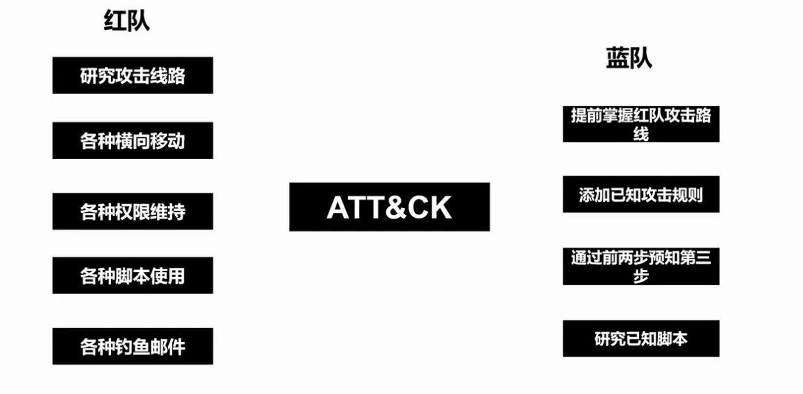
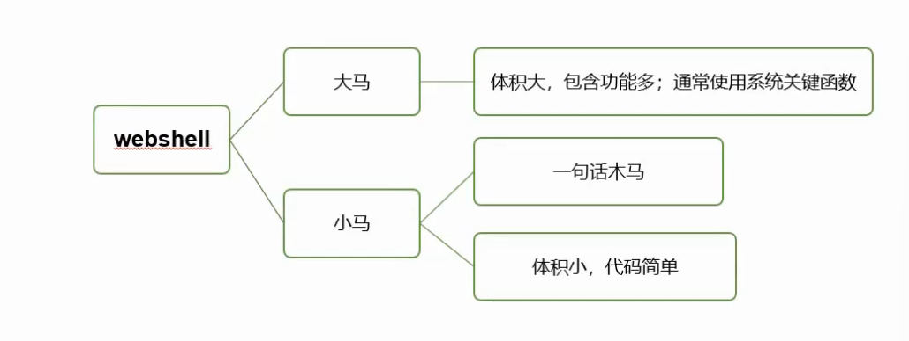
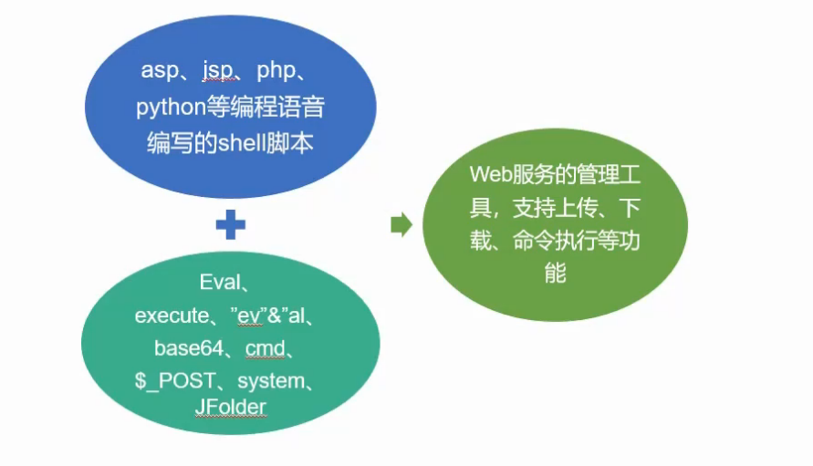
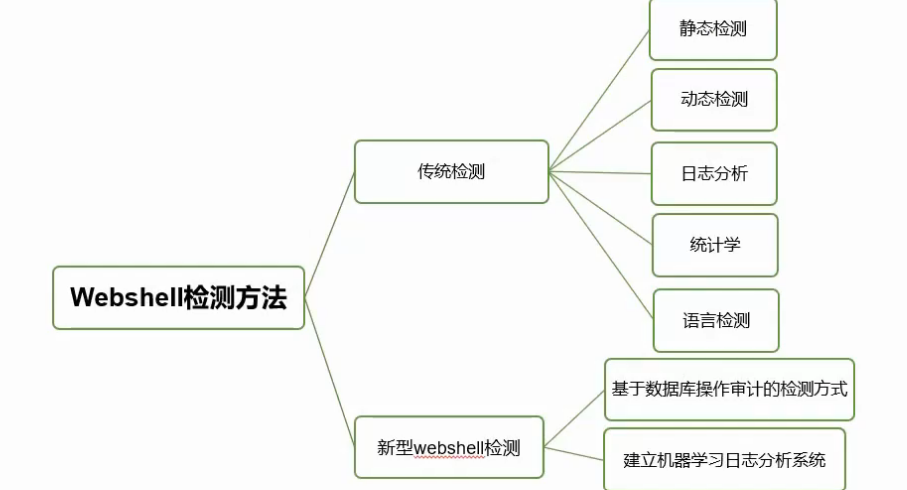

# 蓝队基础

## 蓝队防守思路

**安全管理**

- 资产管理
- 拓扑管理
- 安全基线检查
- web主机安全检查
- 安全意识培训
- 运营（监测、预警、分析、验证、处置）
  
**安全监控**

- 对资产进行实时监控并对威胁进行快速处理，保证系统的安全性

## 蓝队防守监测工具

- webshell检测工具
- wireshark
- HFish
- HIDS
- 
## ATT&CK

## webshell

百度WEBDIR+
下一代WebShell检测引擎，采用先进的动态监测技术，结合多种引擎零规则查杀。
兼容性：提供在线查杀木马，免费开放API支持批量检测。
在线查杀地址：https://scanner.baidu.com/