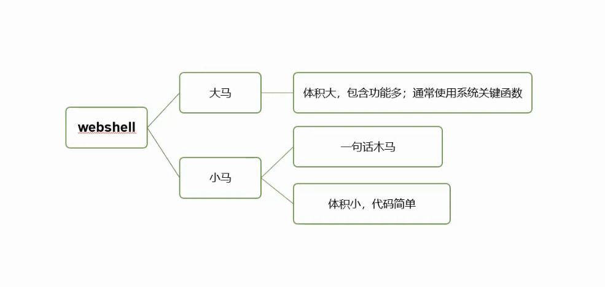
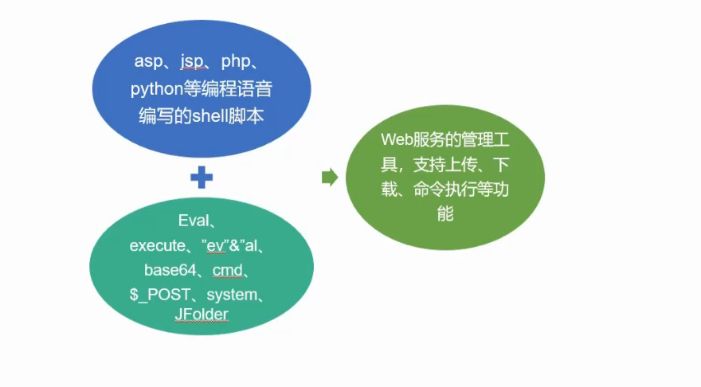
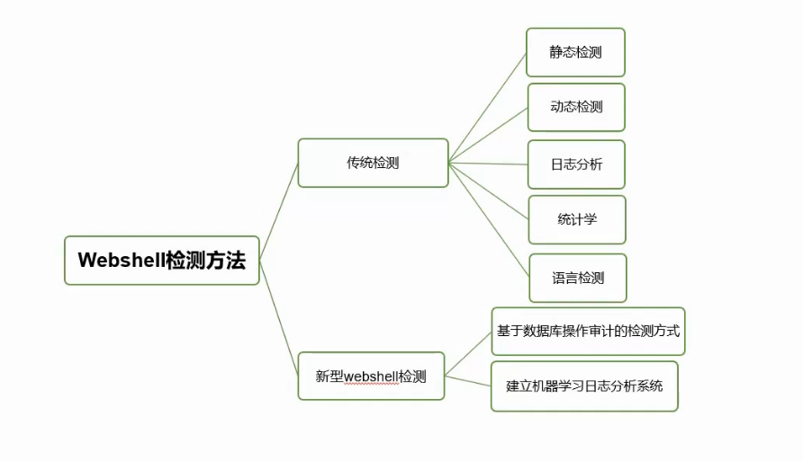

# webshell检测

## Webshell简介

web指的是在web服务器上，shell是指用脚本语言编写的脚本程序；webshell就是web的一个管理工具，可以对web服务器进行操作的权限，也叫webadmin。webshell一般是被网站管理员用于网站管理、服务器管理等等一些用途。

**分类**

**组成**

## 常用管理工具

* 中国蚁剑AntSword
* 中国菜刀 (caidao)
* 冰蝎 webshell
* cknife (c刀)
* xise
* QuasiBot
* WeBaCoo
* Weevely
* Fastener
* Altman
* Webshell-Sniper

## 检测方法

**静态特征检测**

指对脚本文件中所使用的关键词、高危函数、文件修改的时间、文件权限、文件的所有者以及和其它文件的关联性等多个维度的特征进行检测，即先建立一个恶意字符串特征库（“WScript.Shell、 Shell.Application、Eval()、Execute()、Set Server、Run()、Exec()、ShellExecute()”），同时对WEB文件修改时间，文件权限以及文件所有者等进行确认。通常情况下 WEB文件不会包含上述特征或者特征异常，通过与特征库的比对检索出高危脚本文件。

优点：可快速检测，快速定位；

缺点：容易误报，无法对加密或者经过特殊处理的Webshell文件进行检测。尤其是针对窃密型Webshell无法做到准确的检测，因为窃密型Webshell通常具有和正常的WEB脚本文件具有相似的特征。

以下是图片中提取的文字内容：

**动态特征检测**

通过Webshell运行时使用的系统命令或者网络流量及状态的异常来判断动作的威胁程度，Webshell通常会被加密从而避免静态 特征的检测，当Webshell运行时就必须向系统发送系统命令来达到控制系统或者操作数据库的目的，通过检测系统调用来监测甚至拦截系统命令被执行，从 行为模式上深度检测脚本文件的安全性。

优点：可用于网站集群，对新型变种脚本有一定的检测能力

缺点：针对特定用途的后门较难检测,实施难度较大

## 检测工具

### D盾
阿D出品，免费，GUI，WebShell扫描检测查杀

支持系统:win2003/win2008/win2012/win2016
PHP支持:FastCGI/ISAPI (版本:5.x至7.x)

一句话免疫,WebShell扫描查杀,主动后门拦截,SESSION保护,防WEB嗅探,防CC,防篡改,注入防御,防XSS,防提权,上传防御,未知0day防御,异 形脚本防御等等。防止黑客入侵和提权,让服务器更安全。
下载地址：http://www.d99net.net/

### WEBDIR在线检测
百度WebShell扫描检测引擎

百度OpenRASP团队，推出的一款WebShell检测引擎，免费，Shell在线检测查杀

支持的文件类有 php, phtml, inc, php3, php4, php5, war, jsp, jspx, asp, aspx, cer, cdx, asa, ashx, asmx, cfm

支持的压缩包有 rar, zip, tar, xz, tbz, tgz, tbz2, bz2, gz

上传后的文件或者压缩包，会经过WEBDIR+三种引擎的扫描检测，检测后文件会被立即删除，全程无人工介入。传统的正则表达式方式，存在高误报、低查杀率的问题，WEBDIR+采用先进的动态监测技术，结合多种引擎零规则查杀

WEBDIR+ WebShell检测引擎

在线查杀地址：https://scanner.baidu.com/#/pages/intro

### WebShell Detector 
免费，在线检测查杀

php/python脚本，帮助您查找和识别php/cgi（perl）/asp/aspx shell。Web Shell Detector具有“Web shell”签名数据库，可帮助识别高达99％的“Web shell”。

下载地址：http://www.shelldetector.com/