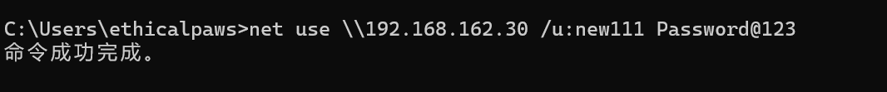
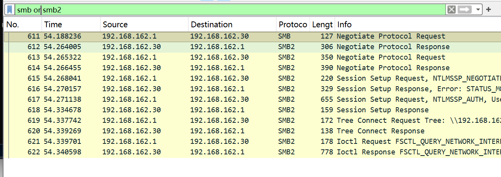
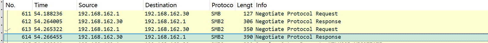
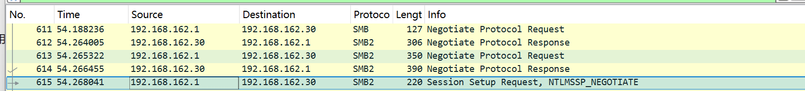
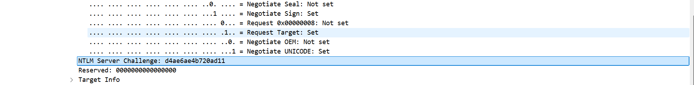
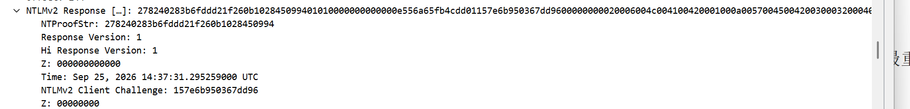
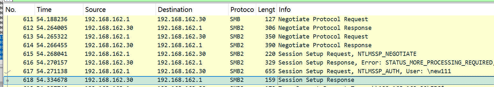
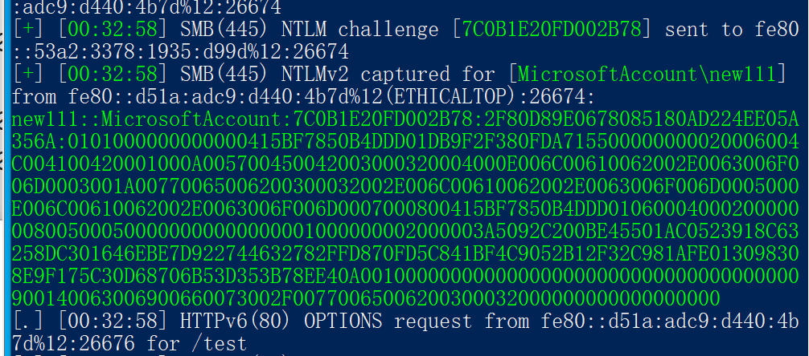
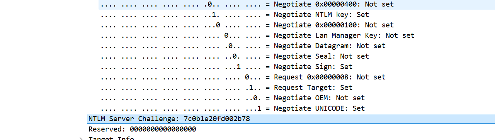
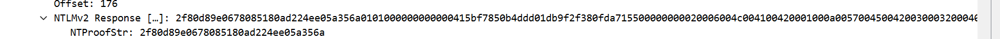

# 网络认证

## 网络认证概述和介绍
**什么是网络认证**
在平时的测试中，经常会碰到处于工作组的计算机，主机A想要访问主机B上的资源，就要向主机B发送一个存在于主机B上的一个账户，主机B接收以后会在本地进行验证，如果验证成功，才会允许主机A进行相应的访问。

NTLM（NT LAN Manager）认证是一种早期的Windows网络身份验证协议。它在Windows系统中用于验证用户的身份，并提供对网络资源的访问控制
当一台机器（客户端）想要访问另一台机器（服务器，如文件共享、Web 服务、远程桌面）上的资源时，服务器需要验证客户端的身份。

两种主要方式：

- **工作组环境（Workgroup）：** 本地认证。如果客户端和服务器不在同一个域，客户端会把用户名和 Hash 发给服务器，服务器在自己的 SAM 库里找对应账户比对。如果两台机器账户密码不一致，就无法访问。

- **域环境（Domain）：** 域认证。客户端不直接把凭据发给服务器，而是发给域控（DC）。域控验证通过后，给客户端发一张“门票”（票据），客户端拿门票去访问服务器。这就是 Kerberos 协议

>NTLM 是 Windows 早期默认的、基于“挑战-响应”机制的网络认证协议。即使在现代域环境中，NTLM 依然作为备用机制被广泛使用，是内网渗透的重灾区。

## NTLM协议挑战响应认证机制（核心流程）
>NTLM 认证是一种质询-响应（Challenge-Response）机制。它最大的特点是：密码（或 Hash）永远不会在网络中明文传输。

**经典的三次握手交互流程（以访问 SMB 共享为例）：**

- 协商（Type 1 - NEGOTIATE）：

    客户端 -> 服务器：客户端发送一个 NEGOTIATE_MESSAGE，告诉服务器我支持什么 NTLM 版本、什么加密算法。

- 质询（Type 2 - CHALLENGE）：

    服务器 -> 客户端：服务器收到后，生成一个 16 字节的随机数（称为 Challenge），发送给客户端。这个随机数每次连接都不同。

- 响应（Type 3 - AUTHENTICATE）：

    客户端 -> 服务器：客户端收到 Challenge 后，用自己本地存储的 NTLM Hash 对这个 Challenge 进行加密（具体算法是 HMAC-MD5），生成一个 Response（响应值）。

    客户端把 用户名、域名、Challenge、Response 一起打包发回给服务器。

- 验证：

    服务器收到 Response 后，如果是本地认证，它去自己的 SAM 库里拿出该用户的 NTLM Hash，用同样的算法加密 Challenge，比对结果。

    如果是域环境，服务器会把 用户名、Challenge、Response 转发给 域控（DC），让 DC 去验证。

**渗透视角**：攻击者如果抓到了这个 Response，或者拿到了用户的 NTLM Hash，就可以伪造这个响应，实现哈希传递（PtH）。

## 抓包流量分析NTLM协议
采用IP：192.168.162.1和IP：192.168.162.30两台主机进行NTLM认证抓包分析

**抓取认证数据包**

- wireshark抓取对应网卡的数据包
- 使用net use \\192.168.162.30 /u: 用户名 密码  进行NTLM认证
  
- wireshark语法过滤 smb or smb2 【net use使用的是smb协议】
  

**详细分析**


前四个数据包是协商阶段


第五个数据包是，用户启动身份的验证包，和一些规则，主要是flag里面有相关规则


第6个数据包是，有一些包含同意的列表和最重要的challenge值

可以看到challenge是16位，这是因为这个采用NTLM v2的协议，如果是NTLM v1的协议就是8位


第7个数据包是，是发送Response的数据包，还包含账户名的相关信息
- 将用户名的NTLM-Hash和challenge加密
- 提供域名、机器名、IP、等相关信息
- 将上述的相关信息进行加密发生成response送给server


第8个数据包就是返回节结果，用来表示成功还是失败,失败就是ERROR
- 使用相同方式加密生成Response
- 和发送过来的Response对比
- 如果成功就认证成功否则失败


## Challenge和Response分析
>这是 NTLM 安全性的核心，也是攻击者破解密码的切入点。

- Challenge（挑战值）：服务器发送的 16 字节（最早期是8位）随机数。它保证了每次认证的响应都不一样，防止重放攻击（除非你抓到完整的 Challenge 和 Response，且服务器允许重放）。

- Response（响应值）：客户端使用 NTLM Hash 加密 Challenge 的结果。
  - 如何生成
    - 由 Response =NTProofStr+blob两部分拼接起来
    - NTProofStr：NTLM-v2-Hash值 和 challenge+blob 进行 HMAC-MD5加密
      - NTLM-v2-Hash:大写的用户名+域名编码成unicode格式，然后和密码的NTLM-Hash值进行HMAC-MD5加密
      - blob是由时间，目标信息，随机填充字符等生成。

我们平时在使用工具进行攻击的时候抓到的都是Net-NTLM Hash数据：
username::domain:challenge: NTProofStr :blob

**使用inveigh抓取NTLM 哈希**
```
# 启动inveigh
1. Inveigh.exe -LLMNR Y -NBNS Y -SMB Y -HTTP Y -Console 4 -FileOutput Y

# 触发SMB 认证，抓取NTLM哈希
2. 在文件资源管理器地址栏输入：\\192.168.162.30\test
```


net-ntlm v2 hash
```
new111::MicrosoftAccount:7C0B1E20FD002B78:2F80D89E0678085180AD224EE05A356A:0101000000000000415BF7850B4DDD01DB9F2F380FDA715500000000020006004C004100420001000A005700450042003000320004000E006C00610062002E0063006F006D0003001A00770065006200300032002E006C00610062002E0063006F006D0005000E006C00610062002E0063006F006D0007000800415BF7850B4DDD01060004000200000008005000500000000000000001000000002000003A5092C200BE45501AC0523918C63258DC301646EBE7D922744632782FFD870FD5C841BF4C9052B12F32C981AFE013098308E9F175C30D68706B53D353B78EE40A001000000000000000000000000000000000000900140063006900660073002F00770065006200300032000000000000000000
```
challenge[7C0B1E20FD002B78] 
NTProofStr[2F80D89E0678085180AD224EE05A356A]
blob[0101000000000000415BF7850B4DDD01DB9F2F380FDA715500000000020006004C004100420001000A005700450042003000320004000E006C00610062002E0063006F006D0003001A00770065006200300032002E006C00610062002E0063006F006D0005000E006C00610062002E0063006F006D0007000800415BF7850B4DDD01060004000200000008005000500000000000000001000000002000003A5092C200BE45501AC0523918C63258DC301646EBE7D922744632782FFD870FD5C841BF4C9052B12F32C981AFE013098308E9F175C30D68706B53D353B78EE40A001000000000000000000000000000000000000900140063006900660073002F00770065006200300032000000000000000000]

**手动计算response**

- wireshark抓包，找到challenge[7C0B1E20FD002B78] 的那次认证
  
- 计算NTLM-v2-Hash
  - 将用户名转换为大写  ->  NEW111
  - 将和域名拼接  ->  NEW111MicrosoftAccount
  - 转换为十六进制  ->  4E45573131314D6963726F736F66744163636F756E74
  - 转换为Unicode格式   ->  data：4E00450057003100310031004D006900630072006F0073006F00660074004100630063006F0075006E007400
  - 将用户new111的密码NTLM Hash值[a29f7623fd11550def0192de9246f46b]作为key与上述data进行HMAC-md5加密  ->   9a739d55fce0955815876cb9a289d9c9
  - NTLM-v2-Hash:9a739d55fce0955815876cb9a289d9c9

- 计算NTProofStr
  - 将challenge和blob拼接   ->  data：7C0B1E20FD002B780101000000000000415BF7850B4DDD01DB9F2F380FDA715500000000020006004C004100420001000A005700450042003000320004000E006C00610062002E0063006F006D0003001A00770065006200300032002E006C00610062002E0063006F006D0005000E006C00610062002E0063006F006D0007000800415BF7850B4DDD01060004000200000008005000500000000000000001000000002000003A5092C200BE45501AC0523918C63258DC301646EBE7D922744632782FFD870FD5C841BF4C9052B12F32C981AFE013098308E9F175C30D68706B53D353B78EE40A001000000000000000000000000000000000000900140063006900660073002F00770065006200300032000000000000000000
  - 将NTLM-v2-Hash作为key与data进行HMAC-md5加密 ->  2f80d89e0678085180ad224ee05a356a
  - NTProofStr：2f80d89e0678085180ad224ee05a356a
- response:NTProofStr拼接blob   ->  [2f80d89e0678085180ad224ee05a356a7C0B1E20FD002B780101000000000000415BF7850B4DDD01DB9F2F380FDA715500000000020006004C004100420001000A005700450042003000320004000E006C00610062002E0063006F006D0003001A00770065006200300032002E006C00610062002E0063006F006D0005000E006C00610062002E0063006F006D0007000800415BF7850B4DDD01060004000200000008005000500000000000000001000000002000003A5092C200BE45501AC0523918C63258DC301646EBE7D922744632782FFD870FD5C841BF4C9052B12F32C981AFE013098308E9F175C30D68706B53D353B78EE40A001000000000000000000000000000000000000900140063006900660073002F00770065006200300032000000000000000000]




**手工计算结果和抓取的数据包中的数据以及工具抓取的数据一致**
破解原理：

攻击者抓到了 Challenge 和 Response。

攻击者不知道明文密码，但他知道 Response 是 Challenge 和 NTLM Hash 算出来的。

攻击者可以通过暴力破解或彩虹表，尝试不同的密码，计算出 NTLM Hash，再计算出 Response，与抓到的 Response 比对。如果匹配，就找到了密码。

Hashcat 模式：-m 5600（NetNTLMv2）。

## NTLMv1和NTLMv2的区别
NTLM 协议有两个主要版本，安全性天差地别。

| 特性 | NTLMv1 | NTLMv2 |
|------|--------|--------|
| Challenge 长度 | 8 字节 | 16 字节 |
| 加密算法 | DES（非常弱） | HMAC-MD5（相对强） |
| 是否支持时间戳 | 否 | 是（防止重放） |
| 是否支持客户端 Challenge | 否 | 是（增加了随机性） |
| 安全性 | 极低。使用 DES 加密，且容易受到彩虹表攻击。可以在几小时内破解。 | 较高。目前没有已知的快速破解方法，主要靠暴力破解。 |
| 渗透现状 | 现代系统默认禁用。如果发现 NTLMv1，说明系统非常古老或配置错误，是重大漏洞。 | 默认启用。攻击者主要依赖降级攻击（强制客户端使用 NTLMv1）或者中继攻击（Relay）来利用。 |


## NTLM协议安全问题（内网渗透的攻击面）
NTLM 协议设计上的缺陷，导致了内网渗透中几个最经典的攻击手法：

**哈希传递（Pass-the-Hash, PtH）：**

- 原理：NTLM 认证只需要 Hash，不需要明文。攻击者拿到 NTLM Hash 后，直接用它来构造 Response。

- 利用：使用 psexec.py、crackmapexec 等工具，直接拿着 Hash 去登录其他机器。这是内网横向移动的“核武器”。

**NTLM 中继（NTLM Relay）：**

- 原理：攻击者（中间人）截获客户端的认证请求，不破解它，而是直接把它转发给另一台服务器（如域控），利用客户端的高权限身份去访问那台服务器。

- 利用：使用 Responder + ntlmrelayx.py。常见于 LLMNR/NBNS 欺骗（诱骗客户端向你认证）。

**Net-NTLMv1 降级攻击：**

攻击者可以强制服务器和客户端协商使用 NTLMv1（例如通过修改注册表或中间人攻击），从而获得极易破解的 NTLMv1 Response。

**SMB 签名绕过：**

如果内网主机没有强制启用 SMB 签名，攻击者就可以进行中继攻击。如果启用了签名，中继攻击就会失败。因此，“检查 SMB 签名是否开启”是内网渗透信息收集的重要一步。

**暴力破解：**

抓到 NetNTLMv2 Hash 后，用 Hashcat 配合强大的字典（如 Rockyou）进行离线破解。