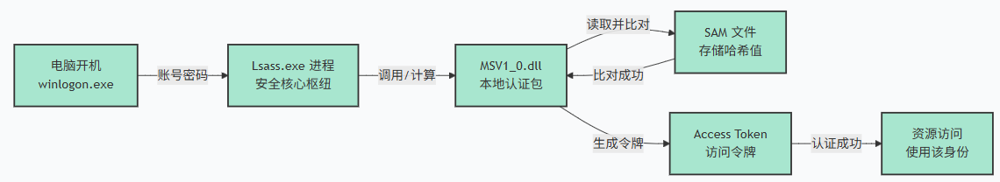
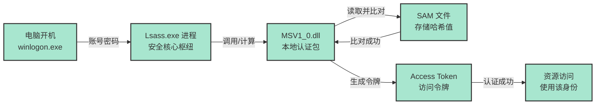
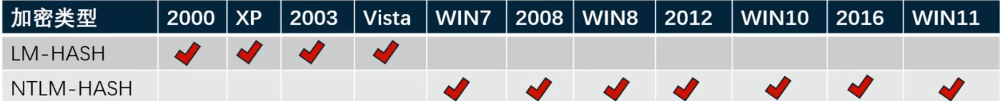
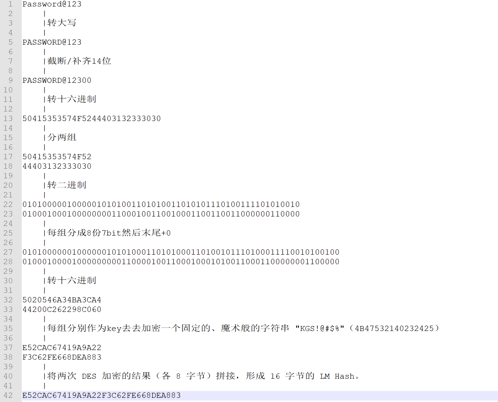
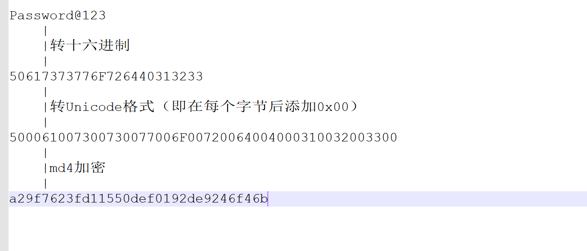
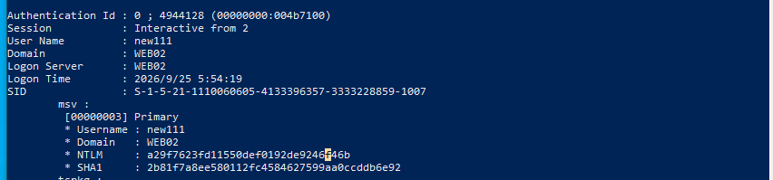

# 本地认证
>本地认证的意思就是，我们的电脑上存储着自己的账号密码，无论电脑是否联网，只要能开机，就可以输入账号密码登录到电脑中
>工作组就是采用本地认证

## 本地认证概述（底层交互流程）
Windows 本地认证不是单一程序完成的，而是由多个核心组件协同工作的过程。

**核心组件：**

- Winlogon.exe：负责接收用户的 Ctrl+Alt+Del 安全序列，显示登录界面，并将凭据传递给 LSA。
- Lsass.exe (Local Security Authority Subsystem Service)：认证的核心枢纽。它调用具体的认证包（Authentication Packages）来验证凭据。
- MSV1_0.dll：负责处理本地 SAM 数据库认证的默认认证包。
- SAM (Security Account Manager)：存储本地用户账户和哈希的数据库。

**底层交互流程（你输入密码后发生了什么）：**

- 凭据捕获：Winlogon 捕获你输入的明文密码。
- 调用 LSA：Winlogon 通过 LsaLogonUser API 将明文密码传递给 Lsass.exe。
- 调用认证包：Lsass 加载 MSV1_0.dll，将明文密码传给它。
- 哈希计算：MSV1_0 将明文密码转换为 NTLM Hash（以及可能的 LM Hash）。
- 数据库比对：MSV1_0 读取 C:\Windows\System32\config\SAM 文件中该用户的哈希值，与刚刚计算出的哈希进行比对。
- 生成令牌 (Token)：如果比对成功，Lsass 会创建一个包含该用户 SID 和组成员身份的访问令牌（Access Token）。这个 Token 就是你后续操作所有资源的“身份证”。

**渗透视角：** 本地认证是离线（相对域环境）的。攻击者一旦拿到 SAM 文件，就可以在本地无限次暴力破解，不受目标机器账户锁定策略的限制。

## SAM文件和lsass进程（深入结构与内存）
>整个本地认证中最具攻击价值的两个目标。

### SAM 文件深入解析
**物理位置：**
C:\Windows\System32\config\SAM。系统运行时，该文件被内核独占锁定，无法直接复制。

**内部结构：**

- SAM 文件本身是一个注册表 Hive 文件。
- 它存储了用户的 RID（相对标识符）、用户名、以及两个关键的哈希值：LM Hash 和 NTLM Hash。
- 为了增加破解难度，SAM 文件在存储哈希时，会使用 SYSKEY 进行加密。SYSKEY 的一部分存储在注册表的 HKLM\SYSTEM\CurrentControlSet\Control\Lsa 中（通常叫 JD、Skew1、GBG、Data），另一部分存储在 C:\Windows\System32\config\SYSTEM 文件中。

**提取方法：**

- **注册表导出（需要管理员权限）：** reg save hklm\sam sam.hive 和 reg save hklm\system system.hive。导出后，用 secretsdump.py 或 mimikatz 离线解密。

- **卷影拷贝（VSS）：** 利用 vssadmin 或 diskshadow 创建快照，从快照中复制 SAM 文件。

- **Psexec 获取 SYSTEM：** 直接复制 SAM 文件。

### lsass.exe 进程深入解析
**核心地位：** Lsass.exe进程的作用非常重要，它主要负责管理本地安全策略和认证机制。这些策略包括密码策略、账户策略、用户权限、域策略等等。同时，它还负责对用户进行身份验证，以确保只有授权的用户才能访问系统资源。

**lsass.exe进程在本地认证中的两个作用**

1. 将winlogon传过来的明文账号密码进行加密，然后和SAM文件中的密文账号密码作对比。如果对比成功就登陆成功
2. 将收到的明文账号密码在本地内存中保留一份用作备用

**内存中的凭据缓存（Credential Caching）：**

- 用户登录成功后，为了支持“单点登录”（SSO）和网络访问，lsass 进程的内存中会缓存该用户的凭据。

- WDigest：在 Windows 7 / Server 2008 R2 及之前，WDigest 默认开启，会在内存中保留明文密码。Win8/2012 之后默认关闭，但如果攻击者通过注册表 HKLM\SYSTEM\CurrentControlSet\Control\SecurityProviders\WDigest 将 UseLogonCredential 设为 1，可以强制开启，等待管理员下次登录时抓取明文。

- NTLM Hash：即使没有明文，内存中一定会有 NTLM Hash，用于 NTLM 认证。

- Kerberos 票据：域环境下，lsass 内存中会保存 TGT 和 TGS 票据。

**读取 lsass 内存：**

- Mimikatz 的 sekurlsa::logonpasswords 命令就是通过读取 lsass 进程的内存，解密出缓存的凭据。

- LSA 保护（RunAsPPL）：Win10/Server 2016 之后，微软引入了 LSA 保护，将 lsass 进程作为受保护进程（PPL）运行。此时，即使你拥有 SYSTEM 权限，也无法直接打开 lsass 进程句柄。攻击者需要利用内核驱动漏洞（如 CVE-2019-0859）来绕过，或者使用 PPLdump 等工具。

## LM Hash加密步骤
LM Hash的全名为"LAN Manager Hash",是微软为了提高Windows操作系统的安全性而采用的散列加密算法，其本质是DES加密。尽管LM Hash较容易被破解，但为了保证系统的兼容性，Windows只是将LM Hash禁用了(从Windows vista和Windows Server2008版本开始,Windows操作系
统默认禁用LMHash)。

LM Hash明文密码被限定在14位以内，也就是说，如果要停止使用LM Hash，将用户的密码设置为14位以上即可。如果LM Hash被禁用了，攻击者通过工具抓取的LMHash通常为“aad3b435b51404eead3b435b51404ee”(表示LMHash为空值或被禁用)

**详细加密步骤**（以密码 Password@123 为例）

- 转为大写：PASSW0RD@123。（致命缺陷 1：密码不区分大小写，增加了哈希碰撞率）

- 截断或补零：将密码补足或截断为 14 个字符。

- 分割：将 14 个字符分为两组，每组 7 个字符。

- 转换为 DES 密钥：将每组 7 个字符（56 位）作为 DES 密钥。由于 DES 需要 8 字节（64位），系统会在这 7 个字节中插入奇偶校验位，生成 8 字节密钥。【每组分成8份7bit然后末尾+0】

- DES 加密：分别用这两个密钥去加密一个固定的、魔术般的字符串 "KGS!@#$%"（8 字节）【4B47532140232425】

- 拼接：将两次 DES 加密的结果（各 8 字节）拼接，形成 16 字节的 LM Hash。

**安全问题：**

- **分段攻击**：由于被分成 7 字符，攻击者可以分别破解这两段。如果密码小于等于 7 位，第二段就是固定值（AAD3B435B51404EE），破解难度直接减半。

- 彩虹表秒破：由于 DES 算法极快，且字符集小，几乎所有 LM Hash 都可以通过彩虹表瞬间破解。

## NTLM Hash加密步骤
>NTLM Hash 是当前 Windows 本地认证和域认证的核心。

NTLM Hash是微软为了在提高安全性的同时保证兼容性而设计的散列加密算法。NTLM Hash是基于MD4加密算法进行加密的。个人版从Windows vista以后，服务器版从Windows Server 2003以后，Windows操作系统的认证方式均为NTLM Hash

**详细加密步骤：**

- 明文密码转为十六进制

- 将十六进制转换为unicode格式

- MD4 哈希：对转换后的字节流进行 MD4 算法运算。

- 生成 NTLM Hash：得到一个 16 字节（128 位） 的哈希值。这就是 NTLM Hash（也叫 NT Hash）。

mimikatz抓取ntlm hash验证

与手工计算出的值一样

**关键特性：**

- **单向性**：MD4 是不可逆的，无法从哈希值反推明文（只能暴力破解或查表）。

- **无盐（No Salt）**：相同的密码永远生成相同的 Hash。这使得彩虹表攻击极其有效。

- **不区分大小写**：UTF-16 转换后，大小写字母的哈希值不同，但在实际认证中，Windows 会进行大小写不敏感处理（取决于版本）。不过，NTLM Hash 本身是区分大小写的。

**渗透意义：**

Pass-the-Hash (PtH)：这是内网渗透的灵魂。

因为 Windows 的 NTLM 认证协议并不需要明文密码，只需要 NTLM Hash。攻击者拿到 Hash 后，直接将其注入到内存或使用工具（如 psexec.py、crackmapexec）进行认证，即可登录其他机器。你甚至不需要破解出明文。

## 本地认证中的安全问题
>本地认证机制在设计上存在一些固有的安全隐患，这也是攻击者最喜欢利用的突破口。

**凭据缓存（内存泄露）：**

- 问题：lsass.exe 进程为了 SSO，必须在内存中缓存凭据（明文或 Hash）。

- 攻击：攻击者一旦获得 SYSTEM 权限，就可以读取 lsass 内存，使用 Mimikatz 抓取所有登录过该机器的用户凭据（包括域管）。

- 防御：开启 LSA 保护（RunAsPPL）、禁用 WDigest、使用 Credential Guard。

**哈希传递（PtH）：**

- 问题：NTLM 认证不要求明文密码，只要求 Hash。

- 攻击：攻击者不需要破解 Hash，直接使用 Hash 进行横向移动。这打破了“不知道密码就不能登录”的传统认知。

- 防御：禁用 NTLM 认证（全面转向 Kerberos）、启用受保护用户组（Protected Users）、限制本地管理员权限。

**SAM 文件离线破解：**

- 问题：SAM 文件可以脱离系统被复制并离线破解。

- 攻击：攻击者导出 SAM 和 SYSTEM 文件，用 Hashcat 在本地 GPU 集群上高速爆破。

- 防御：启用 BitLocker 加密磁盘、限制物理接触、使用强密码策略（长度 > 14 位，包含特殊字符，避免 LM Hash 生效）。

**令牌窃取与模拟（Token Impersonation）：**

- 问题：Windows 使用访问令牌（Token）来标识用户身份。令牌一旦生成，就代表了用户身份。

- 攻击：攻击者（SYSTEM 权限）可以使用 incognito 等工具窃取内存中的其他用户令牌，直接“变成”该用户，无需密码或 Hash。

- 防御：最小权限原则，避免高权限账户在低安全级别的机器上登录。

**LM Hash 的遗留风险：**

- 问题：尽管现代 Windows 默认禁用 LM Hash，但为了兼容性，有时仍会生成。

- 攻击：LM Hash 极其容易被破解（DES 密钥空间小，彩虹表秒破）。

- 防御：通过组策略 网络安全: 不要在下次更改密码时存储 LAN Manager 的哈希值 彻底禁用 LM Hash。

