# 信息收集

## 本地工作组信息收集
- **查询操作系统和版本信息**
    ```
    systeminfo | findstr /B /C:"OS Name" /C:"OS Version"
    systeminfo| findstr /B /C:"OS 名称" /C:"OS 版本"
    ```
    

- **查看系统体系结构**
    ````
    echo %PROCESSOR_ARCHITECTURE%
    ```
    

- **查看安装的软件及版本**
    ```
    wmic product get name,version
    powershell "Get-WmiObject -class win32_product | Select-Object -Property name,version"
    ```

    

- **本机正在运行的服务**
    ```
    wmic service list brief
    ```
    

- **查看进程**
    ```
    tasklist
    wmic process list brief
    ```
    
    

- **电脑启动程序**
    ```
    wmic startup get command,caption     
    ```
    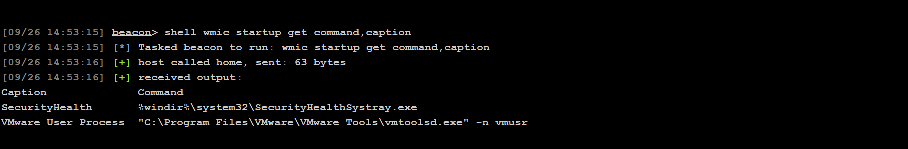

- **查看计划任务**（如果出现无法加载列资源 输入：chcp 437）
    ```
    schtasks /query /fo LIST /v
    ```
    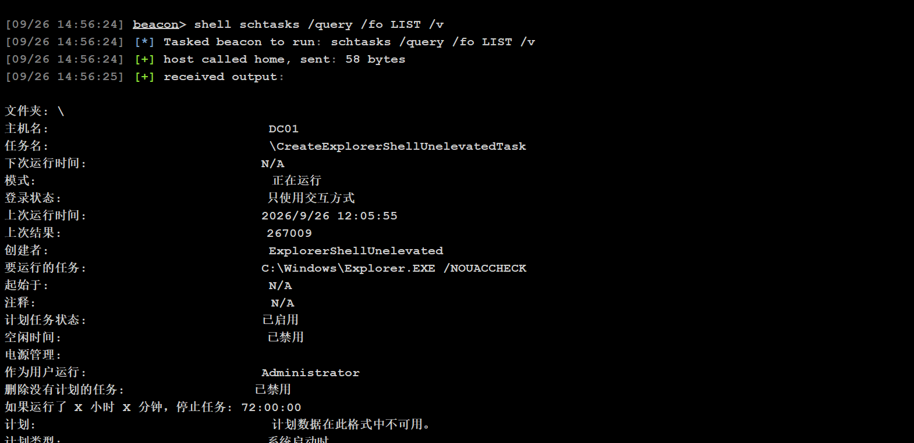

- **电脑开机时间**
    ```
    net statistics workstation
    ```
    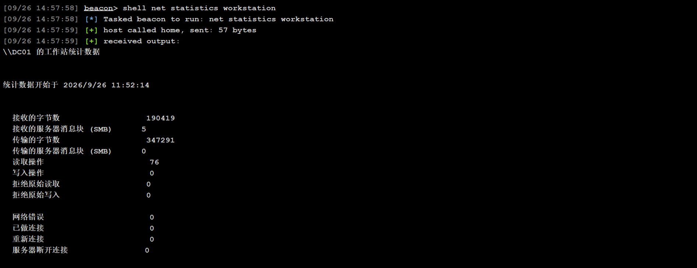


- **用户列表信息**
    ```
    net user
    wmic useraccount get name ,SID
    ```
    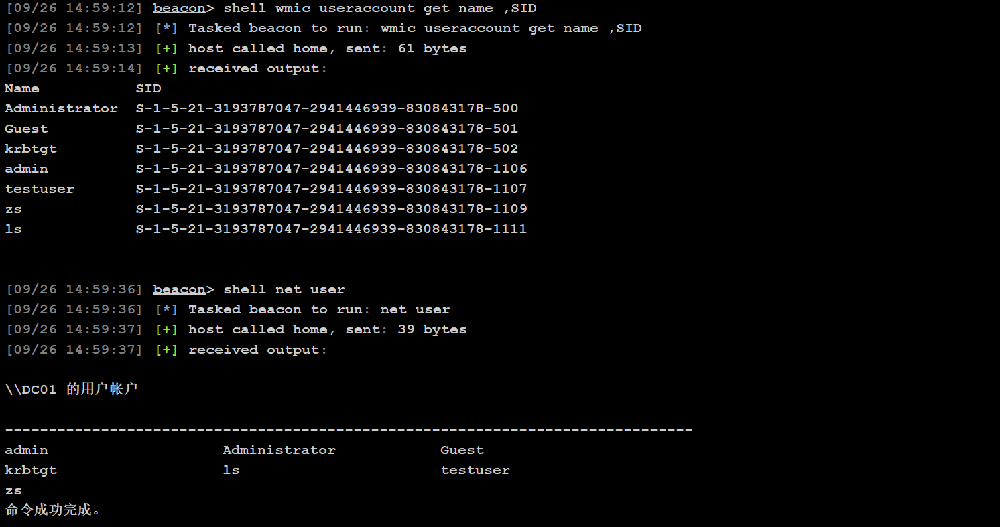

- **当前会话列表**
    ```
    net session
    ```
    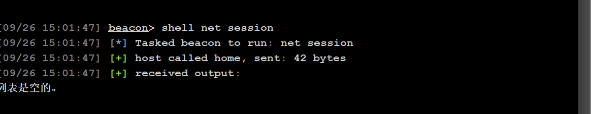

- **查询端口信息**
    ```
    netstat -ano
    ```
    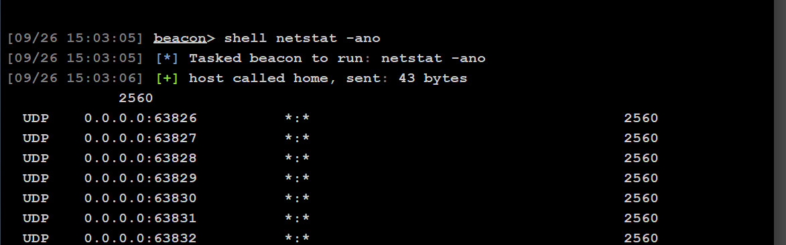

- **查询补丁信息**
    ```
    systeminfo
    wmic qfe get Caption,Description,HotFixID,InstalledOn
    ``` 
    
    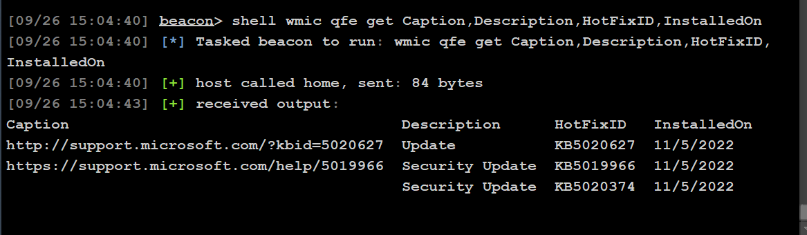

- **查询杀软等信息**
    ```
    wmic /node:localhost /namespace:\\root\securitycenter2 path antivirusproduct get displayname /format:list
    ```

- **查询共享列表**
    ```
    net share
    wmic share get name,path,status
    ```
    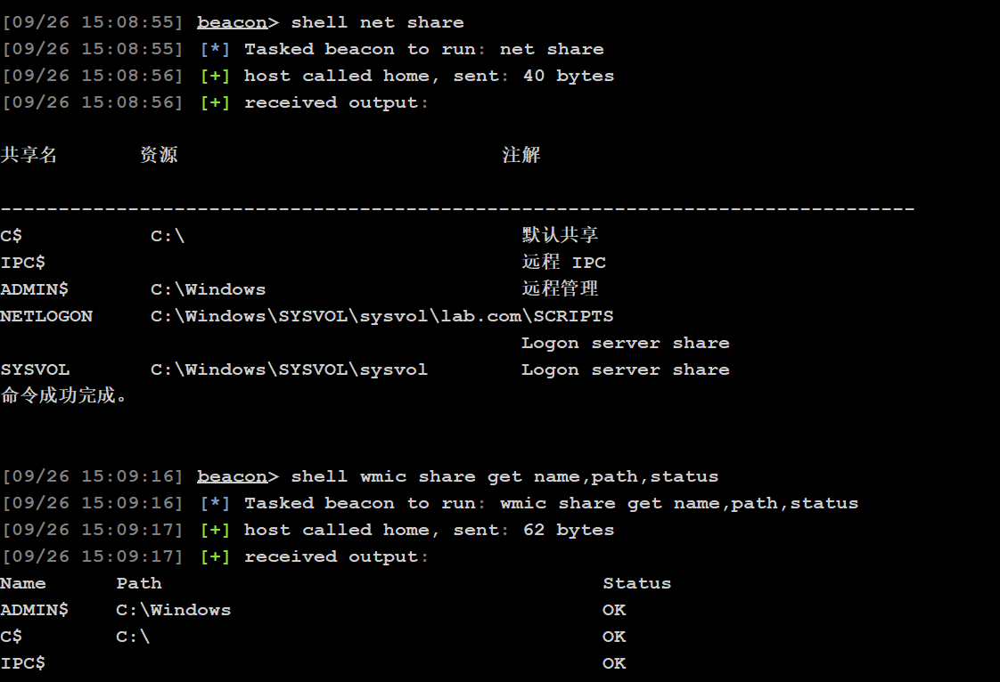

- **查询路由信息**
    ```
    route print
    ```
    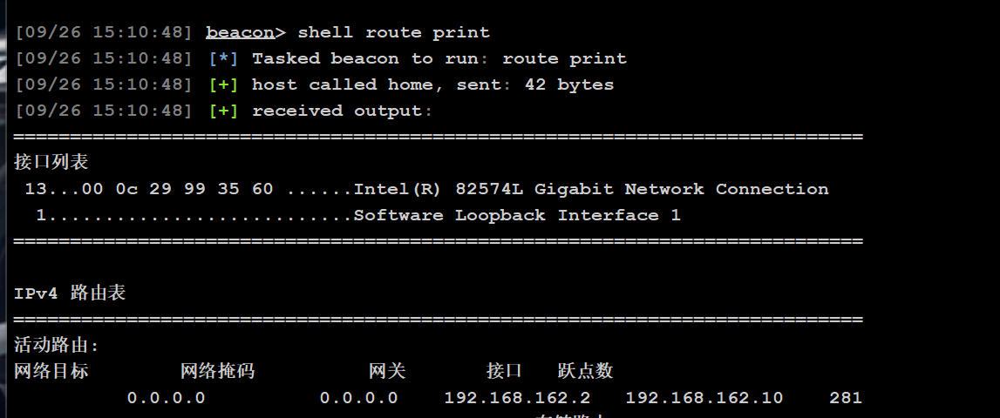

- **查询防火墙是否开启**
    ```
    netsh firewall show state
    ```
    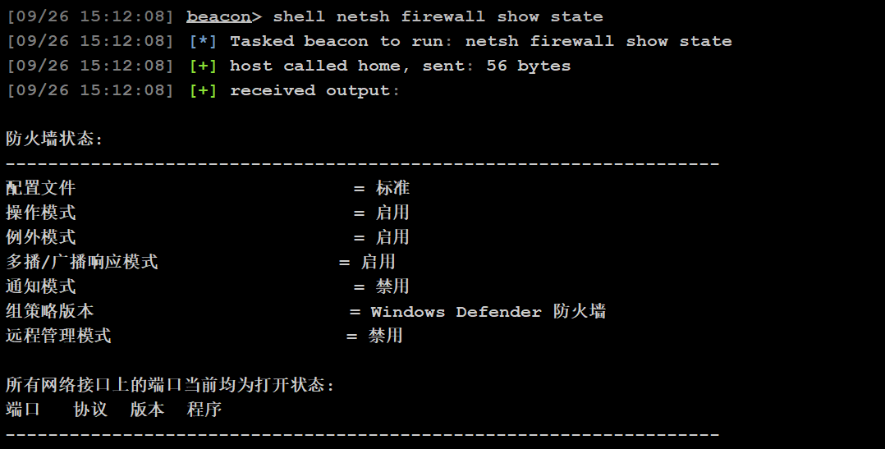

- **关闭防火墙强**
    ```
    # Windows server 2003:     
    netsh firewall set opmode disable

    #Windows server 2003之后: 
    netsh firewall set opmode disable 
    
    # 或者 
    netsh advfirewall set allprofiles state off
    ```
    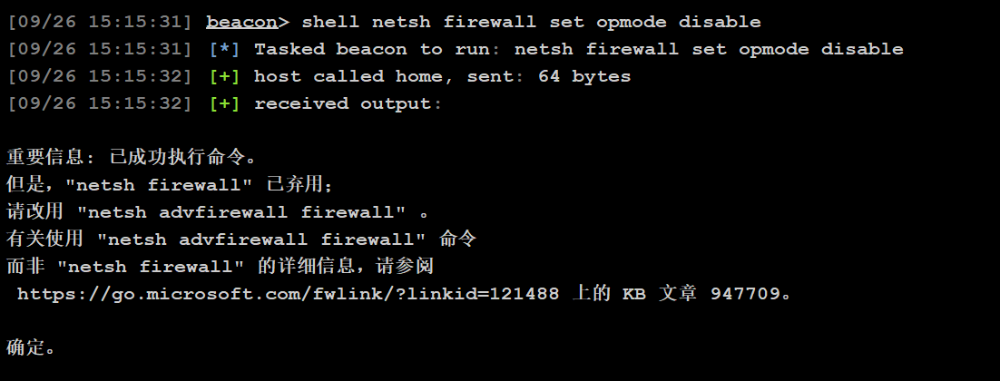

- **防火墙其他的命令**
    
  - 2003及之前的版本,允许指定的程序进行全部的连接
    ```
    netsh firewall add allowedprogram c:\nc.exe "allownc" enable
    ```
  - 2003之后的版本，允许指定的程序进行全部的连接
    ``` 
    netsh advfirewall firewall add rule name="pass nc"dir=in action=allow program="C:\nc.exe"
    ```
  - 允许指定程序退出,命令如下
    ``` 
    netsh advfirewall firewall add rule name="Allownc" dir=out action=allow program="C: \nc.exe"
    ```
  - 允许3389端口放行,命令如下
    ```
    netsh advfirewall firewall add rule name="RemoteDesktop" protocol=TCP dir=in localport=3389 action=allow
    ```

- **开启3389**
    ```
    REG ADD HKLM\SYSTEM\CurrentControlSet\Control\Terminal" "Server /v fDenyTSConnections /t REG_DWORD /d 00000000 /f
    ```
    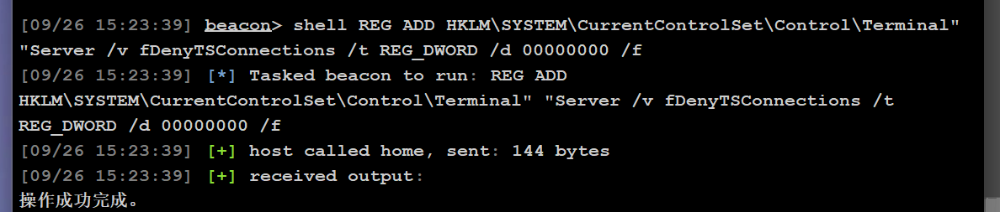
    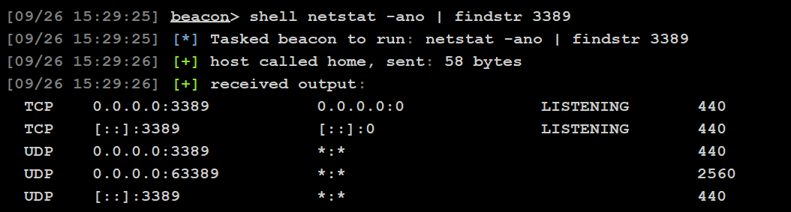

- 关闭3389
    ```
    REG ADD HKLM\SYSTEM\CurrentControlSet\Control\Terminal" "Server /v fDenyTSConnections /t REG_DWORD /d  11111111 /f 
    ```
    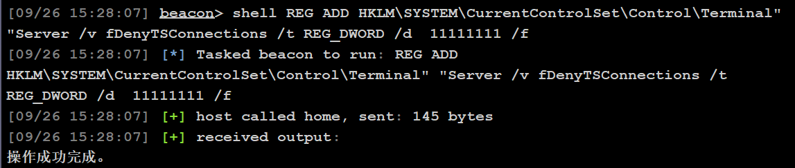
    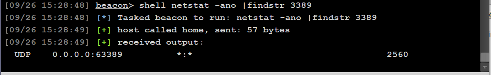

- **收集本机的WIFI密码信息**
    ```
    for /f "skip=9 tokens=1,2 delims=:" %i in ('netsh wlan show profiles') do @echo %j | findstr -i -v echo | netsh wlan show profiles %j key=clear
    ```
    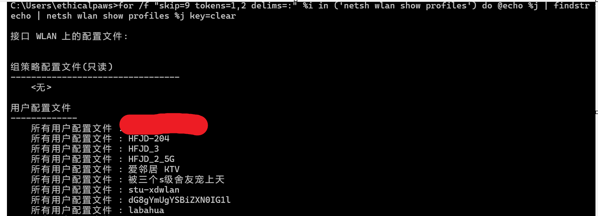

- **查询RDP端口**
    ```
    reg query "HKEY_LOCAL_MACHINE\SYSTEM\CurrentControlSet\Control\Terminal Server\WinStations\RDP-Tcp" /V PortNumber

    ```
    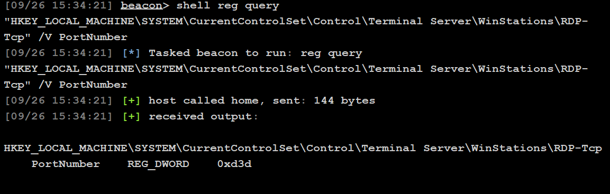

- **查询当前保存的凭据**
    ```
    cmdkey /l 
    ```
    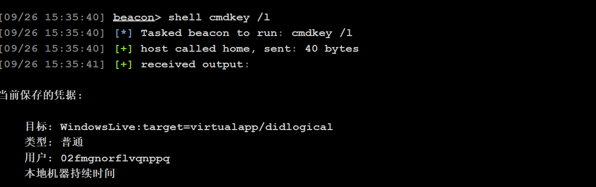

- **arp信息**
    ```
    arp -a
    ```
    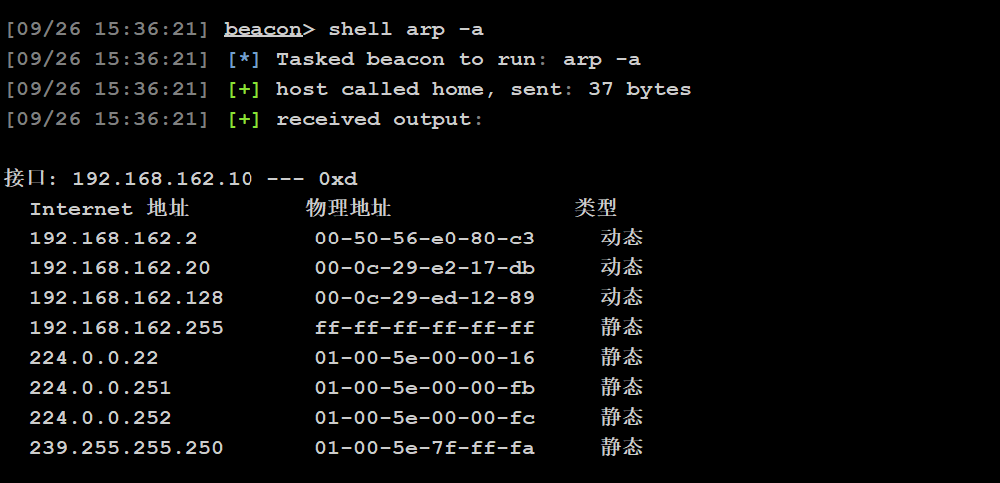

- **查询最近打开的文件**
    ```
    dir %APPDATA%\Microsoft\Windows\Recent
    ```
    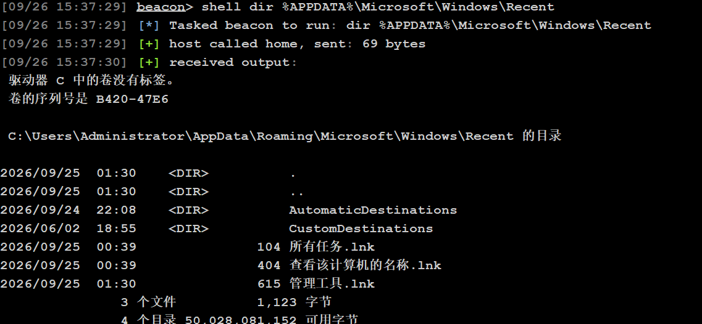

- **查询本地工作组**
    ```
    net localgroup
    ```
    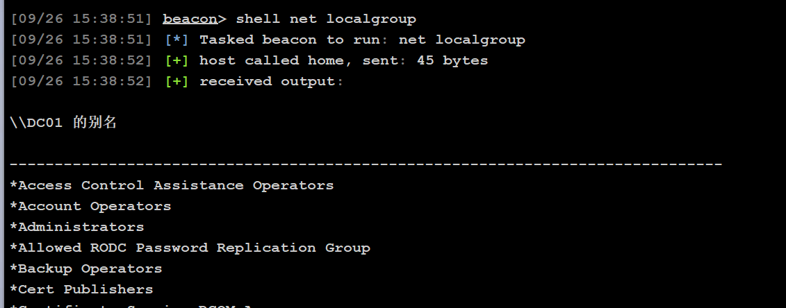

- **查询管理员组员信息**
    ```
    net localgroup administrators
    ```
    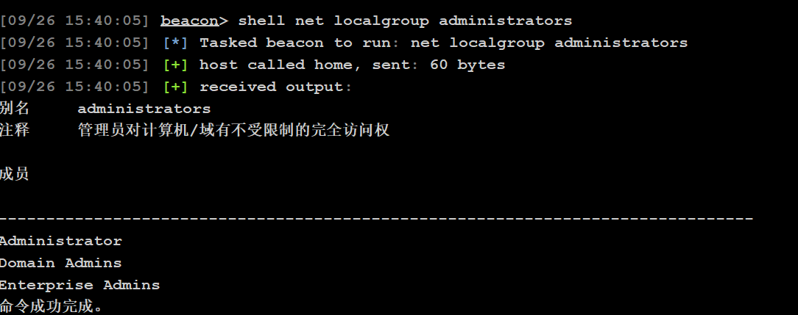

- **查询RDP凭据**
    ```
    dir /a %userprofile%\AppData\Local\Microsoft\Credentials\*
    ```
    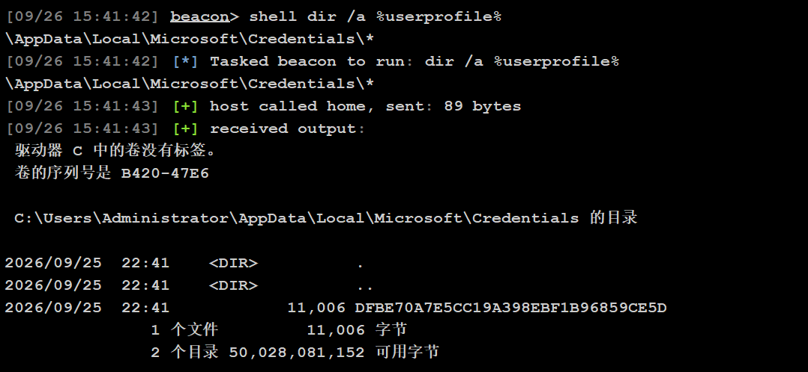

## 域内信息收集

### 域内基本信息收集

**查询权限**

查看当前权限命令如下

```cmd
whoami
```

获取台主机的权限后,有四种情况:

1. 本地普通用户:当前为本机的user用户

    ```cmd
    C:\>whoami
    pc-2008\zhangsan
    ```

2. 本地管理员用户:当前为本机的admministrator

    ```cmd
    C:\>whoami
    pc-2008\administrator
    ```

3. 域内用户:当前为域内普通用户

    ```cmd
    C:\Users\bob>whoami
    hack\bob
    C:\Users\bob>
    ```

4. 域内用户:当前为hacke域内的administrator用户

    ```cmd
    C:\>whoami
    hack\administrator
    ```

在这四种情况中

- 如果当前内网中存在域,那么本地普通用户只能查询本机相关信息,不能查询域内信息.
- 而本地管理员用户和域内用户可以查询域内信息.

**查询是否存在域**

- ipconfig /all
  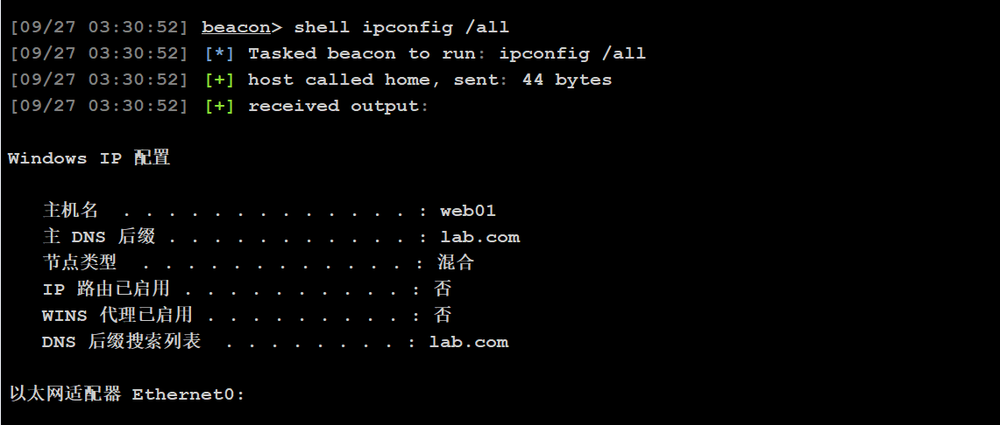 
- systeminfo
   
- net config workstation
  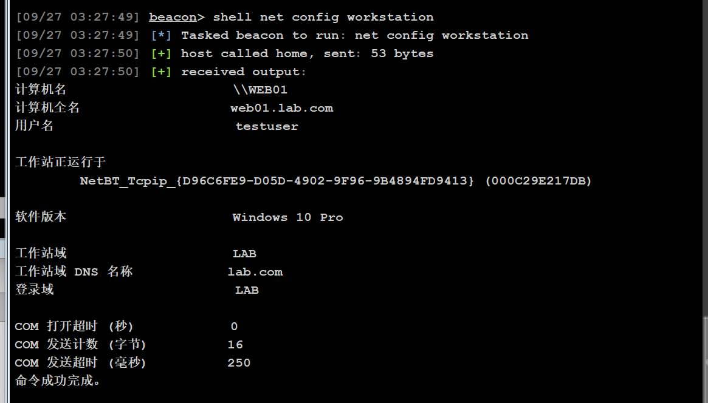
- Net time
  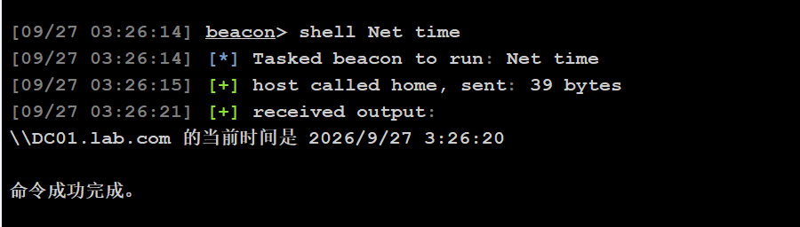  


**查询域内所有用户组列表**
```
net group /domain
```
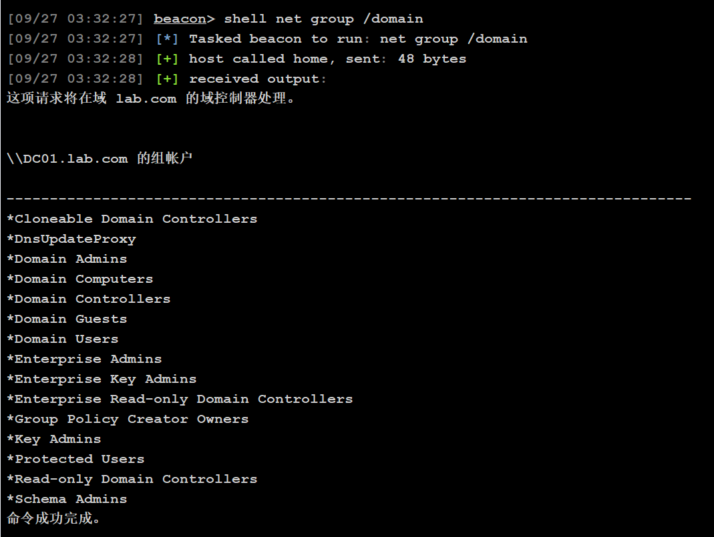

**查询域内某用户组成员**
```
net group "组名" /domain
```
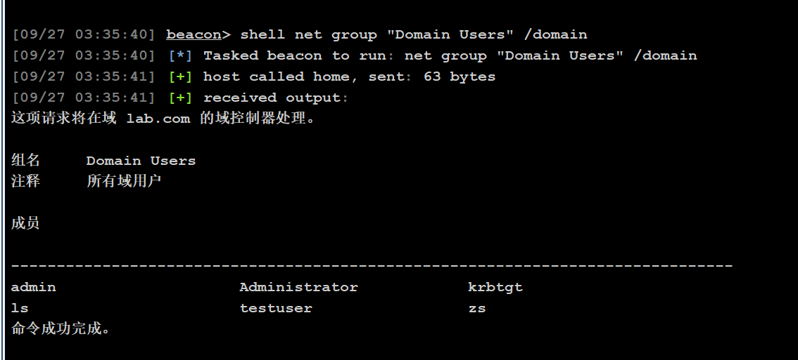


### 定位域控的位置（找“大脑”）
>目标：找到域控（DC）的 IP 地址和主机名。域控是整个内网的“大脑”，拿下它就能控制整个域。

**查询域控主机名常用方法**

- nltest /dclist:域名
  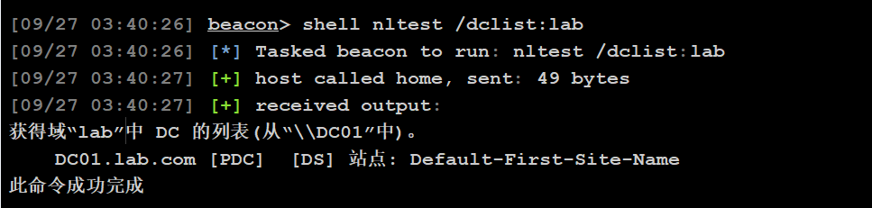
  
  DC01就是域控的主机名

- DNS 查询
  ``` 
  nslookup -type=SRV _ldap._tcp 
  ``` 
  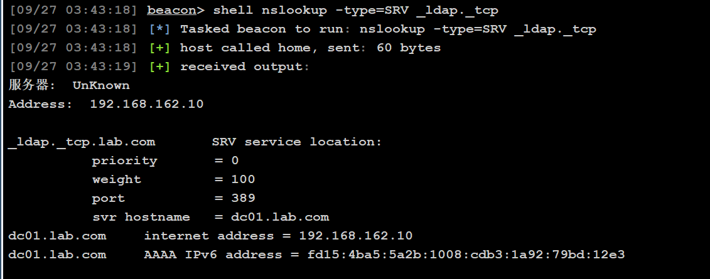
  
  这是最标准的方法，DNS 服务器会返回域控的 SRV 记录。

- 查看域控制器组
  ```
  net group "Domain Controllers" /domain
  ```
  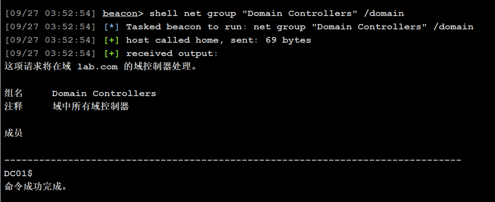

**知道域控主机名后查询ip的方法**

- ping 域控
  ```
  ping DC01.lab.com
  ``` 
  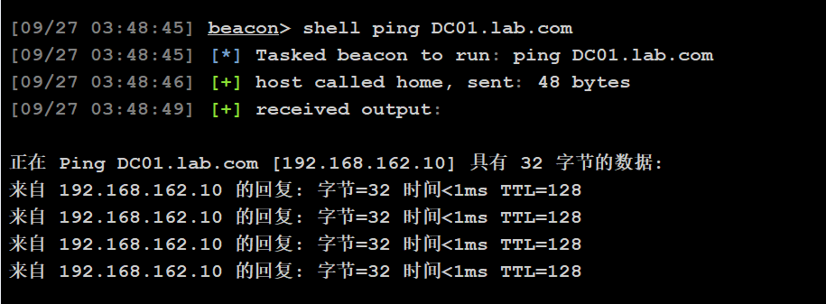
- dns解析
  ```
  nslookup DC01.lab.com
  ``` 
  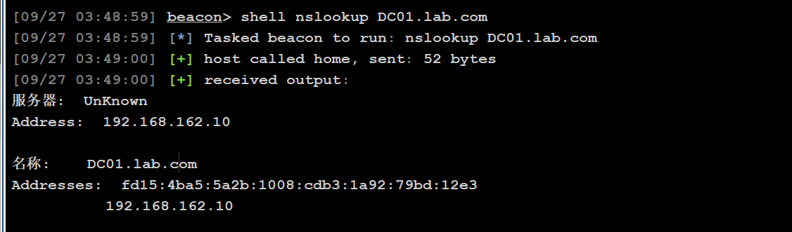


>渗透意义：所有的高级攻击（如 DCSync、黄金票据）都需要你明确知道域控的 IP。

### 获取域内用户（找“猎物”）
目标：拿到域内所有用户的列表，为后续的密码喷洒（Password Spraying）或 Kerberoasting 做准备。


- net user /domain  列出域内所有用户。
  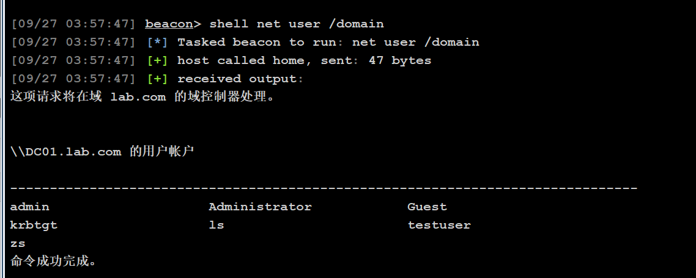
- net group "Domain Admins" /domain 列出域管理员组的成员。
  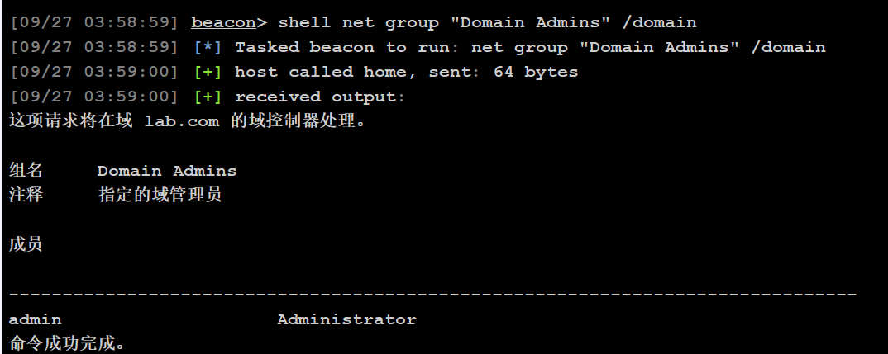
- net group "Domain Users" /domain  列出所有域用户。
  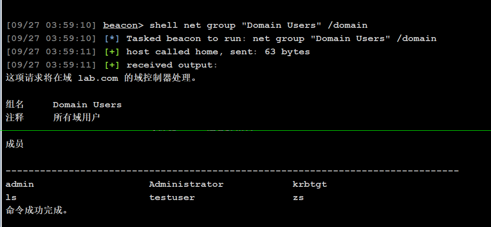
- net group "Enterprise Admins /domain" 查询域控管理员
  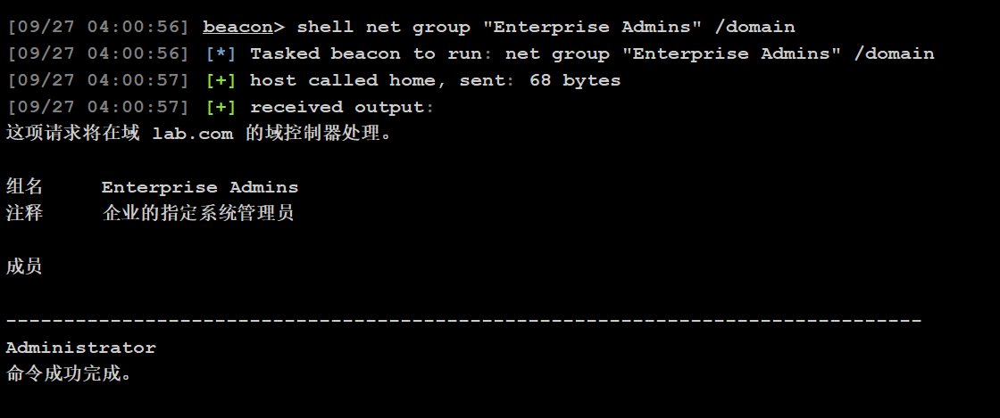 
>渗透意义：拿到用户列表后，就可以进行密码喷洒（用同一个弱密码去试所有用户），或者寻找有 SPN 的服务账户进行 Kerberoasting

### 定位域管理员在域中的位置
>目标：找出域管理员（Domain Admins）和企业管理员（Enterprise Admins）是谁，以及他们当前登录在哪台机器上。

**常用方法**


- **Psloggedon**
  - **作用：** psloggedon.exe 可以显示本地登录的用户和通过本地计算机或远程计算机的资源登录的用户。如果指定了用户名而不是计算机，psloggedon.exe 会搜索网络邻居中的计算机，并显示该用户当前是否已登录。
  - **语法**
    ```
    PsLoggedon.exe \\机器名
    PsLoggedon.exe 账号名
    ``` 
  - **示例**
    `PsLoggedon.exe \\web01 `
    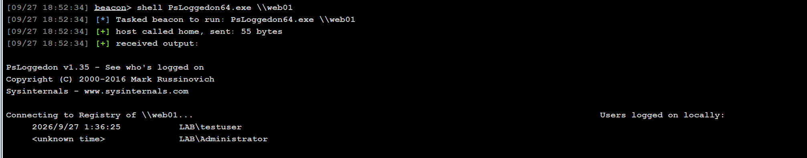

  **注意** 第一次使用该工具需要使用-accepteula参数绕过弹窗
    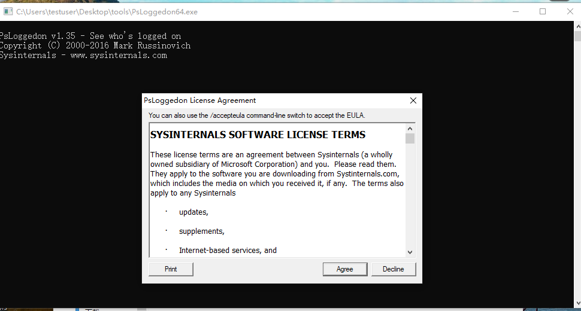
    
    
- **PVEFindADUser**
  - **作用：**可用于查找 AD用户登录的位置，枚举域用户，以及查找在特定计算机上登录的用户，包括本地用户、通过RDP 登录的用户、用于运行服务和计划任务的用户
  - **语法**
    ``` 
    pvefindaduser.exe -current
    ```

  - **示例**
    `pveFindADUser.exe -current` 
    
>渗透意义：“域管在哪里，攻击就打向哪里。” 拿下域管是内网渗透的终极目标。

### 敏感数据定位
>目标：在文件服务器、数据库、Web 配置文件中寻找明文密码、连接字符串、SSH 密钥、VPN 凭证等。

内网的核心敏感数据，不仅包括数据库、电子邮件，还包括个人数据及组织的业务数据、技术数据等。可以说，价值较高的数据基本都在内网中

**重点核心业务机器**

高级管理人员 系统管理人员 财务/人事/业务人员的个人计算机
产品管理系统服务器
办公系统服务器
财务应用系统服务器
核心产品源码服务器（SVN/GIT服务器）
数据库服务器
文件服务器
共享服务器
电子邮件服务器
网站监控系统服务器
信息安全监控服务器
生产工厂服务器
站点源码备份文件
数据库备份文件等等
浏览器保存的密码和浏览器的cookie
其他用户会话
3389和ipc$连接记录
回收站中的信息等等
Windows的无线密码
网络内部的各种账号密码,
包含电子邮箱, V**, FTP等等

**常用命令**

- 指定目录下搜集各类敏感文件
  ```
  dir /a /s /b d:\"*.txt"
  dir /a /s /b d:\"*.xml"
  dir /a /s /b d:\"*.mdb"
  dir /a /s /b d:\"*.sql"
  dir /a /s /b d:\"*.mdf"
  dir /a /s /b d:\"*.eml"
  dir /a /s /b d:\"*.pst"
  dir /a /s /b d:\"*conf*"
  dir /a /s /b d:\"*bak*"
  dir /a /s /b d:\"*pwd*"
  dir /a /s /b d:\"*pass*"
  dir /a /s /b d:\"*login*"
  dir /a /s /b d:\"*user*"
  ```

  | 参数 | 含义 |
  |------|------|
  | `/a` | 显示所有属性的文件（包括隐藏、系统文件） |
  | `/s` | 递归搜索所有子目录 |
  | `/b` | 使用"裸格式"输出，只显示文件完整路径，不显示标题、大小、日期等信息 |  

  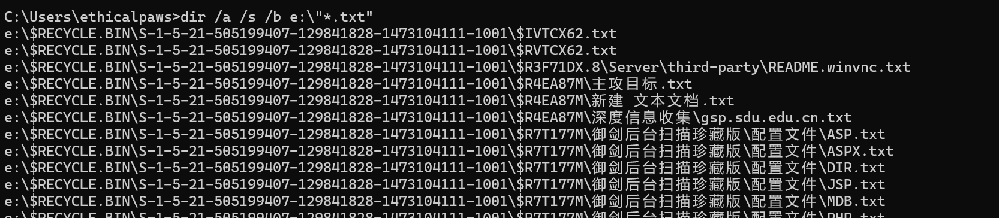


- 指定目录下的文件中搜集各种账号密码
  ```
  findstr /si pass *.inc *.config *.ini *.txt *.asp *.aspx *.php *.jsp *.xml *.cgi *.bak
  findstr /si userpwd *.inc *.config *.ini *.txt *.asp *.aspx *.php *.jsp *.xml *.cgi *.bak
  findstr /si pwd *.inc *.config *.ini *.txt *.asp *.aspx *.php *.jsp *.xml *.cgi *.bak
  findstr /si login *.inc *.config *.ini *.txt *.asp *.aspx *.php *.jsp *.xml *.cgi *.bak
  findstr /si user *.inc *.config *.ini *.txt *.asp *.aspx *.php *.jsp *.xml *.cgi *.bak
  ```


  | 部分 | 含义 |
  |------|------|
  | `findstr` | Windows 内置的字符串搜索命令，功能类似 Linux 的 `grep` |
  | `/s` | 递归搜索当前目录及其所有子目录 |
  | `/i` | 忽略大小写（pass、PASS、Pass 都能匹配） |
  | `pass` | 要搜索的关键词，即"密码"相关的字符串 |
  | `*.inc *.config *.ini *.txt *.asp *.aspx *.php *.jsp *.xml *.cgi *.bak` | 指定要搜索的文件类型（多个模式之间用空格分隔） |  

  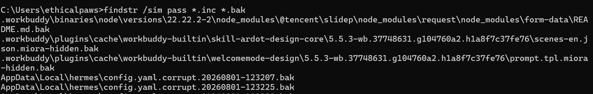

## 内网IP扫描

### ICMP协议扫描
**ICMP协议介绍**：
ICMP是(Internet Control Message Protocol)Internet控制报文协议。它是TCP/IP协议族的一个子协议，用于在IP主机、路由器之间传递控制消息。控制消息是指网络通不通、主机是否可达、路由是否可用等网络本身的消息。这些控制消息虽然并不传输用户数据，但是对于用户数据的传递起着重要的作用

**方法一：使用PING命令配合CMD语法进行C端扫描**

  - **命令**：
    ```
    for /L %I in (1,1,254) DO @ping -w 1 -n 1 192.168.1.%I | findstr "TTL="
    ```
  - **结果**：
    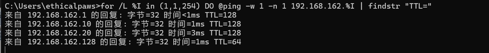

**方法二：使用**

  - **简介：** fping是一个小型命令行工具，用于向网络主机发送ICMP 回应请求，类似于ping，但在ping多个主机时性能要高得多。fping完全不同于ping，一位可以指定IP数量和网段
  - **命令**：
    ```
    fping IP1 IP2 -c 10          扫描多个IP 10次
    fping -a -g 172.18.9.0/24     扫描C端IP
    ```

    | 参数 | 含义 |
    |------|------|
    | `-a` | 只显示存活（alive）的主机 |
    | `-g` | 指定网段（CIDR 格式）来生成目标列表 |
    | `172.18.9.0/24` | 要扫描的目标网段，即 172.18.9.1 到 172.18.9.254 |

  - **结果**：
    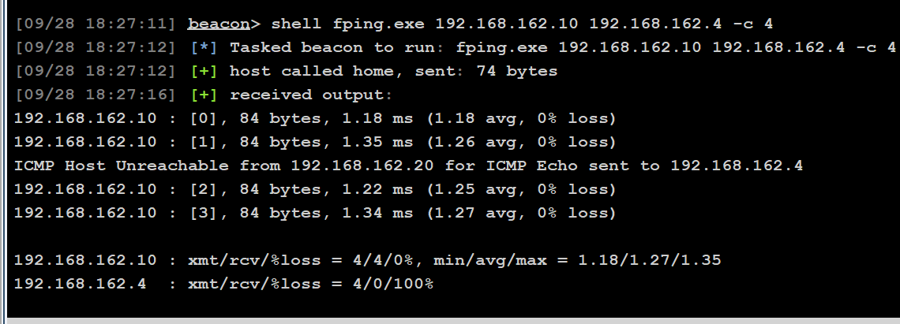

    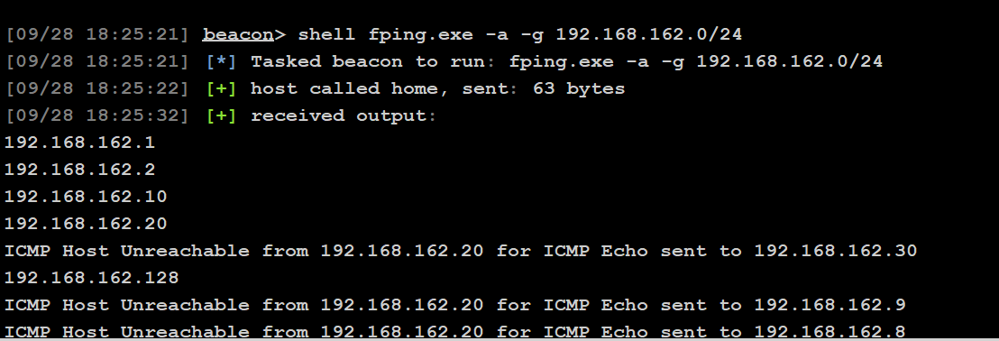

### ARP协议扫描扫描

**ARP协议介绍** 
地址解析协议，即ARP(Address Resolution Protocol)，是根据IP地址获取物理地址的一个TCP/IP协议

**方法一：ARP缓存表**
  - **命令**
    ``` 
    arp -a
    ```
    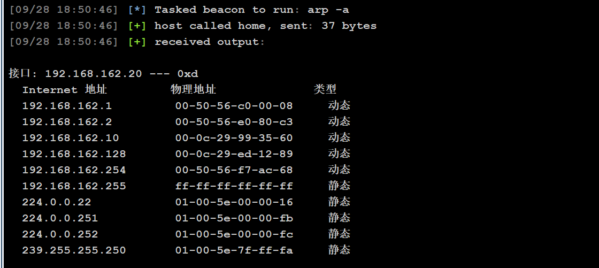

**方法二：使用ARP工具**
  - 命令
    ```
    arp.exe -t IP段
    ```

### NetBISO协议扫描
**NetBIOS协议介绍** 
NetBIOS协议是由IBM公司开发，主要用于数十台计算机的小型局域网。NetBIOS协议是一种在局域网上的程序可以使用的应用程序编程接口(API)，为程序提供了请求低级服务的统一的命令集，作用是为了给局域网提供网络以及其他特殊功能，几乎所有的局域网都是在NetBIOS协议的基础上工作的，在网络中使用计算机名通讯就是使用NetBIOS协议， NetBIOS协议,主要用于局域网通信,开启之后,局域网的其他计算机可以发现并找到你的计算机

**使用nbtscan工具扫描**
  - **命令**
    ```
    nbtscan.exe IP段
    ``` 
  - **结果**
    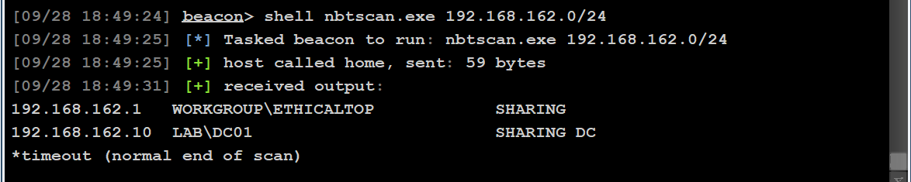


### FSCAN工具扫描
**FSCAN介绍**
一款内网综合扫描工具，方便一键自动化、全方位漏扫扫描。支持主机存活探测、端口扫描、常见服务的爆破、ms17010、redis批量写公钥、计划任务反弹shell、读取win网卡信息、web指纹识别、web漏洞扫描、netbios探测、域控识别等功能。

**项目地址**：https://github.com/shadow1ng/fscan

**常用命令**
```
fscan.exe -h IP段
```
**示例**
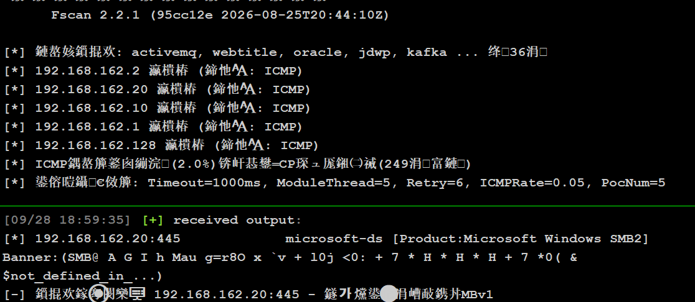

### KSCAN工具扫描
**kscan介绍**
kscan是一款资产测绘工具，可针对指定资产进行端口扫描以及TCP指纹识别和Banner抓取，在不发送更多的数据包的情况下尽可能的获取端口更多信息。并能够针对扫描结果进行自动化暴力破解，且是go平台首款开源的RDP暴力破解工具

**项目地址**： https://github.com/lcvvvv/kscan

**常用参数**
-t/--target 可添加--check参数，只对指定的目标端口进行指纹识别，否则指定目标进行端口扫描和指纹识别
```
IP地址：114.114.114.114
IP地址段：114.114.114.114-115.115.115.115
URL地址：https://www.baidu.com
文件地址：/tmp/target.txt
```
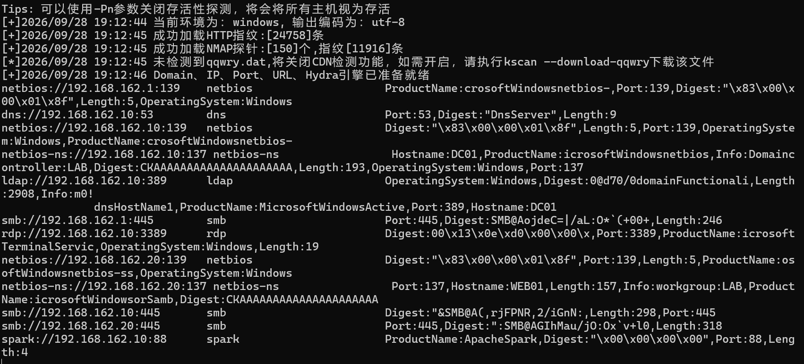

--spy可添加--scan参数可对最长的网段进行端口扫描和指纹识别，否则将只检测最长的网段

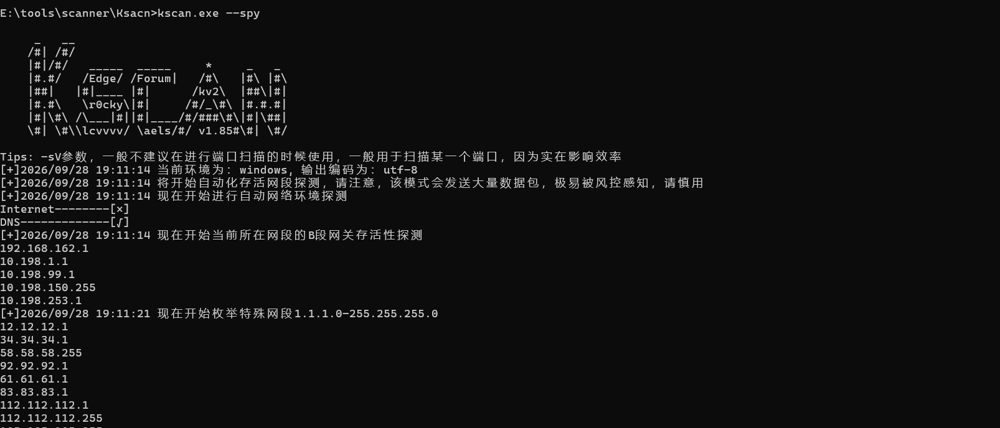


### Ladon工具扫描
**Ladon介绍** 
一款用于大型网络渗透的多线程插件化综合扫描神器，含端口扫描、服务识别、网络资产、密码爆破、高危漏洞检测以及一键GetShell，支持批量A段/B段/C段以及跨网段扫描，支持URL、主机、域名列表扫描。7.5版本内置100个功能模块,外部模块18个,通过多种协议以及方法快速获取目标网络存活主机IP、计算机名、工作组、共享资源、网卡地址、操作系统版本、网站、子域名、中间件、开放服务、路由器、数据库等信息，漏洞检测包含MS17010、SMBGhost、Weblogic、ActiveMQ、Tomcat、Struts2系列等，密码爆破13种含数据库(Mysql、Oracle、MSSQL)、FTP、SSH、VNC、Windows(LDAP、SMB/IPC、NBT、WMI、SmbHash、WmiHash、Winrm)、BasicAuth、Tomcat、Weblogic、Rar等，远程执行命令包含(wmiexe/psexec/atexec/sshexec/jspshell),Web指纹识别模块可识别75种（Web应用、中间件、脚本类型、页面类型）等，可高度自定义插件POC支持.NET程序集、DLL(C#/Delphi/VC)、PowerShell等语言编写的插件,支持通过配置INI批量调用任意外部程序或命令，EXP生成器可一键生成漏洞POC快速扩展扫描能力。Ladon支持Cobalt Strike插件化扫描快速拓展内网进行横向移动。

**项目地址：**https://github.com/k8gege/Ladon

**作为cs插件使用**

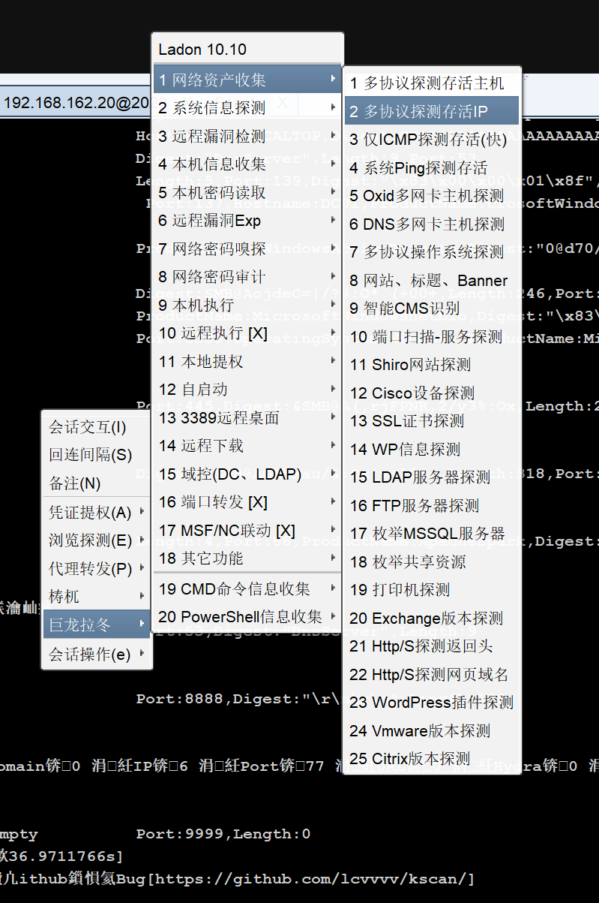

**单独使用**

  - **常用命令**
    
    - ladon.exe IP段 icmp
    - ladon.exe IP段 onlinepc
    - ladon.exe IP段 dnsscan
    - ladon.exe IP段 osscan
    - ladon.exe IP段 whatcms

## 内网端口扫描
### 概述
通过查询目标主机的端口开放信息，不仅可以了解目标主机所开放的服务，还可以找出其开放服务的漏洞、分析目标网络的拓扑结构等，在进行内网渗透测试时，通常会使用Metasploit内置的端口进行扫描。也可以上传端口扫描工具，使用工具进行扫描。还可以根据服务器的环境，使用自定义的端口扫描脚本进行扫描。在获得授权的情况下，可以直接使用Nmap、masscan等端口扫描工具获取开放的端口信息

### 常见端口

| 端口号 | 端口说明 | 使用说明 |
| :--- | :--- | :--- |
| 21、22、69 | FTP/ FTP 文件传输协议 | 允许匿名的上传、下载、爆破和嗅探操作 |
| 2049 | NFS 服务 | 配置不当 |
| 139 | SAMBA 服务 | 爆破、未授权访问、远程代码执行 |
| 22 | SSH远程连接 | 爆破、SSH隧道及内网代理转发、文件传输 |
| 23 | Telnet 远程连接 | 爆破、嗅探、弱口令 |
| 3389 | RDP 远程桌面连接 | Shift 后门 (2003 以下版本) 爆破 |
| 5900 | VNC | 弱口令爆破 |
| 80、443、8080 | 常见的Web 服务端口 | Web 攻击、爆破、对应服务器版本漏洞 |
| 7001、7002 | WebLogic 控制台 | Java 反序列化、弱口令 |
| 8080、8089 | JBoss/Resin/Jetty/Jenkins | 反序列化、控制台弱口令 |
| 9090 | WebSphere 控制台 | Java 反序列化、弱口令 |
| 4848 | GlassFish 控制台 | 弱口令 |
| 1352 | Lotus Domino 邮件服务 | 弱口令、信息泄露、爆破 |
| 10000 | webmin 控制面板 | 弱口令 |


| 端口号 | 端口说明 | 使用说明 |
| :--- | :--- | :--- |
| 3306 | MySQL 数据库 | 注入、提权、爆破 |
| 1433 | MSSQL 数据库 | 注入、提权、SA 弱口令、爆破 |
| 1521 | Oracle 数据库 | TNS 爆破、注入、反弹Shell |
| 5432 | PostgreSQL数据库 | 爆破、注入、弱口令 |
| 27017、27018 | MongoDB 数据库 | 爆破、未授权访问 |
| 25 | SMTP 邮件服务 | 邮件伪造 |
| 110 | POP3 协议 | 爆破、嗅探 |
| 53 | DNS 域名系统 | 允许区域传送、DNS 劫持、缓存投毒、欺骗 |
| 67、68 | DHCP 服务 | 劫持、欺骗 |
| 2181 | ZooKeeper 服务 | 未授权访问 |
| 8069 | Zabbix 服务 | 远程执行、SQL 注入 |
| 9200、9300 | Elasticsearch 服务 | 远程执行 |
| 11211 | Memcached 服务 | 未授权访问 |
| 512、513、514 | Linux rexec 服务 | 爆破、远程登录 |
| 873 | rsync 服务 | 匿名访问、文件上传 |
| 3690 | SVN 服务 | SVN 泄露、未授权访问 |
| 50000 | SAP Management Console | 远程执行 |
### ScanLine端口扫描
**介绍**
ScanLine是一款windows下的端口扫描的命令行程序。它可以完成PING扫描、TCP端口扫描、UDP端口扫描等功能。运行速度很快，不需要winPcap库支持，应用场合受限较少。


### Telnet端口扫描
**介绍**
Telnet协议是TCP/IP协议族的一员，是Internet远程登录服务的标准协议和主要方式。它为用户提供了在本地计算机上完成远程主机工作的能力。在目标计算机上使用Telnet协议，可以与目标服务器建立连接。如果只是想快速探测某台主机的某个常规高危端口是否开放，使用telnet命令是最方便的

**命令**
```
telnet  IP 端口
```
**示例**


### 其他集成工具
- kscan 
- fscan
- ladon
## 常见信息含义


**用户名和SID**

```
用户名            SID                                          
================= =============================================
god\administrator S-1-5-21-2952760202-1353902439-2381784089-500
```

| 字段 | 值 | 含义 |
|------|-----|------|
| 用户名 | `god\administrator` | 域 `god.org` 的内置管理员账户 |
| SID | `S-1-5-21-...-500` | SID 后缀 `-500` 是 Administrator 账户的固定标识，说明这是真正的内置管理员，不是伪装的 |
| SID 前缀 | `S-1-5-21-2952760202-1353902439-2381784089` | 域 SID，域内所有用户共享这个前缀，后续黄金票据需要用到 |

**组信息**

| 组名 | SID | 权限含义 |
|------|-----|----------|
| `BUILTIN\Administrators` | `S-1-5-32-544` | 本地管理员，可以操作本机任何资源 |
| `GOD\Domain Admins` | `S-1-5-21-...-512` | 域管理员，可以管理域内所有计算机 |
| `GOD\Enterprise Admins` | `S-1-5-21-...-519` | 企业管理员，可以管理整个 AD 森林（如果有多个域） |
| `GOD\Schema Admins` | `S-1-5-21-...-518` | 架构管理员，可以修改 AD 的底层架构 |
| `GOD\Group Policy Creator Owners` | `S-1-5-21-...-520` | 可以创建和修改组策略对象（GPO） |
| `Everyone` | `S-1-1-0` | 任何用户（包括匿名）都在此组，无特殊权限 |
| `NT AUTHORITY\Authenticated Users` | `S-1-5-11` | 所有通过认证的用户，基础组 |
| `Mandatory Label\High Mandatory Level` | `S-1-16-12288` | 高完整性级别，表示进程运行在高权限上下文中 |

**特权信息**

| 特权名 | 状态 | 攻击用途 |
|--------|------|----------|
| `SeDebugPrivilege` | ⚠️ 已禁用（但可启用） | 调试进程权限——可以读写 `lsass.exe` 内存，用于 Mimikatz 抓密码 |
| `SeImpersonatePrivilege` | ✅ 已启用 | 模拟客户端权限——可以伪造其他用户的令牌，用于令牌窃取和横向移动 |
| `SeCreateGlobalPrivilege` | ✅ 已启用 | 创建全局对象权限——可用于某些持久化技术 |
| `SeChangeNotifyPrivilege` | ✅ 已启用 | 绕过遍历检查——可以访问任意路径，即使没有明确权限 |

**本地用户**


| 用户名 | 类型 | 攻击价值 |
|--------|------|----------|
| `Administrator` | 本地管理员 | 本机最高权限账户 |
| `Guest` | 内置访客账户 | 默认禁用，如被启用可能有风险 |
| `liukaifeng01` | 普通用户 | 可能是网站管理员或开发人员，可作为后续横向移动的跳板 |


**主机名和域名**


```
主机名: stu1
DNS后缀: god.org
```

**网络接口**


| 字段 | 值 | 含义 |
|------|-----|------|
| IP 地址 | `192.168.52.143` | VM2 在域内网络中的 IP，这是横向移动的入口 |
| 子网掩码 | `255.255.255.0` | 子网是 `/24`，IP 范围 `192.168.52.1 - 192.168.52.254` |
| DNS 服务器 | `192.168.52.138` | 这是域控（DC）的 IP！ |


**域控的 SRV 记录**


```
记录名称: _ldap._tcp.Default-First-Site-Name._sites.god.org
记录类型: 33                        ← SRV 记录（服务定位记录）
SRV 记录  . . . . . . : owa.god.org
                        0          ← 优先级
                        100        ← 权重
                        389        ← 端口（LDAP 服务）
记录名称: owa.god.org
记录类型: 1                         ← A 记录
A (主机)记录: 192.168.52.138        ←  域控 IP！
```

如何判断这是域控？
原理：域控制器必须向 DNS 注册 LDAP 服务的 SRV 记录，以便客户端（如本机）通过 ipconfig /displaydns 查询时能找到它。记录明确将 LDAP 服务指向了 owa.god.org。
