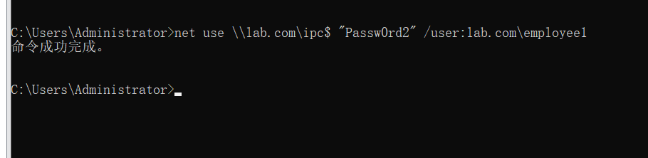

# IPC$进行横向移动

IPC（Internet process connection）共享，为了实现进程间通信而开放的命名管道。

>IPC$

IPC可以通过验证用户名和密码获得相应的权限，通常在远程管理和查看计算机的共享资源时使用。通过IPC$可以与目标机器建立连接，不仅可以访问目标机器的文件进行上传、下载等操作，还可以在目标机器上运行其他命令，以获取目标机器的目标结构、用户列表等信息。

>共享文件

文件共享指的是主动在网络上共享自己计算机中的文件，默认共享是为了方便管理员进行远程管理而默认开启的。

逻辑磁盘默认都是处于共享状态的。

访问的命令格式为
```
\\IP地址\磁盘符$
```

**注意**：如果当前计算机A的用户账户是administrator，目标机器B上的账户也是administrator，且密码相同，则不需要输入密码就可以访问，默认会用本地账户密码进行认证。

**IPC$连接方式**

用户组连接
```
net use \\IP\ipc$ "password" /user:"username"
```
域用户连接
```
net use \\域名\ipc$ "域成员密码" /user：域名\域成员账户
```


**删除ipc$连接**
``
net use \\IP\ipc$ /del
```


**利用条件**
1、开启了139、445端口

IPC$可以实现远程登录及对默认共享资源的访问，445端口可以实现对共享文件打印机的访问，一般来讲需要445端口的支持。

2、管理员开启了默认共享

默认共享是为了访问管理员进行远程管理而默认开启的，包括所有的逻辑盘可以实现对这些默认共享目录的访问。

3、必须得知道对方机器的用户名和密码

注意：在内网中，很多计算机的账户密码都是一样的，故可以通过抓取本地计算机的账户密码，然后和对方的电脑进行IP连接


**查看共享资源**

```
net share
```

**删除C盘的共享**

```
net share c$ /del
```
**设置共享盘的名字**
```
net share xbxaq=D:\  #设置D盘共享，共享名字为xbxaq
```