# 用户权限
## 本地用户权限
### 本地用户组介绍
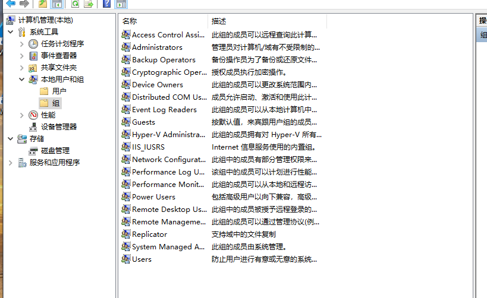
Windows通过“组”来管理权限，而不是直接给每个用户分配权限。内网渗透中常关注的内置组：

- Administrators（管理员组）：拥有对计算机的完全控制权。
- Users（普通用户组）：权限受限，不能修改系统设置或访问受保护的文件。
- Guests（来宾组）：权限极低，通常默认禁用。
- Remote Desktop Users（远程桌面用户组）：允许通过RDP登录。
- Backup Operators（备份操作员组）：渗透重点，该组可以备份/还原系统文件，常被用来读取SAM文件或提取系统权限。

### 本地最高管理员权限 (Administrator)
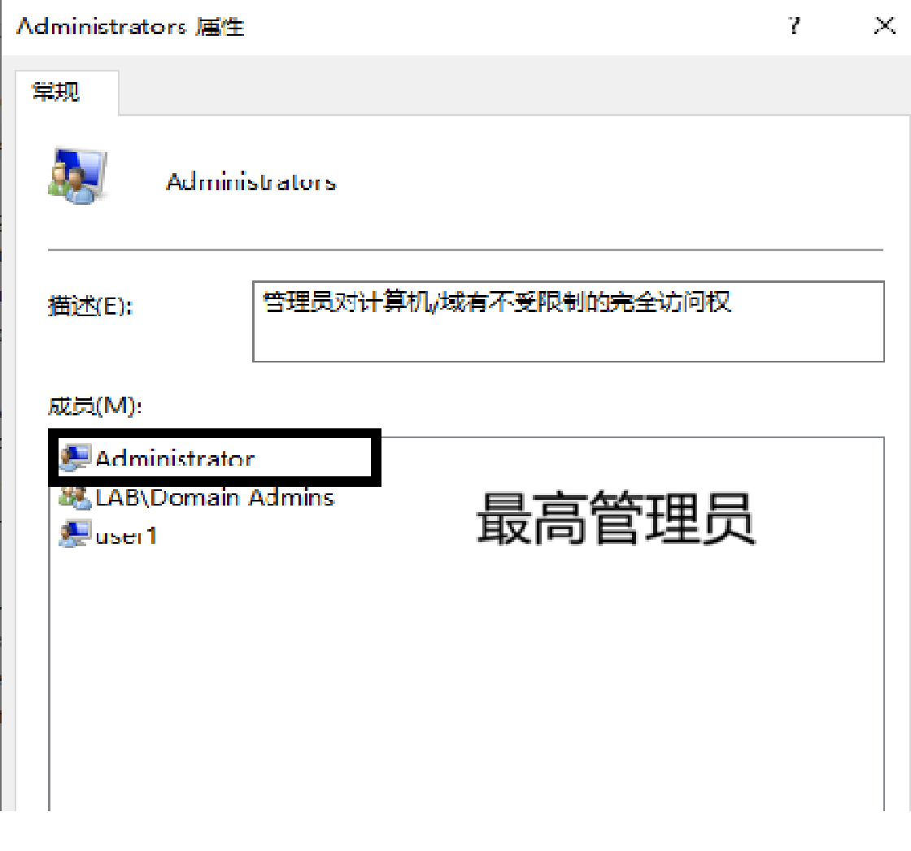
- 本质：这是Windows内置的默认超级管理员账户。
- 渗透意义：“拿到Administrator的密码或Hash就等于拿下了这台机器”。
- 利用方式：在提权后，通常会尝试读取 C:\Windows\System32\config\SAM 和 SYSTEM 文件，或者使用 mimikatz 抓取内存中的NTLM Hash。有了Administrator的Hash，可以通过PtH（Pass-the-Hash，哈希传递）攻击横向移动，或者直接登录目标机器。

### 本地普通管理员权限
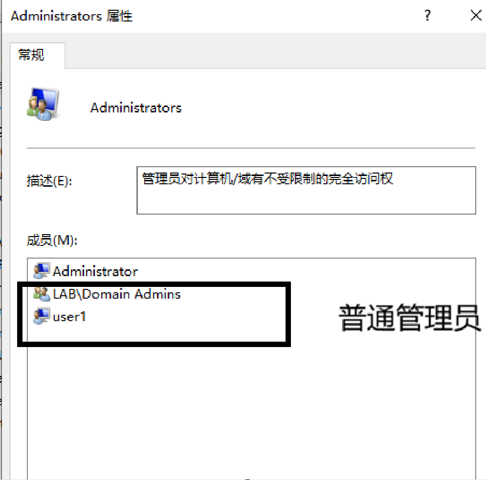

- 本质：属于 Administrators 组，但不是默认的 Administrator 账户。
- UAC的限制：虽然属于管理员组，但在UAC（用户账户控制）开启的情况下，默认是以“标准用户”令牌运行的。
   
- 渗透意义：这是“Bypass UAC（绕过UAC）”的主战场。攻击者通常会利用系统白名单程序（如 fodhelper.exe、eventvwr.exe）或 COM 接口劫持，在不弹窗的情况下将普通管理员权限提升为高完整性级别，从而获得完整的最高权限

### 本地普通用户
- 本质：属于 Users 组，权限受到严格限制。
- 限制：进行高权限操作时会需要认证
  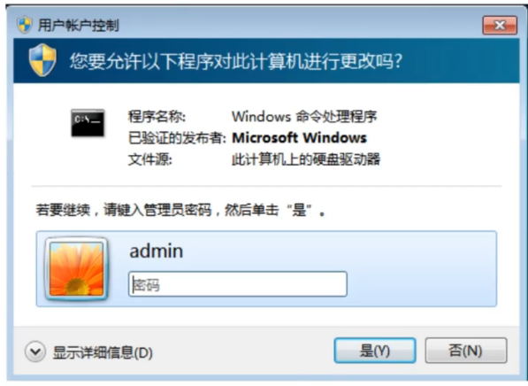
- 渗透意义：这是内网渗透的“初始权限”。如果你只拿到了普通用户，你只能读取自己的文件、查看一些常规系统信息。
- 提权需求：必须通过本地提权漏洞（LPE）（如内核漏洞、服务权限配置错误、计划任务漏洞等）来跨越到管理员组。如果是域环境，普通用户还可以利用域内的错误配置（如GPP密码、委派等）进行域提权。

### UAC认证是什么
- 全称：User Account Control（用户账户控制）。

- 作用：微软在Vista之后引入的安全机制。
  - 即使你是管理员，执行敏感操作（如修改注册表、安装软件）时，也会弹出确认框，或者需要提升令牌。
    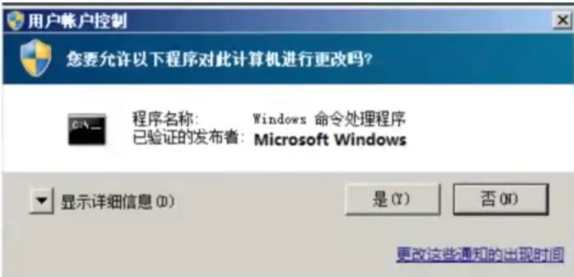

  - 当标准用户尝试执行需要用户管理访问令牌的任务时，会显示凭据提示。
    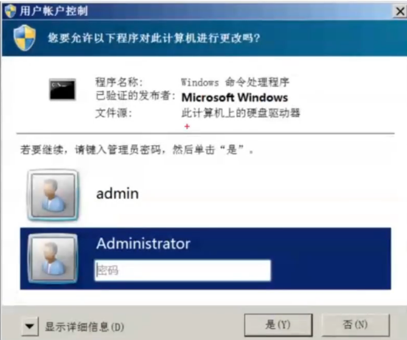

- 渗透中的核心思路：

    - Bypass UAC：利用Windows自带的、带有 auto-elevate 属性的程序，或者利用 COM 组件，绕过弹窗直接提权。
    - UAC 提权：如果无法绕过，攻击者会尝试欺骗用户点击“是”，或者利用 AlwaysInstallElevated 等注册表配置错误强制安装MSI包来提权。

- UAC的触发条件

    - 修改Windows Update配置;
    - 增加或删除用户帐户;
    - 改变用户的帐户类型;
    - 改变UAC设置;
    - 安装ActiveX;
    - 安装或卸载程序;
    - 安装设备驱动程序;
    - 修改和设置家长控制;
    - 增加或修改注册表;
    - 将文件移动或复制到Program Files或是Windows目录;
    - 访问其他用户目录

### 本地系统最高权限 (SYSTEM)
- 本质：这是Windows操作系统中最高级别的权限，比Administrator还要高。它对应的是操作系统内核本身。

- 渗透意义：“SYSTEM是内网渗透的终极目标之一”。

- 特权：

    - 可以访问所有文件，包括系统核心文件。
    - 可以加载内核驱动。
    - 可以调试任何进程（例如直接读取 lsass.exe 内存抓取所有用户密码）。

- 如何获得：通常通过令牌窃取（Token Impersonation）。一旦你有了Administrator权限，就可以利用 Potato 系列（如 JuicyPotato, RoguePotato）或 PrintSpoofer 等工具，将权限从 Administrator 提升为 NT AUTHORITY\SYSTEM。

- Administrator和system权限区别

并不是说System比Administrator权限大，这两个用户的区别是
  - Administrator是系统内置的管理员用户，一般平时安装、运行程序、修改系统设置等都是以这个权限身份运行的
  - System权限是系统本身的权限，比如任务管理器里面的winlogon.exe、svchost.exe、alg.exe这些进程等等，另外，注册表里面某些地方只有系统自己可以访问，Administrator用户也不能访问

## 域内机器权限
### 域内用户组介绍
在域环境中，权限管理不再局限于单机，而是由域控制器（DC）统一管理。
域控上的Administrators组中额外包含Domain Admins（域管理员组）和Enterprise Admins（企业管理员组）
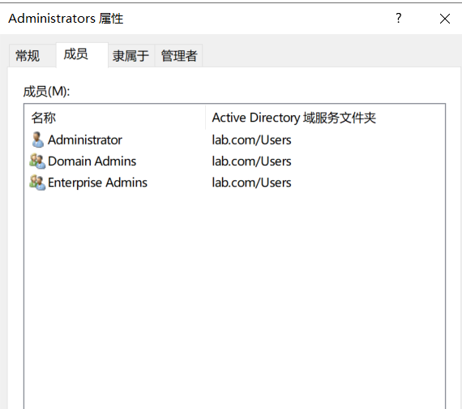

核心的域组包括：
- Domain Admins（域管理员组）：最高权限组。拥有完整的管理员权限。因为该组会被添加到自己所在域的Administrators组中,因此可以继承Administrators组的所有权限。同时该组默认会被添加到每台域成员计算机的本地。该组成员可以登录域内任何一台机器，并拥有所有域控的完全控制权。Administrators组中，这样，Domain admins组就获得了域中所有计算机的所有权。
  - 问题?如果我要添加一个域管理员，是添加到域控Administrators组还是Domain Admins组

    - Domain Admins 组（域管理员组）
      - 定位：这是域级别的最高权限组，存在于 Active Directory（AD）数据库中。
      - 权限范围：拥有管理整个域内所有对象（用户、计算机、组策略等）的权限。
      - 关键机制（自动加入）：当你把某个用户加入 Domain Admins 组时，系统会自动将该用户加入到域内所有计算机（包括域控）的本地 Administrators 组中。
      - 结论：你要添加“域管理员”，选这个。加了它，该用户就自动拥有了域控的本地管理员权限。

    - 域控上的 Administrators 组（本地管理员组
      - 定位：这是本地级别的组。虽然域控没有传统意义上的“本地用户”，但域控也有自己的本地 Administrators 组（存储在域控的本地 SAM 数据库中，或由 AD 管理）。
      - 权限范围：仅拥有对这一台域控服务器的完全控制权，没有管理域内其他成员服务器或工作站的权限。
      - 关键区别：如果你只把用户加到“域控的 Administrators 组”，他只能管理这一台域控，不能去管理域内其他的服务器（除非那台服务器也单独加了他）。
      - 结论：如果你只想让某个人管理这一台域控，不想让他管理整个域，才选这个。

- Enterprise Admins（企业管理员组）：仅存在于域林（Forest）的根域中，该组在域森林中的每个域内都是Administrators组的成员,因此对所有域控制器都有完全访问权

- Domain Users（域用户组）：所有域用户的默认组，权限最低。

- Domain Computers（域计算机组）：所有加入域的计算机账户默认在此组。

- Protected Users（受保护用户组）：微软为了防御 Pass-the-Hash 等攻击引入的组，该组成员无法进行凭据委派，且 NTLM 认证受限。

渗透意义：攻击者拿到权限后，第一步就是 net group "Domain Admins" /domain 查看谁是域管，寻找高价值目标。

>机器加入到域之后可以选择使用域内用户登录，也可以使用本地用户登录，注意以下的区别
- 本地用户登录，是存放在本地文件中然后本机进行校验。域内用户登录，是要通过DC的认证之后才能登录，用户信息存放在域控上
- 本地用户登录主要是对比NTLMHASH值，域认证是通过kerberos认证
- 机器可以选择本地登录或者域用户登录，本地用户机器名\用户名，域内用户域名\用户名

### 域内最高管理员权限
域内最高管理员权限是`域名\administrator`,他没有UAC认证，他也是每个域内机器的本地管理员，和`机器名\administrator`具有相同的权限，SID后缀也是500

**验证：** 使用域成员机器（web01）登录域管账号`lab\Administrator`检查其权限
- sid后缀为500
  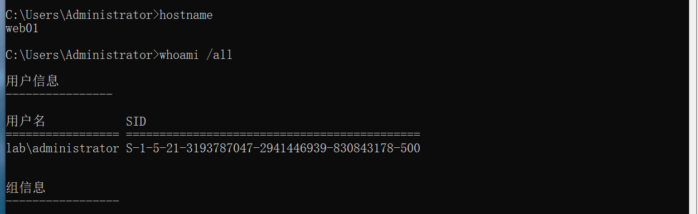

- 执行敏感操作无uac弹窗
  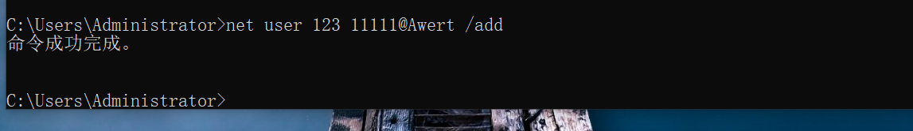

### 域内普通管理员权限
域内普通管理员就是加入了域中的Domain Admins组成员（不包含Administrator），与本地普通管理员权限一样
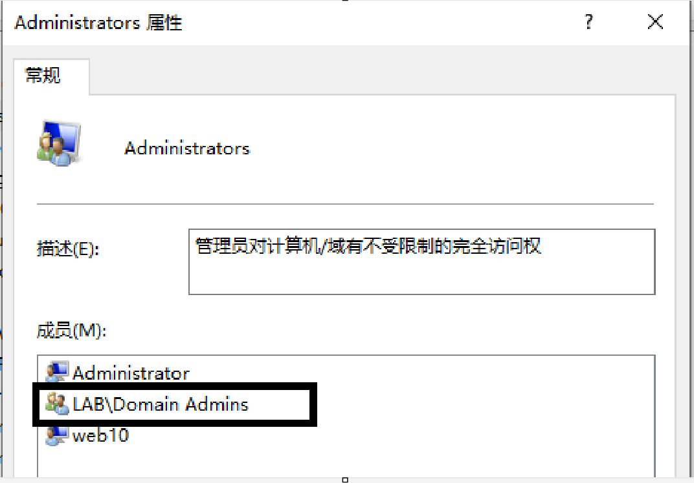

**验证：** 使用域中的Domain Admins组中的成员（李四）登录域成员机器，查看权限
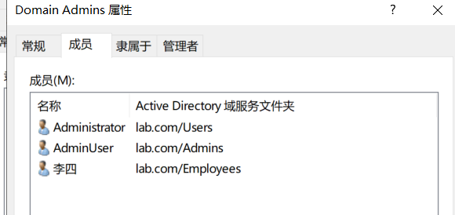

  - sid后缀不为500
    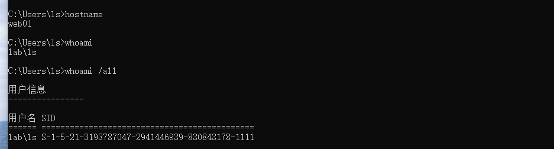
  - 执行敏感操作有uac弹窗   
    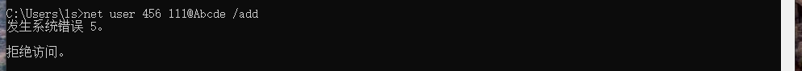 
- 渗透意义：这是横向移动的跳板。

- 利用方式：
  如果某个域用户是内网中 50 台服务器的本地管理员，攻击者控制了该用户，就可以直接通过 PtH（哈希传递） 或 RDP 登录这 50 台机器。

  攻击者可以利用ACL（访问控制列表）配置错误。例如，一个普通域用户对某个域管用户拥有 GenericAll（完全控制）权限，就可以通过修改域管密码来提权。

### 域内普通用户权限
域用户组（Domain users）中是所有的域成员。在默认情况下，任何由我们建立的用户账号都属于Domain Users组，该组在域内机器中存在于Users组
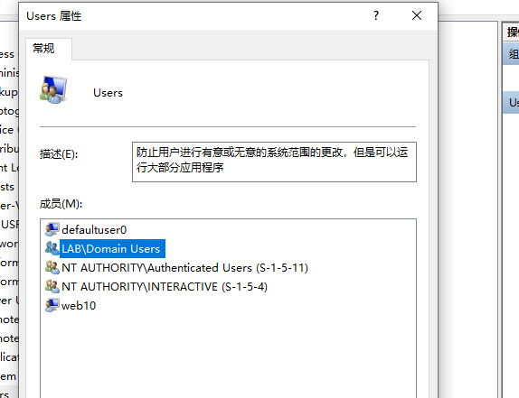
- 本质：最基础的域账户（Domain Users）。
- 渗透意义：这是信息收集的黄金起点。
- 权限利用：

  - 即使是最低权限的域用户，默认也可以查询域内的几乎所有信息（如用户列表、计算机列表、组列表、SPN等）。

  - 攻击面：利用 Kerberoasting 攻击（请求服务票据并离线破解）、AS-REP Roasting 攻击（针对未开启预认证的用户），或者寻找域内配置错误（如 GPP 密码泄露、SYSVOL 共享中的脚本密码）。

  - 一旦破解出密码，就可以尝试密码喷洒（Password Spraying），去尝试登录其他机器。

### 机器用户和 SYSTEM 关系
Domain Computers组，任何由我们建立的计算机账号都属于该组，机器账户是指在网络中用于代表计算机或设备的账户。
在Windows域环境中，每台计算机都有一个机器账户，用于在网络中进行身份验证和授权。

- 机器账户的名称通常以计算机名称或计算机GUID作为前缀，如“ZS-PC$"。
- 机器账户与具体计算机相关联，用于代表计算机进行域认证和访问域资源。
- 机器用户（Machine Account）：当一台电脑加入域时，域控会为它创建一个账户，名称通常是 计算机名$（例如 WIN7$）。这个账户的密码是由系统自动维护的，非常复杂。

SYSTEM 权限：这是本地最高权限。

- 核心关系：

  当电脑加入到域中后机器账号的密码或同步到域控上，所以说本地system用户对应域内的机器用户
  如果说我们渗透的电脑加入了域，但是使用本地用户进行登录，我们就可以提权到system用户，然后对域内进行查询
  虽然"System”账户是本地计算机上的特殊账户，而机器账户是域环境中的账户，但在某些情况下

  例如当本地计算机需要访问域资源时，“System”账户可能会充当机器账户的角色。
  这是因为在域环境中，本地计算机可以使用"System”账户作为其身份进行域认证和访问授权。但需要明确的是，它们仍然是两个不同的概念，
  "System"账户不是专门为域中的机器账户而创建的。

- 本地用户非system权限无法向域控查询域内用户
- system权限的本地用户可以向域控查询域内用户
  **检验：** 
    - 本地用户非system权限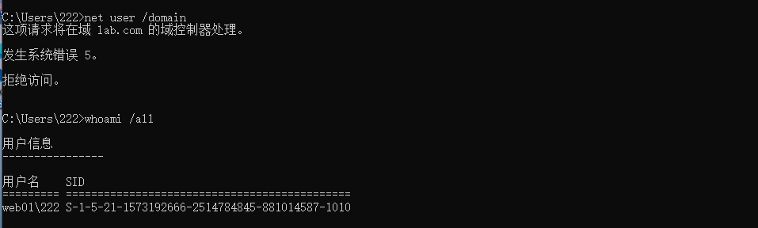
    - 使用incognito窃取令牌提权到system权限后就可以向域控查询域内用户了
    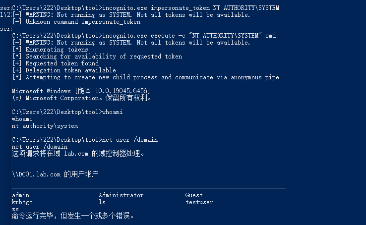

- 经典利用：白银票据（Silver Ticket）。如果你拿到了机器账户的 Hash（在 SYSTEM 权限下可以抓取到），就可以伪造针对特定服务（如 CIFS、LDAP）的票据，访问该机器有权访问的资源，而无需与域控通信。

