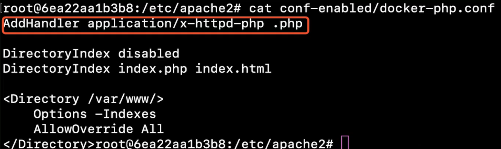

## Apache

### 配置漏洞
**原理：**
```
AddHandler application/x-httpd-php .jpg
```

AddHandler 为相应的文件扩展名指定处理程序

将扩展名为 .jpg 的文件交给 x-httpd-php 程序处理

漏洞利用方法
**方法一：修改Apache配置文件**

修改好Apache配置文件后重启Apache服务即可生效

**方法二：通过.htaccess文件对当前目录下的文件应用配置**

#### 多后缀解析漏洞


- **原理：** Apache 识别文件扩展名是从前往后的，如果遇到了无法识别的扩展名会接着往后识别，遇到的第一个可以识别的扩展名作为该文件的扩展名。

- **实际应用：** Apache 从前往后获取第一个可以识别的扩展名，Web 应用从后往前获取第一个扩展名。将文件的最后一个扩展名设置为 Web 应用程序允许上传的扩展名，将文件的第一个扩展名设置为 Apache 可以识别的脚本类型


#### 换行解析漏洞

**原理**
1. 文件的实际后缀为.php%0A，0A表示换行，意味着一行结束
2. 进行正则匹配的时候，使用的是php$，也就是以.php结尾
3. 所以apache认为.php是文件的扩展名

**解析过程**


**实际利用**

利用该漏洞可以绕过黑名单