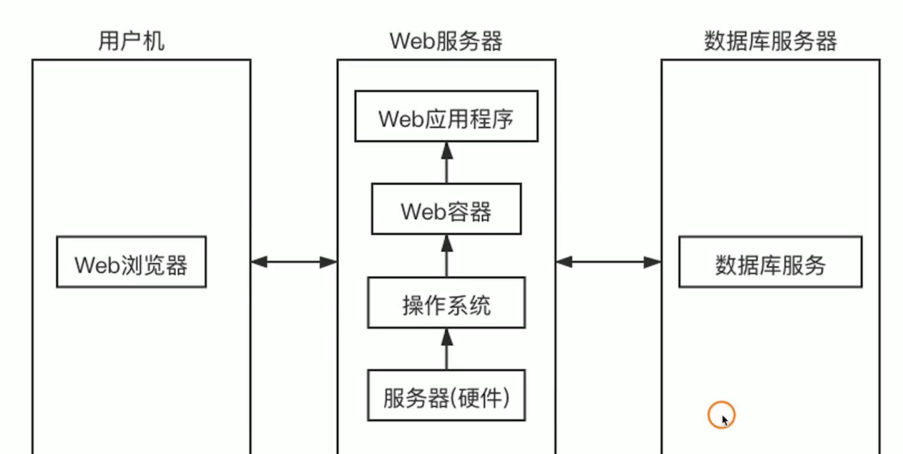
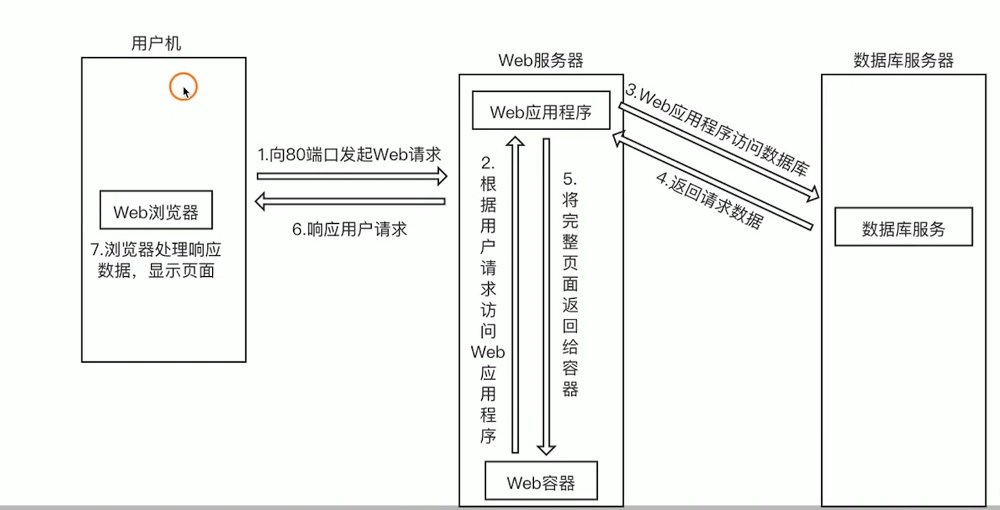

## Web 容器

**Web 服务器：**
提供 Web 服务器的软件或主机，即 Web 服务器软件或者装有 Web 服务器软件的计算机。

**Web 中间件：**
提供系统软件与应用软件之间连接的软件，Web 中间件是提供 Web 应用软件和系统软件连接的软件的总称。

**Web 容器：**
容器是中间件的一种，它给处于其中的应用程序组件提供一个环境，使应用程序直接与容器中的环境变量进行交互而不必关注其他的系统问题。Web 容器用于给处于其中的应用程序组件提供一个环境。

## Web请求与响应处理流程
>“三层架构”（客户端-服务器-数据库）下的一个完整HTTP请求生命周期

**核心角色说明**

- **用户机 (Client)：** 用户使用的设备，里面运行着Web浏览器（如Chrome、Edge）。
- **Web服务器 (Web Server)：** 处理业务逻辑的服务器。其中包含Web应用程序（你的代码逻辑）和Web容器（如Tomcat、Nginx，负责管理Servlet/应用的运行环境）。
- **数据库服务器 (Database Server)：** 专门负责存储和管理数据的服务器，运行着数据库服务（如MySQL、PostgreSQL）

**详细流程解析**

1. 向80端口发起Web请求 (Request)

    **动作**：用户在浏览器中输入网址（或点击链接），浏览器向Web服务器的80端口（HTTP协议默认端口，HTTPS为443）发起一个HTTP请求。

    **例子**：比如请求 http://www.example.com/index.html。

2. 根据用户请求访问Web应用程序

    **动作**：

    - Web服务器接收到请求后，Web容器（如Tomcat）会解析这个请求，并根据URL路径将其转发给对应的Web应用程序（比如后端的Java/Python/PHP代码）。
    - Web应用程序开始执行代码逻辑。如果这个页面需要查询数据（比如用户列表、商品信息），它就会向数据库发起请求。

3. Web应用程序访问数据库

    **动作**：Web应用程序通过数据库驱动（如JDBC）建立与数据库服务器的连接，并发送SQL查询语句。

4. 返回请求数据

    **动作**：数据库服务器执行完查询后，将结果集（原始数据）返回给Web应用程序。

    **结果**：Web应用程序拿到了数据，但它通常不会直接把原始的数据库数据扔给浏览器，而是会进行业务处理（如格式化、计算、封装成JSON或HTML）。

5. 将完整页面返回给容器

    **动作**：Web应用程序将处理好的数据（通常是动态生成的HTML页面，或者JSON数据）交还给Web容器。

    **含义**：此时，Web容器负责将这个响应打包成标准的HTTP响应报文。

6. 响应用户请求 (Response)

    **动作**：Web服务器通过之前建立的连接，将HTTP响应报文发送回用户机。

    **内容**：包含状态码（如200 OK）、响应头和响应体（HTML代码/JSON数据）。

7. 浏览器处理响应数据，显示页面

    **动作**：用户的Web浏览器接收到响应后，开始解析HTML代码。

    **渲染**：浏览器会加载CSS样式、执行JavaScript脚本、请求图片等静态资源，最终将完整的网页渲染在屏幕上，呈现给用户。

## 常用的web服务器

- Apache
- Nginx
- Tomcat
