# 堆基础实验
## 堆程序demo
```
#include <stdio.h>
#include <stdlib.h>
#include <string.h>

int main() {
    printf("=== 堆实验 ===\n");

    // 1. 申请两块 32 字节的内存
    char *a = malloc(32);
    char *b = malloc(32);

    printf("a 的地址: %p\n", a);
    printf("b 的地址: %p\n", b);

    // 2. 写入数据
    strcpy(a, "AAAA");
    strcpy(b, "BBBB");

    printf("\n释放 a 之前:\n");
    printf("a 的内容: %s\n", a);
    printf("b 的内容: %s\n", b);

    // 3. 释放 a
    free(a);

    // 4. 尝试通过 a 读取数据（这是非法的，但为了实验）
    printf("a 被释放后，尝试读取 a 的内容: %s\n", a); 

    // 5. 堆溢出攻击模拟
    memset(a, 'X', 60); // 写入 60 字节的 'X'，超过了 a 原本的 32 字节大小

    // 6. 查看 b 是否受到了影响
    printf("现在 b 的内容: %s\n", b); 
    // 如果 b 的内容变成了 "XXXX..." 说明堆溢出成功覆盖了 b

    return 0;
}
```
**编译成32位**
`gcc -m32 -g -o heap_32 heap.c`
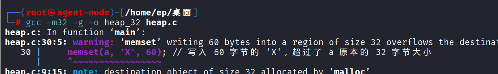

## gdb观察堆的物理结构

**断点打在main处**


**分配堆块并将malloc返回的地址赋值给a指针**


**此时栈上的局部变量*a已经指向刚刚分配的堆块的用户数据起始地址**
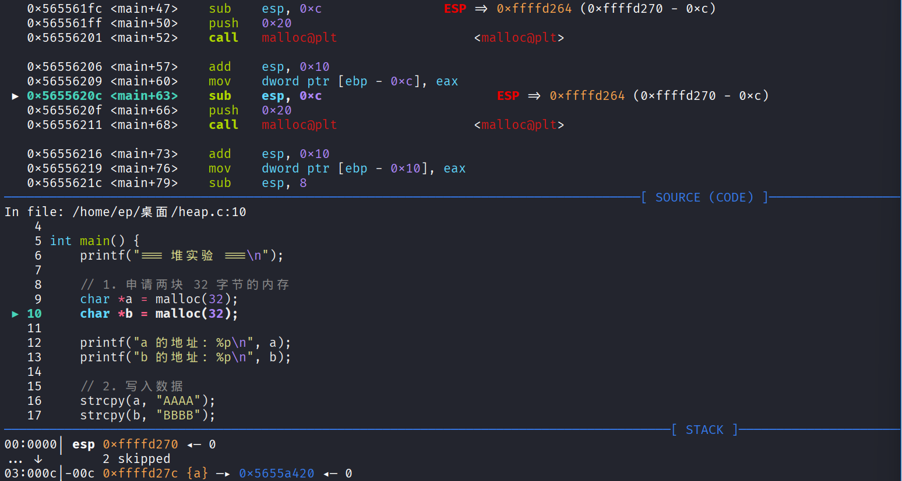

**a堆块的头部数据起始地址**
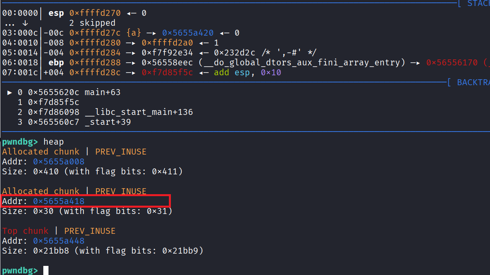

**第二个chunk也分配完成并赋值给指针b**


**此时的bin链表**
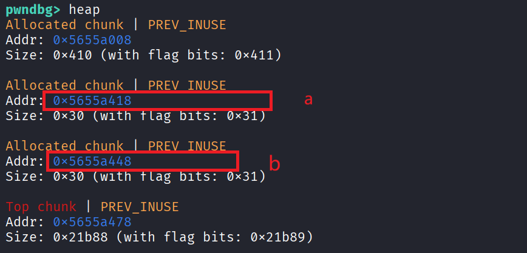

**向a,b中写入数据**


**释放chunk a**
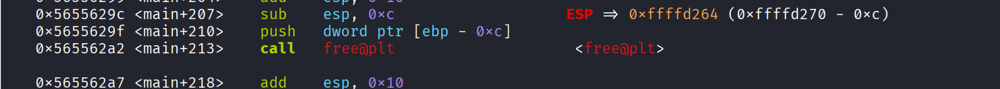

**此时a指向的chunk中的内容已经变了，但a指针仍指向该chunk**


**向a指向的chunk中写入超过该chunk大小的数据**


**由于chunk a和chunk b物理上相距0x30=48字节所以向chunk a写入60字节数据导致溢出的数据覆盖到了b中，可以看到chunk b的头部字段已经被覆盖**


## 溢出程序demo
>如果我们精心构造溢出数据，将chunk b 的fd字段覆盖为指定地址就可以达到劫持fd指针的目的

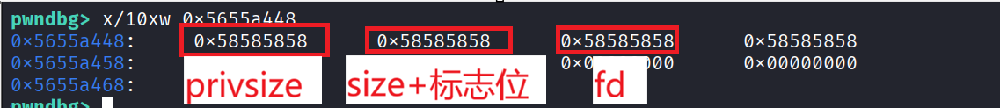


```
#include <stdio.h>
#include <stdlib.h>
#include <string.h>

int main() {
    printf("=== 最简堆溢出 Demo ===\n");

    // 1. 申请两块 32 字节的堆内存
    char *a = malloc(32);
    char *b = malloc(32);

    // 2. 向 a 和 b 写入初始数据
    strcpy(a, "AAAA");
    strcpy(b, "BBBB");

    // 3. 释放 a和b，但不清空指针（UAF漏洞）
    free(a);
    free(b);
    // 4. 通过 a 写入超长数据，覆盖 b 的头部
    printf("[!] 请输入超长字符串（输入超过 40 字节的数据）:\n");

    char input[256];
    fgets(input, sizeof(input), stdin);

    // 去掉换行符
    input[strcspn(input, "\n")] = '\0';

    // 将输入写入已释放的 a，溢出覆盖 b
    strcpy(a, input);

    // 5. 查看 b 的头部（通过指针偏移）
    unsigned int *b_size = (unsigned int *)(b - 4);
    printf("b 的 size 字段 = 0x%08x\n", *b_size);

    // 6. 再次将b分配出去，此时fastbin的fd应该被劫持
    malloc(32);

    // 7. 再次分配chunk程序应该会崩溃
    malloc(32);

    return 0;
}
```

## 动态分析

**此时a，b都释放完毕**
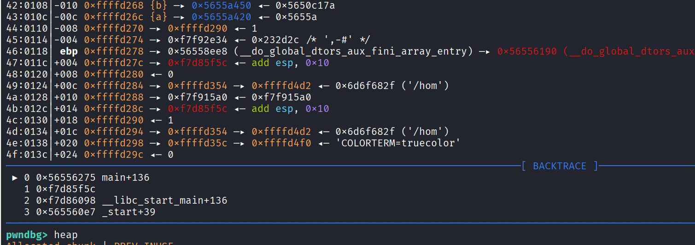

**随意填充60字节**
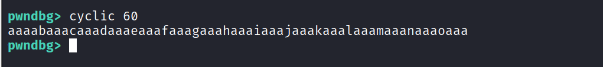
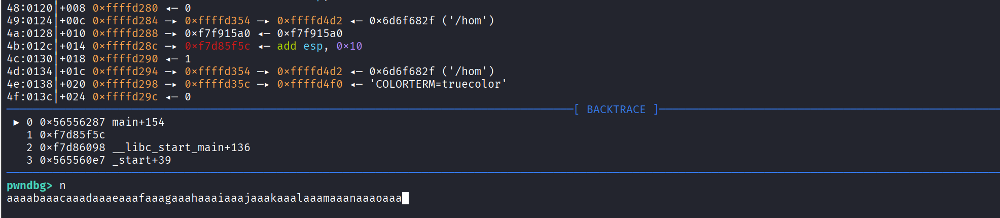

**成功溢出覆盖b**
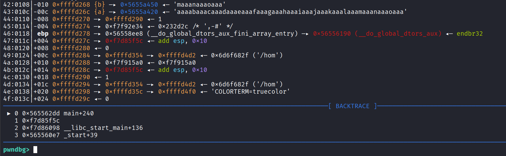

**b的size字段已经被覆盖**
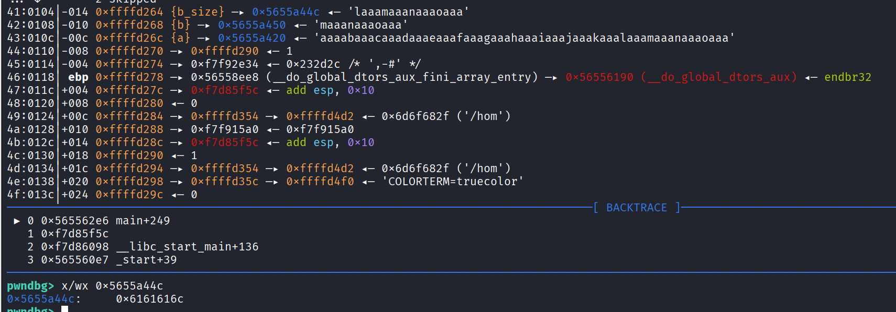

- 地址 0x5655a44c：这就是你之前计算的 b 的 size 字段的地址。

- 值 0x6161616c：这是 4 个 ASCII 字符的十六进制组合

  - 0x6c = ASCII 字符 'l'

  - 0x61 = ASCII 字符 'a'

  - 0x61 = ASCII 字符 'a'

  - 0x61 = ASCII 字符 'a'

- 这正好对应 STACK 面板里 {b_size} 显示的内容 'laaa...' 的前四个字母！

**再次malloc就导致程序崩溃，因为size字段无效**
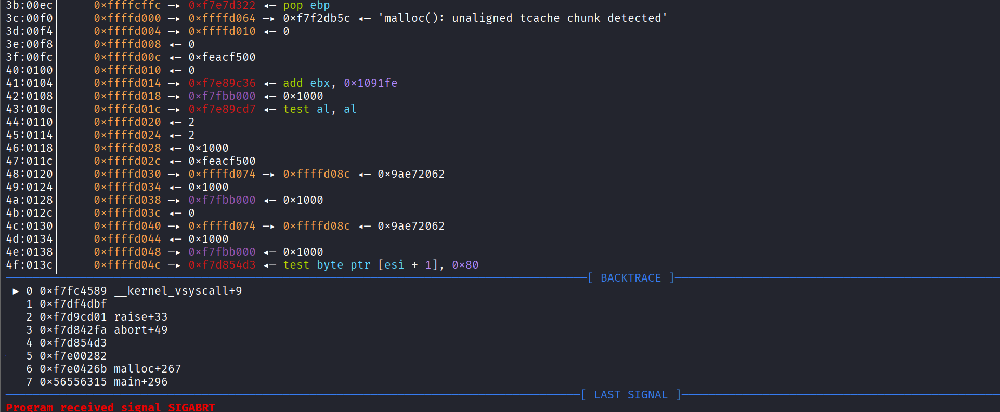
