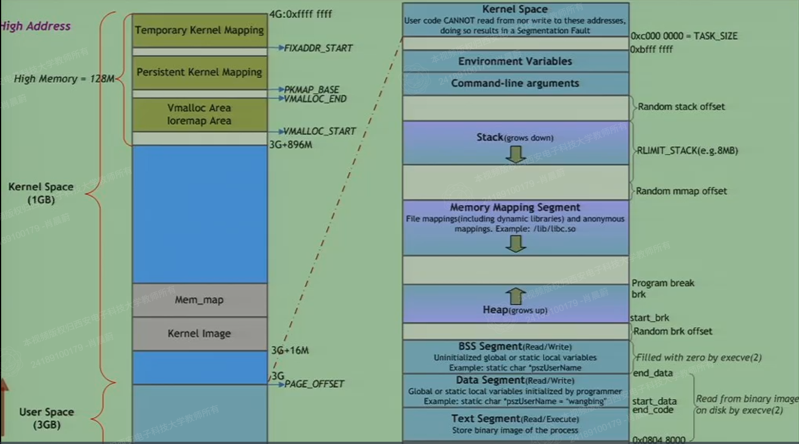
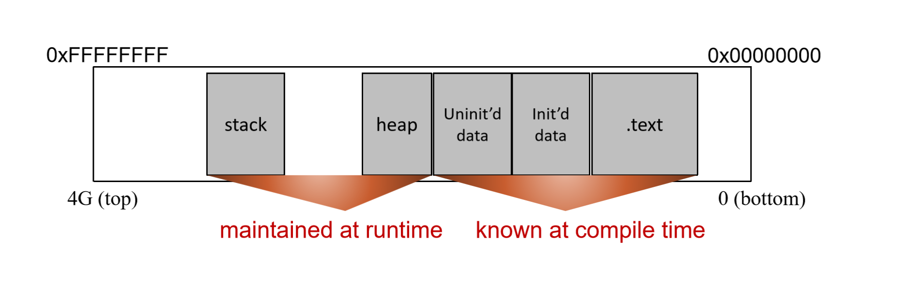
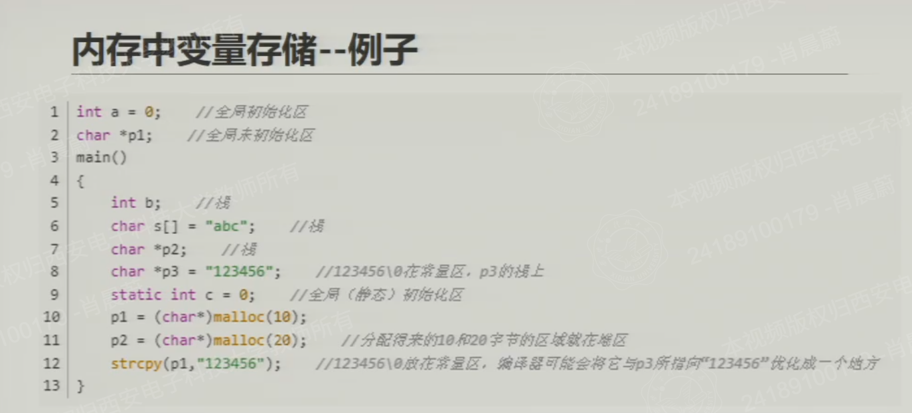
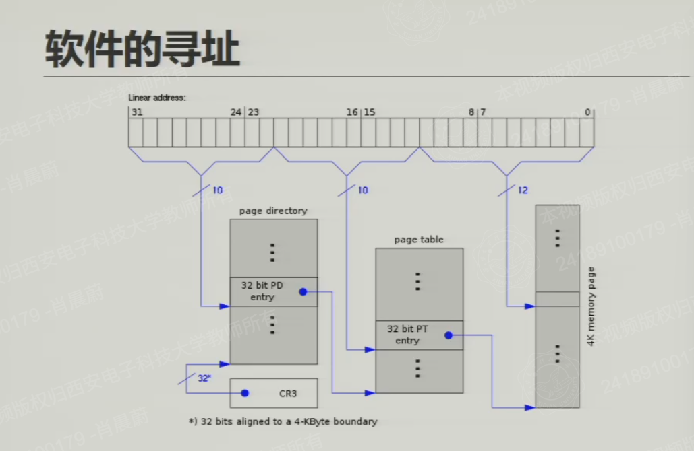
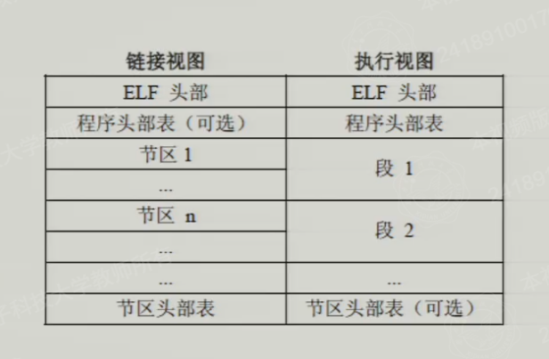

# 计算机存储空间原理
>操作系统层面：以Linux和32位为例
>底层：x86体系结构为例

## 典型操作系统的内存布局

**进程 —— 软件在操作系统中的基本形态**

- 具有独立的地址空间
- 掌握着软件执行时所需要的所有资源（或资源的位置）

**32位操作系统的地址空间：最大4GB（2的32次方）**

- 用户空间——0-3GB
- 内核空间——3-4GB（独立于所有进程的用户空间）


**32位 Linux 操作系统下的虚拟内存布局（Virtual Memory Layout）**



- User Space (用户空间，3GB)：

  - 范围：0x00000000 到 0xBFFFFFFF（图中标识为 3G，即 PAGE_OFFSET）。
  - 这是普通应用程序（进程）运行的地方。每个进程都有自己独立的 3GB 用户空间，互相隔离。

- Kernel Space (内核空间，1GB)：

  - 范围：0xC0000000 到 0xFFFFFFFF。
  - 这是操作系统内核运行的地方。所有进程共享这 1GB 的内核空间。


- 图中标注了内核空间内部的细分：
  
  - Kernel Image & Mem_map: 从 3G+16M 开始，存放内核代码和物理内存映射表。
  - Vmalloc Area / Ioremap Area: 用于内核动态分配内存和映射硬件 I/O 空间。
  - Persistent Kernel Mapping: 持久内核映射区。
  - Temporary Kernel Mapping: 临时内核映射区（如 kmap），范围从 FIXADDR_START 到 4G。图中标注 High Memory = 128M，这是32位系统为了解决无法直接映射所有物理内存而引入的“高端内存”概念。

- 用户空间详细布局 (User Space Detailed Layout)，从低地址（底部）到高地址（顶部），依次是：

  1. Text Segment (代码段)：

     - 权限： 只读/可执行 (Read/Execute)。
     - 内容： 存放程序编译后的机器指令（二进制镜像）。
     - 来源： 从磁盘上的可执行文件中加载。
     - 在 Linux 中，默认起始地址通常是 0x08048000。

  2. Data Segment (数据段)：

     - 权限： 可读/可写 (Read/Write)。
     - 内容： 存放已初始化的全局变量和静态局部变量。
     - 例子： static char *pszUserName = "wangbing";
     - 来源： 从磁盘上的可执行文件中加载。

  3. BSS Segment (BSS段)：

     - 权限： 可读/可写 (Read/Write)。
     - 内容： 存放未初始化的全局变量和静态局部变量。
     - 例子： static char *pszUserName;
     - 特点： 为了减小可执行文件体积，BSS段在磁盘文件中不占用实际空间，加载到内存时由系统（execve）自动全部清零（Filled with zero by execve(2)）。
     - 注：Data 和 BSS 段之间通常紧挨着，图中有 end_data 和 start_data 等边界标记。

  4. Heap (堆)：

     - 权限： 可读/可写。
     - 方向： 向上增长 (grows up)（向高地址方向）。
     - 内容： 用于程序运行时动态分配的内存。
     - 相关系统调用： 通过 malloc() / free() 申请和释放，底层通过 brk() 系统调用移动 program break 指针来扩展或收缩堆的大小。

  5. Memory Mapping Segment (内存映射段 / 文件映射与匿名映射区)：

     - 权限： 视具体映射而定（通常是可读/可写/可执行）。
     - 内容：
  
       - 文件映射： 将磁盘文件直接映射到内存，例如动态链接库（如 /lib/libc.so）。
       - 匿名映射： 不关联具体文件的内存，常用于大块内存分配（如 malloc 超过一定阈值时底层会调用 mmap）或进程间通信（共享内存）。

     - 相关系统调用： mmap()。
     - 随机偏移： 图中标注了 Random mmap offset，这是 ASLR（地址空间布局随机化）安全机制的一部分。

  6. Stack (栈)：

     - 权限： 可读/可写。
     - 方向： 向下增长 (grows down)（向低地址方向）。
     - 内容： 存放函数的局部变量、函数参数、返回地址等。函数的调用和返回对应着栈帧的压入和弹出。
     - 大小限制： 图中标注了 RLIMIT_STACK(e.g.8MB)，默认情况下栈的大小是有限制的（通常是 8MB），如果递归太深会导致栈溢出（Stack Overflow）。
     - 随机偏移： 同样有 Random stack offset 用于安全防护。

  7. 最高地址处 (顶部)：

     - Command-line arguments (命令行参数)： 如 main(int argc, char** argv) 接收的参数。
     - Environment Variables (环境变量)： 如 PATH, HOME 等。
     - 栈的顶部紧挨着这些参数和环境变量。



**分段的意义**

1. 缓存命中率高 (High Cache Hit Rate)
   - 局部性原理 (Principle of Locality)： 程序在执行时具有空间局部性和时间局部性。比如，代码段中的指令往往是顺序执行的，数据段中的变量也往往会被频繁访问。

   - 分离的好处： 如果不分段，代码和数据混杂在一起，CPU 的缓存（L1/L2 Cache）可能会把正在执行的指令旁边的无用数据也加载进来，导致缓存污染，降低命中率。通过分段，将频繁访问的指令（代码段）和频繁访问的数据（数据段）在物理或逻辑上分离开来，可以让缓存更有效地缓存当前需要的部分。

   - 共享与隔离： 多个进程可以共享同一个代码段（例如多个进程运行同一个程序，如 bash）。如果代码段是只读的，并且被缓存，那么其他运行相同程序的进程可以直接从缓存中读取，极大地提高了缓存利用率。

2. 访问控制 (Access Control)
   
   - 这是分段在现代操作系统中最核心的安全意义。不同的段有不同的读写执行权限，这从硬件层面防止了程序破坏自身或其他程序的数据。

     - 代码段 (Text Segment)： 权限是 只读、可执行 (Read/Execute)。程序只能读取并执行里面的指令，不能修改。这防止了程序在运行中意外或恶意地篡改自己的指令。
     - 数据段 (Data Segment) 和 BSS 段： 权限是 可读、可写 (Read/Write)，但通常不可执行。这存放的是全局变量。如果黑客通过缓冲区溢出将恶意代码写入数据段，CPU 会因为该段没有“可执行”权限而拒绝执行，从而触发段错误（Segmentation Fault），阻止攻击。
     - 栈 (Stack) 和 堆 (Heap)： 同样是可读可写的，通常不可执行（现代系统有 NX 位保护）。
     - 内核空间 (Kernel Space)： 用户程序完全无权访问。如果用户程序试图访问 0xC0000000 以上的地址，硬件会直接拦截并报错。

**ASLR (地址空间布局随机化)**

- Random stack offset：栈底不是固定的，每次运行都会随机偏移。
- Random mmap offset：内存映射区的基址是随机的。
- Random brk offset：堆的起始地址（start_brk）也是随机的。

这是现代操作系统重要的安全机制，防止黑客利用固定地址进行攻击。

## 内存中变量存储的例子



1. **全局变量与静态变量（位于低地址：数据段 / BSS 段）**
   这些变量在程序启动时就已经分配好了内存，直到程序结束才释放。

   - 第 1 行：int a = 0; // 全局初始化区

      - 解析： 这是一个全局变量，并且赋了初值 0。它会被存放在 .data 段（数据段）。

   - 第 2 行：char *p1; // 全局未初始化区

      - 解析： 这是一个全局变量，但没有赋初值。它会被存放在 .bss 段（BSS 段）。操作系统在加载程序时，会自动把 BSS 段全部清零，所以 p1 初始值是 NULL。

   - 第 9 行：static int c = 0; // 全局（静态）初始化区

      - 解析： static 关键字把 c 变成了静态局部变量。虽然它写在 main 函数里面，但它的生命周期和全局变量一样长，也存放在 .data 段（数据段），而不是栈上。

2. 函数内部的局部变量（位于高地址：栈）
   main 函数开始执行时，系统会在栈（Stack）上为它开辟一块栈帧（Stack Frame），用来存放函数内的局部自动变量。栈是向下增长的。

   - 第 5 行：int b; // 栈

      - 解析： 普通的局部变量，在栈上分配。

   - 第 6 行：`char s[] = "abc"; // 栈

      - 解析： s 是一个数组。数组名 s 代表数组首地址，它在栈上分配了 4 个字节的空间（'a', 'b', 'c', '\0'），并把这四个字符拷贝到栈里。所以字符串内容在栈上。

   - 第 7 行：`char p2; // 栈

      - 解析： 这是一个普通的局部指针变量。指针变量 p2 本身存放在栈上。

   - 第 8 行：`char p3 = "123456"; // p3在栈上，123456\0在常量区

      - 解析：指针变量 p3 本身是在栈上分配的（占 4 字节）。但是，字符串 "123456\0" 作为一个字符串字面量，它被存储在 .rodata 段（只读数据段 / 常量区），*p3指向"123456\0"在 .rodata 段上的位置
      - 这行代码的意思是：把常量区 "123456\0" 的首地址赋值给栈上的指针变量 p3。也就是说，p3 指向了常量区。

3. 动态分配的内存（位于中间：堆）

   - 第 10 行：p1 = (char*)malloc(10);
     
     - 解析： malloc 函数在堆（Heap）上申请了 10 个字节的内存。堆是向上增长的。这 10 个字节的地址被赋给了全局指针 p1。

   - 第 11 行：p2 = (char*)malloc(20);

     - 解析： 同理，在堆上申请了 20 个字节，地址赋给了栈上的指针 p2。

4. 字符串拷贝与编译器优化（第 12 行）
   
   - 第 12 行：strcpy(p1, "123456");

     - 解析： 这行代码把常量区里的字符串 "123456"，拷贝到了 p1 指向的堆内存中。

     - “编译器可能会将它与p3所指的‘123456’优化成一个地方”
  
       - 解释： 在代码里，第 8 行和第 12 行都写了 "123456"。为了节省空间，现代编译器（如 GCC）通常会把这两个完全相同的字符串字面量合并。也就是说，常量区里只存一份 "123456\0"，p3 指向它，strcpy 也从它那里拷贝。


## 软件的加载

**操作系统创建进程的步骤**

通常发生在 fork() 创建子进程或者 execve() 加载并执行一个新程序时

1. 创建虚拟内存空间来容纳一个进程
   含义： 当操作系统决定运行一个程序时，它首先需要为该程序“圈地”。在 32 位系统中，就是分配那 3GB 的用户虚拟地址空间（0x00000000 到 0xBFFFFFFF）。

   底层机制： 操作系统会为该进程创建一个页表（Page Table）和内存描述符（Linux 中是 mm_struct）。此时，只是建立了虚拟地址的“管辖范围”，物理内存并没有马上全部分配。这是虚拟内存的核心——延迟分配（Lazy Allocation）。只有等到程序真正读写某块内存时，才会触发缺页异常（Page Fault），操作系统才会分配实际的物理内存页。

   意义： 让每个进程都认为自己独占整个内存，实现了进程间的地址空间隔离。

2. 建立虚拟内存地址与可执行文件的映射关系表（根据文件头）
   含义： 程序在磁盘上是一个可执行文件（如 Linux 下的 ELF 文件）。操作系统需要读取这个文件的文件头（File Header），从中解析出代码段（.text）、数据段（.data）等信息。

   底层机制： 这一步不会把整个文件读取到物理内存中，而是建立内存映射（Memory Mapping）。操作系统会设置页表，将虚拟地址空间中的代码段、数据段映射到磁盘上可执行文件的对应位置。

   延迟加载（Demand Paging）： 只有当 CPU 真正去执行某条指令时，如果发现该指令对应的虚拟内存页还没有加载到物理内存，就会触发缺页中断，操作系统再去磁盘把那一页读进内存。

   意义： 极大节省了物理内存，加快了程序启动速度。多个进程如果运行同一个程序（比如打开多个终端），它们的代码段可以共享同一块物理内存。

3. 初始化栈空间、堆空间
   含义： 映射好代码和数据后，还需要为程序运行时的动态部分做准备。

   初始化栈（Stack）：

      操作系统会在虚拟内存的高地址区域（靠近 3GB 边界下方）分配栈空间。

      关键动作： 将命令行参数（argv）和环境变量（envp）压入栈中。同时，设置好栈指针寄存器（如 x86 的 ESP/RSP），让程序启动后能立即找到这些参数。

      这里也会应用 Random stack offset（随机栈偏移），以增强安全性（ASLR）

   初始化堆（Heap）：

      在数据段（BSS）的上方预留堆的起始地址。此时通常不会分配实际的物理内存，只是设置好 start_brk 指针。

      当程序调用 malloc() 时，堆才会向上增长（grows up）。

**虚拟地址空间看上去并不够用，如何解决**

1. “copy on write” (写时复制)

   场景： 当使用 fork() 系统调用创建子进程时，操作系统不会立刻把父进程的所有物理内存复制一份给子进程。

   机制： 操作系统让父进程和子进程共享同一份物理内存页，并将这些页标记为只读。此时，父子进程的虚拟地址不同，但映射到同一块物理内存。

   触发复制： 当父进程或子进程试图修改（写入）这些共享的内存页时，CPU 会触发一个保护异常（缺页中断的一种）。此时，操作系统才会真正分配一块新的物理内存，把原数据复制过去，然后让修改的一方指向新的内存。

   好处： 极大地节省了物理内存，并且让 fork() 操作变得极其快速（因为不需要立刻复制大量数据）。只有当真正发生写入时，才进行复制。

2. 多级页表查询 + 缺页中断
   - 多级页表查询（Multi-level Page Tables）：

      在 32 位系统中，如果将 4GB 空间按 4KB 分页，需要 
      2的20次方个页表项。如果只用单级页表，这个页表本身就占 4MB 内存。如果每个进程都分配 4MB 页表，100 个进程就吃掉 400MB 物理内存，这太浪费了。

      解决： 采用多级页表（如两级或三级）。只有真正用到的虚拟地址区域，才会分配对应的页表项。大部分虚拟地址空间是空的，对应的页表项就不存在，从而极大地节省了页表本身占用的内存。

   - 缺页中断（Page Fault）：

      这是虚拟内存得以实现的基石。

      当程序访问一个虚拟地址时，硬件（MMU）会去查页表。如果发现该页不在物理内存中（或者没有权限），就会触发一个缺页中断。

      操作系统接管中断，负责把缺失的页面从磁盘（交换分区或可执行文件）加载到物理内存中，然后更新页表，让程序继续执行。

      结合上述的“延迟加载”：程序启动时，代码和数据并没有全部加载进内存，只有真正执行到某一行代码时，如果它不在内存，才会触发缺页中断把它加载进来。

## 软件的寻址



1. 虚拟地址是“假”的：程序里用的地址（如 0x0804A000）只是虚拟坐标，CPU 真正去内存条拿数据用的是物理地址。

2. 为了省内存：如果用“单级页表”，为了映射 4GB 空间，必须强制分配一个 4MB 的大数组，极度浪费。所以采用“二级页表”按需分配。

**完整寻址过程**

- 起点：CPU 从 CR3 寄存器里拿到页目录（总目录）的物理基址。

- 第一步：用虚拟地址的前 10 位，在页目录里找到对应的页目录项 (PD entry)。这个条目里存的是页表（分目录）的物理基址。

- 第二步：用虚拟地址的中间 10 位，在这个页表里找到对应的页表项 (PT entry)。这个条目里存的是物理内存页的物理基址。

- 终点：用虚拟地址的最后 12 位（页内偏移量），加上刚拿到的物理页基址，得到最终物理地址。

```
虚拟地址 (32位)   CR3中存放的页目录基址
      │                  |
      |                页目录
      |                  +
      ├── 前10位 ──>   偏移地址   ——> 页表基址
      │                                 +
      ├── 中10位    ──────────────>   偏移地址  ──>  物理页基址
      │                                                 +
      └── 后12位      ───────────────────────>      偏移地址   ──>   数据真实物理地址
```

**核心**

- 地址切分：10位 + 10位 + 12位 = 32位。（寻址空间依然是 4GB，没有变大！）

- 页目录和页表都是 4KB

- 省内存的灵魂：“总目录必须有，页表按需再建。用到哪就建哪，不用全都不管。”

  - 每个进程必须有一个 4KB 的总目录。

  - 如果只用到 2 个区，就只建 2 个 4KB 的页表，总共占 12KB，而不是单级页表的 4MB

## 可执行文件

**问题：共享代码**

   - 不同的软件可能会使用同样的代码模块
   - 软件往往需要用到操作系统提供的执行功能

**解决方案：可链接的可执行文件**

   - 将重复利用率很高的代码模块构造成共享库
     -  工程师们把那些大家都用得上的通用代码（比如 printf、网络通信、图形界面）提前写好、编译好，打包成一个个独立的文件。
     -  在 Windows 里这叫 .dll 文件
     -  在 Linux 里这叫 .so（Shared Object）文件（比如最常见的 libc.so）
   - 软件通过与共享库链接使用这些代码
     -  比如：程序员在写 QQ 的时候，不需要把 printf 的代码抄一遍。只需要在代码里写一句“我要用共享库里的 printf”。在编译或运行时，操作系统会把 QQ 和共享库“链接”在一起。
  -  共享库放在内存的Memory Mapping Segment（内存映射段）
     -  当程序启动，加载 .so 或 .dll 文件时，操作系统就是通过 mmap（内存映射） 技术，把这些共享库的文件直接映射到进程的内存映射段里的。
  -  多级页表如何实现“物理内存共享”
     - 假设你的电脑同时运行了 QQ 和微信，它们都需要用到标准的 C 语言库（libc.so）。
     - 物理内存中： 只有一份 libc.so 的代码。
     - 虚拟内存中： QQ 和微信有各自的页目录和页表。操作系统通过修改它们各自的页表项 (PT entry)，让它们指向物理内存中同一块 libc.so 的物理页。
     - 结果： 无论 QQ 和微信眼里 libc.so 的虚拟地址是否相同（通常由于 ASLR 它们甚至可能不同），只要顺着各自的多级页表查下去，最终拿到的是同一个物理内存地址。
     - 这就实现了物理内存的高效复用。

**可用于代码共享的常见可执行格式**

  - Executable & Linkable Format (ELF) —— Linux 系统
    - 这是 Linux（以及很多类 Unix 系统）下的标准格式。不仅普通的可执行程序（比如 /bin/ls）是 ELF 格式，前面提到的共享库（.so 文件）、甚至编译过程中的目标文件（.o 文件）也是 ELF 格式。

  - Portable Executable (PE) —— Windows 系列
    - 这是 Windows 系统下的标准格式。常见的 .exe（可执行文件）和 .dll（动态链接库）都是 PE 格式。它的设计参考了早期的格式，但名字里带个 "Portable"（可移植）是因为它最初是为了支持多种 CPU 架构（如 x86、ARM）而设计的。

  - **注**：虽然名字不同，但它们在底层设计思想上是非常相似的，都包含了文件头、代码段、数据段、重定位表等信息。

**特点**

  - 承担多个角色（程序本身，多种类型的共享库）
    - 同一个文件格式（比如 ELF），既可以是一个可以直接运行的主程序（比如你写的 main.c 编译出来的程序），也可以是一个共享库（供别的程序调用，比如 libc.so）。
    - 区别在 ELF 的文件头（Header）里有一个字段叫 e_type。
      - 如果是 ET_EXEC，说明这是一个“可执行程序”，入口点明确，可以直接运行。
      - 如果是 ET_DYN，说明这是一个“共享对象”（动态库），它本身不能直接运行，必须被其他程序加载。
    
    - 意义： 这种设计非常灵活。程序员可以用同一种工具链（编译器、链接器）来生成程序或库，操作系统也能用同一套逻辑来加载它们。

  - 地址空间可以被重定位（relocation）

    - 为什么需要重定位
      - 假设在写程序时调用了一个共享库里的函数 printf。但在编译时，并不知道操作系统会把这个共享库加载到虚拟内存的哪个具体地址（因为前面说过，为了安全，内存映射区的基址是带随机偏移的——ASLR）。
      - 如果代码里写死了“跳到 0x400000 执行 printf”，但操作系统实际把库加载到了 0x800000，程序就会崩溃。

    - 什么是重定位
      - 可执行文件里包含了一张“重定位表”（Relocation Table）。
      - 当操作系统加载这个程序（或共享库）到内存时，会读取这张表。它告诉操作系统：“嘿，我在代码里写了个占位符，等你真正把我放进内存时，根据我实际所在的地址，帮我把代码里所有调用外部函数的地方，都改成正确的物理地址或虚拟地址。”
      - 这也就是为什么我们在讲 Memory Mapping Segment 时，说动态库是通过 mmap 映射进来的。因为用了 mmap 和多级页表，每个进程都可以认为自己的共享库放在了固定的位置（比如都用 0x400000），然后通过各自不同的页表，映射到物理内存中同一份共享库。这就是“重定位”配合“多级页表”实现的



一个程序从源代码变成能在内存里跑的进程，要经历两个阶段：

**链接阶段（编译时）**： 编译器把你的代码变成 .o 文件，链接器把这些 .o 文件和库拼装成一个可执行文件。这个阶段关心的是代码和数据的分类。

**执行阶段（运行时）**： 操作系统加载器把这个可执行文件读取到内存中，准备运行。这个阶段关心的是权限（哪里可读、哪里可执行）和加载位置。

为了同时满足这两个阶段的需求，ELF 文件在内部巧妙地安排了数据。链接视图和执行视图其实就是从文件的不同位置、用不同的“地图”去解读同一堆数据。

  - 链接视图（Linking View）—— 按“节（Section）”划分
    - 这是给链接器（Linker）看的，主要存在于磁盘上的文件中。
    - ELF 头部（必备）： 文件的身份证，记录了这个文件是 32 位还是 64 位、是哪种 CPU 架构、程序的入口地址在哪等基本信息。
    - 程序头部表（可选）： 在链接视图里它是可选（通常会有，但主要是为了执行视图准备的）。
    - 节区 1 到 节区 n（Sections）： 这是链接视图的核心。它把文件切成了很多细碎的“节”。比如：
      - .text（代码节）
      - .data（已初始化数据节）
      - .bss（未初始化数据节）
      - .symtab（符号表，记录函数名和变量名）
      - .rel.text（重定位表，用来记录哪里需要在运行时修改地址）
      - 链接器就是根据这些“节”来合并代码、解决函数调用的。
    - 节区头部表（Section Header Table，必备）： 这是一份目录，告诉链接器：“你去找 .text 节，它在文件的第 100 个字节开始，长度是多少”。没有它，链接器就找不到各个节。
    - 

  - 执行视图（Execution View）—— 按“段（Segment）”划分
    - 这是给操作系统加载器（Loader）看的，主要体现在程序运行时的内存中。
    - ELF 头部（必备）： 同样存在。
    - 程序头部表（必备）： 这是执行视图的核心。它告诉操作系统加载器：“磁盘上的哪些数据应该被映射到内存的哪个虚拟地址，并且赋予什么权限（可读/可写/可执行）”。
    - 段 1、段 2（Segments）： 这是执行视图的核心单位。
      - 一个“段”通常包含了好几个“节”。
      - 例如，代码段（Code Segment） 可能包含了 .text 节和 .rodata（只读数据）节，因为在内存里它们都具有“只读、可执行”的权限，可以合并在一起加载。
      - 数据段（Data Segment） 可能包含了 .data 节和 .bss 节，因为它们都需要“可读、可写”权限。
    - 节区头部表（可选）： 在程序运行时，加载器主要靠“程序头部表”工作。但节区头部表有时也会留在内存里，方便程序在运行时进行动态链接（比如查找函数符号）。
  
  - ELF中与共享代码链接有关的重要section
    - 符号表
    - 字符串表
    - 重定位表
    - 程序头部

## rowhammer攻击

1. 攻击原理：
   由于内存颗粒制造得越来越小，cell 之间的距离越来越近。如果在极短的时间内，极其频繁地（比如每秒几十万次）去读取某一行内存（比如 Row 1），这个高频的电流开关动作，会产生电磁干扰，导致相邻的行（比如 Row 0 和 Row 2）里的电容发生漏电。

   就像在一堵薄墙的一边疯狂敲锤子（Rowhammer 名字的由来），墙另一边的画（相邻行的数据）可能会被震掉下来。

2. 导致的结果：

   相邻行里的某个 bit，原本是 1，因为受到干扰漏电，变成了 0。

   这叫做位翻转（Bit Flip）。

   最可怕的是，这种翻转是硬件层面的，不需要任何软件漏洞，也不需要程序有 Bug，纯粹是物理攻击。

3. 攻击者的利用方式（提权）：
   黑客会写一个恶意程序，在内存里精确定位到某个关键区域（比如操作系统的页表，或者某个程序的权限校验位），然后不断锤击它相邻的行。

   如果黑客能让页表里的某个物理地址指向内核空间，他就能读写内核数据。

   如果黑客能翻转一个进程的 UID（用户ID）里的某个 bit，把自己的普通用户权限（比如 UID=1000）翻转为管理员权限（比如 UID=0，即 root），他就成功攻破了系统。

4. 防御措施
   因为 Rowhammer 是硬件物理缺陷，软件很难完全防御，目前主要有几种应对方式：

      - 硬件层面： 内存厂商引入 ECC（纠错内存），能发现并纠正单比特翻转。或者在内存颗粒内部加入逻辑，检测到频繁访问某一行时，主动去刷新相邻行（如 DDR4 的 TRR 技术）。

      - 软件层面： 操作系统内核修改内存分配策略，避免把关键数据（如页表）放在容易被攻击的物理行附近。

## Kartograph（地图透视）

1. 核心原理（为什么外挂能透视？）

   游戏的妥协（为了流畅）： 现代网络游戏（比如 FPS 射击游戏或 MOBA 游戏）为了保证你玩游戏时不卡顿，通常会“预加载”地图里的所有信息。也就是说，哪怕敌人躲在墙后面你看不见，游戏客户端为了保证他一旦露头就能立刻显示，其实早就把他的坐标、血量、装备等数据下载到了你的电脑内存里。

   外挂的窃取： 作弊程序就像一个“小偷”，它潜入你电脑的内存里，把这些原本被墙壁遮挡、但实际存在本地的数据偷出来，然后画在你的屏幕上。这就实现了“无视视野遮挡的全图透视”。

2. 作弊的四个步骤
   - 内存结构（找到数据的“仓库”）
     - 游戏把地图上所有实体（玩家、NPC、道具）的坐标、状态等信息，集中存放在一块连续的、结构化的内存区域（通常是一个大数组或链表）中。
     - 外挂作者知道这些数据肯定是按规律排布的，这是利用的前提。

   - 特征扫描（找到数据的“钥匙”）
     - 外挂工具会利用“特征码匹配”。
     - 比如，它知道玩家实体的结构大概是：[名字字符串][血量][X坐标][Y坐标]。
     - 外挂会去内存里搜索符合这个特征（比如搜索特定的血量数值或坐标范围）的地址。这个过程通常被称为“找基址”。

   - 读取坐标（偷取数据）
     - 一旦定位到了存放玩家数据的数组基址，外挂就能顺着偏移量，直接读取里面最核心的信息，比如三维坐标（X, Y, Z）、阵营（是敌人还是队友）、血量等。
     - 关键点： 这一步绕过了游戏逻辑层的验证。它不通过游戏正常的渲染管线去拿数据，而是直接读内存。

   - 绘制透视（把数据变成画面）
     - 读到了敌人的三维坐标后，外挂程序会调用一套数学公式（通常是世界坐标转屏幕坐标，即 World-to-Screen），计算出敌人在你当前视角下应该出现在屏幕的哪个像素位置。
     - 然后，外挂直接在你的游戏画面上强制渲染一个方框、骷髅头或者血条。这个绘制层是盖在游戏之上的，实现了无视障碍物的“透视”效果。

3. 总结

   源头：本地内存预加载。 —— 游戏为了降低延迟，把全图数据放本地，这是漏洞的根源。

   手段：内存特征码匹配。 —— 外挂通过扫描特征，快速定位数据的藏身之处。

   结果：强制渲染透视。 —— 绕过游戏正常的视野判定，在屏幕上画图，实现监控。

4. 游戏厂商如何反制这种外挂

   - 数据加密： 游戏把存在本地内存里的坐标加密。外挂读到的是一串乱码，需要解密才能用。

   - 服务器校验（战争迷雾）： 也就是“视野外数据不下发”。游戏服务器只把玩家视野范围内的数据发给你的客户端。但这对网络延迟要求极高，且难以实现真正的“预加载”。

   - 反作弊系统（如 EAC, BE, VAC）： 检测内存中是否有非法程序在读取游戏进程，或者检测是否有未知的 DLL 被注入到游戏进程中。

   - 内存混淆： 不断改变数据在内存里的存放位置，让外挂的“特征码”失效。