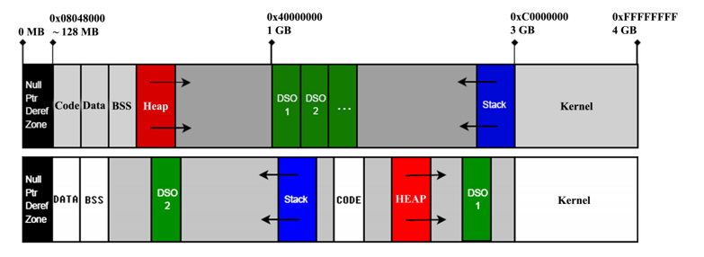
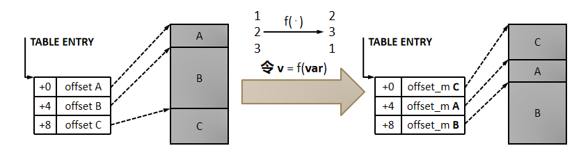
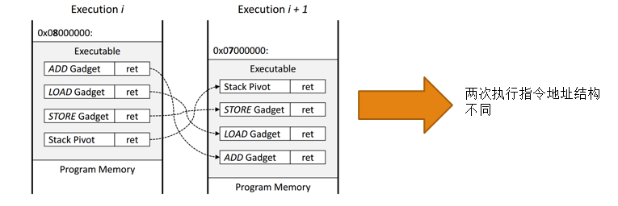

# ASLR（地址空间随机化）

通过地址空间随机化増强系统的多样性，同一个程序在不同的机器上，内存布局不一样，在同一台计算机上，两次运行的内存布局也不同

ret2libc攻击、ＲＯＰ攻击利用基于每一个gardget的地址己知并且不会变化的前提
地址空间随机化（ＡＳＬＲ）技术通过将程序代码段加载到一个随机的基址，代码段中每一条指令的地址都发生了变化。如果ＲＯＰ等攻击方法仍然将控制流劫持到原来gardget的地址就会导致攻击失败

## 如何将地址空间随机化

- 系统将进程的用户空间划分为三个区域，可执行区域（代码区（部分可随机化代码），初始化数据和未初始化数据），映射区（堆，动态库和共享内存）和栈区
- 对于32位系统来说，并不能在整个４Ｇ的地址空间中进行随机化，栈区基址第4-23位可随机化，映射区基址第12-27位可被随机化，可执行区也是12-27位可被随机化
- 32位线性地址，高四位为全局页表，如果应用随机化则会影响到高位内存的映射能力，产生大量内存碎片，低12位考虑页对齐操作

## 粗粒度 ASLR

- 已广泛安装在 Windows/Linux 等系统上。

- 改进方式：偏移量 + 内存区段的位置置换。

- 第一次执行时各段位置固定，第二次执行时各段位置发生置换。
    
## 粗粒度ASLR的局限性

- 在32位系统上，ASLR对于代码段只有16位的随机化强度，这样的随机化强度远远不够，平均只需要32768次（最坏情况是2的16次方）尝试即可攻破一个采用ASLR防御技术的系统
- 实验结果，采用暴力尝试的方法用ROP技术攻击部署了ASLR的机器上的Apache Http Server，平均耗费216秒即可攻击成功
- 仅仅对代码段的基地址进行随机化，指令间的相对位置并没有改变，易受到信息泄露攻击的威胁

## 细粒度ASLR

- 区段间 → 区段内
- 改变代码文本的具体内容

- 细粒度ASLR的实施

  - 程序在加载时自我随机化
  - 通过虚拟机进行动态随机化
  - 操作系统的随机化

## ASLR的无效化

1. ASLR 假设的攻击模型
   - Case 1：攻击者无法披露目标程序的内存空间

   - Case 2：攻击者可以实施内存空间披露，但只能获得一个代码指针

2. 关键问题
   - 如果攻击者真的寻获了一个可以远程利用的内存披露漏洞，为何不反复利用之，以最大化漏洞价值？

   - Limitation：对于任何 ASLR，程序在执行时不再改变其内存空间结构。

3. 4KB 对齐与页面收割（Page Harvest）
   - 由于 4KB 对齐，攻击者可以通过页面收割，最终暴露进程中的全部代码、API 接口等可利用资源。

## ASLR总结

- ASLR通过给内存布局的偏移做了随机化工作
- ASLR增加了漏洞利用的难度，不解决漏洞本身
- 64位操作系统中，ASLR能够提供更大的熵（可随机的地址范围更大），因而具有很好的防利用效果