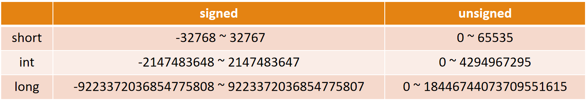
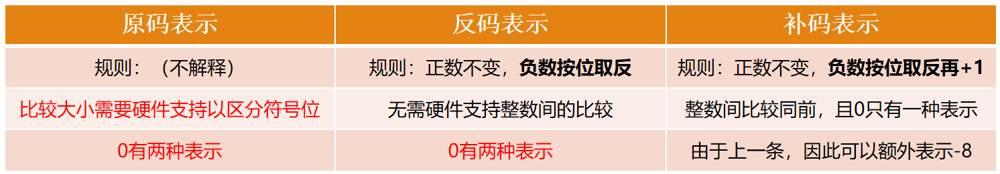
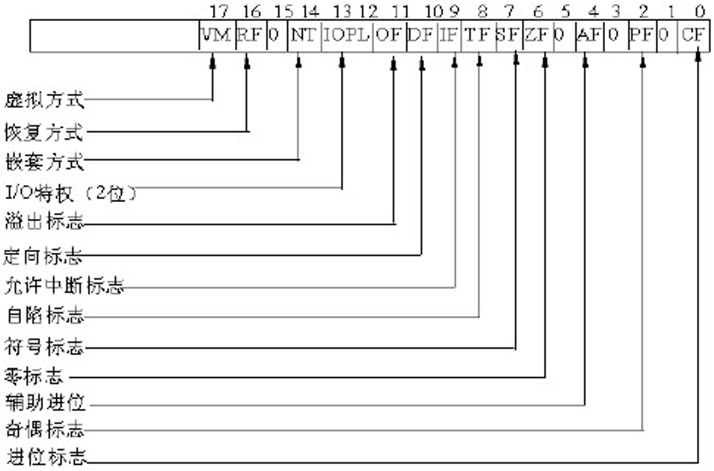
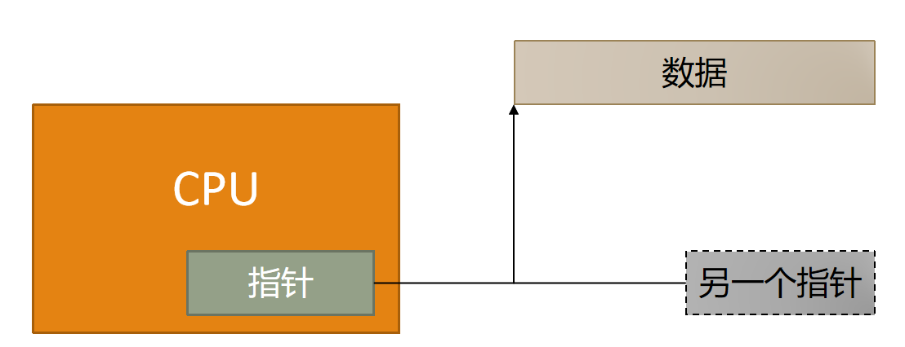

# 整数溢出

## 数值计算的基本原理

### 整数在计算机中的存储

1. 计算机只能存 0 和 1
   - 计算机里所有数据都是二进制：0 和 1。

   - 一个位（bit） 就是一个 0 或 1。
   - 8 个 bit 组成一个字节（byte）。
   - 在 C 语言里，不同的整数类型占不同的字节数：

    | 类型 | 位数 | 字节数 |
    |------|------|--------|
    | short | 16 位 | 2 字节 |
    | int | 32 位 | 4 字节 |
    | long | 64 位 | 8 字节 |

### 整数溢出原理

1. 位数决定了能表示的范围
   - 带符号(-2n-1 ~ 2n-1-1) / 无符号(0 ~ 2n-1)

    

   - 关键点：位数是固定的，能表示的范围就是有限的。超出范围，就会“溢出”。

2. 带符号整数格式中的补码

   - 带符号整数统一用补码表示（而非仅限负数数值）
   - 意义：符号位和数值域统一，加法和减法统一
     

3. CPU的FLAG寄存器
     

   - 然而检查FLAG这件事常常被忽略
   - 对数据的使用还存在如下情况
     


## 无符号整数溢出

- 规则：模运算
   - C 语言规定：无符号整数溢出时，以以2(8*sizeof(type))作模运算
   - 用人话说：超出最大值后，从 0 重新开始数。

- 例子
    ```c
    unsigned char x = 255;   // 8 位，最大值 255
    x = x + 1;               // 256 装不下，变成 0
    printf("%d\n", x);       // 输出 0
    ```

    ```c
    unsigned char x = 0;     // 0
    x = x - 1;               // -1 装不下，变成 255
    printf("%d\n", x);       // 输出 255
    ```
- 比喻：一个只能显示 3 位数的计数器，999 再加 1 变成 000；000 再减 1 变成 999。

## 整数溢出可能导致的后果

### 绕过安全检查
- 漏洞程序
    ```c
    unsigned short s;
    int i;
    char buf[100];

    i = atoi(argv[1]);   // 用户输入65536
    s = i;               // 把 i 塞进 s

    if (s >= 100) {      // 检查 s 是否 >= 100
        printf("太大，退出！");
        return -1;
    }

    memcpy(buf, argv[2], i);   // 实际拷贝时用的是 i
    ```
- 详解
  - argv[1]=65536，而int i是int 可表示-2^31~2^31-1，s是unsigned short最大2^16-1=65535。
  - s = i则s=0，取后面的16个0.

  - `int atoi(const char *nptr);`
    - 用法：将字符串里的数字字符转化为整形数。返回整形值。
    - 注意：转化时跳过前面的空格字符，直到遇上数字或正负符号才开始做转换，而再遇到非数字或字符串结束时('/0')才结束转换，并将结果返回。

  - `void *memcpy(void*dest, const void *src, size_t n);`
    - 由src指向地址为起始地址的连续n个字节的数据复制到以destin指向地址为起始地址的空间内。
    - 函数返回一个指向dest的指针。
    - 说明
      - source和destin所指内存区域不能重叠，函数返回指向destin的指针。
      - 与strcpy相比，memcpy并不是遇到'\0'就结束，而是一定会拷贝完n个字节。
      - 如果目标数组destin本身已有数据，执行memcpy（）后，将覆盖原有数据（最多覆盖n）。
      - 如果要追加数据，则每次执行memcpy后，要将目标数组地址增加到你要追加数据的地址。
      - 注意，source和destin都不一定是数组，任意的可读写的空间均可。

- 攻击过程

  - 用户输入 65536。

  - s = i 时，65536 装不进 unsigned short（最大 65535），溢出变成 0。

  - 检查 s >= 100 时，0 >= 100 是假的，程序放行。

  - 但 memcpy 用的是 i（还是 65536），把 65536 个字节硬塞进只能装 100 个字节的 buf 里，缓冲区溢出。

- 关键：整数溢出骗过了安全检查，为后续的缓冲区溢出当了“引信”。

### 死循环
- 漏洞程序
    ```c
    short len = 0;
    while (len < MAX_LEN) {
        len += readFromInput(fd, buf);   // 假设每次加 2
        buf += len;
    }
    ```
- 详解

  - short 最大值是 32767。

  - 当 len 加到 32766 时，还没超过最大值。

  - 再加 2，变成 32768，但 short 装不下，溢出变成 -32768。

  - -32768 < MAX_LEN 永远成立，循环永远出不去，程序卡死。

### 逻辑错误
- 漏洞程序
    ```c
    int abs(int x) {
        if (x < 0) return -x;
        return x;
    }
    ```
    - 函数abs的功能 --- 对于输入参数为正，返回其本身，否则返回其相反数
    - 然而，对于-2147483648（int类型的最大负数值），函数abs返回的是其本身

- 详解

  - 调用 abs(-2147483648)：

  - -2147483648 是 int 能表示的最小负数。

  - 取反后 2147483648 超出 int 正数范围（最大 2147483647），溢出。

  - 结果还是 -2147483648。

  - 程序以为返回了正数，实际还是负数，逻辑错误。


## 整数溢出和缓冲区溢出的关系

- 整数溢出本身不一定直接造成危害
  - 它本身只是“算错了数”。但算错的数被用于内存操作时，就会造成严重后果。

  - 典型链条
    ```text
    用户输入一个很大的数
        ↓
    整数溢出，变成一个很小的数
        ↓
    安全检查被绕过
        ↓
    用原始的大数做内存拷贝
        ↓
    缓冲区溢出，覆盖返回地址
        ↓
    控制程序执行流
    ```

## 如何防护整数溢出
1. 编译时检查
   - 使用 -ftrapv 等编译选项，让溢出时程序崩溃。

   - 使用静态分析工具（如 IntScope）检测潜在的溢出。

2. 运行时检查
   - 在做内存操作前，检查长度是否合法。

   - 使用安全的函数（如 strncpy 代替 strcpy）。

3. 使用更大的类型
   - 如果可能溢出，用 long 或 long long 代替 int。

   - 但这不是万能的，long 也会溢出。

4. 自动修复
   - IntPatch 等工具可以在编译时检测“整数溢出到缓冲区溢出”的漏洞，并自动打补丁。

>整数溢出是：整数装不下超出范围的值，溢出后变成另一个数。如果这个错误的数被用于安全检查或内存操作，就会绕过防护，导致缓冲区溢出、死循环、逻辑错误等严重后果。