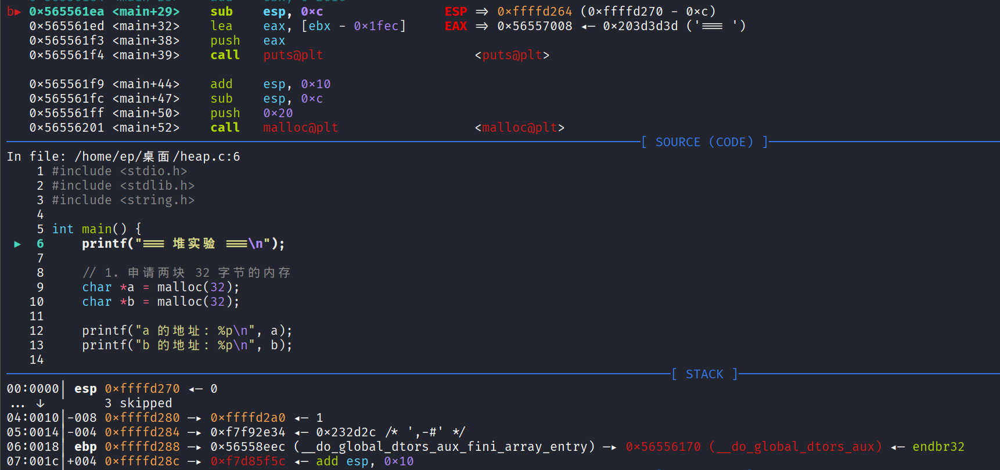
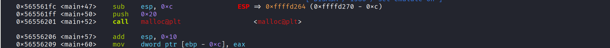
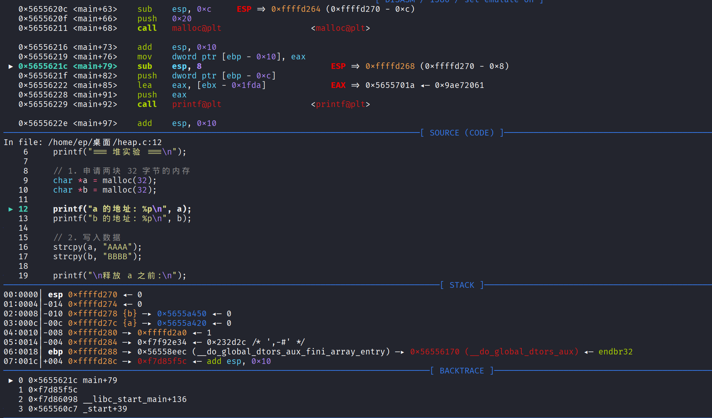
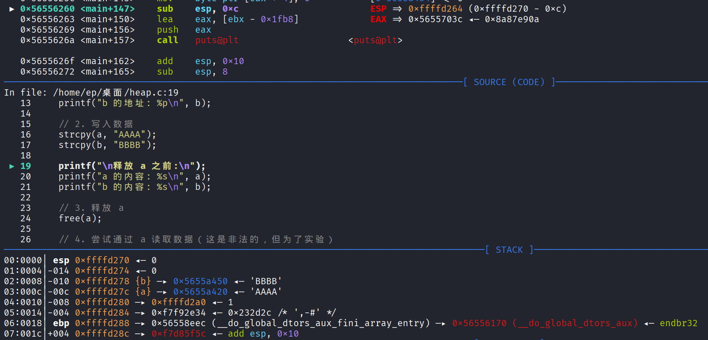
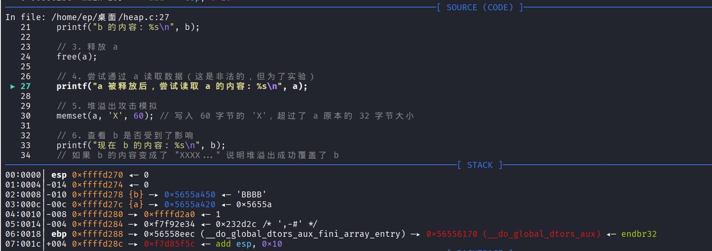
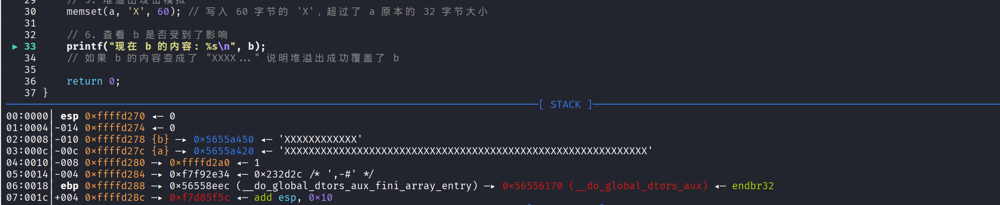
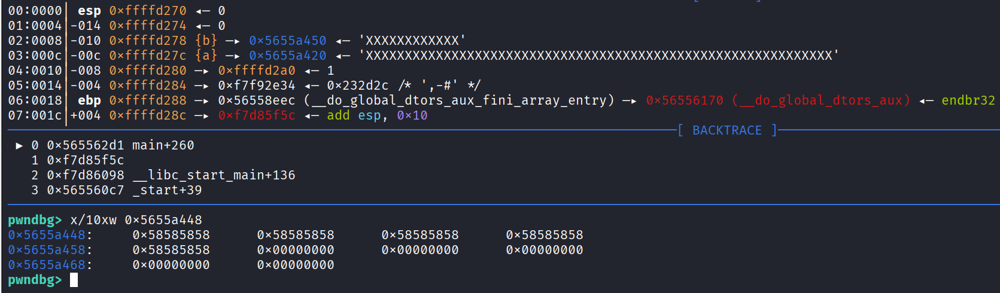

# UAF（use-after-free）

## 概述
UAF是指在用户向系统请求一个堆块之后进行释放时，程序并没有对内存指针清零，导致用户可以读取或修改堆块的关键数据（在用户态的堆下主要是针对fd/bk等指针的读取后篡改）。导致程序数据流被控，甚至控制空间合理还可以通过某些结构体控制程序控制流（通过任意写或任意读）。

## 释放重引用漏洞的一般流程

- 申请一段空间，将其释放但并不将指针置为空（这个悬空指针记为p1 ）
- 申请空间p2，由于malloc分配的过程使得p2指向的空间为刚刚释放的p1指针的空间
- 构造恶意的数据将p2指向的内存空间布局好（即覆盖了p1中的数据）
- 利用p1

## 释放重引用的潜在后果：

- 一般地，攻击会尝试劫持函数指针
- 造成不同指针引用同一内存区域


## UAF实例演示
```
#include <stdio.h>
#include <stdlib.h>
#include <string.h>

int main() {
    printf("=== 堆实验 ===\n");

    // 1. 申请两块 32 字节的内存
    char *a = malloc(32);
    char *b = malloc(32);

    printf("a 的地址: %p\n", a);
    printf("b 的地址: %p\n", b);

    // 2. 写入数据
    strcpy(a, "AAAA");
    strcpy(b, "BBBB");

    printf("\n释放 a 之前:\n");
    printf("a 的内容: %s\n", a);
    printf("b 的内容: %s\n", b);

    // 3. 释放 a
    free(a);

    // 4. 尝试通过 a 读取数据（这是非法的，但为了实验）
    printf("a 被释放后，尝试读取 a 的内容: %s\n", a); 

    // 5. 堆溢出攻击模拟
    memset(a, 'X', 60); // 写入 60 字节的 'X'，超过了 a 原本的 32 字节大小

    // 6. 查看 b 是否受到了影响
    printf("现在 b 的内容: %s\n", b); 
    // 如果 b 的内容变成了 "XXXX..." 说明堆溢出成功覆盖了 b

    return 0;
}
```
**编译成32位**
`gcc -m32 -g -o heap_32 heap.c`


**动态分析**

**断点打在main处**


**分配堆块并将malloc返回的地址赋值给a指针**


**此时栈上的局部变量*a已经指向刚刚分配的堆块的用户数据起始地址**


**a堆块的头部数据起始地址**


**第二个chunk也分配完成并赋值给指针b**


**此时的bin链表**


**向a,b中写入数据**


**释放chunk a**


**此时a指向的chunk中的内容已经变了，但a指针仍指向该chunk**


**向a指向的chunk中写入超过该chunk大小的数据**


**由于chunk a和chunk b物理上相距0x30=48字节所以向chunk a写入60字节数据导致溢出的数据覆盖到了b中，可以看到chunk b的头部字段已经被覆盖**

