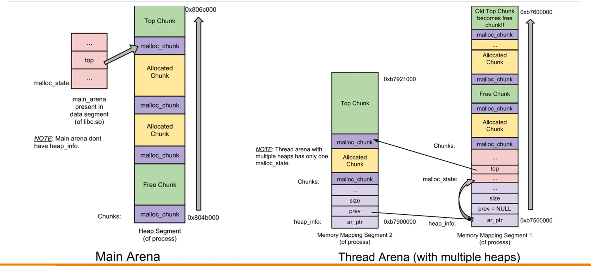
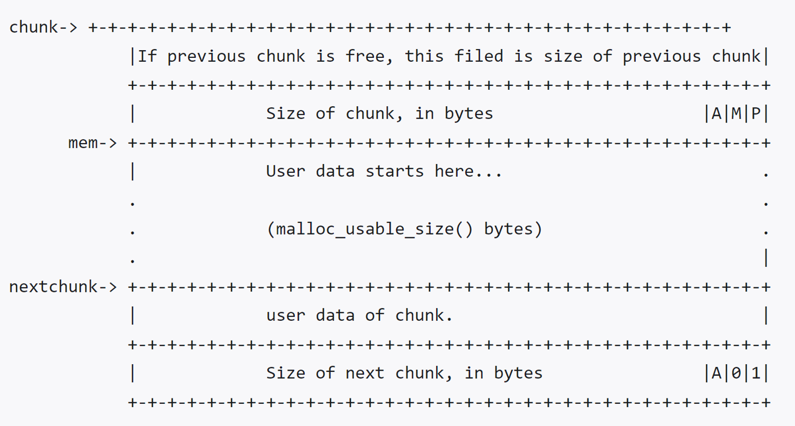
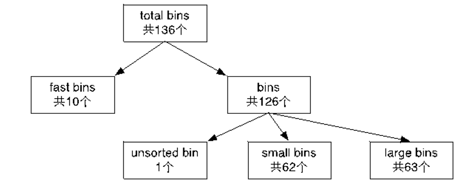
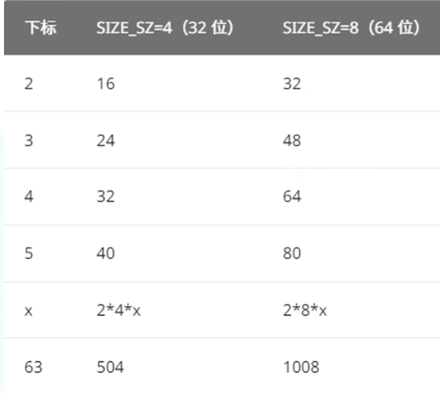

# 缓冲区溢出——堆溢出

## 堆的工作原理

### 堆的作用
响应用户的申请内存请求，向操作系统申请内存，然后将其返回给用户程序。同时，为了保持内存管理的高效性，内核一般都会预先分配很大的一块连续的内存，然后让堆管理器通过某种算法管理这块内存。只有当出现了堆空间不足的情况，堆管理器才会再次与操作系统进行交互。

管理用户所释放的内存。一般来说，用户释放的内存并不是直接返还给操作系统的，而是由堆管理器进行管理。这些释放的内存可以来响应用户新申请的内存的请求。
目前 Linux标准发行版中使用的堆分配器是 glibc 中的堆分配器：ptmalloc2。ptmalloc2 主要是通过 malloc/free 函数来分配和释放内存块。

- dlmalloc – General purpose allocator
- ptmalloc2 – glibc
- jemalloc – FreeBSD and Firefox
- tcmalloc – Google
- libumem – Solaris

在程序的执行过程中，我们称由 malloc 申请的内存为 chunk。这块内存在 ptmalloc 内部用 malloc_chunk 结构体来表示。

当程序申请的 chunk 被 free 后，会被加入到相应的空闲管理列表中。

无论一个 chunk 的大小如何，处于分配状态还是释放状态，它们都使用一个统一的结构。虽然它们使用了同一个数据结构，但是根据是否被释放，它们的表现形式会有所不同。

### 堆与栈的区别

- 栈是具有硬件直接支持的
- 栈存储数据+控制流信息
- 堆是由操作系统的库函数予以支持的
- 堆存储数据

### 堆的创建和维护
>通过malloc实现


**malloc 的底层实现：brk 与 mmap**

当应用程序调用 malloc(size) 申请内存时，glibc 的 malloc 并不会直接返回物理内存，而是根据申请的大小和当前线程的状态，选择通过以下两个系统调用向内核申请虚拟内存：

1. brk() 系统调用

    适用场景：主线程（Main Thread）申请较小的内存。

    原理：brk 用于调整进程数据段（Data Segment）的边界，即 program break 指针。当需要更多内存时，brk 会将这个边界向高地址推移，从而扩大堆区。

    特点：这种方式申请的内存位于主堆区，释放时通常不会立即归还给操作系统，而是由 malloc 库缓存起来供后续复用。

2. mmap() 系统调用

    适用场景：子线程（Thread）申请内存，或者主线程申请非常大的内存块（通常大于 128KB）。

    原理：mmap 会在进程的“内存映射区（Memory Mapping Segment）”直接映射一块新的虚拟内存区域。

    特点：这种方式申请的内存是独立的，与主堆区分离。释放时（munmap）可以彻底归还给操作系统，不会影响主堆区。

**Arena（场地）机制：解决多线程竞争**

在多线程环境下，如果所有线程都去竞争同一个堆区的锁，会导致严重的性能下降。为了解决这个问题，glibc 引入了 Arena（场地） 的概念。

- Arena 的概念

  - 一个 Arena 是一个独立的内存管理区域，包含自己的空闲内存块链表（bins）和互斥锁（mutex）。

  - 每个线程在申请内存时，会尝试绑定一个 Arena。一旦绑定，该线程的 malloc 和 free 操作都在这个 Arena 内进行，从而减少线程间的锁竞争。

- Arena 的分配规则

  - 主线程（Main Thread）：拥有一个独立的 main_arena，通常位于主堆区（通过 brk 扩展）。

  - 子线程（Threads）：每个子线程默认拥有自己的 thread_arena（通过 mmap 分配）。

  - 数量限制：在 32 位系统中，Arena 的总数量是有限制的，通常为 2 * CPU核心数 + 1。例如，单核 CPU 最多有 3 个 Arena。

- Arena 的循环复用

    如果程序创建的线程数超过了 Arena 的总数，那么多余的线程必须循环复用已经存在的 Arena。

  - 机制：当线程尝试申请内存时，glibc 会遍历所有可用的 Arena。如果某个 Arena 的锁没有被占用（即当前没有其他线程在使用它），该线程就会获取这个 Arena 的锁并开始使用。

  - 阻塞：如果所有 Arena 都在被使用中，该线程的 malloc 操作会被阻塞，直到有可用的 Arena 释放出来。
  - 场景：单核的32位操作系统（场地数量2*1+1=3），运行多线程程序---1个主线程+3个用户线程，malloc如何确保这4个线程共享3个arena

    - 主线程分配主arena,线程1、2分别分配arena，那么线程3需要重复使用已分配好的arena
    - glibc malloc循环遍历所有可用的场地，如果lock成功（该场地当前对应的线程并未使用堆内存），则将该场地供线程3使用
    - 如果没有找到可用的arena，则将线程3的malloc操作阻塞，直到找到可用的为止

**主场地 vs 线程场地的内存布局差异**



- 主场地（Main Arena）：

  - 内存是单一连续段（Heap Segment），通过 brk 扩展。

  - 管理结构 malloc_state 位于 libc.so 的数据段中。

  - 没有 heap_info 结构

- 线程场地（Thread Arena）：

  - 内存是多段非连续的（Multiple heaps，通过 mmap 多次映射）。

  - 每个 mmap 出来的堆段头部都有一个 heap_info 结构，用于记录该堆段的元数据（如指向的 Arena ar_ptr，前一个堆段 prev）。

  - 一个线程的 Arena 里，即使有多个堆段，也只有一个 malloc_state。

  - top 指针始终指向最新创建的堆段中的 Top Chunk。旧的 Top Chunk 会变为空闲块（"Old Top Chunk becomes free chunk!!"），并被挂入空闲链表。


**堆内存的微观管理与缓存机制**

1. Chunk（堆块）

   - 无论你申请多少字节，malloc 都会返回一个 Chunk。一个 Chunk 包含头部（Header）和用户数据区（Payload）。

   - 头部（Header）：记录着该 Chunk 的大小（size）、前一个 Chunk 的大小（prev_size）以及标志位（A/M/P，分别代表是否分配、是否由 mmap 分配、前一个 Chunk 是否在使用中）。

   - 对齐：为了效率，malloc 分配的 Chunk 大小通常是 8 或 16 字节对齐的。

2. 内存分配与缓存

   - 申请了 1000 字节，但系统通过 brk 分配了 132KB（135168 字节）的堆空间。这块空间被称为 main_arena。

   - 释放不归还：当你调用 free() 释放内存时，这块内存通常不会立刻还给操作系统，而是被 malloc 库函数放入一个叫 Bin（空闲链表） 的缓存结构中。

   - 复用：下次你再次调用 malloc 时，malloc 会优先从 Bin 中查找是否有满足大小的空闲 Chunk。如果有，直接复用，避免频繁的系统调用，从而提高效率。


### 堆块（Chunk）的内部结构
>堆内存被划分为多个 Chunk（堆块）。Chunk 的结构经历了演进，并包含了复杂的管理信息。



**核心基础字段**
1. prev_size（前一个堆块的大小）
   - 定义：如果当前 Chunk 物理相邻的前一个 Chunk 是空闲的，那么这个字段记录的是前一个 Chunk 的大小（包含头部）。

   - 复用机制：如果前一个 Chunk 正在使用中（未释放），那么这个字段就无效了，它会被前一个 Chunk 借去当作数据区（Payload）使用。

   - 方向：“前一个”指的是较低地址的 Chunk（因为堆是从低地址向高地址增长的）。

2. size（当前堆块的大小）
   - 对齐要求：这个大小必须是 MALLOC_ALIGNMENT 的整数倍。

     - 32 位系统中，对齐通常是 4 或 8 字节。

     - 64 位系统中，对齐是 8 字节。

     - 如果申请的大小不满足对齐，系统会通过 request2size() 宏向上取整。

   - 标志位（低 3 位）：由于对齐要求，size 的低 3 位（二进制最后三位）永远是 0。因此，glibc 巧妙地借用这 3 位来存储标志位。从高到低分别是：

     - NON_MAIN_ARENA (A)：记录当前 Chunk 是否属于主线程（Main Arena）。1 表示不属于（属于子线程），0 表示属于。

     - IS_MAPPED (M)：记录当前 Chunk 是否是由 mmap 系统调用直接分配的。1 表示是，0 表示不是。

     - PREV_INUSE (P)：记录前一个物理相邻的 Chunk 是否被分配。

       - P=1：前一个 Chunk 正在使用中（或当前是第一个 Chunk）。

       - P=0：前一个 Chunk 是空闲的。此时，可以通过当前 Chunk 的 prev_size 字段来获取前一个 Chunk 的大小和地址，以便进行合并操作。

**空闲状态下的指针字段（Bin 链表）**

当 Chunk 被 free 释放后，它会被加入到相应的空闲链表中。此时，它的用户数据区（Payload）的前几个字节会被用来存储链表指针：

- fd (Forward Pointer)：指向下一个（非物理相邻）空闲的 Chunk。

- bk (Backward Pointer)：指向上一个（非物理相邻）空闲的 Chunk。

作用：通过 fd 和 bk，所有空闲的 Chunk 被串成一个双向链表（Bin），方便 malloc 快速查找合适的空闲块。

当该chunk处于分配状态时，从fd字段开始就存储用户数据

**大型空闲堆块的专属字段**

对于大型 Chunk（Large Chunk），仅仅有 fd 和 bk 不够，还需要额外的指针来加速查找

- 适用对象：仅当 Chunk 空闲，且属于 Large Chunk 时使用。

- fd_nextsize：指向前一个与当前 Chunk 大小不同的第一个空闲块（不包含 bin 的头指针）。

- bk_nextsize：指向后一个与当前 Chunk 大小不同的第一个空闲块。

- 排序规则：一般空闲的 Large Chunk 在 fd 的遍历顺序中，是按照由大到小的顺序排列的。

- 目的：这样做可以避免在寻找合适 Chunk 时逐个遍历。比如，你要找一个大小为 1024 的块，直接顺着 nextsize 链条跳过大小的块，快速定位到合适的大小范围。

**Chunk 结构的物理与逻辑视图**

物理内存中的 Chunk 结构（从低地址到高地址）：

```text
[ prev_size ]  (4字节，前一个块空闲时才有效)
[ size + A|M|P ] (4字节，当前块大小+标志位)
[ fd ]         (4字节，仅空闲时有效)
[ bk ]         (4字节，仅空闲时有效)
[ fd_nextsize ](4字节，仅 Large Chunk 空闲时有效)
[ bk_nextsize ](4字节，仅 Large Chunk 空闲时有效)
[ Payload ]    (用户数据区，malloc 返回的指针指向这里)
...
```

**堆溢出攻击的切入点**

- 覆盖 size 字段：攻击者可以通过溢出，篡改下一个 Chunk 的 size 和其标志位（尤其是 PREV_INUSE 位）。伪造 PREV_INUSE 为 0，可以欺骗 free() 函数认为前一个 Chunk 是空闲的，从而触发 Unlink（合并） 操作。

- 覆盖 fd 和 bk 指针：在 free() 执行 Unlink 时，会执行 FD->bk = BK 和 BK->fd = FD。如果攻击者精心构造了 fd 和 bk 的值（比如指向 GOT 表地址和 Shellcode 地址），就能在合并过程中实现任意地址写。

- 利用 fd_nextsize：在大型 Chunk 的链表中，如果伪造了 fd_nextsize，也可能导致指针劫持。

### bin是记录free chunk的链表数据结构

**空闲堆块的管理策略：缓存与复用**

- 延迟归还：当用户调用 free() 释放一块堆内存（Chunk）时，ptmalloc 不会立即通过系统调用（如 brk 或 munmap）将其归还给操作系统内核，而是将其保留在用户态，由 ptmalloc 分配器统一管理。这一机制同时适用于 heap 段和 mmap 映射区域。

- 优先复用：当用户再次请求内存分配时，ptmalloc 会首先在已缓存的空闲 Chunk 中寻找大小合适的块进行分配。

- 性能收益：这种设计避免了频繁的用户态与内核态切换（系统调用开销较大），从而显著降低了内存分配的整体开销，提升了程序运行效率。

**空闲堆块的分类：分箱（Binning）机制**

- 分箱管理：ptmalloc 采用“分箱（Binning）”策略，根据空闲 Chunk 的大小和状态，将其划分为四大类：

  - fast bins

  - small bins

  - large bins

  - unsorted bin

- 链表组织：在每一大类内部，ptmalloc 还会根据 Chunk 的具体大小进行更细粒度的划分。具有相似大小的 Chunk 会通过双向链表连接在一起。这意味着，在同一个大类（如 small bins）中，会存在多个相互独立的链表，每个链表专门维护特定大小的空闲 Chunk。

- 管理目的：通过这种分类和链表化，分配器在查找合适大小的空闲块时，无需遍历所有空闲块，从而提高了查找效率。

**分类的具体实现：malloc_state 中的 bins 数组**

- 统一维护：这三种 Bin（small、large、unsorted）被统一维护在 malloc_state 结构体的一个名为 bins 的数组中。

- 数组定义：

  ```c
  #define NBINS 128
  /* Normal bins packed as described above */
  mchunkptr bins[NBINS * 2 - 2];
  ```

  - NBINS 定义为 128，表示逻辑上共有 128 个 Bin。

  - bins 数组的大小为 NBINS * 2 - 2（即 254）。这是因为 small bins、large bins 和 unsorted bin 采用的是双向链表结构。

  - 在双向链表中，每个链表的头节点需要存储两个指针：fd（指向下一个 Chunk）和 bk（指向前一个 Chunk）。因此，逻辑上的一个 Bin，在数组中需要占用两个 mchunkptr（指针）的空间。

  - 数组的具体划分为：bins[1] 对应 unsorted bin；bins[2] 到 bins[63] 对应 small bins；bins[64] 到 bins[126] 对应 large bins。


**在glibc中的划分**

  - fastbinsY，一个用于记录所有fastbins的数组，size为16-80字节             
  - bins，也是一个数组，记录除fast bins之外的所有bins；
    - 其中bin 1 为unsorted bin
    - bin 2 到63为small bin
    - bin 64到126为large bin
  
  

#### small bin
>与 Fast Bin 不同，Small Bin 采用了更严谨的数据结构来管理稍大一些的内存块

small bins 中每个 chunk 的大小与其所在的 bin 的 index 的关系为：chunk_size = 2 * SIZE_SZ * index


- 计算公式：Small Bin 中每个 Chunk 的大小是固定的，且可以通过其所在的 Bin 的索引（index）精确计算得出。

- SIZE_SZ 是一个机器字长（在 32 位系统中通常为 4 字节，在 64 位系统中为 8 字节）。

- 尺寸示例

   

- 特点：Small Bin 中每个链表管理的 Chunk 大小完全一致，且尺寸是等差数列（步长为 2 * SIZE_SZ）。

**数据结构与分配策略**

small bins 中一共有 62 个循环双向链表，每个链表中存储的 chunk 大小都一致。比如对于 32 位系统来说，下标 2 对应的双向链表中存储的 chunk 大小均为 16 字节。每个链表都有链表头结点，这样可以方便对于链表内部结点的管理。此外，small bins 中每个 bin 对应的链表采用 FIFO 的规则，所以同一个链表中先被释放的 chunk 会先被分配出去。


- 每个链表都有一个头节点，用于连接所有大小相同的空闲 Chunk。双向链表使得插入和删除操作更加灵活。

- 大小一致性：正如上面公式所述，每个链表只管理一种特定大小的 Chunk。

- FIFO（先进先出）策略：

  - 当释放一个 Chunk 时，它会被插入到对应链表的尾部。

  - 当分配一个 Chunk 时，会从链表的头部取出。

  - 这意味着最先被释放的 Chunk 会最先被分配出去。这与 Fast Bin 的 LIFO（后进先出）策略截然不同。FIFO 有助于保持内存分配的公平性和某种程度上的顺序性。

**注意**

在 small bin 中有很大一部分大小与 fastbin 重合，不是就是说这部分没用了，而是在后期触发某些操作时，就会导致分配器刷新 fastbin，将 fastchunks 清理到 smallbin 里”

- 尺寸重叠：Fast Bin 管理的尺寸范围（通常 16-80 字节）与 Small Bin 的前几个链表（如 16, 24, 32, 40, 48, 56, 64, 72, 80 字节）存在重叠。

- 优先级：当申请一个重叠尺寸的内存时，ptmalloc 优先从 Fast Bin 中分配，因为 Fast Bin 更快。

- Fast Bin 的清理（Consolidation）：当触发某些特定条件时（例如 malloc_consolidate 被调用，通常发生在申请大内存或 Fast Bin 积累过多时），ptmalloc 会执行“刷新”操作：

  - 遍历 Fast Bin 中的所有 Chunk。

  - 将它们从 Fast Bin 中取出。

  - 尝试与相邻的空闲 Chunk 合并。

  - 将合并后的 Chunk 放入 Unsorted Bin（未排序箱）中，随后会被整理到 Small Bin 或 Large Bin 中。

#### large bin
>与 Small Bin 每个链表只管理一种固定大小的 Chunk 不同，Large Bin 管理的 Chunk 尺寸跨度很大。为了提高管理效率，Large Bin 采用了一种分组（Group）和等差区间的策略

arge bins 中一共包括 63 个 bin，每个 bin 中的 chunk 的大小不一致，而是处于一定区间范围内。此外，这 63 个 bin 被分成了 6 组，每组 bin 中的 chunk 大小之间的公差一致


**分组与公差规律**


- 公差（步长）按照 64、512、4096、32768、262144 的顺序递增，每次大约乘以 8。

- 这种设计使得小尺寸的 Chunk 划分得更精细（步长小），大尺寸的 Chunk 划分得更粗略（步长大）。这是因为程序通常更频繁地申请中小型内存，而对超大内存的需求相对较少。

- 最后一个 Bin（第 6 组）没有公差限制，它负责管理所有大于前一组最大值的超大 Chunk。


#### unsorted bin
>Unsorted Bin 是堆管理机制中的一个“中转站”，它的设计初衷是为了提高内存分配和释放的效率


- 定位：Unsorted Bin 位于 malloc_state 结构体中 bins 数组的下标 1 处。它不是一个最终归宿，而是一个缓冲区（Cache）。所有被释放的空闲 Chunk，在真正被归类到 Small Bin 或 Large Bin 之前，都会先被放入 Unsorted Bin 中。

- 结构特点：

  - 它只有一个链表（双向链表）。

  - 链表中的 Chunk 不按大小排序（处于乱序状态）。

- 效率优化：引入 Unsorted Bin 可以减少 free() 操作的耗时。当释放一个 Chunk 时，ptmalloc 不需要立即判断它属于哪个 Small/Large Bin 并执行插入排序，而是直接丢进 Unsorted Bin。真正的分类工作被推迟到下一次 malloc() 时进行（如果 Unsorted Bin 中没有合适的 Chunk，ptmalloc 会遍历它，将 Chunk 整理归位）。

- 进入 Unsorted Bin 的两个主要来源

  - 来源一：内存分割的剩余部分（Last Remainder）

    - 当用户申请一个较小的内存，而 ptmalloc 从 Unsorted Bin 或 Large Bin 中找到一个较大的 Chunk 时，会进行分割（Split）。

    - 如果分割后剩余的部分（last remainder）大于最小 Chunk 大小（MINSIZE），这部分剩余内存会被重新放回 Unsorted Bin 中。

      - 安全意义：这个特性在堆布局（Heap Feng Shui）中非常有用，攻击者可以通过精确控制申请和释放的尺寸，来操纵 Unsorted Bin 中 Chunk 的位置和大小。

  - 来源二：非 Fast Bin 的释放

    - 当一个 Chunk 被释放，且它不属于 Fast Bin 范围（即尺寸较大），并且它不与 Top Chunk 紧邻时，它会被直接放入 Unsorted Bin。

    - 如果它与 Top Chunk 紧邻，则会直接合并到 Top Chunk 中。


- 核心安全风险：信息泄露（Information Leak）


  - 双链表结构与指针：当一个 Chunk 被放入 Unsorted Bin 时，它的 fd（前向指针）和 bk（后向指针）会被设置。由于 Unsorted Bin 本身位于 malloc_state 中，而 malloc_state 通常位于 libc.so 的数据段或堆段中，因此，Unsorted Bin 中 Chunk 的 fd 或 bk 指针，往往指向 main_arena（位于 libc 中）的地址。

  - 缺乏指针保护：与 Fast Bin 和 Tcache 不同，Unsorted Bin 在目前的 libc 版本中，没有对指针进行加密或保护（Safe-Linking）。

  - 信息泄露攻击（Libc Leak）：
    - 如果攻击者拥有一个指向该 Chunk 的悬垂指针（UAF, Use-After-Free），或者有能力读取该 Chunk 的内存。
    - 攻击者就可以读取 Chunk 的 fd 或 bk 指针。
    - 由于这些指针指向 main_arena，攻击者可以通过读取到的地址，计算出 libc.so 在内存中的基地址（Base Address）。
    - 一旦获得了 libc 的基地址，攻击者就可以计算出 libc 中任意函数（如 system、free_hook、__malloc_hook）的绝对地址，从而绕过 ASLR（地址空间布局随机化），实现任意代码执行。


### 顶块（top chunk）

- 不属于任何bin
- 当前所有空闲块(无论哪种bin)全都尺寸不合时，由顶块应急
  - 顶块比请求尺寸大 --- 分割供给使用，剩余部分为新顶块
  - 顶块比请求尺寸小 --- 全堆无适合块，扩展堆/分配新堆


###  glibc 源码中关于堆块（Chunk）操作的底层宏定义（Macros）


**基础定义与掩码**

```c
#define SIZE_BITS (PREV_INUSE | IS_MAPPED | NON_MAIN_ARENA)
```
*   **含义**：定义了一个“掩码”。我们之前讲过，`size` 字段的低 3 位被借用来存储标志位（`PREV_INUSE`、`IS_MAPPED`、`NON_MAIN_ARENA`）。这个宏把这三个标志位组合起来，用于后续提取真实的 `size`。

```c
/* Get size, ignoring use bits */
#define chunksize(p) (chunksize_nomask(p) & ~(SIZE_BITS))
```
*   **含义**：获取 Chunk `p` 的**真实大小**。
*   **原理**：先用 `chunksize_nomask(p)` 拿到原始的 `size` 字段，然后与 `~SIZE_BITS`（标志位取反）进行**按位与（&）**操作。这相当于把低 3 位的标志位全部**清零**，只保留高位的真实大小数值。

```c
/* Like chunksize, but do not mask SIZE_BITS. */
#define chunksize_nomask(p) ((p)->mchunk_size)
```
*   **含义**：直接读取 Chunk `p` 的 `mchunk_size` 字段（包含标志位），不做任何处理。

---

**物理相邻关系的定位**

```c
/* Ptr to next physical malloc_chunk. */
#define next_chunk(p) ((mchunkptr)(((char *) (p)) + chunksize(p)))
```
*   **含义**：获取**物理相邻的下一个** Chunk 的指针。
*   **原理**：当前 Chunk 的地址 `p` 加上当前 Chunk 的**真实大小** `chunksize(p)`，就得到了下一个 Chunk 的起始地址。

```c
/* Size of the chunk below P. Only valid if !prev_inuse (P). */
#define prev_size(p) ((p)->mchunk_prev_size)
```
*   **含义**：获取前一个 Chunk 的大小。**注意**：只有当 `PREV_INUSE` 标志位为 0（即前一个 Chunk 是空闲的）时，这个字段才有效。

```c
/* Set the size of the chunk below P. Only valid if !prev_inuse (P). */
#define set_prev_size(p, sz) ((p)->mchunk_prev_size = (sz))
```
*   **含义**：设置前一个 Chunk 的大小。同样，仅当前一个 Chunk 空闲时使用。

```c
/* Ptr to previous physical malloc_chunk. Only valid if !prev_inuse (P). */
#define prev_chunk(p) ((mchunkptr)(((char *) (p)) - prev_size(p)))
```
*   **含义**：获取**物理相邻的前一个** Chunk 的指针。
*   **原理**：当前 Chunk 的地址 `p` **减去**前一个 Chunk 的大小 `prev_size(p)`，就得到了前一个 Chunk 的起始地址。

---

**辅助定位与状态判断**

```c
/* Treat space at ptr + offset as a chunk */
#define chunk_at_offset(p, s) ((mchunkptr)(((char *) (p)) + (s)))
```
*   **含义**：把指针 `p` 加上偏移量 `s` 后的地址，强制转换为一个 Chunk 指针。常用于在内存中快速定位。

```c
/* extract p's inuse bit */
#define inuse(p) \
  ((((mchunkptr)(((char *) (p)) + chunksize(p)))->mchunk_size) & PREV_INUSE)
```
*   **含义**：**判断当前 Chunk `p` 是否正在被使用（分配状态）**。
*   **原理**：
    1.  首先，`((char *) (p)) + chunksize(p)` 计算出**下一个物理相邻 Chunk** 的地址。
    2.  然后，读取下一个 Chunk 的 `mchunk_size` 字段。
    3.  最后，将这个 `size` 与 `PREV_INUSE` 标志位进行**按位与（&）**。
    *   **为什么这样写？** 因为 `PREV_INUSE` 标志位是存储在**下一个 Chunk 的 `size` 字段**里的！如果当前 Chunk 正在使用中，那么下一个 Chunk 的 `size` 字段里的 `PREV_INUSE` 位就会被设置为 1。因此，通过检查下一个 Chunk 的 `PREV_INUSE` 位，就可以反推出当前 Chunk 的状态。


### malloc_state结构体

**并发控制与基础标志**

1.  **`__libc_lock_define (, mutex);`**
    *   **作用**：这是一个互斥锁（Mutex）。
    *   **解释**：为了解决多线程竞争，每个 Arena 都有一个独立的锁。当一个线程想要在这个 Arena 里申请或释放内存时，必须先获取这个 `mutex`。如果获取不到，线程就会阻塞，直到锁被释放。

2.  **`int flags;`**
    *   **作用**：记录当前 Arena 的属性标志。
    *   **解释**：比如标记这个 Arena 是否是主场地（Main Arena），或者是否处于某些特殊状态。

3.  **`int have_fastchunks;`**
    *   **作用**：一个布尔值标志。
    *   **解释**：用于快速判断当前的 Fastbins 链表中是否有空闲的 Chunk。如果有，`malloc` 在分配小内存时会优先去 Fastbins 里找，而不需要遍历其他复杂的链表，从而提高效率。

**空闲块管理（Bins 数组）**

1.  **`mfastbinptr fastbinsY[NFASTBINS];`**
    *   **作用**：Fastbins（快速 bins）的数组。
    *   **解释**：`NFASTBINS` 通常是 10。这个数组专门用于管理**小尺寸（16-80字节）**的空闲 Chunk。由于小内存分配和释放极其频繁，Fastbins 采用了**单链表（LIFO，后进先出）**结构，且不进行合并操作，以追求极致的速度。

2.  **`mchunkptr top;`**
    *   **作用**：指向当前 Arena 的 **Top Chunk（顶块）**。
    *   **解释**：这是整个 Arena 中最重要的指针之一。它指向当前堆内存最顶部的那块空闲区域。当所有 Bins 都找不到合适尺寸时，`malloc` 就会从 `top` 指向的 Chunk 中分割内存。如果 `top` 不够大，就会触发系统调用（`brk` 或 `mmap`）来扩展堆。

3.  **`mchunkptr last_remainder;`**
    *   **作用**：记录最近一次分割产生的剩余部分。
    *   **解释**：这是一个优化字段。当你申请一个小内存，而系统从一个大空闲块中切分时，剩下的那部分会被记录在 `last_remainder` 中。下次你再申请小内存时，系统会优先看看 `last_remainder` 里是否还有空间，以增加内存复用的局部性。

4.  **`mchunkptr bins[NBINS * 2 - 2];`**
    *   **作用**：普通 Bins（Unsorted, Small, Large bins）的数组。
    *   **解释**：`NBINS` 通常是 128。这个数组非常特殊，它**不直接存储 Chunk 的指针**，而是存储**双向链表的头节点（fd 和 bk 指针）**。因为双向链表需要两个指针（前驱和后继），所以数组大小是 `NBINS * 2 - 2`。这里的 `bins[1]` 是 Unsorted bin，`bins[2]` 到 `bins[63]` 是 Small bins，`bins[64]` 到 `bins[126]` 是 Large bins。

5.  **`unsigned int binmap[BINMAPSIZE];`**
    *   **作用**：Bins 的位图（Bitmap）。
    *   **解释**：这是一个极其精妙的优化设计。因为 Bins 数组有 126 个，如果每次 `malloc` 都去遍历这 126 个链表，效率太低。`binmap` 用二进制位来标记哪些 Bin 是**非空的**。`malloc` 只需要扫描这个位图，就能瞬间找到有内存的 Bin，直接跳过去，大大加快了查找速度。

**多 Arena 管理（链表与统计）**

1.  **`struct malloc_state *next;`**
    *   **作用**：指向下一个 Arena。
    *   **解释**：所有的 Arena 通过这个字段被串联成一个**单向链表**。当系统需要为新线程分配 Arena 时，会遍历这个链表。

2.  **`struct malloc_state *next_free;`**
    *   **作用**：指向下一个**空闲的** Arena。
    *   **解释**：这是一个专门的“空闲场地链表”。当某个线程不再需要它的 Arena 时，这个 Arena 会被挂入这个链表。当有新线程需要 Arena 且系统已达上限时，会优先从这个 `next_free` 链表中寻找可复用的场地。

3.  **`INTERNAL_SIZE_T attached_threads;`**
    *   **作用**：记录当前有多少个线程绑定（Attached）在这个 Arena 上。
    *   **解释**：这是一个引用计数。如果值为 0，说明这个 Arena 目前是空闲的，可以放到 `next_free` 链表中供其他线程使用。

4.  **`INTERNAL_SIZE_T system_mem;`**
    *   **作用**：记录当前 Arena 从操作系统申请的总内存大小（以字节为单位）。
    *   **解释**：用于统计和限制。比如，当 `system_mem` 达到某个上限时，`malloc` 可能会拒绝分配，或者触发内存整理。

5.  **`INTERNAL_SIZE_T max_system_mem;`**
    *   **作用**：记录当前 Arena 从操作系统申请的内存的历史峰值。
    *   **解释**：用于监控和调试，帮助分析程序的内存使用特征。

---

**对比chunk**

*   **`malloc_chunk`** 是仓库里的**一个个箱子**（有的装着货，有的空着）。
*   **`malloc_state`** 是仓库管理员的**工作手册**。
    *   `fastbinsY` 和 `bins` 是手册里的**索引目录**，告诉你空箱子放在哪。
    *   `top` 是手册里标注的**“当前空地的边界”**。
    *   `mutex` 是仓库的**钥匙**，防止多个人同时进来抢箱子。
    *   `next` 和 `next_free` 是**连锁仓库的地址簿**。

**与堆溢出攻击的关系：**
攻击者通过堆溢出，不仅仅可以覆盖单个 Chunk 的 Header，如果溢出足够长，甚至可能覆盖到 **`malloc_state` 结构体本身**（尤其是子线程的 `thread_arena`，它的 `malloc_state` 就在堆段的头部）。一旦攻击者控制了 `top` 指针或 `bins` 数组，就能完全掌控整个堆的内存分配，实现任意地址读写，甚至直接劫持程序执行流（例如著名的 **House of Force** 攻击就是利用了 `top` 指针）。


## 堆溢出

**概述**
堆溢出是指程序向某个堆块中写入的字节数超过了堆块本身可使用的字节数（之所以是可使用而不是用户申请的字节数，是因为堆管理器会对用户所申请的字节数进行调整，这也导致可利用的字节数都不小于用户申请的字节数），因而导致了数据溢出，并覆盖到物理相邻的高地址的下一个堆块。

1. 覆盖与其物理相邻的下一个 chunk 的内容。
   - prev_size
   - size，主要有三个比特位，以及该堆块真正的大小。
     - NON_MAIN_ARENA
     - IS_MAPPED
     - PREV_INUSE
     - the True chunk size
     - chunk content，从而改变程序固有的执行流。

2. 利用堆中的机制（如 unlink 等 ）来实现任意地址写或控制堆块中的内容等效果，从而来控制程序的执行流。

**与栈溢出的区别**

- 溢出方向 == 堆增长方向
- 首先破坏（虚拟地址意义上的）下一个堆块的构造


**Linux上的典型堆溢出利用方式**

- 攻击fastbin
- 攻击unlink

### UAF
UAF是指在用户向系统请求一个堆块之后进行释放时，程序并没有对内存指针清零，导致用户可以读取或修改堆块的关键数据（在用户态的堆下主要是针对fd/bk等指针的读取后篡改）。导致程序数据流被控，甚至控制空间合理还可以通过某些结构体控制程序控制流（通过任意写或任意读）。


### Windows堆溢出攻击的主要形式

- 利用向量化异常处理（VEH）
- 利用系统默认异常处理函数（UEF）
- Heap spray
- Bitmap Flipping攻击
- Bitmap XOR攻击
- Heap Cache攻击

## 堆溢出防御

- 相比栈溢出，针对堆溢出的防御措施更易实用化

  - 堆依靠系统库实现其维护，故堆保护 == 系统库升级

- 针对unlink的保护：

  - Double Free检测:该机制不允许释放已经处于free状态的chunk。因此，当攻击者将second chunk的size设置为-4的时候，就意味着该size的PREV_INUSE位为0，也就是说second chunk之前的first chunk(我们需要free的chunk)已经处于free状态，那么再free就报出double free错误
  - next size非法检测: 检测next size是否在8到当前arena的整个系统内存大小之间。因此当检测到next size为-4的时候，就会报出invalid next size错误
  - 双链表冲突检测:执行unlink操作的时候检测链表中前一个chunk的fd与后一个chunk的bk是否都指向当前需要unlink的chunk