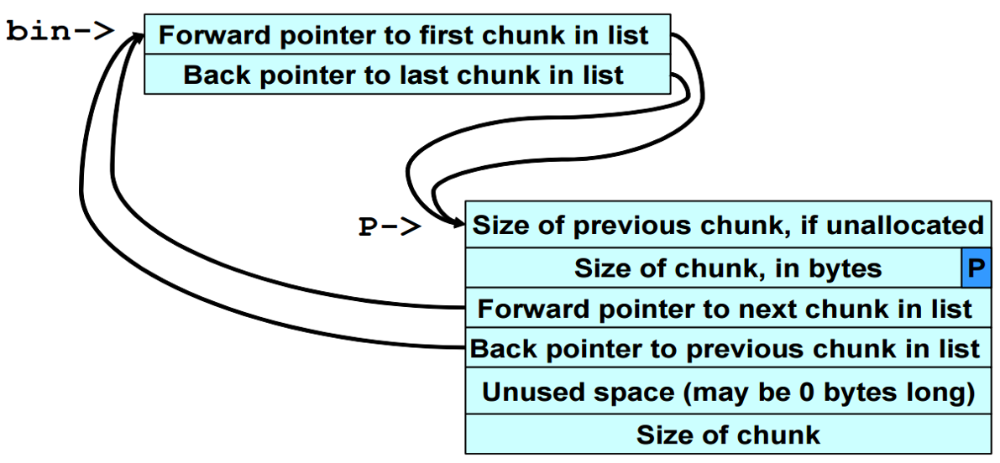
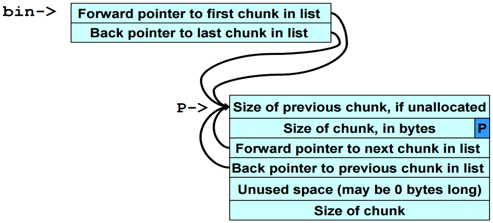
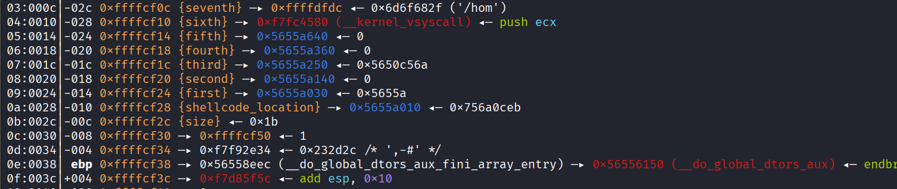

# 双重释放（double-free）
>如果尝试释放一个悬空指针所引用的内存，会如何？

- free()函数中对此的规定：“undefined behavior”
- 问题的爆发点：堆块合并和unlink

## 什么是双重释放
简单来说，就是对同一个内存块（通过同一个指针或指向同一地址的指针）连续调用两次 free()。

## 漏洞原理
在内存中，当一个堆块 P 被分配（In-Use）时，free(P) 会把用户数据区的前 8 个字节（32位系统）拿出来，当作链表指针使用

**关键点**：free() 函数的职责仅仅是把这块内存标记为空闲，并把它挂到 bin 链表里，它不会把指针 P 置空，也不会清除用户数据区的数据。

**如果两次次释放同一个块 P**

- 第一次 free(P)：

  - 系统检查 P 的大小和状态，发现合法。

  - 将 P 的 size 字段的最低位置为 0（标记为空闲）。

  - 将 P 插入到对应的 bin 链表中。假设此时 bin 链表为空，那么 P 就是链表中唯一的块。根据 glibc 的源码逻辑，此时 P 的 fd 和 bk 指针都会指向 bin 链表头（或者指向自己，取决于具体实现，但通常表现为自我闭环）。
    
  - 此时 P 的状态是：空闲，且位于 bin 链表中。

  - 重点：外部的指针 P 依然指着这块内存，但程序逻辑上已经不能再用它了。

- 第二次 free(P)（双重释放）：

  - 程序再次调用 free(P)。此时传入的地址还是那个 P。

  - free() 函数并不知道这个 P 已经被释放过了（因为指针没置空，地址没变）。它只看地址。

  - 它会再次检查 P 的 size 字段。如果攻击者没有伪造数据，此时 size 字段的 P 位已经是 0 了。

    - 在现代 glibc 中，会直接报错并终止程序（抛出 double free or corruption 错误）。因为 glibc 引入了 tcache 机制和一些完整性检查，检测到该块已经在空闲链表中，再次释放就会触发 abort。

    - 但在旧版 glibc 或者攻击者精心构造了数据的情况下（比如利用 UAF 漏洞提前修改了 P 的 size 字段，让 free 函数误以为它是一个新的、合法的空闲块），free(P) 会再次将同一个 P 插入到 bin 链表中。

      - 此时由于 P 被插入了两次，bin 链表中出现了环。
      
      - 假设 bin 链表头是 bin：

      - 第一次释放后：bin -> P，且 P -> bin（自我闭环）。

      - 第二次释放后：free 把 P 再次插入。此时 P 的 fd 指向原来的链表头（也就是它自己），bk 也指向自己。

      - 结果就是：P 的前驱指针 (fd) 和后继指针 (bk) 都指向了 P 自身。

        

**再次分配（malloc）与 unlink 宏**

- 现在，攻击者发起攻击的核心步骤：申请一个与 P 同样大小的内存块。

  - 调用 malloc(size)：

  - malloc 会去对应的 bin 链表中寻找空闲块。

  - 它找到了 P（因为 P 在链表里）。

  - 为了把 P 从链表中拿出来（准备分配给用户），malloc 会调用一个内部宏：unlink(P)。

    - unlink 宏的核心逻辑（简化版）：

        ```c
        // 假设 P 是要被取出的块
        // FD = P->fd (P的前驱)
        // BK = P->bk (P的后继)
        FD->bk = BK;  // 把前驱的后继，指向 P 的后继
        BK->fd = FD;  // 把后继的前驱，指向 P 的前驱
        ```
        - 正常情况（链表没坏）：如果链表是 A <-> P <-> B，那么 unlink(P) 会让 A->bk = B 且 B->fd = A，P 被安全摘除。
        - 双重释放后的情况（链表坏了）
          - 攻击者利用第一次释放后、第二次释放前的空档期（或者通过 UAF 漏洞），篡改 P 的 fd 和 bk 指针。

          - 假设攻击者构造了这样的数据：
            ```
            P->fd = target_addr - 12 (我们想改写的地方)

            P->bk = shellcode_addr (我们想写入的值)

            当 malloc 试图分配 P，触发 unlink 时：

            FD = P->fd = target_addr - 12

            BK = P->bk = shellcode_addr
            ```
          - 执行宏逻辑：FD->bk = BK => *(target_addr - 12 + 12) = shellcode_addr => *(target_addr) = shellcode_addr

          - BK->fd = FD => *(shellcode_addr + 8) = target_addr - 12 (这一步通常会导致崩溃，因为 shellcode_addr 未必可写，但在攻击中，通常会将 shellcode_addr 设置成一个可写的地址，或者利用这步进行二次写入)

          - 最终结果：通过 unlink 宏的 FD->bk = BK 这一句，攻击者成功实现了向任意地址 target_addr 写入任意值 shellcode_addr。

>核心思想：通过释放两次，在空闲链表中制造一个指向自身（或可控地址）的节点。当系统再次分配这个节点时，会触发解链操作，利用解链时的指针赋值（写操作），实现任意地址写，最终劫持程序控制流。


## 现代防御机制

1. Tcache 机制（glibc 2.26+）：引入了 tcache 后，释放的块优先进入 tcache，而不是直接进入 fastbin 或 unsorted bin。tcache 的 unlink 操作非常简单（就是单链表操作，直接取头），根本没有 FD->bk = BK 这种复杂的解链宏。这导致传统的 unlink 攻击直接失效。

2. Tcache Double Free 检测：在 tcache 中，free 函数会检查该块是否已经在 tcache 链表中。如果是，直接报错。

3. Safe-Linking（glibc 2.32+）：对 tcache 和 fastbin 中的 fd 指针进行了加密（fd = ptr ^ (pos >> 12)）。攻击者无法直接伪造 fd 指针，必须先泄露堆地址才能构造攻击。

4. GOT 表保护（Full RELRO）：现代编译默认开启 Full RELRO，GOT 表在程序启动后就被标记为只读，unlink 无法写入 GOT 表。


**现代系统下的演变**

Double Free 不再首选 Unlink

在早期的 glibc（如 2.23 之前），Double Free 确实主要用来打 Unlink 攻击。

但在现代 glibc（2.26+ 引入 Tcache，2.32+ 引入 Safe-Linking）中，Double Free 的利用方式已经发生了根本性改变。它不再倾向于触发复杂的 unlink 宏，而是转向了 Tcache Poisoning（Tcache 投毒）。

**区别如下：**

| 特性 | 传统 Unlink 攻击（基于 Double Free） | 现代 Tcache Poisoning（基于 Double Free） |
|------|--------------------------------------|-------------------------------------------|
| 目标链表 | Fastbin / Unsorted Bin（双向链表） | Tcache（单链表） |
| 核心操作 | 触发 unlink 宏，执行 `FD->bk = BK` 和 `BK->fd = FD` | 直接修改空闲块的 `next` 指针 |
| 写入效果 | 向任意地址写入任意值（写操作复杂，容易崩溃） | 让下一次 `malloc` 返回任意地址（指向目标地址） |
| 完整性检查 | `FD->bk == P` 且 `BK->fd == P`（检查严格） | 早期无检查，现代有 Safe-Linking（指针加密） |
| 利用难度 | 较高（需要构造复杂的伪造块绕过检查） | 较低（只需修改 `next` 指针） |
| 稳定性 | 容易导致程序崩溃 | 相对稳定，精确控制返回地址 |

现在的 Double Free 怎么用？

- 释放 P 两次，导致 Tcache 链表中出现：P -> P（自己指向自己）。

- 此时 malloc 一次，返回 P。Tcache 头变成 P 的 next（也就是 P 自己）。

- 攻击者利用 UAF 修改 P 的 next 指针，使其指向目标地址（如 __free_hook 或 GOT 表）。

- 再次 malloc，返回 P。再次 malloc，就返回了目标地址。

- 向目标地址写入数据（如 system 的地址），完成劫持。

## 漏洞示例

**漏洞c程序**
```c
#include <stdio.h>
#include <stdlib.h>
#include <string.h>

static char *GOT_LOCATION = (char *)0x0804c98c;
static char shellcode[] =
"\xeb\x0cjump12chars_"
"\x90\x90\x90\x90\x90\x90\x90\x90\x90\x90\x90\x90";

int main(void){
    int size = sizeof(shellcode);
    void *shellcode_location;
    void *first, *second, *third, *fourth;
    void *fifth, *sixth, *seventh;
    shellcode_location = (void *)malloc(size);
    strcpy(shellcode_location, shellcode);
    first = (void *)malloc(256);
    second = (void *)malloc(256);
    third = (void *)malloc(256);
    fourth = (void *)malloc(256);
    free(first);
    free(third);
    fifth = (void *)malloc(128);
    free(first);
    sixth = (void *)malloc(256);
    *((void **)(sixth+0))=(void *)(GOT_LOCATION-12);
    *((void **)(sixth+4))=(void *)shellcode_location;
    seventh = (void *)malloc(256);
    strcpy(fifth, "something");
    return 0;
}
```

**动态分析**


