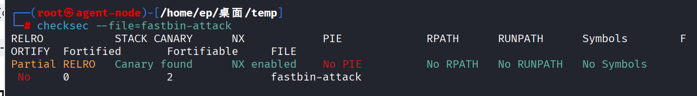
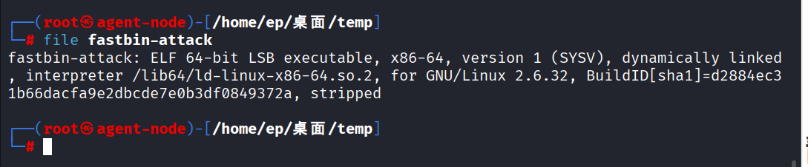

## 题目描述

## 攻击原理
连续释放同一个 Chunk 两次。因为 Fastbin 不检查 Chunk 是否已经处于空闲状态，这会导致同一个 Chunk 被插入链表两次。
后续两次 malloc 会返回同一个地址，导致两个指针指向同一块内存，从而可以修改 Fastbin 的 fd 指针，实现任意地址写。

## 静态分析
`checksec --file=fastbin-attack`


`file fastbin-attack`

64位ELF

## 逆向反编译查看程序逻辑
```

void FUN_00400acd(void)

{
  int iVar1;
  long in_FS_OFFSET;
  char local_28 [24];
  undefined8 local_10;
  
  local_10 = *(undefined8 *)(in_FS_OFFSET + 0x28);
  local_28[0] = '\0';
  local_28[1] = '\0';
  local_28[2] = '\0';
  local_28[3] = '\0';
  local_28[4] = '\0';
  local_28[5] = '\0';
  local_28[6] = '\0';
  local_28[7] = '\0';
  local_28[8] = '\0';
  local_28[9] = '\0';
  local_28[10] = '\0';
  local_28[0xb] = '\0';
  local_28[0xc] = '\0';
  local_28[0xd] = '\0';
  local_28[0xe] = '\0';
  local_28[0xf] = '\0';
  do {
    puts("choice>");
    fgets(local_28,8,stdin);
    iVar1 = atoi(local_28);
    switch(iVar1) {
    default:
      puts("invalid");
      break;
    case 1:
      FUN_00400916();
      break;
    case 2:
      FUN_004009d7();
      break;
    case 3:
      FUN_00400a4d();
      break;
    case 4:
      FUN_00400896();
      break;
    case 5:
                    /* WARNING: Subroutine does not return */
      exit(0);
    }
  } while( true );
}
```
case 1
```

void FUN_00400916(void)

{
  int iVar1;
  int iVar2;
  ulong __size;
  void *pvVar3;
  long in_FS_OFFSET;
  char local_38 [24];
  long local_20;
  
  local_20 = *(long *)(in_FS_OFFSET + 0x28);
  if (DAT_006020bc < 4) {          // 检查分配次数，上限为 4 次
    puts("size>");
    fgets(local_38, 8, stdin);
    iVar2 = atoi(local_38);      // 读取用户输入的大小
    iVar1 = DAT_006020bc;        // 保存当前索引
    __size = (ulong)iVar2;
    if ((__size == 0) || (0x78 < __size)) {  // 限制大小：1~120 字节
        puts("No need");
    } else {
        DAT_006020bc = DAT_006020bc + 1;     // 计数器 +1
        pvVar3 = malloc(__size);             // 申请内存
        *(void **)(&DAT_006020c0 + (long)iVar1 * 8) = pvVar3; // 指针存入数组
    }
}
  else {
    puts("No need");
  }
  if (local_20 != *(long *)(in_FS_OFFSET + 0x28)) {
                    /* WARNING: Subroutine does not return */
    __stack_chk_fail();
  }
  return;
}
```

case 2
```

void FUN_004009d7(void)

{
  int iVar1;
  long in_FS_OFFSET;
  char local_28 [24];
  long local_10;
  
  local_10 = *(long *)(in_FS_OFFSET + 0x28);
  puts("index>");
fgets(local_28, 8, stdin);
iVar1 = atoi(local_28);
free(*(void **)(&DAT_006020c0 + (long)iVar1 * 8)); // 释放指针，但不清空！
  if (local_10 != *(long *)(in_FS_OFFSET + 0x28)) {
                    /* WARNING: Subroutine does not return */
    __stack_chk_fail();
  }
  return;
}

```
case 3
```

void FUN_00400a4d(void)

{
  int iVar1;
  long in_FS_OFFSET;
  char local_28 [24];
  long local_10;
  
  local_10 = *(long *)(in_FS_OFFSET + 0x28);
  puts("index>");
fgets(local_28, 8, stdin);
iVar1 = atoi(local_28);
read(0, *(void **)(&DAT_006020c0 + (long)iVar1 * 8), 8); // 向 ptrs[idx] 写入 8 字节
  if (local_10 != *(long *)(in_FS_OFFSET + 0x28)) {
                    /* WARNING: Subroutine does not return */
    __stack_chk_fail();
  }
  return;
}

```

case 4
```

void FUN_00400896(void)

{
  if (DAT_00602090 == 0) {
    system("/bin/sh");      // 如果 0x602090 处的值为 0，直接给 shell！
  }
  else {
    puts("Not yet");
  }
  return;
}

```

## 反向推理

要让 malloc 返回 0x602090。由于 malloc 返回的是 Chunk 的 Payload 地址，所以伪造的 Chunk 头部起始地址应该是 0x602090 - 8 = 0x602088。

但为了满足 Fastbin 对 Chunk 地址 16 字节对齐的要求，我们需要把伪造的 Chunk 起始地址设为 0x602080（因为 0x602080 是 16 的倍数）。

这样，伪造 Chunk 的 size 字段就位于 0x602080 + 8 = 0x602088，而这里预置的值恰好是 0x50！

0x50 是一个合法的 Fastbin size（大小为 80 字节），完全符合 Fastbin 对 Chunk 大小的要求。

结论：程序作者故意在 .data 段预置了 0x50，这就是在暗示我们：使用 Fastbin Attack，把目标地址伪造在 0x602080 处。
