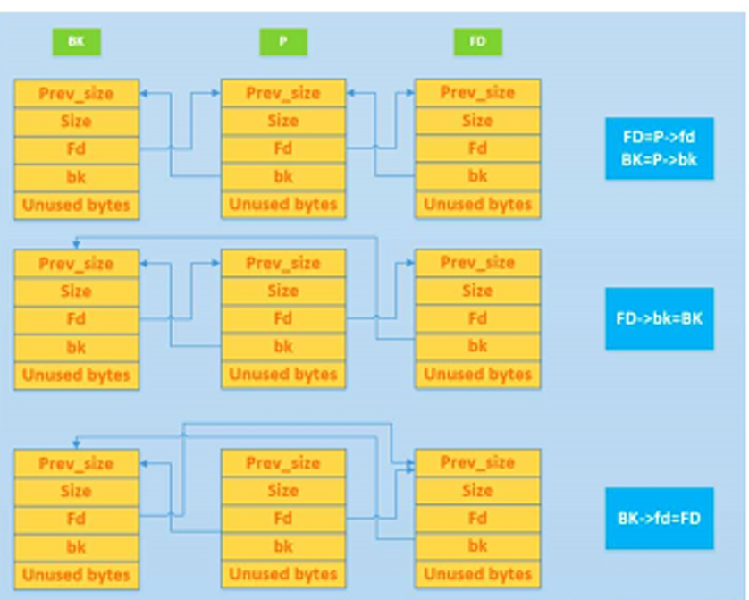
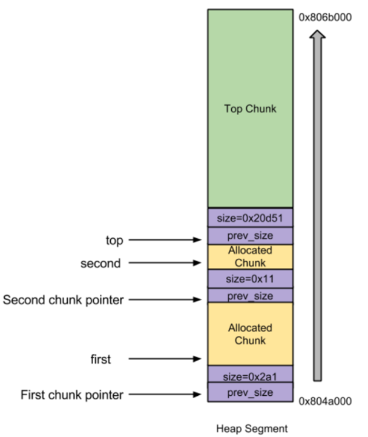

# unlink攻击

## unlink

**Unlink 的定义与核心机制**
unlink 用来将一个双向链表（只存储空闲的 chunk）中的一个元素取出来

- 功能：unlink 操作的本质是将一个指定的 Chunk 从其所在的双向链表（Bin）中移除（脱链）

- 数据结构前提：该操作仅适用于双向链表，即管理 Unsorted Bin、Small Bin、Large Bin 的结构。

- 当执行 unlink(P) 时，其核心逻辑为：

  ```c
  FD = P->fd;  // 获取 P 的前向指针
  BK = P->bk;  // 获取 P 的后向指针
  FD->bk = BK; // 将 FD 的后向指针指向 BK
  BK->fd = FD; // 将 BK 的前向指针指向 FD
  ```
  这四行代码的作用是将 Chunk P 从链表中“摘除”，使得 P 的前后节点直接相连。
  

**Unlink 的四种主要使用场景**

1. malloc（内存分配）
  - 场景 A：从恰好大小合适的 Large Bin 中获取 Chunk。

    当用户申请的内存大小与某个 Large Bin 中 Chunk 的大小完全一致时，malloc 会直接将该 Chunk 从链表中 unlink 下来，分配给用户。

  - 场景 B：从比请求的 Chunk 所在的 Bin 大的 Bin 中取 Chunk。

    当没有精确匹配的 Chunk 时，malloc 会去更大的 Bin 中寻找。找到后，会将该 Chunk unlink，分割出一部分给用户，剩余部分放回 Unsorted Bin。


2. free（内存释放）
   一旦涉及到free内存（非mmaped的chunks的回收机制），那么就意味着有新的chunk由allocated状态变成了free状态，此时glibc malloc就需要进行合并操作——向前以及(或)向后合并

  - 将previous free chunk合并到当前free chunk，叫做向后合并；将后面的free chunk合并到当前free chunk，叫做向前合并
 
    - 后向合并（Backward Consolidation）：合并物理相邻的低地址空闲 Chunk。此时，需要将低地址的空闲 Chunk 从它所在的 Bin 中 unlink 出来，然后与当前 Chunk 合并。

    - 前向合并（Forward Consolidation）：合并物理相邻的高地址空闲 Chunk（除了 Top Chunk）。同样，需要将高地址的空闲 Chunk unlink 出来进行合并。

3. malloc_consolidate（Fast Bin 合并）
  - 当触发 Fast Bin 的清理机制时，ptmalloc 会遍历 Fast Bin，将其中所有 Chunk 取出。

  - 在这个过程中，如果发现 Fast Bin 中的 Chunk 与相邻的空闲 Chunk 物理相邻，就会执行 unlink 操作，将相邻的空闲 Chunk 从它所在的 Bin（如 Unsorted Bin）中摘除，然后进行合并。

4. realloc（内存重分配）
  - 前向扩展：当使用 realloc 扩大内存时，如果当前 Chunk 后面的物理相邻 Chunk 是空闲的（且不是 Top Chunk），ptmalloc 会将该空闲 Chunk unlink 出来，合并到当前 Chunk 中，以满足扩展需求。

>Fast Bin 不使用 unlink。这是因为 Fast Bin 采用单向链表，且不进行合并操作。正因为缺少 unlink 的完整性校验，Fast Bin 成为了堆漏洞（如 Fastbin Attack）的高发区。


## 攻击unlink
>核心就是理解与利用glibc malloc的free机制

**Unlink Attack 的原理（针对旧版 libc）**

- 攻击者通过堆溢出，覆盖一个空闲 Chunk 的 fd 和 bk 指针（例如，将 fd 设为 free 函数的 GOT 表地址 - 12，将 bk 设为 Shellcode 的地址）。

- 当触发 unlink 时，宏执行 FD->bk = BK，实际上就是将 Shellcode 的地址写入了 GOT 表。

- 下次程序调用 free 时，就会跳去执行 Shellcode。

**示例**

```
/*
   Heap overflow vulnerable program.
 */
#include<stdlib.h>
#include<string.h>

int main( intargc, char * argv[] )
{
char * first, * second;

first= malloc( 666 );
second= malloc( 12 );
if(argc!=1)
    strcpy( first, argv[1] );
free(first );
free(second );
return( 0 );
}
```

**代码逻辑**

- first = malloc(666);：申请一块内存，返回指针 first。

- second = malloc(12);：申请第二块内存，返回指针 second。

- strcpy(first, argv[1]);：漏洞点。使用 strcpy 将命令行参数复制到 first 指向的内存中。strcpy 不检查长度，若输入超长，会溢出覆盖到物理相邻的 second Chunk。

- free(first);：释放 first。

- free(second);：释放 second。

**初始状态内存布局**



first Chunk在低地址，second Chunk在高地址，紧邻 Top Chunk。

此时，first 和 second 都处于已分配（Allocated）状态，它们的 size 字段低位的 PREV_INUSE 标志位为 1。

**攻击者精心构造的溢出数据**

攻击者在执行 strcpy 时，输入了精心构造的恶意数据。这些数据不仅填满了 first Chunk 的数据区，还溢出了 first 的边界，覆盖了物理相邻的下一个 Chunk（即 second Chunk）的头部结构。

被篡改的 second Chunk 头部字段如下：

- prev_size = 一个偶数：

  - prev_size 字段用于记录前一个 Chunk（即 first）的大小。

  - 设置为偶数，是为了保证其二进制最低位为 0。

- size = -4：

  - 这是关键操作，size 字段存储了当前 Chunk 的大小以及标志位。

  - 在 32 位系统中，size 的低 3 位是标志位，其中最低位（第 0 位）是 PREV_INUSE（P位）。

  - -4 的十六进制补码是 0xFFFFFFFC。它的最低位是 0。

  - 这导致 second Chunk 的 size 字段的 PREV_INUSE 位被强制置为 0。

  - 效果：欺骗 glibc malloc，让它误以为 second Chunk 的前一个 Chunk（即 first）是空闲的。

- fd = free函数的got表地址 - 12：

  - 攻击者将 second Chunk 的 fd（前向指针）指向了目标地址。

  - 减去 12 是为了补偿 unlink 宏中 FD->bk = BK 操作时的偏移量（因为 bk 在 Chunk 结构中的偏移量是 12 字节）。

- bk = shellcode的地址：

  - 攻击者将 second Chunk 的 bk（后向指针）指向了存放在内存某处的 Shellcode（恶意代码）的起始地址。


**触发 Unlink 操作**

- 程序执行到free(first);

  free() 函数在释放 first 时，会进行合并操作。它的检查逻辑如下：

  - 向后合并（合并低地址 Chunk）：检查 first 前一个 Chunk 是否空闲。由于 first 是堆中第一个分配的 Chunk，其前一个 Chunk 不是空闲的，因此不发生向后合并。

  - 向前合并（合并高地址 Chunk）：检查 first 的下一个 Chunk（即 second）是否空闲。

  - free() 会读取 second Chunk 的 size 字段。

    - 因为攻击者将 size 设置为 -4，其 PREV_INUSE 位为 0，free() 误认为 second 是空闲的。

  - 于是，free() 决定将 second 合并到 first 中。合并的前提是先将 second 从它所处的空闲链表（Bin）中“摘除”。

  - 这会调用 unlink(second)

    ```c
    FD = P->fd;  // FD = (free_addr - 12)
    BK = P->bk;  // BK = shellcode_addr
    FD->bk = BK; // 即 (free_addr - 12) + 12 = shellcode_addr  => free_addr = shellcode_addr
    BK->fd = FD; // 即 shellcode_addr + 8 = free_addr - 12
    ```

  - **关键结果**
    
    - FD->bk = BK 这一行代码执行后，实际上是将 BK 的值（Shellcode 地址）写入了 FD->bk 指向的地址。由于 FD 被设置为 free_addr - 12，计算后的目标地址正是 free 函数在 GOT 表中的地址。
    - 因此，free 函数的 GOT 表项被成功篡改为 Shellcode 的地址。

**地址篡改原理详解**

Chunk 的头部结构
```text
Chunk P 的地址布局：
[ P + 0  ] -> prev_size (4字节)
[ P + 4  ] -> size      (4字节)
[ P + 8  ] -> fd        (4字节)  <-- 注意：fd 在 P+8 的位置
[ P + 12 ] -> bk        (4字节)  <-- 注意：bk 在 P+12 的位置
[ P + 16 ] -> 用户数据区 (Payload)
```
关键点：fd 在结构体里的偏移量是 8，bk 在结构体里的偏移量是 12。


攻击者在溢出数据中，把 P 这个 Chunk 的 fd 和 bk 字段篡改成了特定的值

- FD = P->fd：读取 P 的 fd 字段的值。攻击者把它设为 free_addr - 12。

- 所以，FD 的值 = free_addr - 12。

- BK = P->bk：读取 P 的 bk 字段的值。攻击者把它设为 shellcode_addr。

- 所以，BK 的值 = shellcode_addr。

此时，这两个只是变量（指针），它们指向了攻击者指定的地址。

*理解 FD->bk = BK*

向 FD 这个指针指向的结构体的 bk 字段，写入 BK 的值。

但C 语言编译器是通过 FD 的地址 + bk 字段的偏移量 来计算的

- FD 的地址 = free_addr - 12

- bk 字段的偏移量 = 12

- 所以，FD->bk 这个内存地址实际上是(free_addr - 12) + 12 = free_addr

最终把 BK 的值（shellcode_addr）写入到 free_addr 这个内存地址里

>free_addr 是 free 函数在 GOT 表中的地址。这行代码成功地将 free 函数的 GOT 表项篡改成了 shellcode_addr。下次程序调用 free 时，就会跳去执行 Shellcode。

BK->fd = FD 的意思是：向 BK 这个指针指向的结构体的 fd 字段，写入 FD 的值。

同样，编译器通过 BK 的地址 + fd 字段的偏移量 来计算：

- BK 的地址 = shellcode_addr

- fd 字段的偏移量 = 8

- 所以，BK->fd 这个内存地址实际上是：shellcode_addr + 8

这行代码执行的操作是：把 FD 的值（free_addr - 12）写入到 shellcode_addr + 8 这个内存地址里。

*攻击效果*
这行代码的作用是为了维持链表的完整性，防止程序在后续操作中因为链表断裂而崩溃。它把 shellcode_addr + 8 这个位置的内容改写成了 free_addr - 12，使得链表看起来仍然是合法的。

**劫持程序执行流**

程序执行到free(second);。

- 程序再次调用 free 函数。

- 由于free 函数的 GOT 表项已经被改写为 Shellcode 的地址。

- CPU 不会去执行原本的 free 函数代码，而是直接跳转到 Shellcode 的地址 开始执行。

**最终效果**
攻击者成功通过堆溢出漏洞，实现了任意代码执行（执行了 Shellcode）

**现代防护（libc 2.23 之后）**

- 在执行 unlink 前，会检查 P->fd->bk == P 且 P->bk->fd == P。

- 这意味着，如果攻击者伪造了 fd 和 bk，它们必须指向一个合法的、互相指向的结构。简单的伪造（如上述的 GOT 表攻击）会导致检查失败，程序报错（corrupted double-linked list）。

- 因此，简单的 Unlink 攻击在现代系统上已经失效，仅存在于低版本（如 libc-2.23）的环境中。

