# 缓冲区溢出——栈溢出

## 栈的构造与动态行为

堆栈增长方向相反，栈从高地址向低地址增长
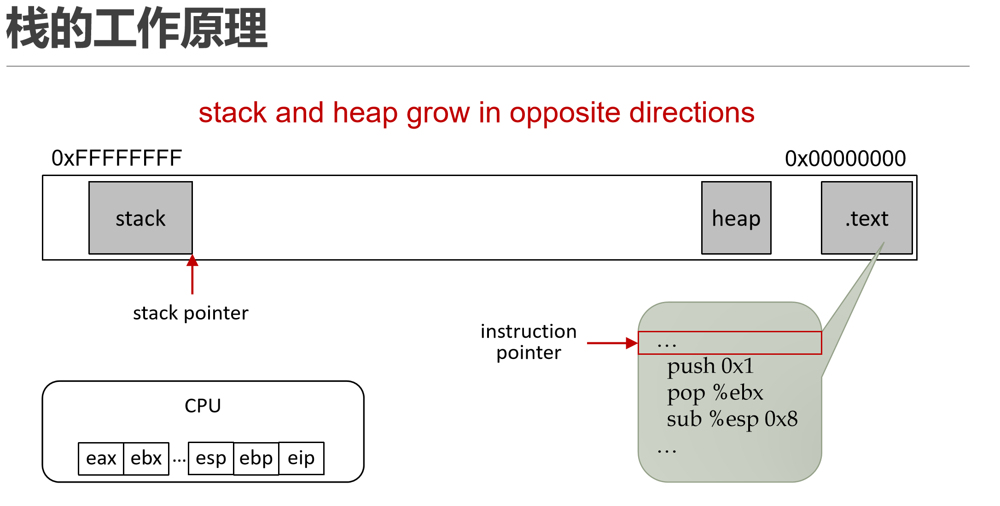

在x86处理器中，EIP(Instruction Pointer)是指令寄存器，指向处理器下条等待执行的指令地址(代码段内的偏移量)，每次执行完相应汇编指令EIP值就会增加
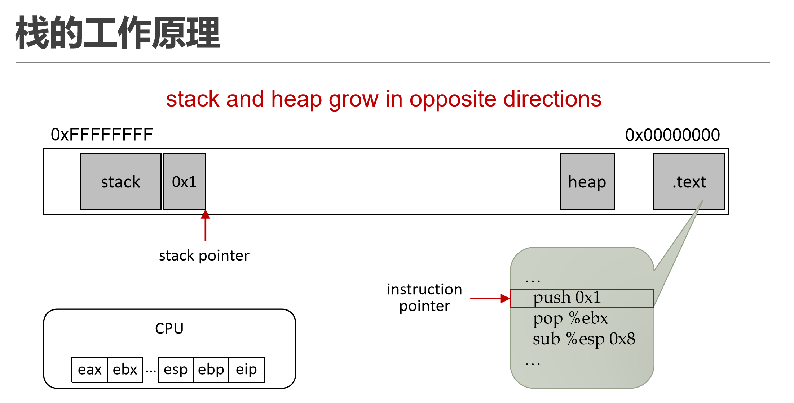
push入栈，pop出栈并将栈上的值保存到寄存器中
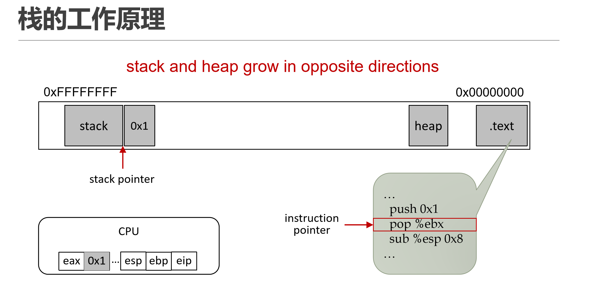

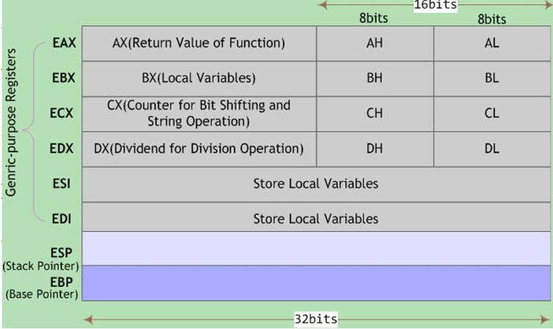
## 栈的工作原理

□ 程序的执行过程，可视为连续的函数调用。当一个函数执行完毕，程序回到调用指令的下一条指令处继续执行

□ 函数调用过程通常用堆栈实现，每个用户进程对应一个调用栈结构

□ 编译器使用堆栈传递函数参数、保存返回地址、临时保存寄存器原有值以备恢复以及存储本地局部变量

### 栈的作用：为函数的调用和执行维护存储结构

- 函数调用时
- 函数返回时

### 基础规定

□ 程序的堆栈是由CPU直接支持，在X86体系中，栈在内存中是从高向底地址扩展，栈顶地址是不断减小的，越后入栈的数据，所处的的地址越低。32位系统中，堆栈中每个数据单元的大小为4字节。用于存储函数的参数，局部变量，寄存器的值（用以恢复寄存器），函数的返回地址等

□ 与堆栈的操作相关的两个寄存器分别为ESP寄存器和EBP寄存器

  - ESP寄存器又称栈顶指针，执行PUSH指令，ESP-4，将数据拷贝到ESP指向的地址；执行POP指令，先将ESP指向的数据拷贝到内存地址/寄存器中，然后ESP+4

  - EBP又称为帧基指针，用于访问堆栈中的数据，函数的参数地址比EBP值高，局部变量地址比EBP低，因而可以使用EBP加或者减一定的偏移地址来访问函数的参数或局部变量


### 函数调用时栈帧（Stack Frame）的建立和销毁过程
>压参 -> 调函数 -> 保存旧栈底 -> 建立新栈底 -> 分配局部变量 -> ... -> 回收局部变量 -> 恢复旧栈底 -> 返回

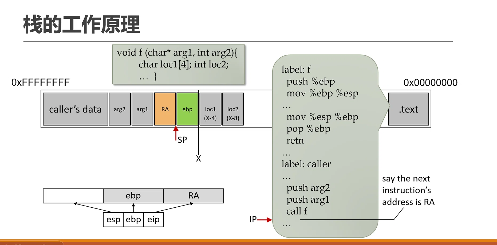

**函数调用前的准备**

- 传参：在调用函数 f 之前，调用者（caller）先把参数压入栈中。注意顺序是从右向左：先 push arg2，再 push arg1。

- 调用：执行 call f 指令。这个指令会把下一条指令的地址（返回地址 RA）压入栈中，然后跳转到函数 f 的代码处执行。

**栈内存的物理布局**

- caller's data：调用者之前的局部数据。

- arg2, arg1：刚才压入的被调用函数参数。

- RA (Return Address)：返回地址，这是 call 指令自动压入的。当函数执行完，CPU 会跳回这里。

- ebp (Old EBP)：调用者原来的栈底指针（图中标为绿色）。这是进入函数 f 后第一件事压入的，为了函数返回时能恢复调用者的栈。

- loc1 (X-4), loc2 (X-8)：函数 f 内部的局部变量（比如代码里的 char loc1[4] 和 int loc2）


**函数内部的汇编指令**

这部分详细描述了函数 f 被调用后，在汇编层面做了什么（建立栈帧）：

- push %ebp：把调用者的 EBP 压入栈（对应左侧绿色的 ebp 块）。

- mov %ebp %esp：把当前栈顶指针 ESP 的值赋给 EBP。这一步非常关键，它确立了当前函数 f 的“基准点”（图中标有 X 的位置）。之后，局部变量通过 EBP - 偏移量 来寻址（比如 loc1 在 EBP-4，loc2 在 EBP-8），参数通过 EBP + 偏移量 来寻址。

- mov %esp %ebp：准备返回。把 EBP 的值赋给 ESP，相当于直接回收了局部变量的空间（栈顶指针回到基准点）。

- pop %ebp：弹出栈顶的值（也就是最初压入的旧 EBP），恢复到调用者的栈底。

- retn：返回。这个指令会自动弹出栈顶的值（也就是 RA 返回地址）给 EIP 寄存器，CPU 据此跳回调用者继续执行。

### 栈帧结构

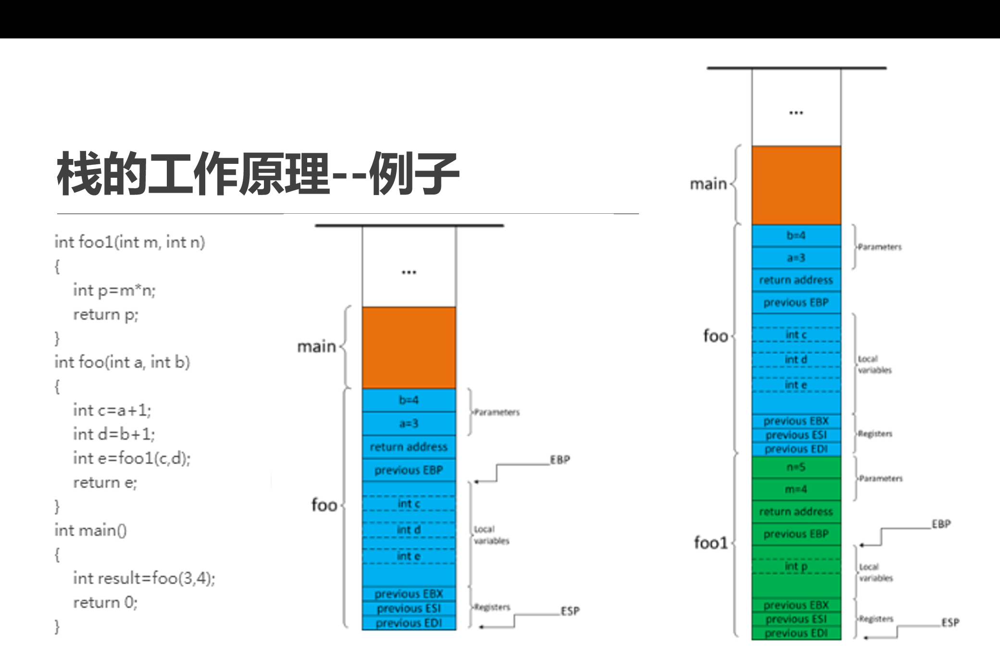
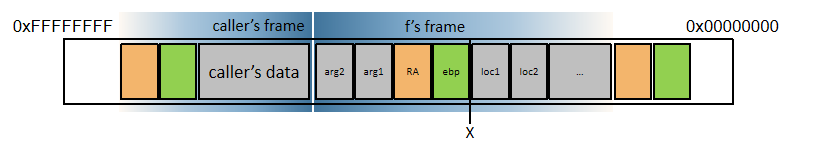

>实参N——1→主调函数返回地址→主调函数帧基指针EBP→被调函数局部变量1——N

可见：调用函数将在栈上创建一个结构化空间

- 称为栈帧
- 锚点：函数被调用时的栈指针位置为
- 可用于对函数的局部数据寻址 / 返回到调用者

## 栈溢出

- 从缓冲区开始
  
  - 缓冲区是内存的一部分空间，用来缓冲输入输出的数据
  - 目的是提高CPU效率
  - 很多时候，函数执行中需要局部分配较大的线性内存空间
  
  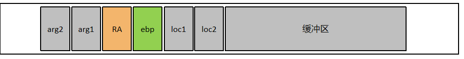

- 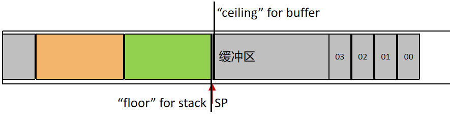

  - 栈增长方向 --- High → Low
  - 缓冲区增长方向 --- Low → High
  - 一旦缓冲区数据“飞跃天花板”，就会造成缓冲区溢出

- 缓冲区应该足够大，且写入数据前应该先检查是否仍有剩余空间可用

- 然而思维盲区 + 设计赶不上发展
  - 开发者有时只考虑到了“被操作对象的结构是合法的”这一种情况
  - 二进制代码的底层细节较为复杂，容易使人忽略问题的存在
  - 一些重要的遗产代码（legacy code）在最初的设计中存在此类缺陷

### 栈溢出实例

```
	#include <stdio.h>
	int main(){
		char name[16];
		gets(name);
		for(int i=0;i<16&&name[i];i++)
		printf(“%c”,name[i]);
 	} 
```
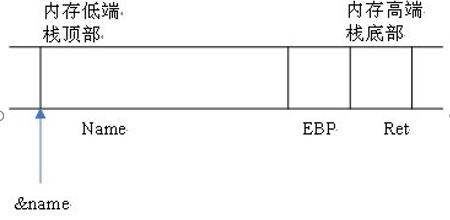

在调用main()函数时

- 先在栈底压入返回地址
- 接着将栈指针EBP入栈，并把EBP修改为现在的ESP
- 之后ESP减16，即向上增长16个字节，用来存放name[]数组

缓冲区的长度即为16字节

- 正常情况
  - 编译上述代码，输入hello world！
  - 结果会输出hello world！ 
  - 执行完gets(name)之后
  - 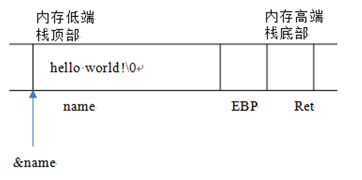

- 溢出情况
  - 如果输入的字符串长度超过16个字节输入：hello world!AAAAAAAA……
  - 当执行完gets(name)之后，栈的情况
  - 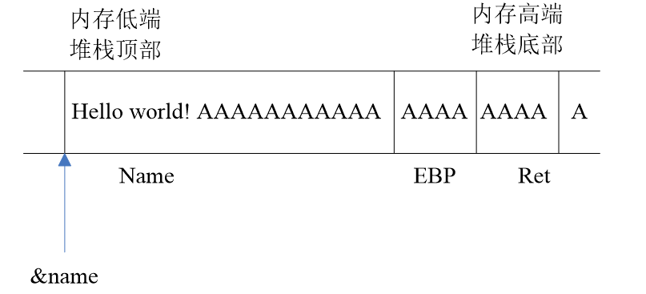
  - 从main返回时，就必然会把‘AAAA’的ASCII码——0x41414141视作返回地址
  - CPU会试图执行0x41414141处的指令，这样就产生了一次堆栈溢出

## 现有栈溢出防护技术

### 数据执行保护（Data Execution Prevention）

- 机制： 给内存页加一个标识位。让栈和堆的内存页要么“可写”，要么“可执行”，不能同时可写又可执行。

- 效果： 黑客把恶意代码写到栈上，但因为栈被标记为“不可执行”，CPU 拒绝执行，攻击失败。

- 缺点： 它不能阻止溢出发生（数据照样被覆盖），只是阻止了执行。黑客可以用“ROP（返回导向编程）”技术绕过它。

### 栈金丝雀（Stack Canaries）

- 机制： 在局部变量和返回地址之间，插入一个随机数（金丝雀）。函数返回前，检查这个数有没有被改变。

- 效果： 如果黑客溢出覆盖了返回地址，必然也会覆盖这个金丝雀。系统发现金丝雀死了，就知道出事了，立刻终止程序。

- 缺点： 有“升洞大”（可能被绕过）的问题，且不是对每个函数都起作用。

### 影子栈（Shadow Stack）

- 机制： 在内存里开两块栈。主栈和影子栈，“影子栈”只存返回地址。函数返回时，对比主栈和影子栈里的返回地址是否一致。

- 效果： 非常强大。黑客在主栈里覆盖了返回地址，但影子栈里的地址是安全的，一对比就露馅了。

### 分离的控制/数据栈（SCADS）

- 机制：直接分配两个物理栈，一个专门存控制流（返回地址、参数），一个专门存数据（局部变量、缓冲区）。

- 效果： 从物理上隔绝了数据溢出对控制流的破坏。

- 缺点： 无法保护遗留代码（Legacy Code），不适用于纯汇编写的函数。