# 部署

## pfSense
>从 MONITOR 或 DC01 访问 pfSense Web 界面

**第一步：登录 pfSense Web 界面**

在 MONITOR 上打开浏览器，访问：

```text
https://10.10.30.1
```
- 用户名：admin

- 密码：之前修改过的密码

浏览器提示证书不受信任时，点击“高级” → “继续访问”。


**第二步：配置 WAN 接口规则**

进入 Firewall → Rules → WAN 标签。

*规则1：允许 ICMP*

点击 Add（向上箭头图标）：

| 字段 | 值 |
|------|-----|
| Action | Pass |
| Interface | WAN |
| Address Family | IPv4 |
| Protocol | ICMP |
| ICMP type | Echo request |
| Source | any |
| Destination | WAN address |
| Description | Allow ICMP for lab |

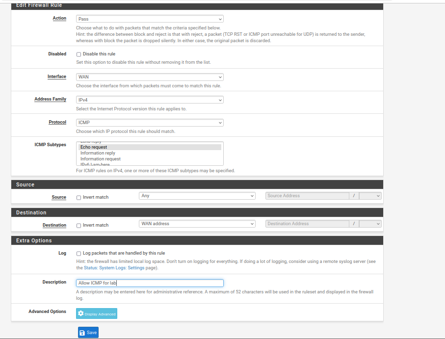

点击 Save。

*规则2：允许访问 DMZ Web*

再次点击 Add：


| 字段 | 值 |
|------|-----|
| Action | Pass |
| Interface | WAN |
| Protocol | TCP |
| Source | any |
| Destination | OPT1 subnets |
| Destination Port Range | 80 |
| Description | Allow Web to DMZ |

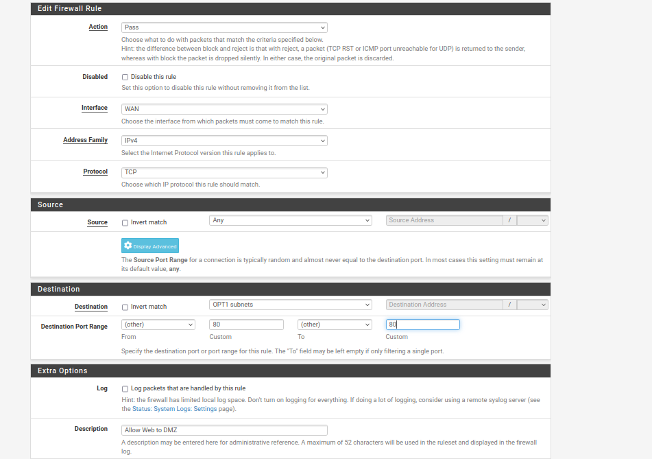
点击 Save

再次点击 Add：


| 字段 | 值 |
|------|-----|
| Action | Pass |
| Interface | WAN |
| Protocol | TCP |
| Source | any |
| Destination | OPT1 subnets |
| Destination Port Range | 8080 |
| Description | Allow Web to DMZ |

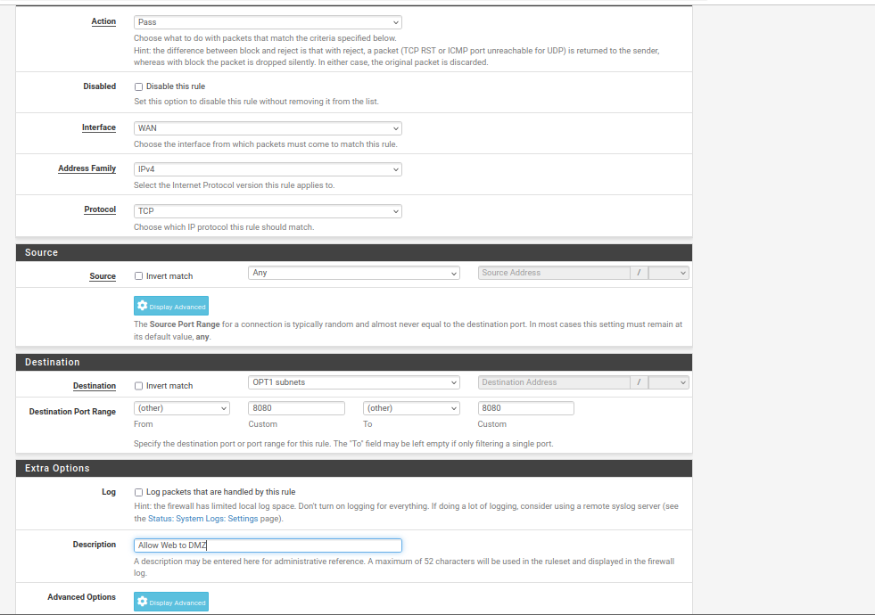
点击 Save

再次点击 Add：


| 字段 | 值 |
|------|-----|
| Action | Pass |
| Interface | WAN |
| Protocol | TCP |
| Source | any |
| Destination | OPT1 subnets |
| Destination Port Range | 443 |
| Description | Allow Web to DMZ |

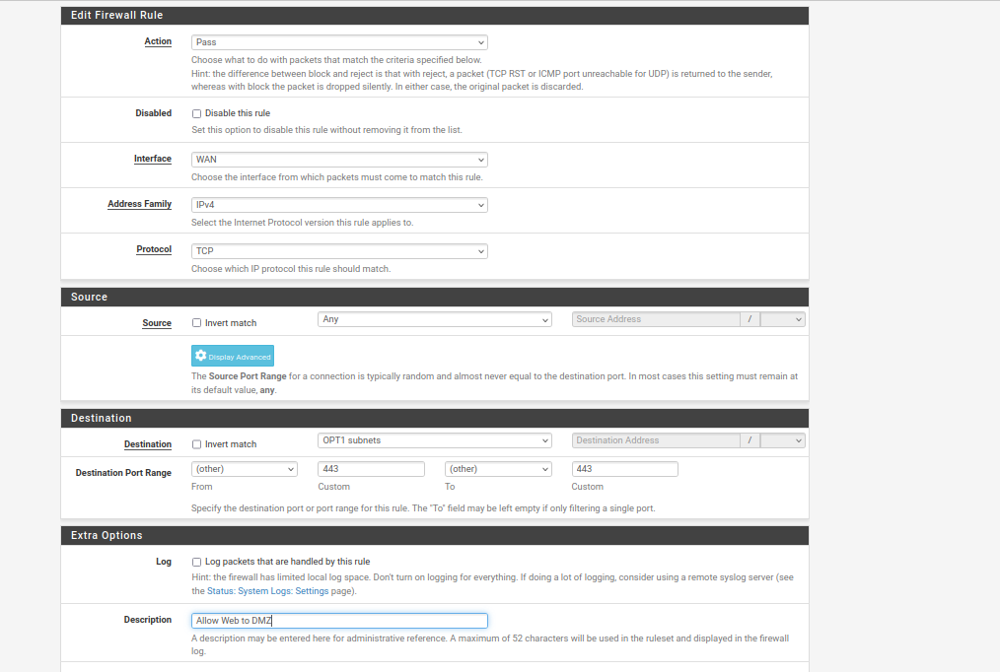
点击 Save

*规则3：阻止 WAN 访问 LAN*

再次点击 Add：

| 字段 | 值 |
|------|-----|
| Action | Block |
| Interface | WAN |
| Protocol | any |
| Source | any |
| Destination | LAN net |
| Description | Block WAN to LAN |

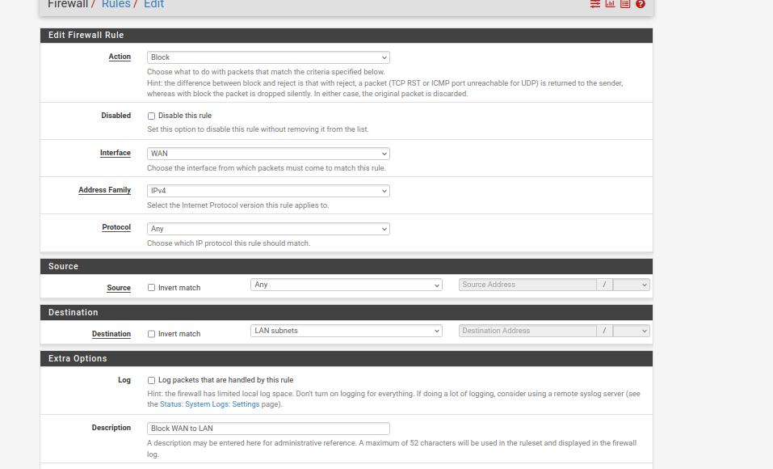
点击 Save。

点击右上角 “Apply Changes”
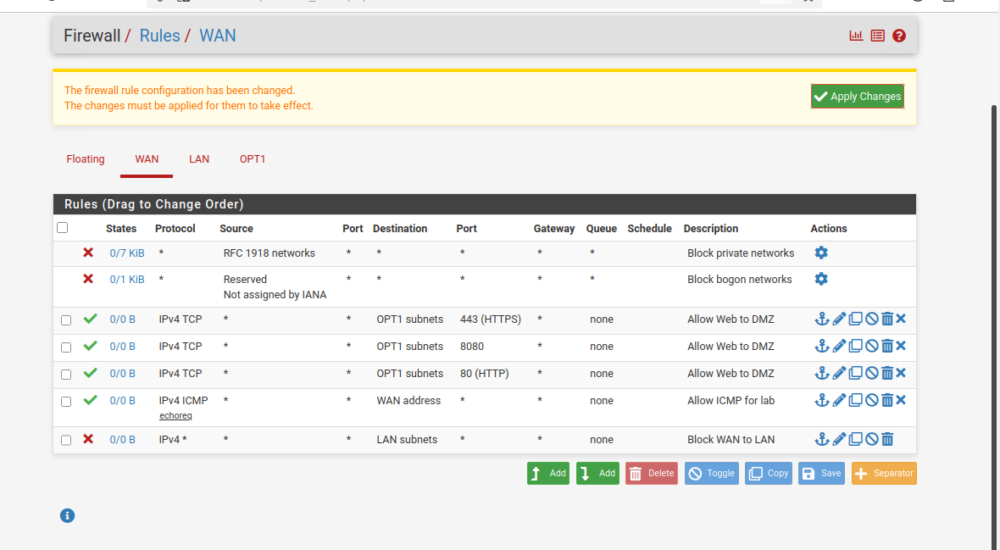

**第三步：配置 DMZ 接口规则**

进入 Firewall → Rules → OPT1 标签。

*规则1：允许 DMZ 访问 LAN 数据库端口*

点击 Add：

| 字段 | 值 |
|------|-----|
| Action | Pass |
| Interface | OPT1 |
| Protocol | TCP |
| Source | OPT1 subnets |
| Destination | LAN subnets |
| Destination Port Range | 3306 |
| Description | Allow DB from DMZ |

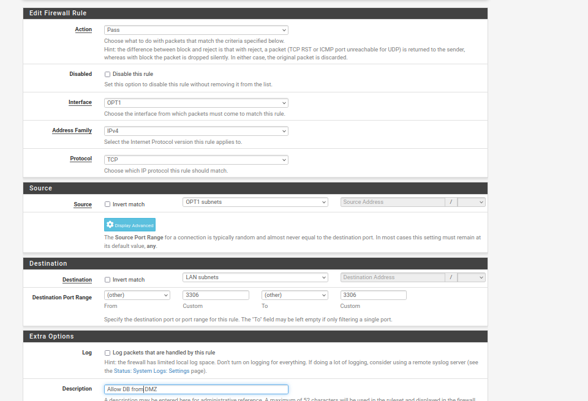
点击 Save。

点击 Add：

| 字段 | 值 |
|------|-----|
| Action | Pass |
| Interface | OPT1 |
| Protocol | TCP |
| Source | OPT1 subnets |
| Destination | LAN subnets |
| Destination Port Range | 1433 |
| Description | Allow DB from DMZ |

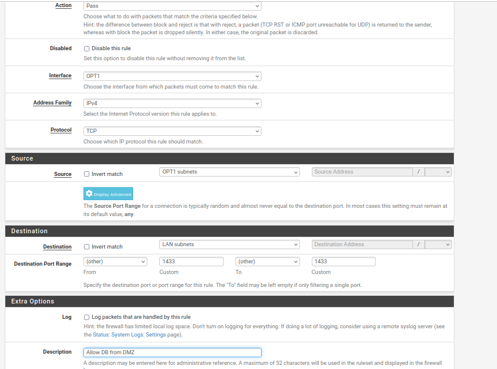
点击 Save。

*规则2：阻止 DMZ 访问 LAN 其他端口*

再次点击 Add：

| 字段 | 值 |
|------|-----|
| Action | Block |
| Interface | OPT1 |
| Protocol | any |
| Source | OPT1 subnets |
| Destination | LAN subnets |
| Description | Block DMZ to LAN |

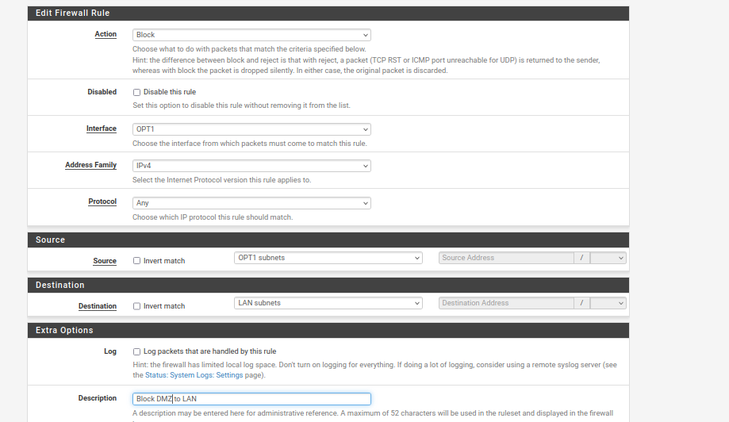
点击 Save。

*在 Block 规则上面，添加一条允许 DMZ 出站的规则：*

点击 Add：

| 字段 | 值 |
|------|-----|
| Action | Pass |
| Interface | OPT1 |
| Protocol | any |
| Source | OPT1 subnets |
| Destination | any |
| Description | Allow DMZ outbound |

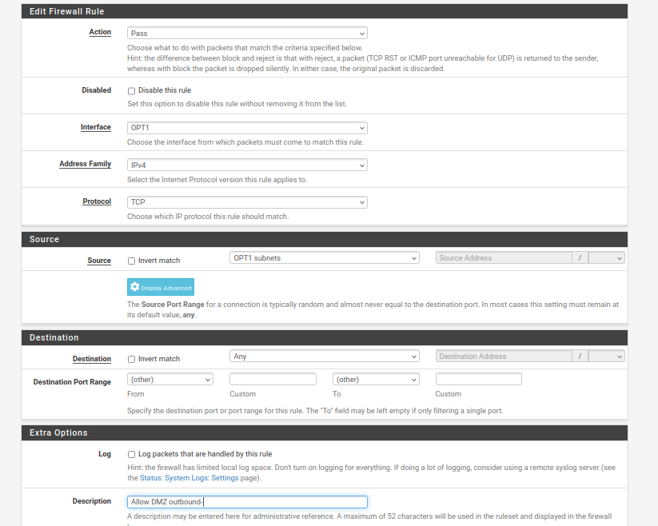
点击 Save。

在 OPT1 规则最上面，加一条允许 DMZ 访问 pfSense 自身的规则：

点击 Add：

| 字段 | 值 |
|------|-----|
| Action | Pass |
| Interface | OPT1 |
| Protocol | any |
| Source | OPT1 subnets |
| Destination | This Firewall (self) |
| Description | Allow DMZ to pfSense |

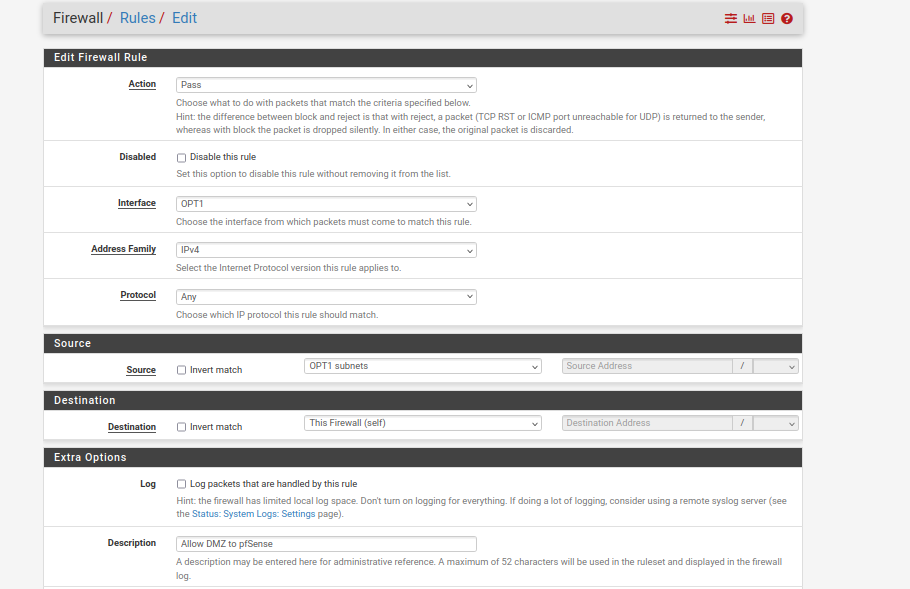

| 字段 | 值 |
|------|-----|
| Action | Pass |
| Interface | OPT1 |
| Protocol | ICMP |
| Source | OPT1 subnets |
| Destination | LAN subnets |
| Description | Allow ICMP reply to LAN |

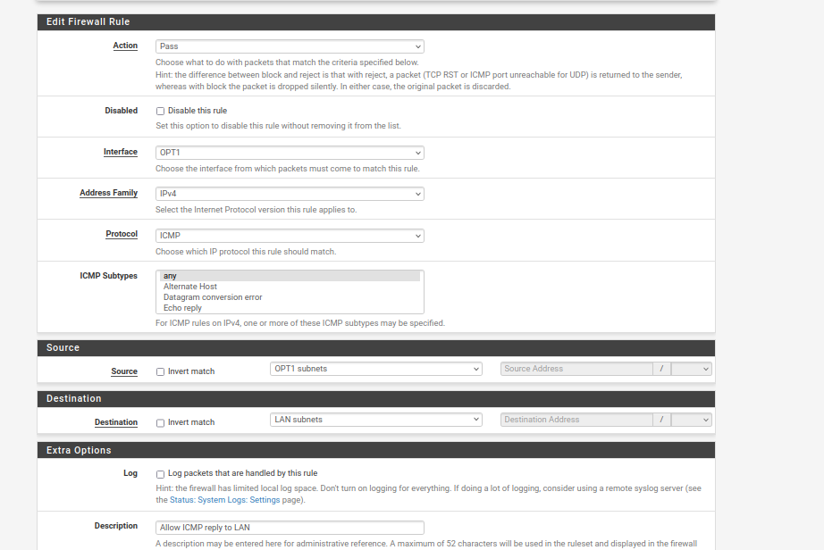
点击 “Apply Changes”。
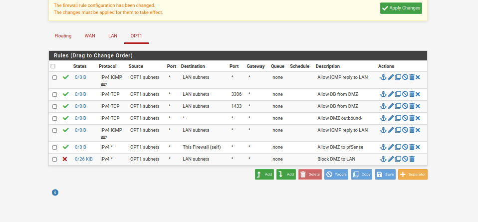

**第四步：确认 LAN 规则**

进入 Firewall → Rules → LAN 标签。

LAN 默认应该已有一条规则：允许 LAN net 访问 any。如果没有，点击 Add 添加：

| 字段 | 值 |
|------|-----|
| Action | Pass |
| Interface | LAN |
| Protocol | any |
| Source | LAN subnets |
| Destination | any |
| Description | Default LAN allow |

点击 Save → Apply Changes。
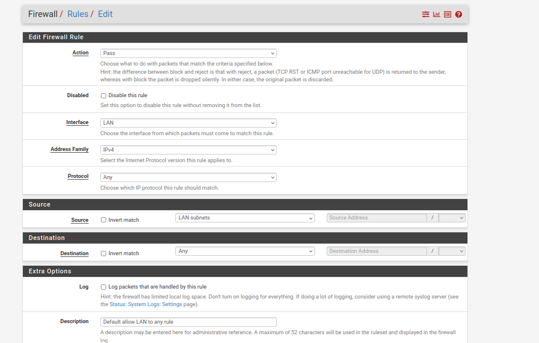

**第五步：恢复包过滤**

在 pfSense 控制台输入 8（Shell），执行：
```bash
pfctl -e
```
或者在 Web 界面 Diagnostics → Command Prompt 中执行。
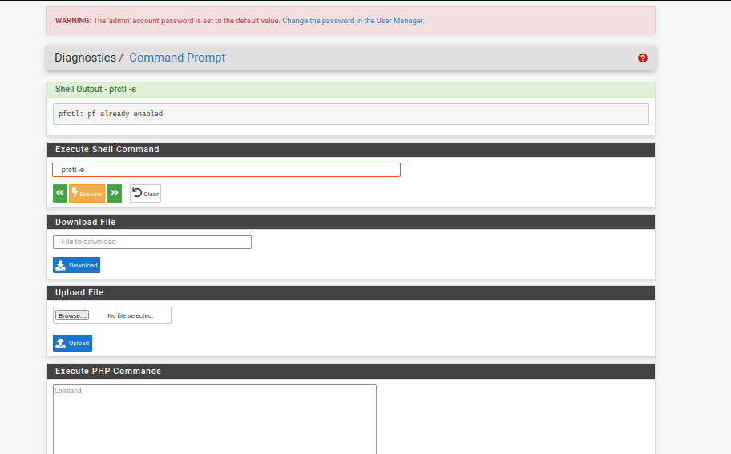

**第六步：验证隔离效果**

从 Kali 测试
```bash
ping 10.10.10.1     # WAN，应该通
ping 10.10.20.10    # DMZ，应该通
ping 10.10.30.10    # LAN，应该不通（被拦截）
curl http://10.10.20.10:8080   # Struts2，应该通
```


从 WEB01 测试
```bash
ping 10.10.20.1     # DMZ网关，通
ping 10.10.30.20    # FS01，1433端口应该通
ping 10.10.30.10    # DC01，应该不通
```


从 MONITOR 测试
```bash
ping 10.10.30.10    # DC01，通
ping 10.10.20.10    # DMZ，通
```

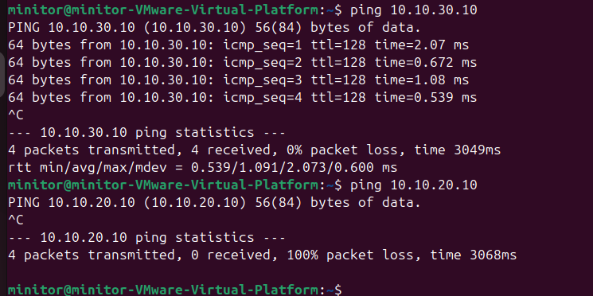