# 环境部署

## 

## 配置VMware虚拟网络
1. 打开虚拟网络编辑器
    ```
    VMware Workstation → 编辑 → 虚拟网络编辑器 → 点击“更改设置”（需要管理员权限）。
    ```
2. 创建三个Host-Only网络

    | VMnet | 类型 | 子网地址 | 子网掩码 | DHCP |
    |-------|------|----------|----------|------|
    | VMnet2 | 仅主机 | 10.10.10.0 | 255.255.255.0 | 取消勾选 |
    | VMnet3 | 仅主机 | 10.10.20.0 | 255.255.255.0 | 取消勾选 |
    | VMnet4 | 仅主机 | 10.10.30.0 | 255.255.255.0 | 取消勾选 |

    **关键点**：全部取消DHCP，因为我们要手动指定IP，避免地址漂移。

    取消“将主机虚拟适配器连接到此网络”：对于VMnet2/3/4，都不要勾选这个选项。这样宿主机不会出现在这些网段中，靶场更隔离。


## pfSense

**虚拟机基础配置**

| 配置项 | 选择 |
|--------|------|
| 硬件兼容性 | Workstation 16.x 或更高（默认即可） |
| 安装来源 | 安装程序光盘映像文件（ISO） → 浏览选择你解压好的 `pfSense-CE-2.7.2-RELEASE-amd64.iso` |
| 客户机操作系统 | 其他 → 版本选 FreeBSD 14 64位（如果没有14，选 FreeBSD 13/12 也可以） |
| 虚拟机名称 | pfSense |
| 位置 | 建议放在 SSD 上，如 `D:\VMs\pfSense`（路径不要有中文） |
| 处理器 | 1 个处理器，1 个核心 |
| 内存 | 2048 MB（2GB） |
| 网络类型 | 先选"不使用网络连接"（后面手动加三张网卡） |
| I/O 控制器类型 | LSI Logic（默认） |
| 磁盘类型 | SCSI（默认） |
| 磁盘 | 创建新虚拟磁盘 → 大小 20GB → 选择"将虚拟磁盘拆分成多个文件" |

**网卡配置**

3 个 Network Adapter，分别对应 VMnet2、VMnet3、VMnet4。
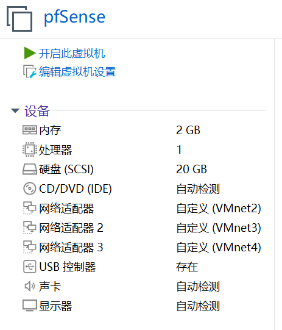

**安装 pfSense**

1. 启动虚拟机
    点击“开启此虚拟机”。如果出现“无法连接虚拟设备”的提示，选择 否（这只是提示虚拟光驱/软驱问题，不影响）。

2. 安装界面
    启动后会看到 pfSense 的安装菜单：

    ```text
    Welcome to pfSense
    1. Install pfSense
    2. Rescue Shell
    ...
    ```
    操作：直接按 回车（默认选中 Install pfSense）。

3. 接受许可协议
    出现许可协议界面 → 按 回车 接受。

4. 键盘布局
    提示选择键盘布局 → 选择 Default (US) → 回车。

5. 分区方案
    提示选择分区方案：

    ```text
    Auto (ZFS)  Guided Root-on-ZFS
    Auto (UFS)  Guided Disk Setup
    Manual
    Shell
    ```
    选择 Auto (UFS)（简单，适合虚拟机）→ 回车。

6. 选择磁盘
    提示选择要安装的磁盘 → 应该显示 da0（20GB 的虚拟磁盘）→ 选中后回车。

7. 确认分区
    提示“Last Chance”确认 → 选择 YES → 回车。

8. 等待安装
    安装过程大约 1-2 分钟。完成后会出现：

    ```text
    Manual Configuration
    Reboot
    ```
    选择 Reboot。

**重新分配接口**

在 Enter an option: 后面输入 1（Assign Interfaces），按回车。

接下来会依次询问：

| 提示 | 你的输入 | 说明 |
|------|----------|------|
| Should VLANs be set up now? | `n` | 不需要 VLAN |
| Enter the WAN interface name | `em0` | 第一张网卡 |
| Enter the LAN interface name | `em2` | 第三张网卡（VMnet4） |
| Enter the Optional 1 interface name | `em1` | 第二张网卡（VMnet3，DMZ） |
| Do you want to proceed? | `y` | 确认 |


**配置 IP 地址**

分配完接口后，回到主菜单，输入 2（Set interface IP address）。

先配 WAN (em0)：

| 提示 | 输入 |
|------|------|
| Select interface | `1`（WAN） |
| Configure via DHCP? | `n` |
| IPv4 address | `10.10.10.1` |
| Subnet bit count | `24` |
| Upstream gateway | 直接回车 |
| IPv6 DHCP? | `n` |
| DHCP server on WAN? | `n` |
| Revert to HTTP? | `n` |

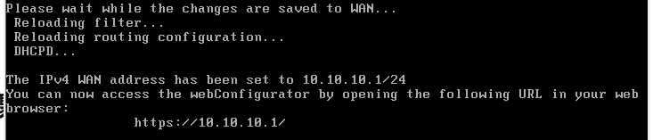

再配 DMZ (em1/OPT1)：
回到主菜单 → 输入 2 → 选择 3（OPT1）

| 提示 | 输入 |
|------|------|
| Configure via DHCP? | `n` |
| IPv4 address | `10.10.20.1` |
| Subnet bit count | `24` |
| Upstream gateway | 直接回车 |
| IPv6 DHCP? | `n` |
| DHCP server? | `n` |
| Revert to HTTP? | `n` |

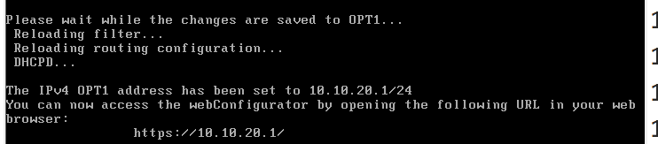

LAN 口 (em2) 默认是 10.10.30.1/24，如果显示的不是这个，也按同样方法改成 10.10.30.1。
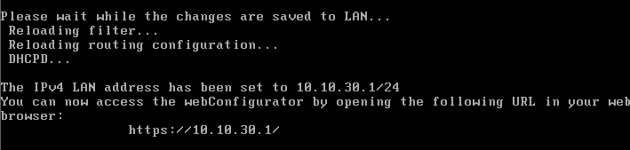

第三步：验证
配置完成后，主菜单应该显示：

```text
WAN (wan)    -> em0    -> v4: 10.10.10.1/24
LAN (lan)    -> em2    -> v4: 10.10.30.1/24
OPT1 (opt1)  -> em1    -> v4: 10.10.20.1/24
```
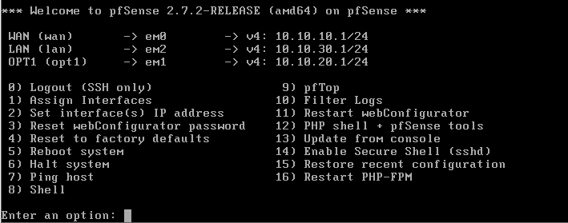
然后输入 7（Ping host），依次测试：
```
10.10.10.1 → 通

10.10.20.1 → 通

10.10.30.1 → 通
```

## kali

**配置双网卡**

| 网卡 | 网络连接 | 用途 |
|------|----------|------|
| 网络适配器 | VMnet8 (NAT) | 更新工具 |
| 网络适配器 2 | VMnet2 | WAN 攻击 |


```bash
sudo nano /etc/network/interfaces
```
把文件内容替换为：

```text
# NAT - VMnet8 (更新用)
auto eth0
iface eth0 inet dhcp

# WAN - VMnet2 (攻击网)
auto eth1
iface eth1 inet static
    address 10.10.10.10
    netmask 255.255.255.0
    gateway 10.10.10.1
```

保存退出：Ctrl + O → 回车 → Ctrl + X
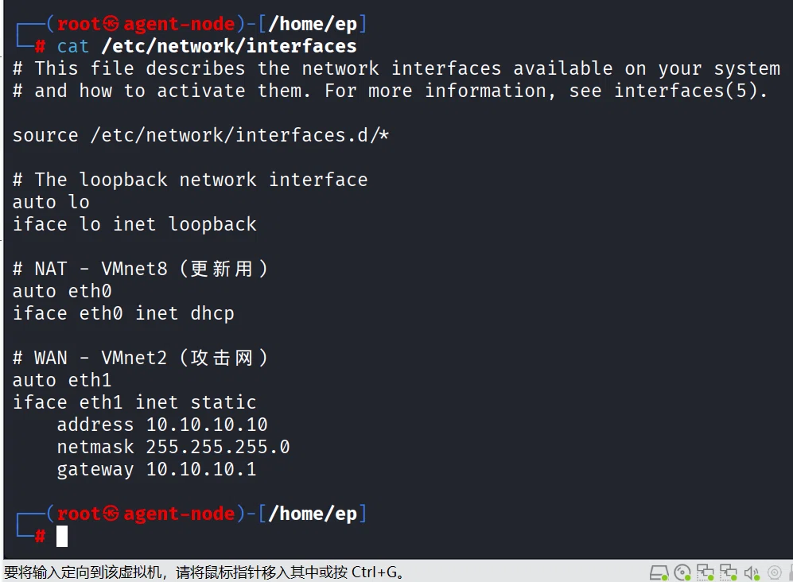

重启网络

```bash
sudo systemctl restart networking
```

**验证ip配置**
```bash
ip a
```
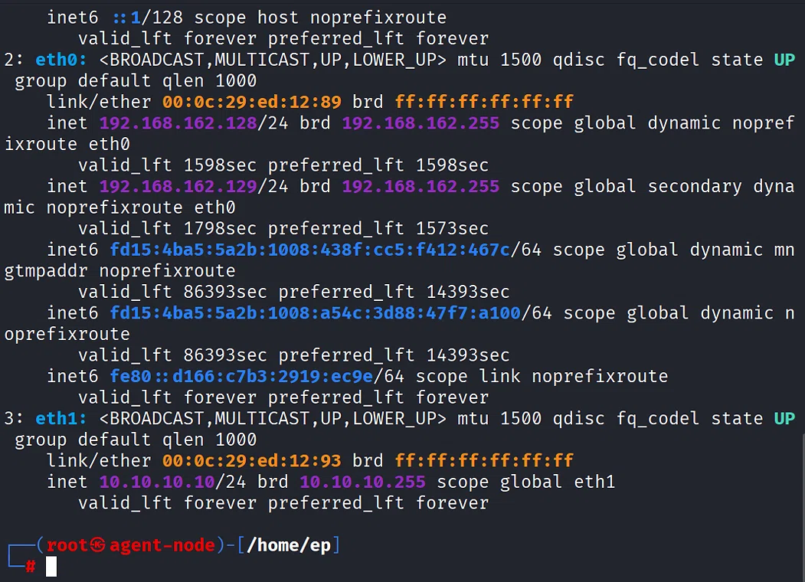

**验证连通性**


```bash
ping 10.10.10.1
```
pfSense WAN，应该通；如果不通应该是pfSense过滤了ICMP包
在 pfSense 控制台输入 8（Shell），执行：
```bash
pfctl -d
```
这会临时禁用 pfSense 的包过滤。然后在 Kali 上 ping 10.10.10.1，应该能通。

验证后记得恢复：

```bash
pfctl -e
```

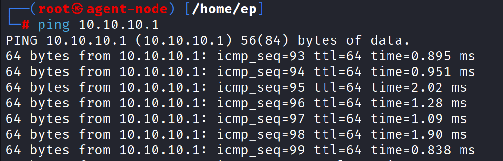
**测试隔离效果**
```bash
ping 10.10.20.1     # DMZ，应该不通
ping 10.10.30.1     # LAN，应该不通
```
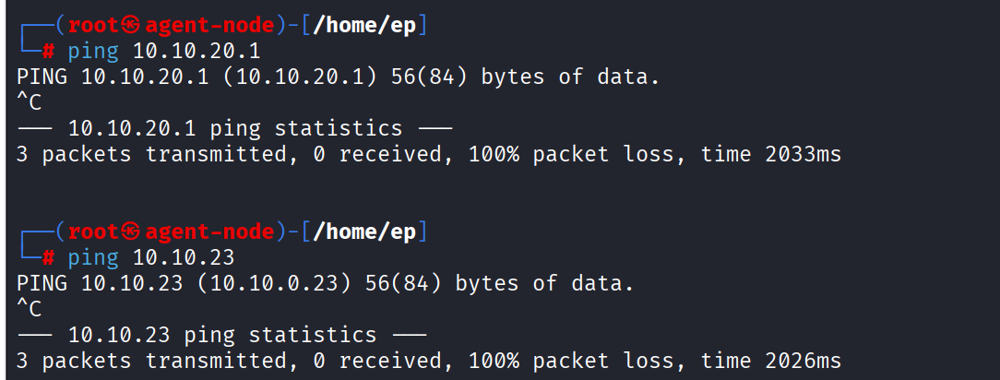

**安装常用工具**

```bash
sudo apt update && sudo apt install -y \
    nmap impacket-scripts bloodhound hashcat john \
    responder crackmapexec sqlmap gobuster \
    enum4linux whatweb
```
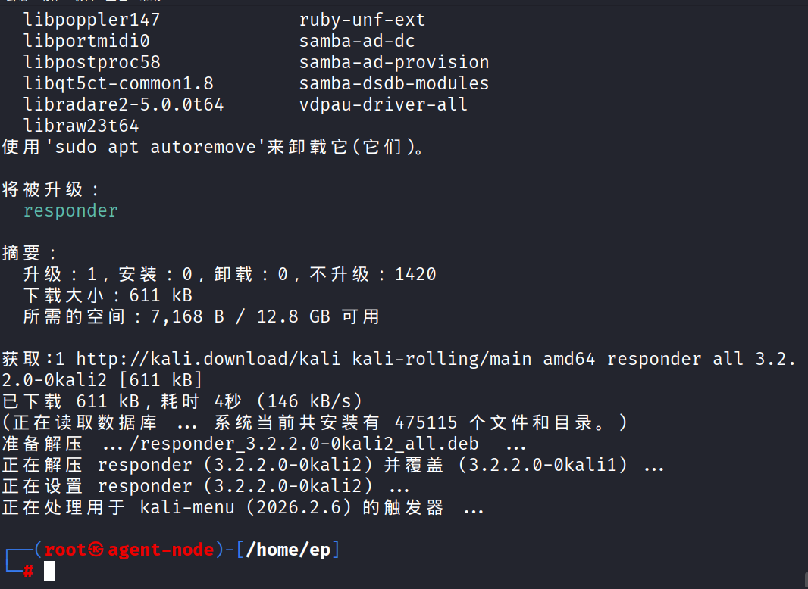

## DC01

Windows Server 2019 Standard (Desktop Experience)
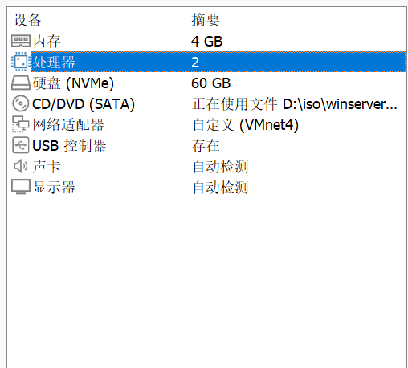

**改计算机名**

- 打开“服务器管理器” → 本地服务器

- 点击计算机名 → 更改

- 改为 DC01 → 确定 → 重启

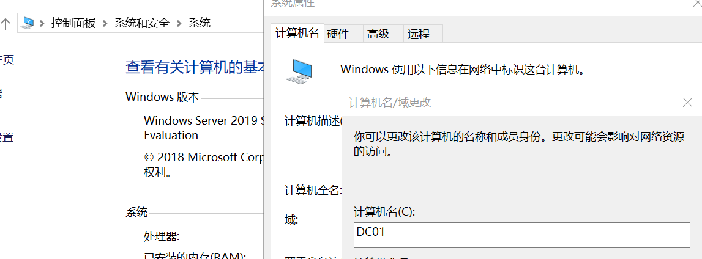

**设置静态 IP**

- 控制面板 → 网络和共享中心 → 更改适配器设置

- 右键“Ethernet” → 属性 → IPv4

- 配置：

  - IP: 10.10.30.10

  - 掩码: 255.255.255.0

  - 网关: 10.10.30.1

  - DNS: 10.10.30.10

- 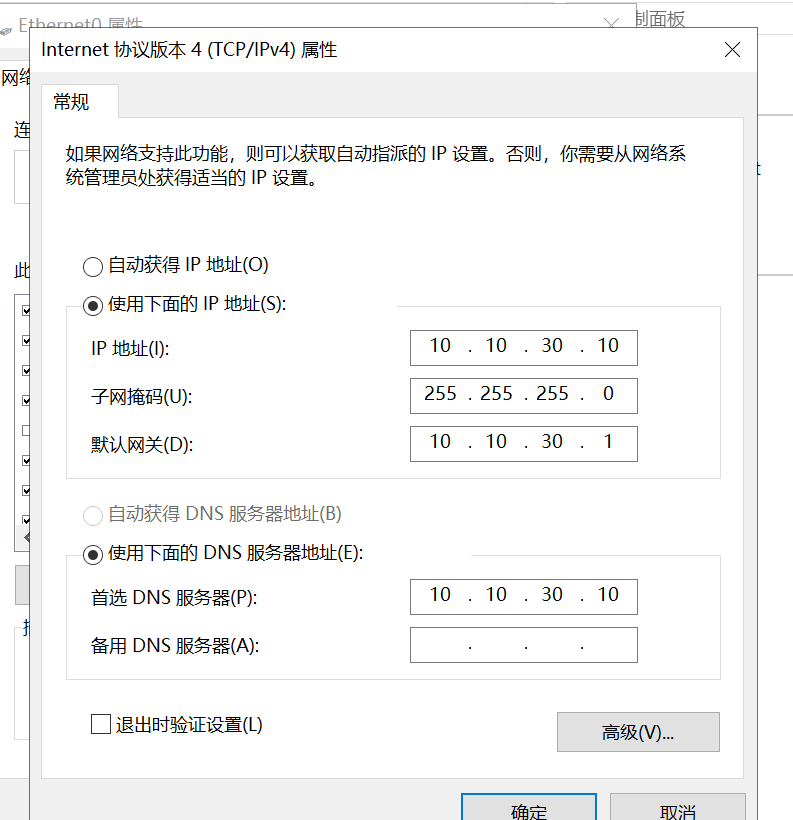


**验证连通性**

```
ipconfig /all
ping 10.10.30.1     # pfSense LAN，应该通
ping 10.10.30.10    # 自身，应该通
```
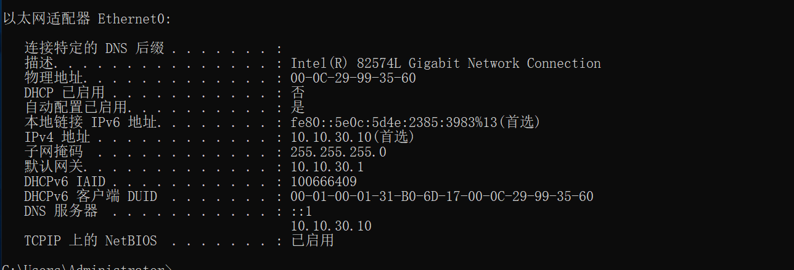
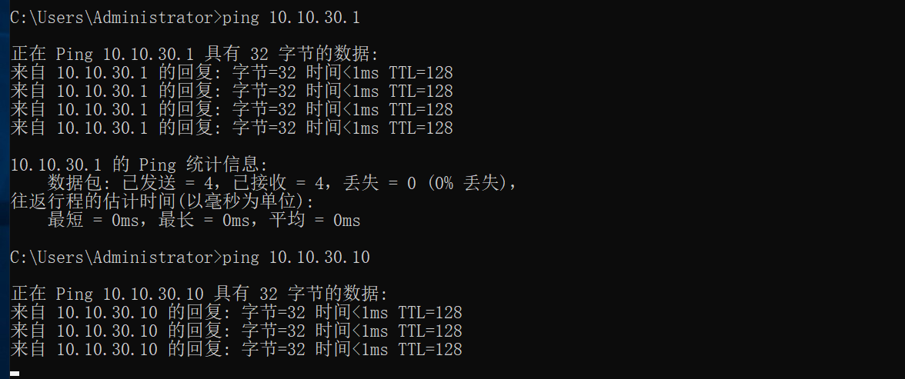


**安装 AD DS + DNS**

- 打开 服务器管理器 → 添加角色和功能

- 勾选 Active Directory 域服务 + DNS 服务器

- 弹出提示框 → 点击 添加功能

- 一路下一步到“安装”

- 安装完成后，点击服务器管理器上方的黄色旗帜图标 → 将此服务器提升为域控制器

- 提升为域控制器的配置：

| 步骤 | 选择 |
|------|------|
| 部署配置 | 添加新林 |
| 根域名 | `lab.local` |
| 域控制器选项 | 功能级别：Windows Server 2016；勾选 DNS 服务器 + 全局编录 |
| DSRM 密码 | 自定义（记牢，恢复时用） |
| DNS 选项 | 默认 |
| NetBIOS 名 | 自动生成为 `LAB` |
| 路径 | 默认 |
| 先决条件检查 | 通过后点击 安装 |

> 安装完成后系统会自动重启。

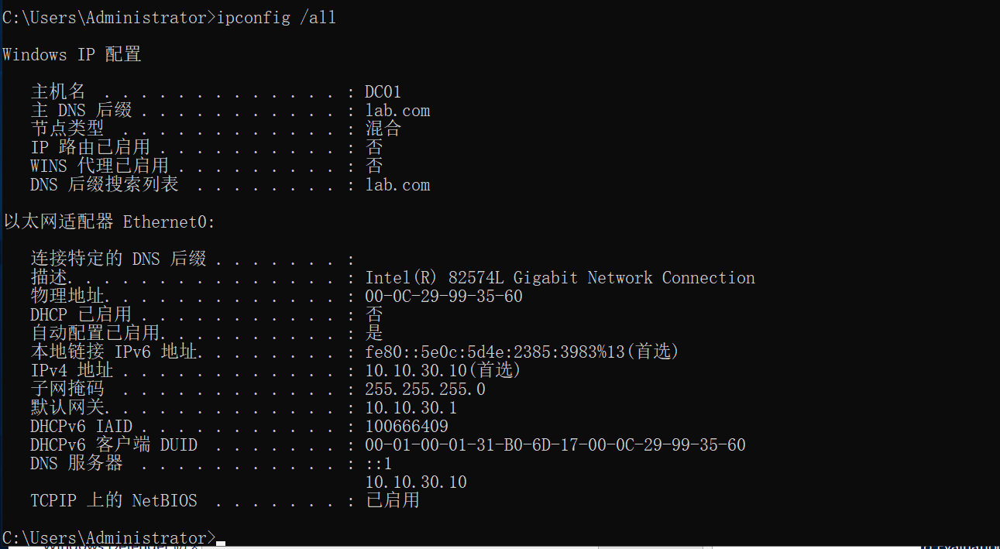

**创建 OU 和用户**

1. 打开 Active Directory 用户和计算机：

   - 服务器管理器 → 工具 → Active Directory 用户和计算机

2. 创建 OU：

   - 右键你的域名 → 新建 → 组织单位：

    | OU 名称 | 用途 |
    |---------|------|
    | Employees | 普通域用户 |
    | ServiceAccounts | 服务账户 |

3. 创建用户：

   - 在 Employees OU 中右键 → 新建 → 用户：

    | 字段 | 值 |
    |------|-----|
    | 姓名 | `employee1` |
    | 用户登录名 | `employee1` |
    | 密码 | `Passw0rd2` |
    | 取消勾选"用户下次登录时须更改密码" | ✅ |

    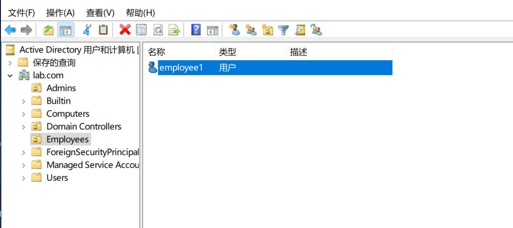

    - 在 **ServiceAccounts** OU 中右键 → 新建 → 用户：

    | 字段 | 值 |
    |------|-----|
    | 姓名 | `svc_sql` |
    | 用户登录名 | `svc_sql` |
    | 密码 | `Passw0rd1@2026` |
    | 取消勾选"用户下次登录时须更改密码" | ✅ |

    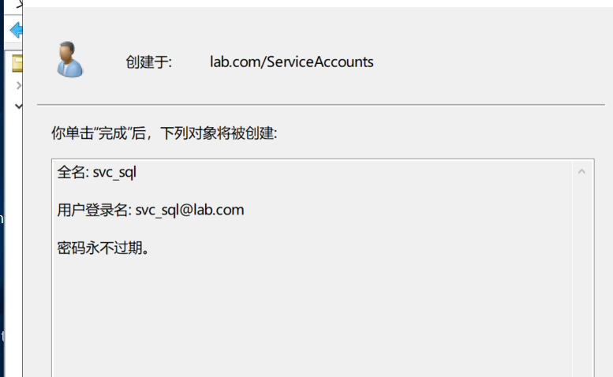

### 预埋 DCSync ACL 错误


```powershell
# 授予 svc_sql DCSync 权限
$domainDN = (Get-ADDomain).DistinguishedName
$acl = Get-Acl "AD:$domainDN"
$identity = New-Object System.Security.Principal.NTAccount("LAB\svc_sql")
$rights = [System.DirectoryServices.ActiveDirectoryRights]::ExtendedRight
$type = [System.Security.AccessControl.AccessControlType]::Allow

# 复制目录更改
$guid1 = [Guid]"1131f6aa-9c07-11d1-f79f-00c04fc2dcd2"
$rule1 = New-Object System.DirectoryServices.ActiveDirectoryAccessRule($identity, $rights, $type, $guid1)
$acl.AddAccessRule($rule1)

# 复制目录更改所有
$guid2 = [Guid]"1131f6ad-9c07-11d1-f79f-00c04fc2dcd2"
$rule2 = New-Object System.DirectoryServices.ActiveDirectoryAccessRule($identity, $rights, $type, $guid2)
$acl.AddAccessRule($rule2)

Set-Acl -Path "AD:$domainDN" -AclObject $acl
```

**验证权限已设置**

```powershell
(Get-Acl "AD:$((Get-ADDomain).DistinguishedName)").Access | Where-Object {$_.IdentityReference -like "*svc_sql*"} | Select IdentityReference, ActiveDirectoryRights
```
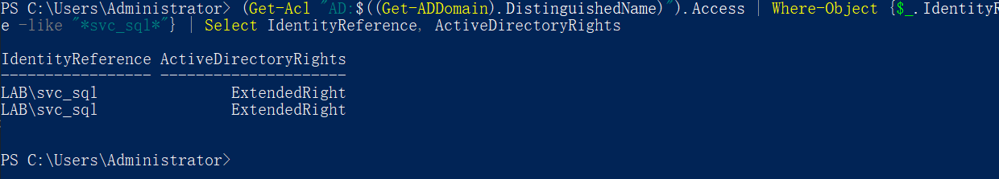

DCSync 权限预埋成功。

- LAB\svc_sql 拥有两条 ExtendedRight 权限，分别对应“复制目录更改”和“复制目录更改所有”

- 这是后续 DCSync 攻击能成功的关键前提。

## FS01
>FS01 是内网横向移动和 Kerberoasting 的目标

**创建虚拟机**：

| 配置项 | 值 |
|--------|-----|
| 系统 | Windows Server 2019 |
| 内存 | 4GB |
| 处理器 | 2核 |
| 磁盘 | 60GB |
| 网络适配器 | 自定义 (VMnet4) — LAN 区 |

**安装过程**：

版本选 Windows Server 2019 Standard (Desktop Experience)

安装完成后设置管理员密码

**安装后配置**：

- 改计算机名为 FS01，重启
  
   

- 设置静态 IP：

  - IP: 10.10.30.20

  - 掩码: 255.255.255.0

  - 网关: 10.10.30.1

  - DNS: 10.10.30.10（指向 DC01）

  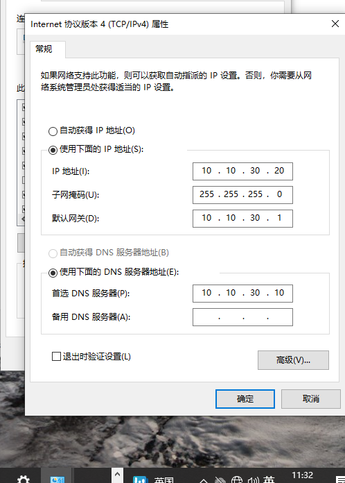

- 加入域：
    ```
    系统属性 → 更改 → 域 → 输入 lab.com
    ```
- 用域管理员凭据（LAB\Administrator）完成加入

- 重启

**验证**

```
systeminfo  
```


## 在FS01上安装SQLserver

**安装**

下载 SQL Server 2022 Express 的 ISO 文件
链接：https://go.microsoft.com/fwlink/?LinkID=2213259&clcid=0x409

1. 点击第一项：New SQL Server standalone installation or add features to an existing installation

2. 接下来会进入安装向导，按以下选择：

| 步骤 | 选择 |
|------|------|
| 产品密钥 | 默认（Express 版免费，直接下一步） |
| 许可条款 | 勾选接受 → 下一步 |
| Microsoft 更新 | 取消勾选 → 下一步（FS01 没网，勾了会卡） |
| 安装规则 | 等待检查通过 → 下一步 |
| 功能选择 | 全选（或至少勾选：数据库引擎服务、客户端工具） |
| 实例配置 | 选 默认实例（MSSQLSERVER）或 命名实例（SQLEXPRESS），记下实例名 |
| 服务器配置 | 默认 |
| 数据库引擎配置 | 选混合模式，设置 `sa` 密码：`P@ssw0rd123`，添加当前用户为管理员 |
| 其他配置 | 默认 → 下一步 |
| 安装 | 点击安装，等待完成（约 10-15 分钟） |


**关键点**：实例名要记住
安装时选择的实例名很重要，后续连接和配置都要用：

实例类型	连接方式	端口配置位置
默认实例	localhost 或 .	SQL Server 配置管理器 → MSSQLSERVER 的协议
命名实例	localhost\SQLEXPRESS	SQL Server 配置管理器 → SQLEXPRESS 的协议
建议选默认实例（MSSQLSERVER），这样连接时不用带实例名，简单一些。

**配置 TCP/IP 和端口 1433**

1. 打开 SQL Server 配置管理器

    开始菜单搜索 SQL Server Configuration Manager，打开。

2. 启用 TCP/IP

   - 展开 SQL Server 网络配置 → MSSQLSERVER 的协议

   - 右键 TCP/IP → 启用

   - 弹出提示“需要重启服务” → 确定

    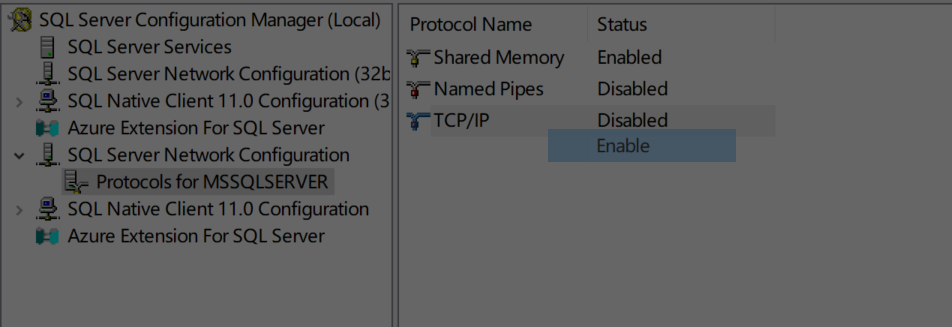
3. 设置端口 1433

   - 右键 TCP/IP → 属性

   - 切换到 IP 地址 标签

   - 拉到最下方 IPAll 区域：

   - TCP 动态端口：清空（删掉里面的 0）

   - TCP 端口：输入 1433

   - 点击 确定

     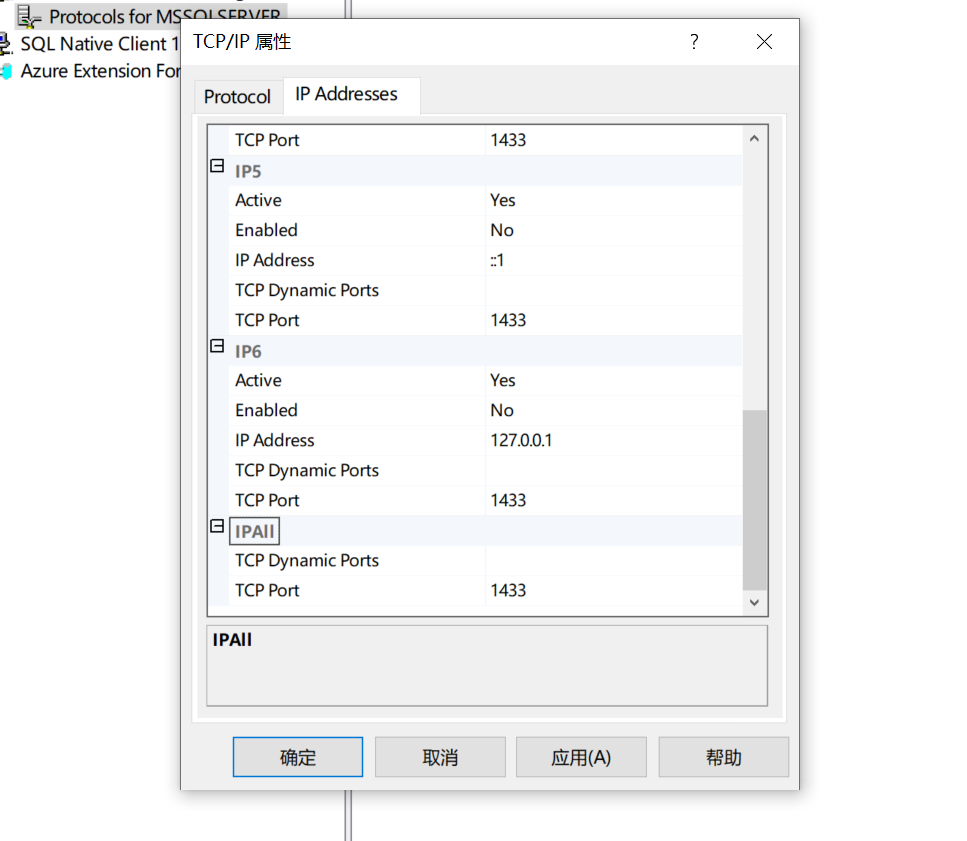 

4. 重启 SQL Server 服务

   - 展开 SQL Server 服务

   - 右键 SQL Server (MSSQLSERVER) → 重新启动

   - 等待服务重启完成

    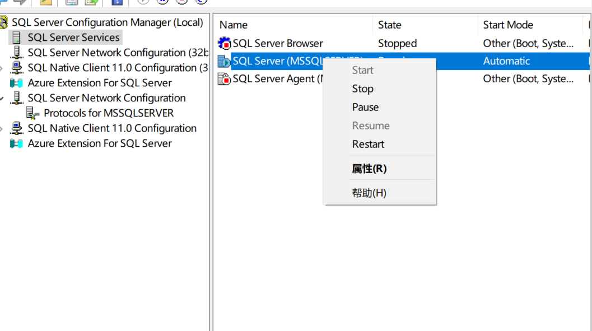

5. 验证端口监听

    ```powershell
    netstat -an | findstr 1433
    ```
    应该看到 0.0.0.0:1433 或 [::]:1433 处于 LISTENING 状态。
    
    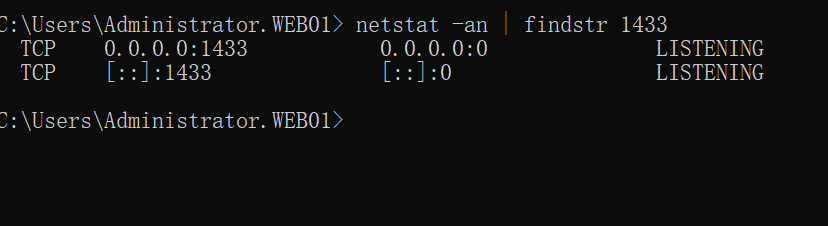


   - FS01 上打开 CMD 或 PowerShell

   - 用 sqlcmd 连接

        ```cmd
        sqlcmd -S localhost -U sa -P P@ssw0rd123
        ```
   - 执行命令

        ```sql
        EXEC sp_configure 'show advanced options', 1;
        RECONFIGURE;
        EXEC sp_configure 'xp_cmdshell', 1;
        RECONFIGURE;
        GO
        EXEC xp_cmdshell 'whoami';
        GO
        EXIT
        ```

**注册 SPN（Kerberoasting 目标）**
    在 FS01 的 PowerShell（管理员）中执行：

    ```powershell
    setspn -A MSSQLSvc/FS01.lab.com:1433 LAB\svc_sql
    setspn -L LAB\svc_sql
    ```
    预期输出应该显示 MSSQLSvc/FS01.lab.com:1433。

    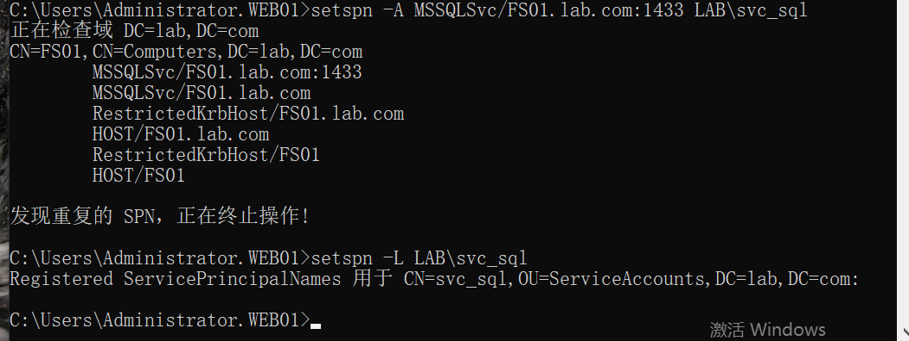

**创建文件共享**
```powershell
New-Item -Path "C:\Share" -ItemType Directory -Force
New-SmbShare -Name "Share" -Path "C:\Share" -FullAccess "LAB\employee1"
"DB_Password=P@ssw0rd123`nAdmin_Password=Admin@123" | Out-File "C:\Share\passwords.txt"
```
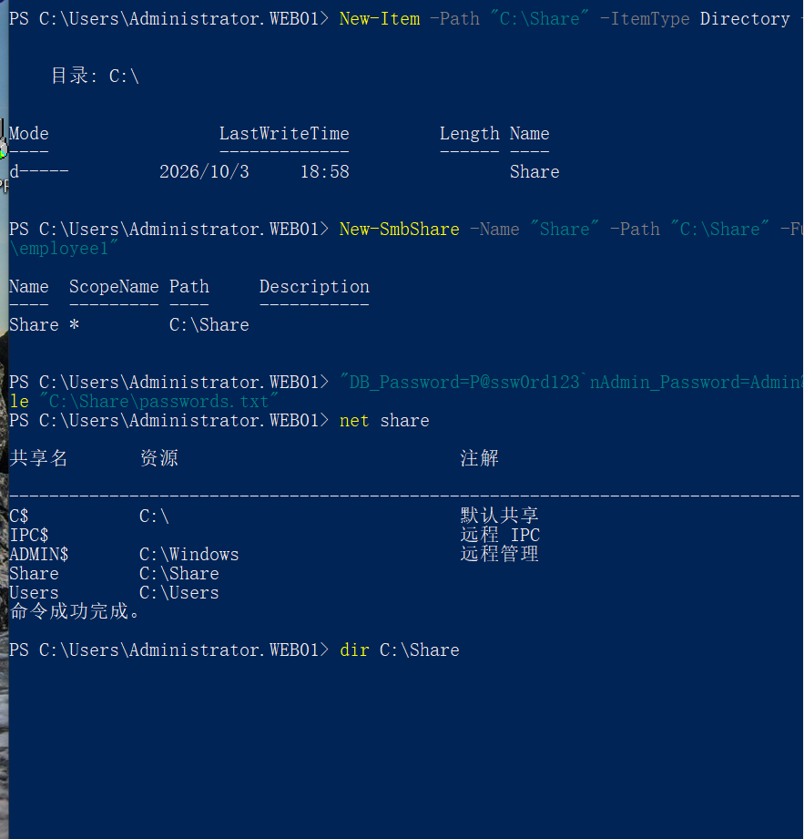
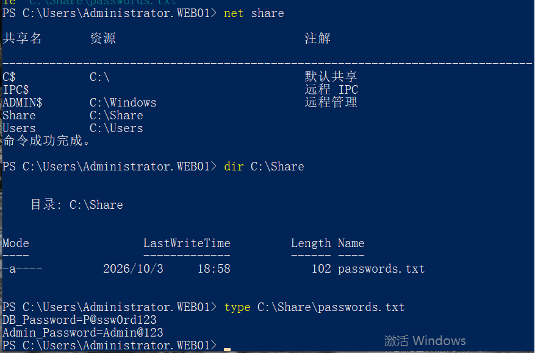


## ws01

**创建虚拟机**

| 配置项 | 值 |
|--------|-----|
| 系统 | Windows 10 Pro |
| 内存 | 4GB |
| 处理器 | 2核 |
| 磁盘 | 60GB |
| 网络适配器 | 自定义 (VMnet4) — LAN 区 |
| ISO | Windows 10 Pro 安装镜像 |

**安装步骤速查**

启动虚拟机，从 ISO 启动

语言和区域：中文或英文均可

安装类型：选 “自定义：仅安装 Windows”

版本选择：Windows 10 Pro（必须是 Pro，家庭版无法加入域）

磁盘分区：选 60GB 磁盘 → 下一步（自动分区）

等待安装完成（约 15-20 分钟）

OOBE 设置：

区域：中国

键盘：微软拼音

网络：选“我没有 Internet 连接” → “继续执行受限设置”（避免强制登录微软账户）

用户名：Administrator（或自定义）

密码：Admin@123（本地管理员密码，与 WEB01 复用）


**安装后配置**
改计算机名为 WS01，重启

设置静态 IP：

    IP: 10.10.30.30

    掩码: 255.255.255.0

    网关: 10.10.30.1

    DNS: 10.10.30.10

加入域 lab.com

用域管理员登录一次，留下凭据缓存

用 employee1 登录一次，模拟普通员工

验证
```powershell
hostname
systeminfo | findstr Domain
```
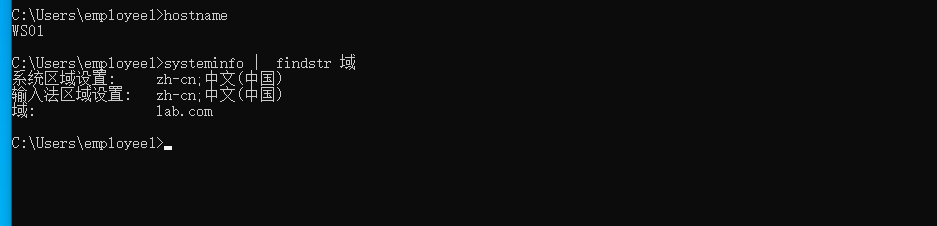

## MONITOR

创建虚拟机：

配置项	值
系统	Ubuntu Server 24.04
内存	8GB（ELK 吃内存）
处理器	2核
磁盘	60GB
网络适配器	自定义 (VMnet4) — LAN 区
安装 Ubuntu Server：

语言：English

网络：手动配置 10.10.30.100/24，网关 10.10.30.1，DNS 10.10.30.10

用户名：monitor

密码：Admin@123

软件选择：OpenSSH server（方便远程管理）


## WEB01

**创建虚拟机**：

| 配置项 | 值 |
|--------|-----|
| 系统 | Ubuntu Server 24.04 |
| 内存 | 8GB（跑多容器） |
| 处理器 | 2核 |
| 磁盘 | 60GB |
| 网络适配器 | 自定义 (VMnet3) — DMZ 区 |


**安装 Ubuntu Server：**

- 语言：English
- 网络：手动配置 10.10.20.10/24，网关 10.10.20.1，DNS 10.10.30.10
- 用户名：web
- 密码：Admin@123
- 软件选择：OpenSSH server + Docker

**安装后配置**

- 配置静态 IP 10.10.20.10
- 安装 Docker（如果安装时没选）：

    ```bash
    sudo apt update
    sudo apt install -y docker.io docker-compose
    sudo systemctl enable docker
    ```
- 部署 Vulhub 漏洞环境：

    ```bash
    git clone https://github.com/vulhub/vulhub.git
    cd vulhub/struts2/s2-048
    sudo docker-compose up -d
    ```
- 验证：

    ```bash
    sudo docker ps
    curl http://localhost:8080
    ```