# 红日靶场1
## 网络拓扑
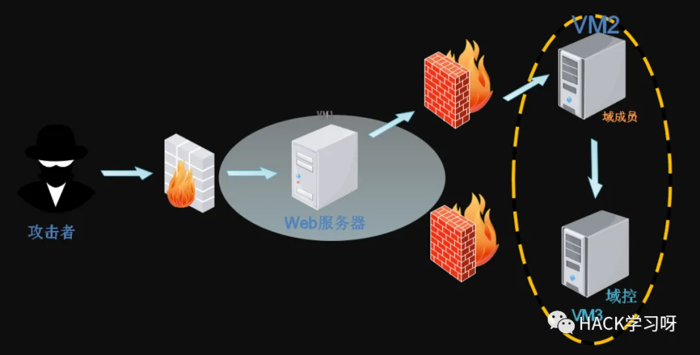

## 外网打点

- **nmap扫描目标网段**

    ```
    nmap -sn 192.168.111.0/24
    ```
    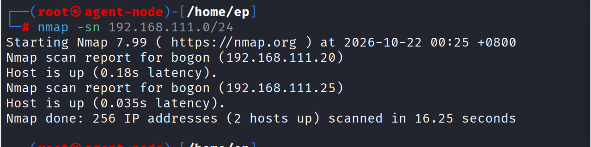
    发现192.168.111.20主机存活

### 信息收集

- **对192.168.111.100主机进行端口扫描**

    ```
    nmap -sS -Pn --min-rate 1000 -p- 192.168.111.20    
    ``` 
    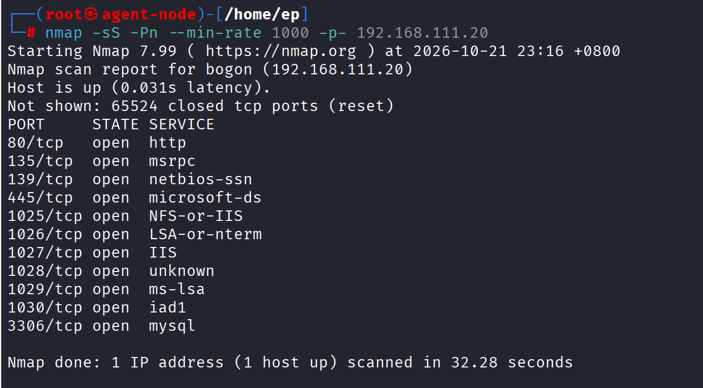

    80端口开放http服务，可能存在web漏洞
    445端口开放smb服务，可能存在永恒之蓝漏洞
    3306端口开放mysql服务，可能存在空口令/弱口令连接漏洞
    135端口开放rpc服务，可以来信息收集

- **SMB 与 RPC 空会话深度枚举**
  - 自动化综合枚举
    ```
    enum4linux-ng -A 192.168.111.20
    ``` 
    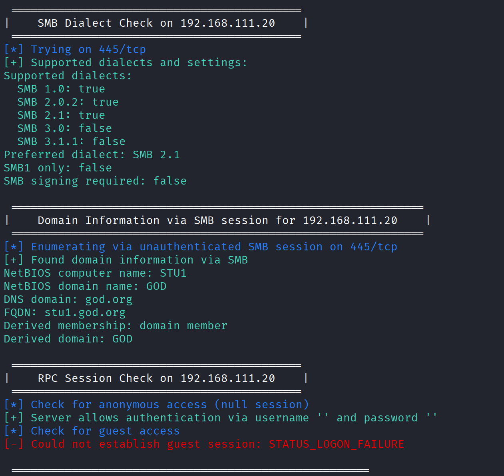

  - **列出共享**
    ```
    smbclient -N -L //192.168.111.20/
    ```
    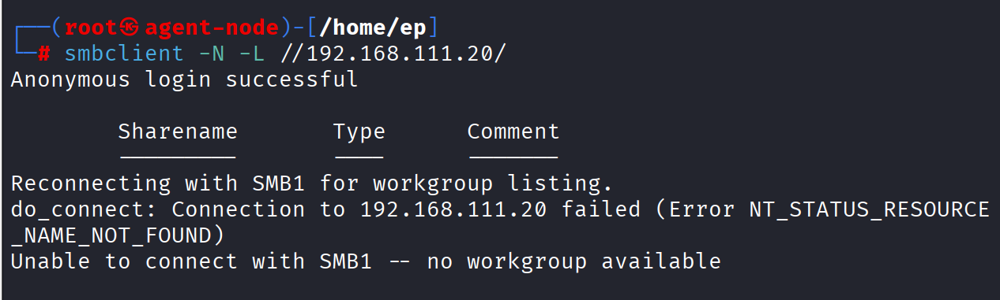

    匿名空会话虽然能连上，但 enumdomusers 等关键查询全被 STATUS_ACCESS_DENIED 拒绝，且共享为 0。说明靶机虽然配置了空会话，但权限极低，无法直接获取域用户列表。

  - 有效信息汇总
    ```
    domain：god.org
    该主机名：STU1
    ```

### 漏洞探测

- **msf探测永恒之蓝**
  ```
  msfconsole
  use exploit/windows/smb/ms17_010_eternalblue
  set RHOSTS 192.168.111.20
  run
  ``` 
  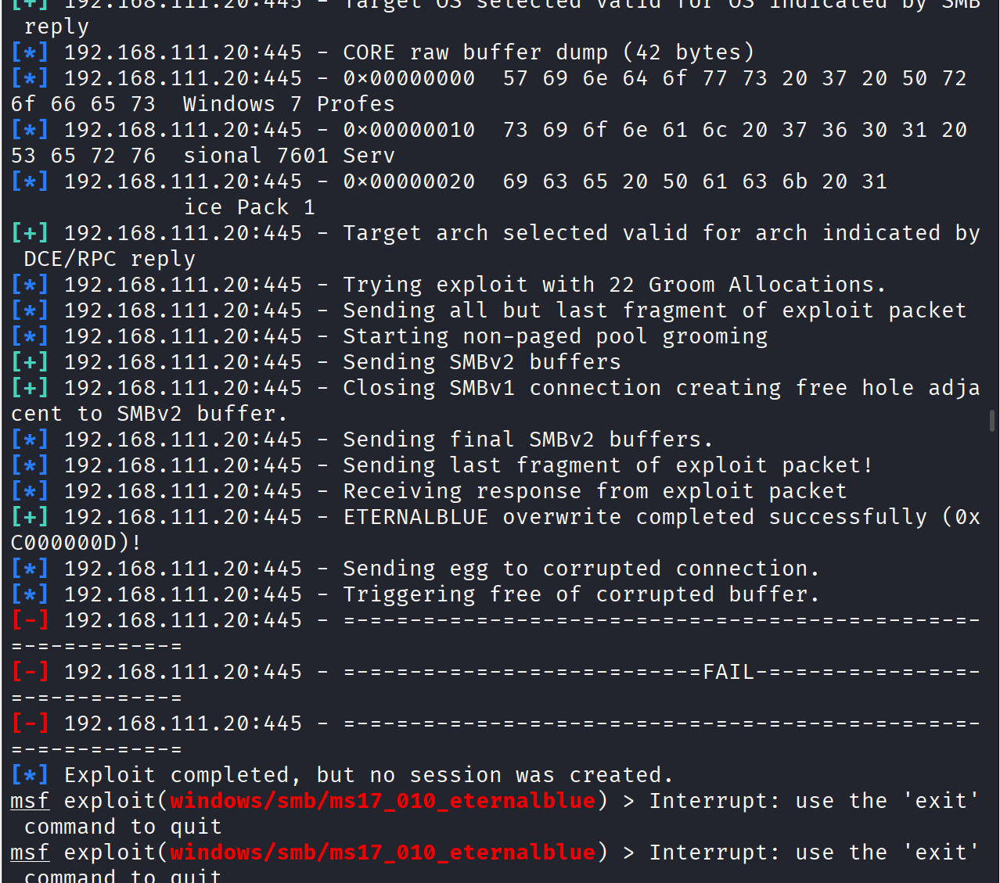
  存在漏洞但无法获得会话

- **尝试匿名/弱口令直连mysql**
  
  3306 端口直接暴露在内网中，常见配置错误通常是 root 空口令或弱口令。
  ```
  mysql -h 192.168.111.20 -u root -p
  ```
  输入回车测试是否为空口令；
  如果失败，尝试少量常见弱口令（如 root、123456、testing 等）
  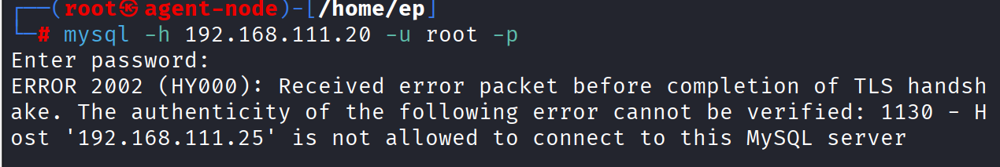
  MySQL 因来源 IP 限制无法连接

- **web服务漏洞探测**
  
  - 浏览器访问
    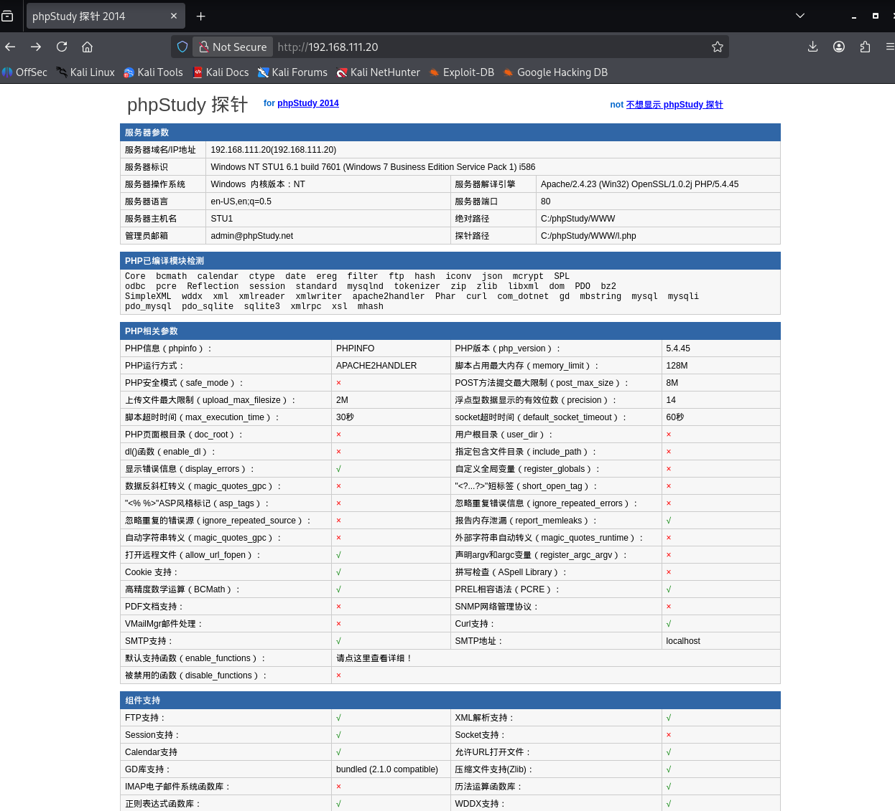
    发现是phpinfo界面
    **关键信息**
    ```
    网站绝对路径 	C:/phpStudy/WWW
    ``` 
  - 目录扫描
    ```
    dirsearch -u http://192.168.111.20 --wordlists= /usr/share/wordlists/dirb/common.txt
    ```
    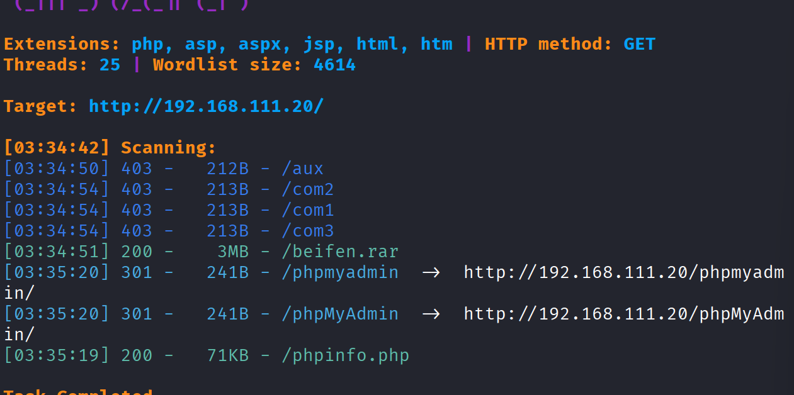

    下载并解压beifen.rar文件夹，发现一个网站目录yxcms
    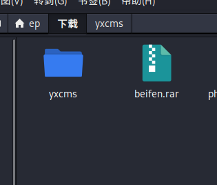
  - 尝试访问/yxcms
    
    访问成功并发现信息泄露
    ```
    后台地址：http://192.168.111.20/yxcms/index.php?r=admin
    用户名：admin
    密码：123456
    ``` 
  - 登录后台
    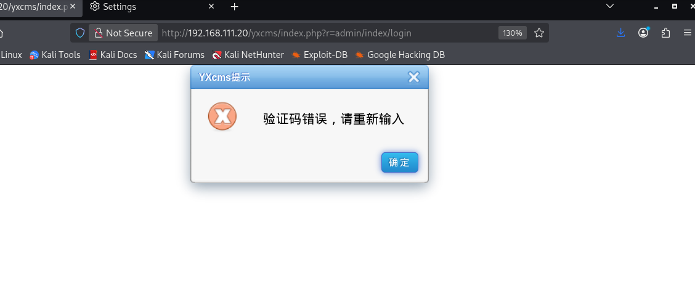
    不知道为什么一直显示验证码错误只能换个思路

  - 访问/phpmyAdmin
    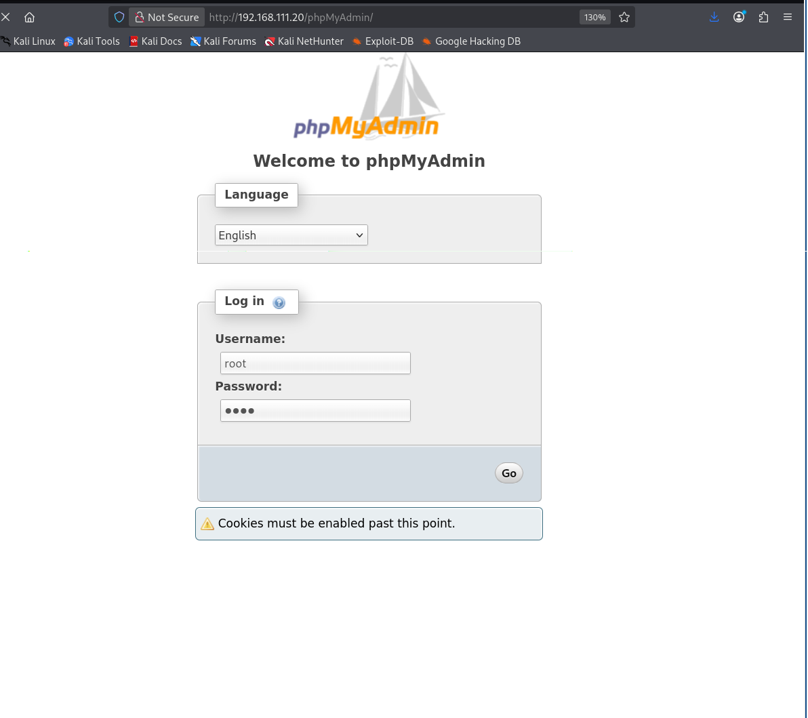

    尝试弱口令

### 漏洞利用

## 隧道搭建
## 内网渗透
## 横向移动
## 持久化
## 痕迹清理

## 遇到的问题
### web打点时死活扫不出有用的目录或文件

**原因**

后来我看网上的wp发现应该有一个beifen.rar文件，但是我的爆破文件里面没有这个条目导致没扫出来

**解决方法**

- 使用更大更全的爆破文件
- 手动尝试一些可能的备份文件名或路径名等，如（beifen.rar）

### 

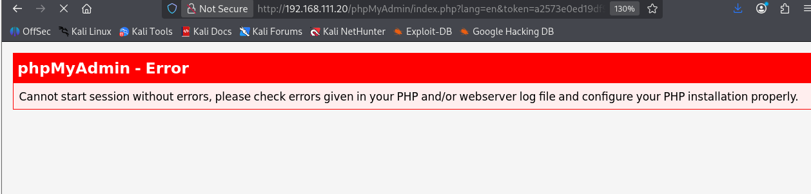